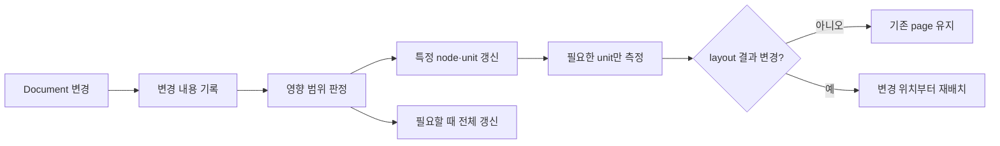
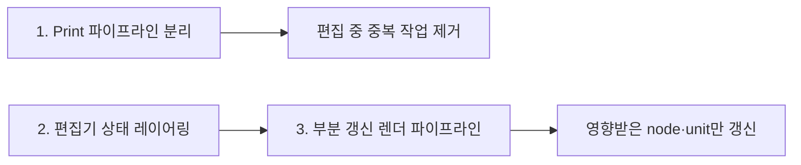
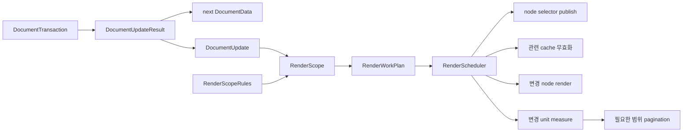
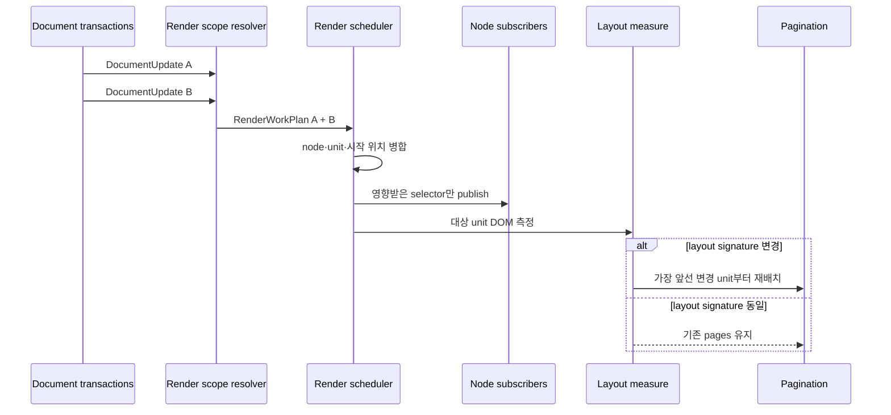

# 렌더링 아키텍처

## 문제

현재는 Document JSON의 일부만 변경돼도 최상위 `DocumentData` 객체가 교체된다. 이 변경은 편집 화면 전체로 전달되어 다음 작업을 함께 실행시킨다.

- screen render tree와 pagination unit 재생성
- screen visible tree와 measure tree 렌더
- print visible tree와 measure tree 렌더
- 동일 Markdown source 반복 파싱
- 전체 pagination unit 높이 측정
- 레이어, 컴포넌트 목록과 Inspector 재실행
- `dirty`, `saving`, `saved` 상태 변경에 따른 editor 재실행

실시간 줄바꿈과 페이지 배치를 위해 변경된 node의 DOM 갱신과 높이 확인은 필요하다. 그러나 변경과 무관한 node, panel, print와 기존 계산 결과까지 매번 다시 처리할 필요는 없다.

## 목표



다음 두 책임을 코드에서 분리한다.

1. 변경이 어떤 render 작업을 일으켜야 하는지 판정한다.
2. 판정된 범위의 node, measure와 pagination을 실제로 갱신한다.

## 작업 구성



1. Print 파이프라인 분리는 평상시 editor에서 print visible·measure tree를 제거하는 독립 작업이다.
2. 편집기 상태 레이어링은 Document, interaction, render derived, lifecycle 상태가 서로 다른 구독 경계를 갖게 한다.
3. 부분 갱신 렌더 파이프라인은 분리된 상태 위에서 `DocumentUpdate → RenderScope → RenderWorkPlan`을 실행한다.

설계는 세 작업을 함께 정의하지만 구현은 `Print 분리 → 상태 레이어링 → 부분 갱신 파이프라인` 순서로 진행한다.

## 아키텍처 원칙

### 편집과 무관한 작업을 상시 실행하지 않는다

- print renderer는 PDF 내보내기 요청 중에만 생성한다.
- 저장 상태와 library summary는 document renderer 구독 밖에서 갱신한다.
- selection 변경은 preview outline과 관련 layer row만 갱신한다.

### 같은 입력으로 같은 계산을 반복하지 않는다

- 동일 Markdown source revision은 한 번만 파싱한다.
- screen renderer, pagination과 fragment renderer가 같은 파싱 결과를 사용한다.
- 같은 frame의 font, resize와 document 측정 요청을 하나로 병합한다.
- pagination 결과가 이전 결과와 같으면 page state를 갱신하지 않는다.

### 변경 범위를 transaction 시점에 기록한다

매 입력마다 이전 JSON과 다음 JSON 전체를 deep diff하지 않는다. Node를 변경하는 transaction은 이미 변경 대상을 알고 있으므로 결과와 함께 변경 정보를 생성한다.

### 판정할 수 없는 변경은 전체 무효화한다

부분 갱신의 근거가 부족하면 성능보다 출력 정확성을 우선한다. 전체 무효화 횟수를 계측하고 안전한 규칙부터 점진적으로 부분 갱신으로 전환한다.

## 처리 단계



### 1. 변경 기록: `DocumentUpdate`

Foundation transaction은 UI 동작을 알지 않고 무엇이 변경됐는지만 반환한다.

```ts
type DocumentUpdate = {
  revision: number;
  operations: readonly DocumentUpdateOperation[];
};

type DocumentUpdateOperation =
  | { type: "node-content-updated"; nodeId: string }
  | { type: "node-style-updated"; nodeId: string; styleKeys: readonly string[] }
  | { type: "node-inserted"; nodeId: string; parentId: string }
  | { type: "node-removed"; nodeId: string; parentId: string }
  | { type: "node-moved"; nodeId: string; previousParentId: string; nextParentId: string }
  | { type: "node-visibility-updated"; nodeId: string }
  | { type: "component-definition-updated"; componentId: string }
  | { type: "page-settings-updated"; keys: readonly string[] };

type DocumentUpdateResult = {
  document: DocumentData;
  update: DocumentUpdate;
};
```

Selection과 save state는 Document 내용 변경이 아니므로 별도 상태로 관리한다.

### 2. 영향 범위: `RenderScope`

`DocumentUpdate`가 어느 node, Markdown source와 layout unit에 영향을 주는지를 표현한다. 변경 조건은 renderer 컴포넌트에 흩어놓지 않고 `RenderScopeRules`와 순수 함수 `resolveRenderScope()`에서 관리한다.

```ts
type RenderImpact = "visual" | "layout" | "structure" | "global";

type RenderScope = {
  impact: RenderImpact;
  nodeIds: ReadonlySet<string>;
  markdownSourceIds: ReadonlySet<string>;
  layoutUnitIds: ReadonlySet<string>;
  earliestAffectedUnitId?: string;
  includesWholeTree: boolean;
  reasons: readonly string[];
};

type RenderScopeRule = {
  id: string;
  matches: (update: DocumentUpdate) => boolean;
  resolve: (update: DocumentUpdate) => Partial<RenderScope>;
};

const renderScopeRules: readonly RenderScopeRule[] = [
  visualOnlyStyleRule,
  textContentRule,
  layoutStyleRule,
  structureRule,
  globalLayoutRule,
];

function resolveRenderScope(
  update: DocumentUpdate,
  rules: readonly RenderScopeRule[],
): RenderScope;
```

새 node 타입이나 style 속성을 추가할 때 규칙과 판정 테스트를 함께 추가한다. 규칙에 없는 변경은 `global`로 분류한다.

### 3. 실행 계획: `RenderWorkPlan`

`RenderScope`를 React 구독 갱신, cache 무효화, DOM 측정과 pagination 작업으로 변환한다.

```ts
type RenderWorkPlan = {
  publishNodeIds: ReadonlySet<string>;
  invalidateMarkdownSourceIds: ReadonlySet<string>;
  invalidateRenderTreeNodeIds: ReadonlySet<string>;
  measureUnitIdsAfterCommit: ReadonlySet<string>;
  repaginateFromUnitId?: string;
  rebuildWholeTree: boolean;
  reasons: readonly string[];
};

function createRenderWorkPlan(
  scope: RenderScope,
  layoutSnapshot: LayoutSnapshot,
): RenderWorkPlan;
```

이 단계는 DOM이나 React state를 변경하지 않는다. 따라서 다음 규칙을 순수 함수 테스트로 검증할 수 있다.

- 색상 변경은 node render만 요청한다.
- 텍스트 변경은 해당 node render와 unit measure를 요청한다.
- 구조 변경은 render tree 재구성과 변경 지점 이후 pagination을 요청한다.
- 페이지 규격 변경은 전체 무효화를 요청한다.

### 4. 실행: `RenderScheduler`

동일 frame에 생성된 여러 `RenderWorkPlan`을 합친 뒤 필요한 작업을 한 번만 실행한다.



React node를 명령형으로 다시 그리지 않는다. 각 node와 panel은 필요한 slice와 revision을 구독하고 scheduler는 영향을 받은 구독 값만 변경한다.

## 변경별 처리 규칙

| 변경 | node render | parse | measure | pagination |
|---|---|---|---|---|
| 글자색·배경색 | 해당 node | 없음 | 없음 | 없음 |
| text·rich-text 내용 | 해당 node | 없음 | 해당 unit | 높이가 바뀔 때만 |
| Markdown source | 해당 node | 해당 source 1회 | 해당 block unit | 구조·높이가 바뀔 때만 |
| 글자 크기·줄 간격·여백 | 해당 node | 없음 | 해당 unit | 변경 위치부터 |
| node 추가·삭제·이동·숨김 | 관련 subtree | 관련 Markdown만 | 관련 unit | 변경 위치부터 |
| component definition | 연결된 instance | 관련 Markdown만 | 연결된 unit | 가장 앞선 변경 위치부터 |
| selection | outline·layer row | 없음 | 없음 | 없음 |
| save state | SaveIndicator | 없음 | 없음 | 없음 |
| content 너비·페이지 규격·font | 전체 | cache 조건에 따라 | 전체 | 전체 |

텍스트의 줄 수를 문자열로 예측하지 않는다. 변경 unit을 DOM에 반영한 후 브라우저가 계산한 실제 크기와 이전 `LayoutSignature`를 비교한다.

```ts
type LayoutSignature = {
  renderId: string;
  width: number;
  height: number;
  nodeType: string;
  keepTogether: boolean;
  keepWithNext: boolean;
  forcePageBreakBefore: boolean;
  styleFingerprint: string;
};
```

크기와 pagination metadata가 같으면 기존 page 배치를 유지한다. 달라지면 가장 앞선 변경 unit부터 뒤쪽 배치를 다시 계산한다.

## 코드 경계

```text
client/src/foundation/
├── documentUpdates.ts
│   └── UI와 무관한 DocumentUpdate
└── documentTransactions.ts
    └── DocumentData와 DocumentUpdate 생성

client/src/renderer/src/pages/document-editor/rendering/
├── update/
│   ├── renderScopeRules.ts
│   ├── resolveRenderScope.ts
│   ├── createRenderWorkPlan.ts
│   └── RenderScheduler.ts
├── cache/
│   ├── MarkdownParseCache.ts
│   ├── RenderTreeCache.ts
│   └── UnitLayoutCache.ts
└── selectors/
    ├── documentNodeSelectors.ts
    └── paginationSelectors.ts
```

파일명은 구현 과정에서 조정할 수 있지만 다음 경계는 유지한다.

- foundation은 변경 사실만 제공하고 React와 DOM을 모른다.
- render scope는 Document update가 영향을 주는 범위를 표현한다.
- render work plan은 실행할 render·cache·measure·pagination 작업을 표현한다.
- scheduler만 frame 병합과 실행 순서를 소유한다.
- cache는 source revision과 layout fingerprint로 유효성을 판단한다.
- renderer와 panel은 전체 `DocumentData`가 아니라 필요한 selector를 구독한다.

## 전체 무효화 조건

- 새 문서를 열거나 외부에서 Document 전체를 교체한 경우
- content 너비, 페이지 크기 또는 페이지 여백이 변경된 경우
- font가 로드되거나 전역 typography가 변경된 경우
- 변경 정보를 제공하지 않는 기존 transaction을 실행한 경우
- cache revision이나 layout fingerprint가 일치하지 않는 경우
- render scope rule이 변경 종류를 판정하지 못한 경우

## 검증 기준

- 평상시 편집에서 print render와 print measure가 실행되지 않는다.
- 동일 Markdown source revision은 한 번만 파싱한다.
- visual-only 변경은 measure와 pagination을 실행하지 않는다.
- 텍스트의 layout signature가 같으면 page state를 갱신하지 않는다.
- layout 변경은 필요한 unit을 측정하고 변경 위치부터 페이지를 재배치한다.
- selection과 save state 변경은 document renderer를 실행하지 않는다.
- 판정하지 못한 변경은 전체 무효화되어 기존 출력 정확성을 유지한다.
- IME, caret, Undo/Redo, component instance와 repeater 동작을 유지한다.

## 결정

1. 아키텍처 개선을 Print 파이프라인 분리, 편집기 상태 레이어링, 부분 갱신 렌더 파이프라인의 세 작업으로 진행한다.
2. 최적화 단위는 전체 Document가 아니라 변경 종류와 영향 범위다.
3. 변경 판정과 렌더 실행은 `DocumentUpdate → RenderScope → RenderWorkPlan → RenderScheduler`로 분리한다.
4. 최적화 규칙은 중앙에서 추가·제거하고 순수 함수로 테스트한다.
5. 부분 갱신 근거가 없으면 전체 무효화를 사용한다.
6. print와 저장 상태처럼 평상시 편집에 필요하지 않은 작업은 렌더 파이프라인에서 분리한다.
