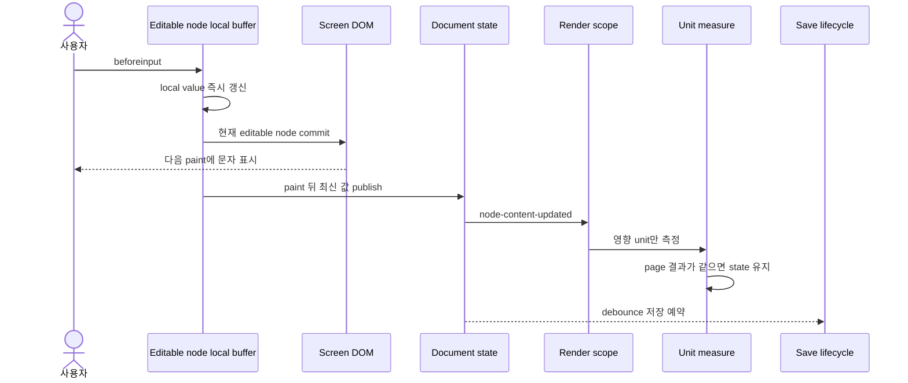
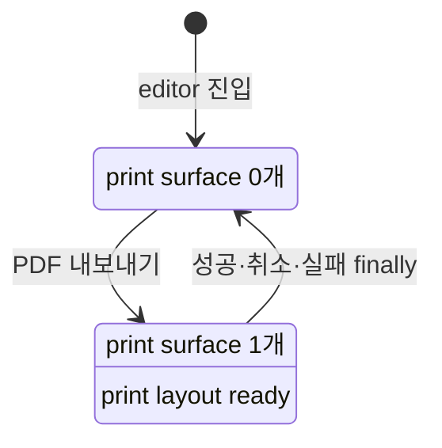

# 렌더링 아키텍처 구현 결과

기준일: 2026-10-15

## 적용 범위

06의 세 작업을 다음 코드 경계에 적용했다.

| 작업 | 구현 결과 |
|---|---|
| Print 파이프라인 분리 | 평상시 print surface를 mount하지 않고 PDF 요청 snapshot이 준비된 동안에만 print renderer를 mount한다. |
| 편집기 상태 레이어링 | save lifecycle은 external store로, 직접 편집 값은 editable node의 local buffer로 분리했다. Layer·component navigator·Inspector는 필요한 Document snapshot만 받는다. |
| 부분 갱신 렌더 파이프라인 | `DocumentUpdate → RenderScope → RenderWorkPlan`을 추가하고 render subtree, Markdown parse, unit height와 page 결과를 재사용한다. |

## 입력 처리 결과

직접 편집은 구조를 바꾸지 않는다. 따라서 이 경로에서는 매 글자마다 전체 document graph와 cycle을 검증하지 않는다. 대상 node·component prop의 type을 제한한 불변 갱신을 사용하고, 전체 검증은 문서 로드, 구조 transaction과 저장 경계에 유지한다.

## 실제 이력서 계측

사용 fixture:

- node 120개
- component 8개
- style 61개
- screen render node 747개
- 8페이지

동일 production build와 임시 user-data 복사본에서 측정했다.

| 항목 | 변경 전 경로 | 변경 후 경로 |
|---|---:|---:|
| 직접 편집 model 갱신 100회 | 149.78ms | 0.69ms |
| Markdown 한 글자 input event 반환 | 74~83ms | 4.3~8.6ms |
| component instance 추가 | 수 초 지연 제보 | 134.95ms |

첫 번째 수치는 전체 검증을 포함한 범용 `updateNode`와 직접 편집 전용 갱신을 같은 실제 Document에서 비교한 값이다. 두 번째 수치는 Electron DevTools Protocol로 실제 contenteditable에 한글을 입력해 측정했다.

## Print 검증

- 평상시 `.document-print-surface`: 0개
- PDF 요청 중: 1개, layout ready, 8페이지
- 취소 후: 0개
- 실제 생성 PDF: 8페이지, 약 1.5MB
- PDF 첫 페이지에는 screen selection outline과 편집 UI가 포함되지 않았다.

## 캐시와 fallback

- Markdown block parse는 동일 source 문자열 결과를 최대 128개까지 재사용한다.
- render tree와 pagination unit은 변경되지 않은 subtree의 reference를 유지한다.
- visual-only style 변경은 unit measure를 요청하지 않는다.
- content 변경은 연결된 unit height만 다시 읽는다.
- 구조 변경, 알 수 없는 변경과 초기 문서는 전체 rebuild·measure로 안전하게 fallback한다.
- 동일 page 구성에는 React page state를 다시 발행하지 않는다.

기존 transaction이 변경 정보를 직접 반환하지 않는 동안에는 structural sharing 기반 adapter가 변경된 node·style·component reference만 분류한다. 새 transaction은 `DocumentUpdateOperation`을 직접 전달하는 것이 최종 경계다.

## 남은 확장점

- 현재 render tree 생성은 변경되지 않은 subtree의 결과를 재사용하지만, 새 후보 tree를 만드는 graph 순회 자체는 남아 있다. 문서 규모가 더 커져 이 비용이 계측되면 node revision selector store로 교체한다.
- pagination은 unit height를 부분 측정하지만 cached height로 전체 unit 순서를 선형 확인한다. 안정 page boundary 이후 재사용은 후속 최적화다.
- component 편집 화면의 직접 편집 buffer는 일반 Document 화면과 별도 성능 계측이 필요하다.
