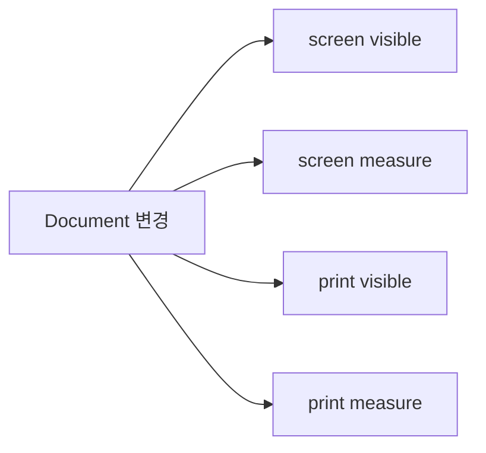
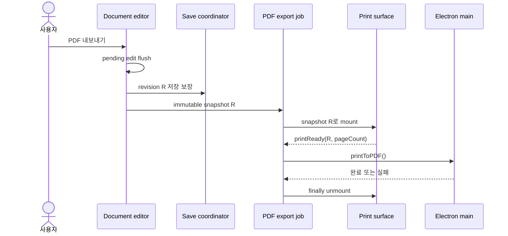

# 1. Print 파이프라인 분리

## 목적

PDF를 내보내지 않는 평상시 편집에서는 print renderer와 print measure tree를 생성하지 않는다. Print는 editor의 상시 mode가 아니라 PDF export job이 소유하는 일시적인 output surface로 변경한다.

## 현재 문제

`GenericDocumentEditorPage`는 screen과 print `PaginatedDocumentRenderer`를 동시에 mount한다. 각각 visible tree와 measure tree를 가지므로 Document 변경 한 번이 네 개의 문서 DOM을 다시 통과한다.

Print DOM을 화면 밖에 숨겨도 React render, Markdown parse와 browser layout 대상에서는 제외되지 않는다.

## 목표 구조

## 변경 내용

1. 일반 editor JSX에서 상시 `.document-print-surface`를 제거한다.
2. PDF 요청 시점에 활성 편집 값을 먼저 Document에 반영한다.
3. 요청 revision이 저장된 뒤 immutable export snapshot을 만든다.
4. snapshot이 존재할 때만 `PrintExportSurface`를 mount한다.
5. font, pagination revision과 page DOM commit을 확인한 뒤 `printReady`를 알린다.
6. 성공, 실패와 취소 경로 모두 `finally`에서 surface를 unmount한다.

## 경계

- screen renderer는 PDF lifecycle 상태를 구독하지 않는다.
- print surface에는 selection outline, 편집 toolbar와 action UI를 전달하지 않는다.
- screen pagination 결과를 재사용할 수 있으면 재사용하고, 출력 조건이 다르면 export 중 한 번만 측정한다.
- export snapshot 이후의 편집은 진행 중인 PDF 결과에 섞이지 않는다.

## 검증

- 평상시 editor DOM에 `.document-print-surface`가 없다.
- 키보드 입력 중 print renderer commit과 measure 호출이 0회다.
- PDF 요청 직전 pending text와 Markdown 편집이 포함된다.
- PDF의 페이지 수, 줄바꿈, 장식과 continuation border가 기준과 일치한다.
- 연속 내보내기, 실패와 취소 후 print surface가 남지 않는다.

## 완료 조건

- [x] Print render와 measure는 PDF export job 안에서만 실행된다.
- [x] 요청 snapshot과 print-ready snapshot이 일치한다.
- [x] 편집 중 screen 출력과 caret 동작이 바뀌지 않는다.
- [x] 기존 PDF 회귀 테스트와 Electron 실제 내보내기가 통과한다.
