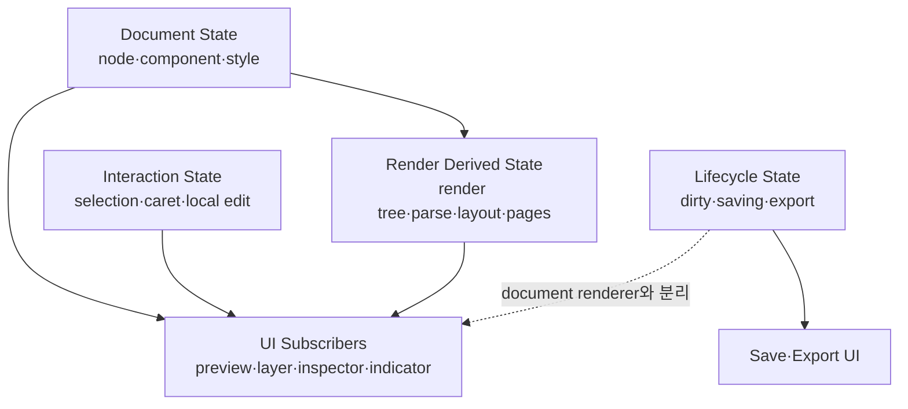

# 2. 편집기 상태 레이어링

## 목적

Document 편집 상태를 책임과 변경 주기에 따라 분리하고 각 UI가 필요한 snapshot만 구독하게 한다. State 변수를 여러 개로 나누는 데서 끝내지 않고 소유권, selector와 render boundary를 함께 분리한다.

## 목표 레이어



| 레이어 | 소유 상태 | 주요 구독자 |
|---|---|---|
| Document State | node, component, style, page settings, document revision | node renderer, structure와 component selector |
| Interaction State | selection, caret, 직접 편집 local value, focus request | 선택 node, layer row, Inspector, toolbar |
| Render Derived State | render tree, parsed Markdown, layout signature, pagination result | screen renderer와 measure coordinator |
| Lifecycle State | dirty, saving, saved, export progress와 error | header indicator와 export UI |

## 상태 구독 구조

최상위 `DocumentData`를 모든 컴포넌트에 전달하지 않는다. Store는 immutable snapshot과 좁은 selector를 제공한다.

```ts
type DocumentEditorStore = {
  getDocumentSnapshot(): DocumentSnapshot;
  getNodeSnapshot(nodeId: string): DocumentNodeSnapshot;
  getInteractionSnapshot(): InteractionSnapshot;
  getPaginationSnapshot(): PaginationSnapshot;
  subscribe(listener: () => void): () => void;
};
```

컴포넌트는 필요한 값만 구독한다.

```ts
const node = useDocumentNode(nodeId);
const selected = useNodeSelection(nodeId);
const saveState = useSaveState();
```

## 변경 내용

1. save와 export lifecycle을 editor document state에서 분리한다.
2. selection, layer focus와 caret 복원을 interaction state로 분리한다.
3. Document transaction과 document revision을 store 경계로 모은다.
4. node, component, selected property와 pagination selector를 제공한다.
5. 레이어 row, Inspector field와 preview node가 전체 Document 대신 selector를 구독하게 한다.
6. Derived cache가 source document와 동일한 state를 복제하지 않고 revision으로 연결되게 한다.

## 구독 규칙

- selection 변경은 이전·새 preview node, layer row와 Inspector만 갱신한다.
- save state 변경은 SaveIndicator와 관련 button만 갱신한다.
- component definition 변경은 그 component를 사용하는 occurrence만 무효화할 수 있어야 한다.
- node 내용 변경은 해당 node snapshot identity만 변경한다.
- selector 결과가 같으면 subscriber에게 새 snapshot을 발행하지 않는다.

## 마이그레이션 순서

1. 기존 동작을 유지한 채 save와 export 상태를 별도 구독으로 이동한다.
2. interaction state를 분리하고 caret·selection 회귀를 확인한다.
3. `DocumentEditorStore`와 전체 document fallback snapshot을 도입한다.
4. Layer와 Inspector부터 좁은 selector로 전환한다.
5. Preview node와 pagination consumer를 전환한다.
6. 최상위 `document` prop 의존성을 제거한다.

## 검증

- save state만 변경했을 때 document renderer commit이 발생하지 않는다.
- selection 변경으로 Markdown parse와 layout measure가 실행되지 않는다.
- node 하나를 변경할 때 무관한 layer row와 Inspector field가 렌더되지 않는다.
- store snapshot은 같은 revision에서 stable identity를 유지한다.
- 직접 편집 중 layer focus가 caret을 빼앗지 않는다.

## 완료 조건

- [x] save lifecycle, interaction local buffer와 render derived cache의 소유권이 분리된다.
- [x] 주요 editor UI가 변경 목적에 맞는 stable Document snapshot을 구독한다.
- [x] selection, save와 export lifecycle은 layout measure를 실행하지 않는다.
- [x] 기존 transaction, Undo/Redo와 저장 결과가 유지된다.
