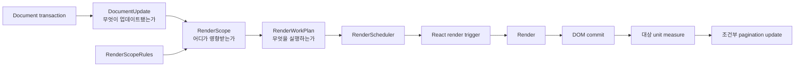

# 3. 부분 갱신 렌더 파이프라인

## 목적

Document 변경을 전체 renderer 실행으로 직접 연결하지 않는다. 무엇이 변경됐는지, 어디가 영향을 받는지, 어떤 작업을 실행할지를 단계별 값으로 표현해 필요한 node와 파생 계산만 갱신한다.

## 처리 과정



## 1. `DocumentUpdate`

Transaction이 새 Document와 함께 UI 비종속 변경 정보를 생성한다. 이전·다음 JSON 전체를 deep diff하지 않는다.

```ts
type DocumentUpdate = {
  revision: number;
  operations: readonly DocumentUpdateOperation[];
};
```

Operation은 node content·style·insert·remove·move·visibility, component definition과 page settings 변경을 구분한다.

## 2. `RenderScope`

Model ID를 실제 render occurrence와 pagination unit으로 변환하고 영향 종류를 판정한다.

```ts
type RenderScope = {
  impact: "visual" | "layout" | "structure" | "global";
  nodeIds: ReadonlySet<string>;
  markdownSourceIds: ReadonlySet<string>;
  layoutUnitIds: ReadonlySet<string>;
  earliestAffectedUnitId?: string;
  includesWholeTree: boolean;
};
```

Component instance와 repeater 때문에 model node와 화면 node는 일대일이 아니다. `RenderDependencyIndex`가 node와 component ID를 모든 render occurrence와 unit ID로 연결한다.

## 3. `RenderWorkPlan`

Scope를 실제 실행 단계별 작업으로 변환한다.

```ts
type RenderWorkPlan = {
  beforeRender: {
    invalidateMarkdownSourceIds: ReadonlySet<string>;
    invalidateRenderTreeNodeIds: ReadonlySet<string>;
  };
  render: {
    publishNodeIds: ReadonlySet<string>;
  };
  afterCommit: {
    measureUnitIds: ReadonlySet<string>;
    repaginateFromUnitId?: string;
  };
  rebuildWholeTree: boolean;
};
```

## 4. `RenderScheduler`

- 같은 frame의 여러 plan을 node·unit 집합과 가장 앞선 pagination 위치로 병합한다.
- render 중 side effect를 실행하지 않는다.
- React commit 이후에만 DOM 높이를 읽는다.
- 오래된 document 또는 layout revision의 측정 결과는 폐기한다.
- 동일 pagination 결과에는 page state update를 발행하지 않는다.

## Cache와 layout 판정

| Cache | Key | 무효화 조건 |
|---|---|---|
| Markdown parse | source identity·source revision·parser version | 해당 source 변경 |
| Render tree | model node revision·component definition revision | 관련 node 또는 definition 변경 |
| Unit layout | content·style·width·font·page fingerprint | layout 입력 변경 |
| Pagination | unit order·height·pagination metadata revision | 배치 입력 변경 |

줄 수를 문자열로 예측하지 않는다. 변경된 unit을 commit한 뒤 실제 크기와 pagination metadata를 `LayoutSignature`로 비교한다. Signature가 같으면 기존 page를 유지한다.

## 부분 페이지네이션

첫 구현은 정확성을 우선해 가장 앞선 변경 unit부터 문서 끝까지 다시 배치한다. 앞쪽 unit의 parse와 높이는 cache에서 재사용한다.

후속 최적화에서는 새 페이지 경계가 기존 결과와 다시 일치하는 안정 지점을 찾으면 이후 page를 재사용할 수 있다.

## 전체 갱신 fallback

다음 경우에는 전체 render tree와 layout을 무효화한다.

- 새 문서를 열거나 Document 전체를 외부에서 교체한 경우
- content 너비, 페이지 크기, 여백 또는 font 조건이 변경된 경우
- 기존 transaction이 `DocumentUpdate`를 제공하지 않는 경우
- dependency index 또는 cache revision이 일치하지 않는 경우
- `RenderScopeRules`가 operation을 판정하지 못한 경우

Fallback은 이유와 횟수를 계측한다.

## 구현 순서

1. `DocumentUpdate` 타입과 기존 transaction adapter를 추가한다.
2. `RenderScopeRules`와 순수 함수 테스트를 작성한다.
3. `RenderDependencyIndex`로 component·repeater occurrence를 연결한다.
4. `RenderWorkPlan` 생성과 plan 병합 테스트를 작성한다.
5. Markdown·render tree·layout cache를 revision 기반으로 연결한다.
6. commit 이후 대상 unit 측정과 부분 pagination을 연결한다.
7. 전체 fallback과 개발용 incremental/full 결과 비교를 추가한다.

## 검증

- visual-only style 변경은 measure와 pagination을 실행하지 않는다.
- Markdown source 변경은 해당 source를 한 번만 파싱한다.
- text 높이가 같으면 page state를 갱신하지 않는다.
- component definition 변경은 연결된 모든 instance와 repeater occurrence를 갱신한다.
- 판정하지 못한 update는 전체 갱신되어 출력이 손상되지 않는다.
- 동일 frame의 여러 update는 하나의 render work로 병합된다.

## 완료 조건

- [x] `DocumentUpdate → RenderScope → RenderWorkPlan` 경계가 코드와 테스트에 존재한다.
- [x] 변경과 무관한 node subtree·Markdown parse·unit height와 page state를 재사용한다.
- [x] 부분 갱신과 전체 fallback의 출력 계약을 유지한다.
- [x] 입력과 구조 변경의 실제 Electron 지연을 밀리초 단위로 확인했다.
- [x] 전체 테스트, production build와 Electron 실제 편집 검증이 통과한다.
