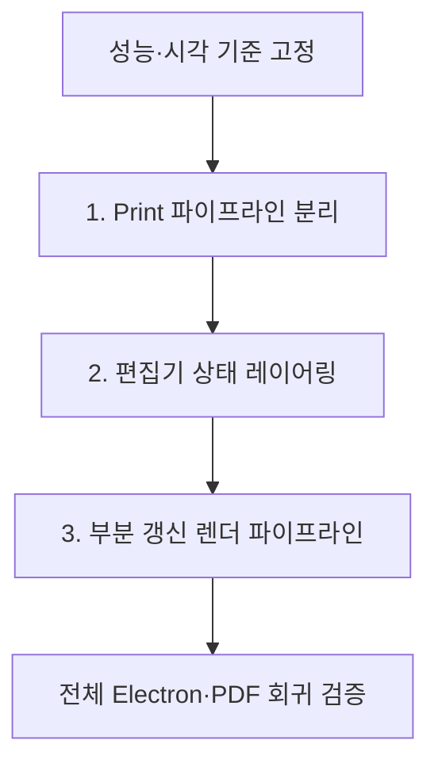

# 렌더링 아키텍처 개선 계획

## 목표

현재 Document 편집은 하나의 변경이 screen, measure, print, panel과 저장 상태까지 함께 다시 실행시키는 구조다. 이번 작업은 불필요한 상시 작업을 제거하고 상태 구독 경계를 나눈 다음, 변경 영향도에 따른 부분 갱신 파이프라인을 도입한다.

## 작업 순서

| 순서 | 작업 | 핵심 결과 | 문서 |
|---:|---|---|---|
| 1 | Print 파이프라인 분리 | 편집 중 print render·measure 0회 | [상세](01-print-pipeline-isolation.md) |
| 2 | 편집기 상태 레이어링 | 상태별 소유권과 node 단위 구독 경계 | [상세](02-editor-state-layering.md) |
| 3 | 부분 갱신 렌더 파이프라인 | `DocumentUpdate → RenderScope → RenderWorkPlan` | [상세](03-incremental-render-pipeline.md) |

## 공통 사전 작업

- 실제 이력서 fixture에서 문자 입력, Markdown 입력, 요소 추가와 스타일 변경 시간을 기록한다.
- React commit 횟수, Markdown parse 횟수, layout measure 횟수와 page state 갱신 횟수를 기록한다.
- 현재 screen과 PDF의 페이지 수, 줄바꿈, continuation border와 주요 화면 스크린샷을 보관한다.
- production build의 Electron에서 한국어 IME, caret와 Undo/Redo 기준을 기록한다.

## 공통 원칙

- 각 단계는 독립적으로 typecheck, 전체 테스트, production build와 Electron 검증을 통과한 뒤 다음 단계로 진행한다.
- 성능 최적화가 출력 정확성보다 우선하지 않는다.
- 부분 갱신을 판정하지 못하면 기존 전체 갱신으로 돌아간다.
- React component를 명령형으로 다시 그리지 않고 필요한 snapshot과 props만 갱신한다.
- 단계별 전후 계측값을 남겨 실제 병목 감소를 확인한다.

## 최종 완료 조건

- 편집 중 print DOM과 print 관련 계산이 존재하지 않는다.
- selection과 save lifecycle 변경이 document renderer를 실행하지 않는다.
- 동일 Markdown source revision은 한 번만 파싱된다.
- visual-only 변경은 layout measure와 pagination을 실행하지 않는다.
- layout 변경은 영향받은 unit을 측정하고 필요한 페이지 범위만 갱신한다.
- 입력 반응, 페이지 정착 시간과 long task 수가 기준 목표를 만족한다.
- screen, PDF, IME, caret와 Undo/Redo 회귀가 없다.

