# 현재 Document 입력·렌더링·저장 과정

## 문서 목적

이 문서는 현재 구현에서 사용자가 키보드로 문자를 입력한 순간부터 다음 결과가 완료될 때까지의 실제 호출 순서를 기록한다.

1. 편집 값이 `DocumentData`에 반영된다.
2. 변경된 값이 화면에 표시된다.
3. 페이지네이션이 다시 계산된다.
4. 변경된 문서가 Electron main process를 통해 파일에 저장된다.

목적은 목표 구조를 먼저 제안하는 것이 아니라, 현재 순서 안에서 같은 데이터를 반복 계산하거나 변경과 무관한 영역까지 다시 처리하는 지점을 식별하는 것이다.

## 범위와 기준

- 일반 Document 편집 화면인 `GenericDocumentEditorPage`를 기준으로 한다.
- 일반 `text`, `rich-text`, `markdown`, component prop, repeater item prop 직접 편집을 포함한다.
- component definition 전용 편집 화면은 구조가 다른 부분만 별도 언급한다.
- 파일 저장은 renderer process, preload IPC, Electron main process의 경계를 모두 포함한다.
- 아래 Mermaid에서 빨간색 노드는 현재 측정에서 큰 병목으로 확인된 구간, 노란색 노드는 반복 여부를 줄여야 하는 구간이다.

## 전체 과정 요약

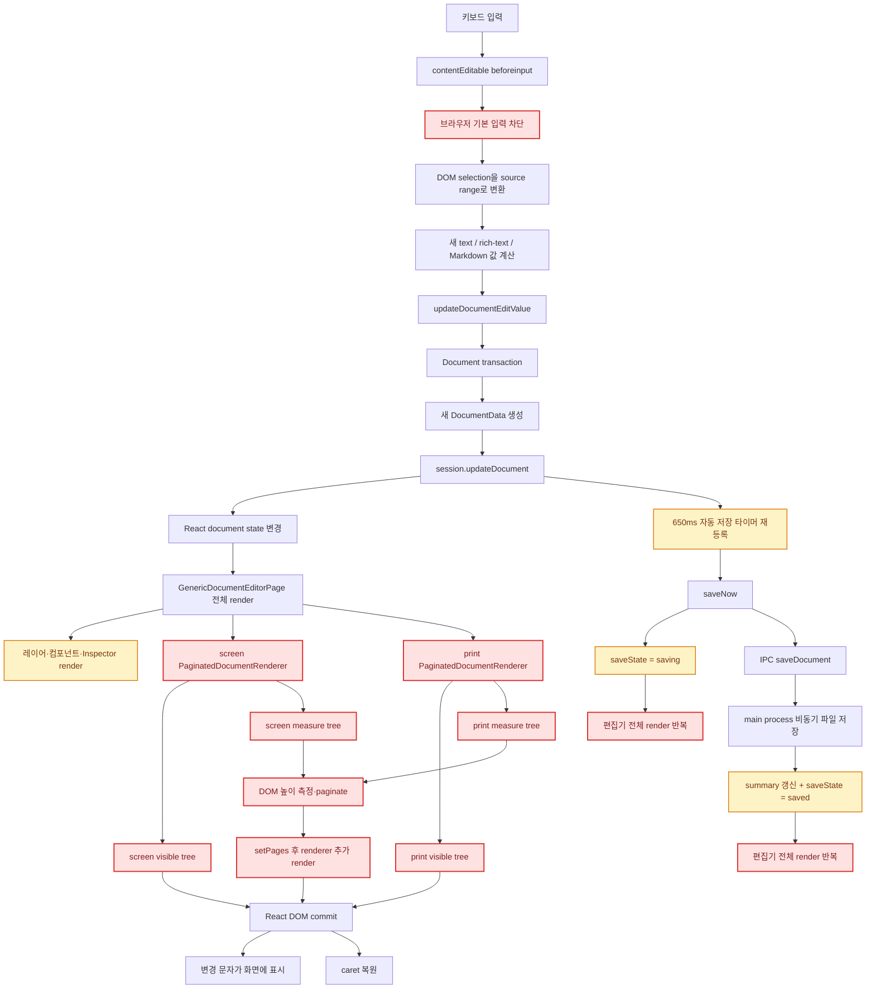

핵심은 입력 처리 함수 자체가 느린 것이 아니라, 입력 한 번이 전체 Document 상태 교체로 이어지고 그 상태가 네 개의 문서 DOM과 모든 편집 패널을 다시 통과한다는 점이다.

## 현재 화면 렌더링 토폴로지

`GenericDocumentEditorPage`는 한 화면 안에 screen renderer와 print renderer를 동시에 mount한다. 각 `PaginatedDocumentRenderer`는 다시 실제 페이지와 측정 전용 페이지를 함께 mount한다.

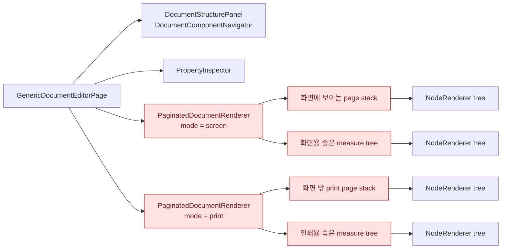

| 렌더 트리 | 현재 역할 | 편집 중 필요성 | 현재 비용 특성 |
|---|---|---|---|
| screen visible | 사용자에게 페이지 표시 | 필요 | 모든 page와 fragment를 렌더링한다. |
| screen measure | 페이지별 높이 계산 | 필요하지만 공유·축소 가능 | 전체 문서를 화면 밖에 한 번 더 렌더링한다. |
| print visible | PDF/print 출력용 DOM | 일반 입력 중에는 즉시 필요하지 않다. | `visibility: hidden`이어도 React render와 layout tree를 유지한다. |
| print measure | print renderer의 페이지 높이 계산 | 일반 입력 중에는 불필요하다. | screen measure와 같은 문서를 다시 측정한다. |

관련 구현:

- screen renderer: [`GenericDocumentEditorPage.tsx`](../../../client/src/renderer/src/pages/document-editor/GenericDocumentEditorPage.tsx#L314)
- print renderer: [`GenericDocumentEditorPage.tsx`](../../../client/src/renderer/src/pages/document-editor/GenericDocumentEditorPage.tsx#L343)
- visible page stack: [`PaginatedDocumentRenderer.tsx`](../../../client/src/renderer/src/pages/document-editor/rendering/PaginatedDocumentRenderer.tsx#L92)
- measure tree: [`PaginatedDocumentRenderer.tsx`](../../../client/src/renderer/src/pages/document-editor/rendering/PaginatedDocumentRenderer.tsx#L118)

## 일반 text·rich-text 키보드 입력 순서

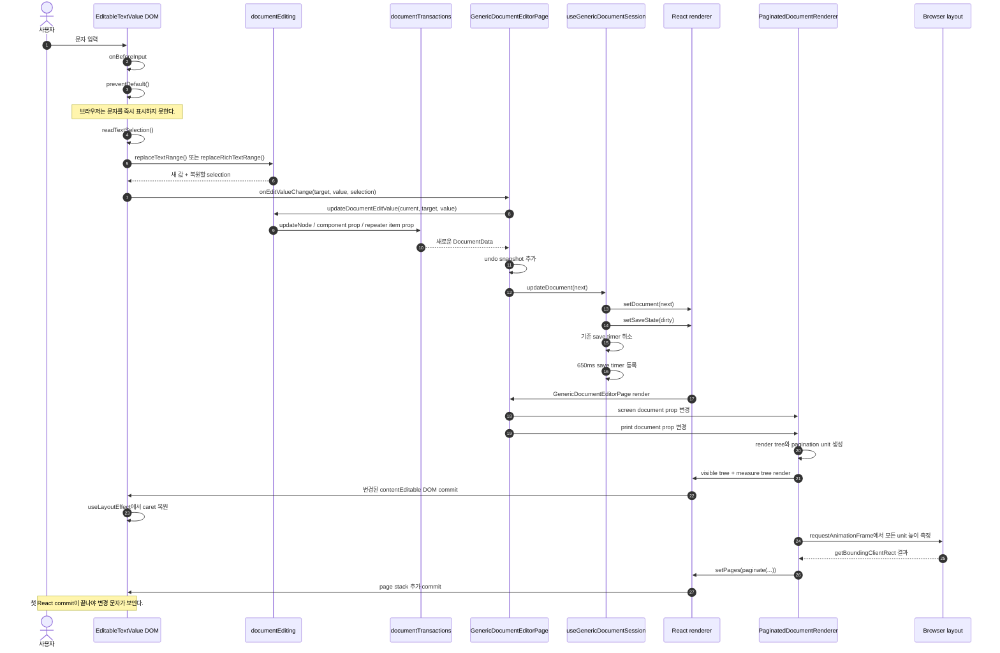

### 값 종류별 transaction 분기

`updateDocumentEditValue`는 사용자가 클릭한 렌더 조각이 어떤 실제 데이터에 연결되어 있는지에 따라 transaction을 선택한다.

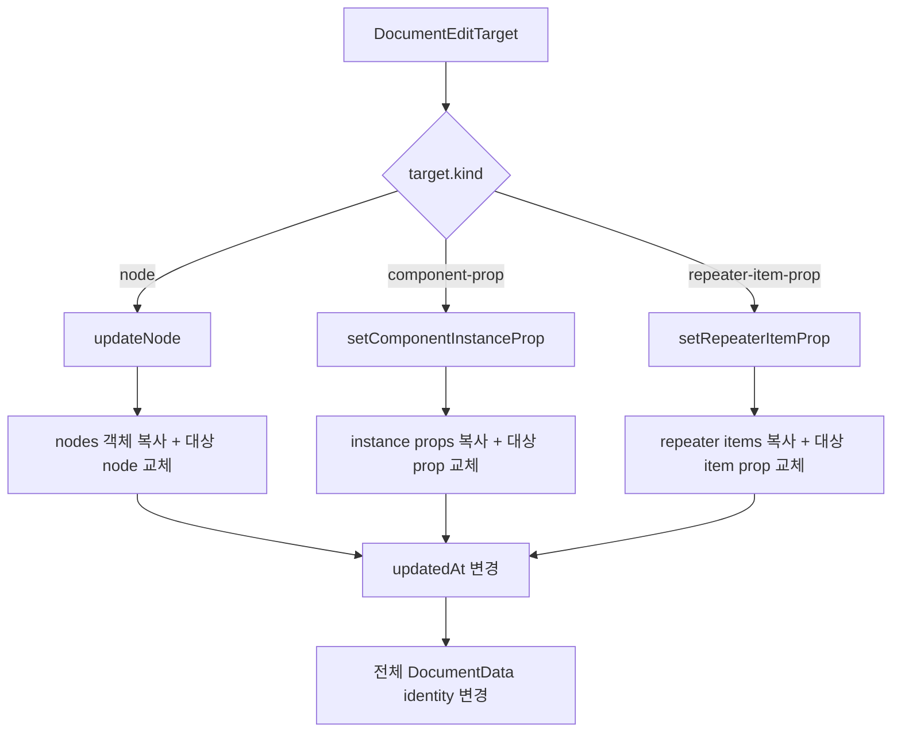

관련 구현:

- 일반 입력 차단과 값 생성: [`EditableTextValue.tsx`](../../../client/src/renderer/src/pages/document-editor/rendering/EditableTextValue.tsx#L68)
- 직접 편집 값 transaction 분기: [`documentEditing.ts`](../../../client/src/foundation/documentEditing.ts#L56)
- 일반 node 변경: [`documentTransactions.ts`](../../../client/src/foundation/documentTransactions.ts#L152)
- session 반영: [`useGenericDocumentSession.ts`](../../../client/src/renderer/src/pages/document-editor/useGenericDocumentSession.ts#L73)

## Markdown 키보드 입력 순서

Markdown은 표시 DOM의 문자를 Markdown source offset으로 다시 매핑해야 한다. 이후 Document 변경 경로는 일반 text와 같다.

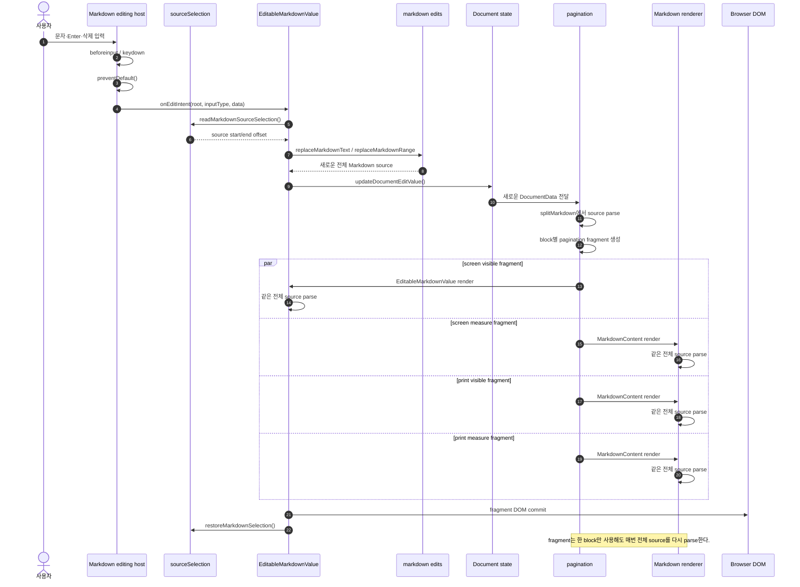

현재 파싱 호출 지점은 세 곳이다.

| 단계 | 호출 위치 | 현재 동작 |
|---|---|---|
| pagination unit 생성 | [`pagination.ts`](../../../client/src/renderer/src/pages/document-editor/rendering/pagination.ts#L52) | render tree의 각 Markdown occurrence마다 전체 source를 파싱한다. |
| 읽기·measure·print 렌더 | [`MarkdownContent.tsx`](../../../client/src/renderer/src/pages/document-editor/markdown/MarkdownContent.tsx#L49) | 각 pagination fragment가 전체 source를 다시 파싱한다. |
| screen 직접 편집 렌더 | [`EditableMarkdownValue.tsx`](../../../client/src/renderer/src/pages/document-editor/rendering/EditableMarkdownValue.tsx#L54) | 각 편집 fragment가 전체 source를 다시 파싱한다. |

## Document 상태 변경 후 React가 다시 실행하는 영역

`DocumentData`는 한 node만 변경되어도 최상위 객체 identity가 바뀐다. `GenericDocumentEditorPage`는 이 객체를 왼쪽 패널, 중앙 renderer, 오른쪽 inspector에 모두 전달한다.

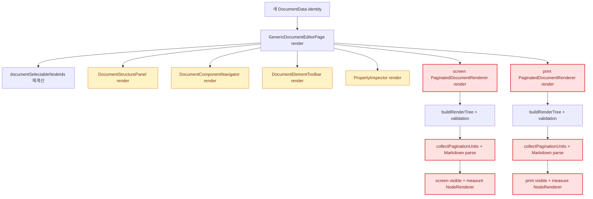

현재 document editor 하위에는 변경되지 않은 subtree의 실행을 차단하는 `React.memo` 경계가 없다. 또한 page root를 `{ ...root, children: ... }` 형태로 매 render마다 새로 만들어 `NodeRenderer`에 전달한다.

따라서 save state, selection, summary처럼 `DocumentData`의 출력 결과를 바꾸지 않는 상태가 변경되어도 상위 page가 render되면 document renderer 함수와 Markdown component가 다시 실행될 수 있다.

## 페이지네이션 계산 순서

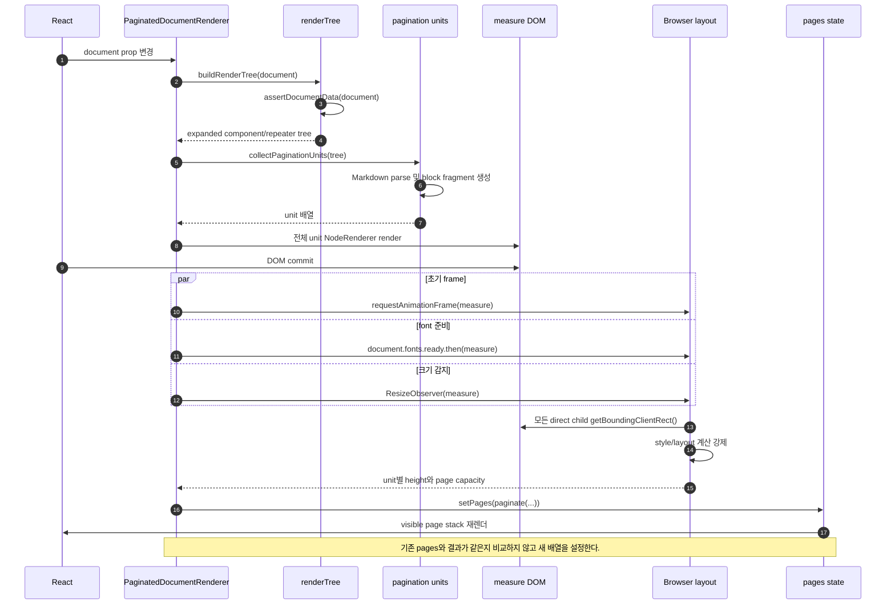

같은 `PaginatedDocumentRenderer` 안에서도 document 변경 직후 다음 render가 연속된다.

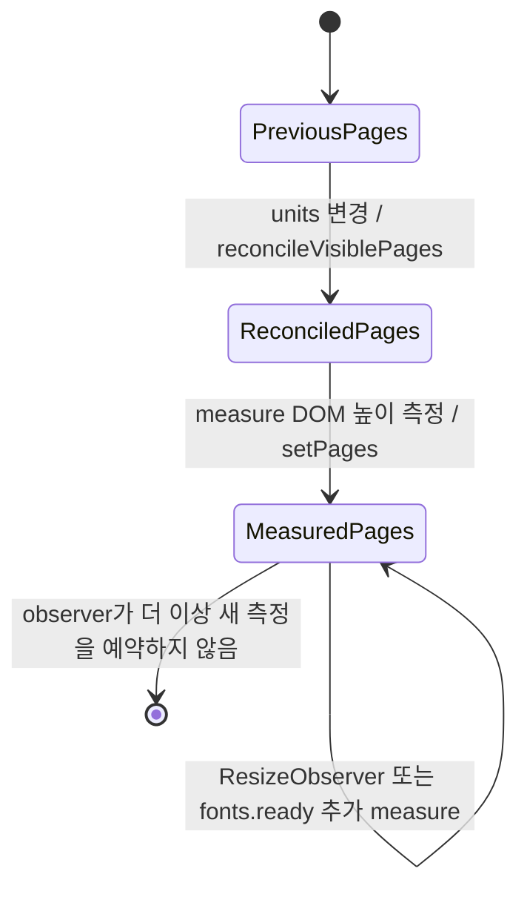

관련 구현:

- tree·unit 생성: [`PaginatedDocumentRenderer.tsx`](../../../client/src/renderer/src/pages/document-editor/rendering/PaginatedDocumentRenderer.tsx#L35)
- 이전 페이지와 unit 임시 조정: [`PaginatedDocumentRenderer.tsx`](../../../client/src/renderer/src/pages/document-editor/rendering/PaginatedDocumentRenderer.tsx#L45)
- 높이 측정과 observer: [`PaginatedDocumentRenderer.tsx`](../../../client/src/renderer/src/pages/document-editor/rendering/PaginatedDocumentRenderer.tsx#L49)
- 페이지 배치: [`pagination.ts`](../../../client/src/renderer/src/pages/document-editor/rendering/pagination.ts#L209)

## 자동 저장 순서와 process 경계

### 변경 이벤트마다 실제 파일을 쓰는가

아니다. 변경 이벤트마다 기존 timer를 취소하고 `650ms` timer를 다시 등록한다. 마지막 변경 이후 650ms 동안 추가 변경이 없어야 `saveNow`가 시작된다.

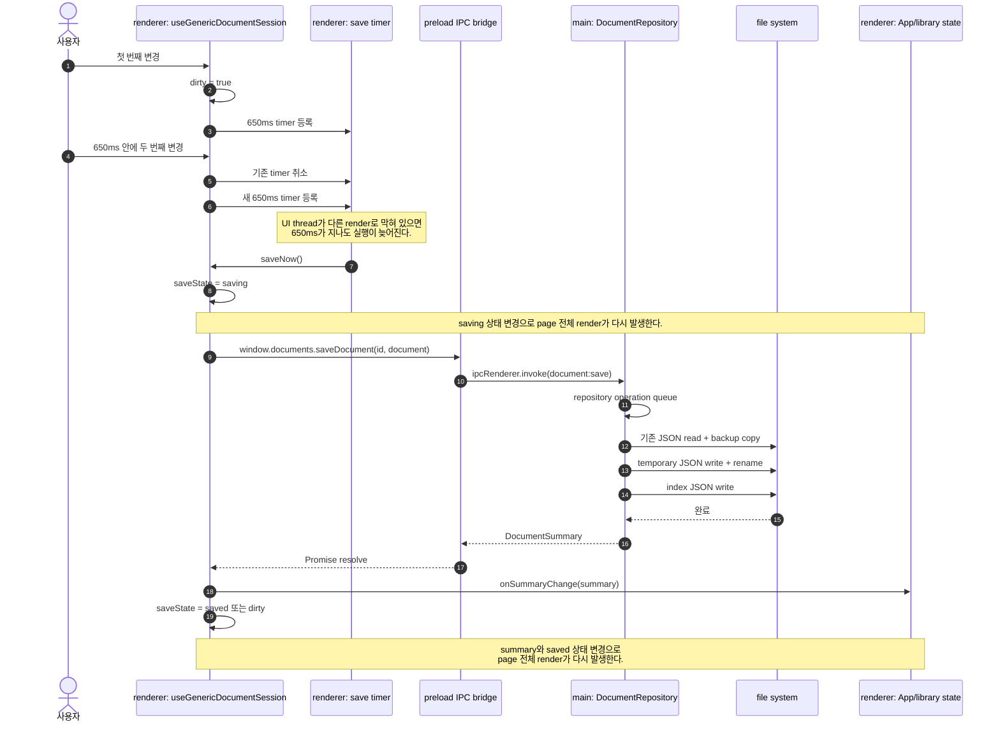

### renderer thread와 main process

```mermaid
flowchart LR
    subgraph Renderer["Electron renderer process · UI main thread"]
        INPUT["입력 이벤트"] --> REACT["React render"]
        REACT --> MD["Markdown parse"]
        MD --> LAYOUT["DOM style/layout 측정"]
        LAYOUT --> TIMER["지연된 save timer callback"]
    end

    subgraph Preload["context-isolated preload"]
        IPC["ipcRenderer.invoke"]
    end

    subgraph Main["Electron main process"]
        HANDLER["ipcMain handler"] --> REPO["DocumentRepository queue"]
        REPO --> ASYNCFS["async fs read/copy/write/rename"]
    end

    TIMER --> IPC
    IPC --> HANDLER
    ASYNCFS -. "Promise result" .-> IPC
    IPC -. "summary" .-> TIMER

    class REACT,MD,LAYOUT hotspot
    classDef hotspot fill:#fee2e2,stroke:#dc2626,color:#7f1d1d,stroke-width:2px
```

파일 읽기·쓰기는 Electron main process에서 비동기 API로 실행된다. renderer UI thread를 동기 파일 쓰기로 직접 점유하지 않는다. 그러나 `saving`, `saved`, library summary 상태는 renderer로 돌아와 무거운 React render를 다시 시작한다.

관련 구현:

- debounce와 save state: [`useGenericDocumentSession.ts`](../../../client/src/renderer/src/pages/document-editor/useGenericDocumentSession.ts#L29)
- preload bridge: [`preload/index.ts`](../../../client/src/preload/index.ts#L12)
- IPC handler: [`registerDocumentHandlers.ts`](../../../client/src/main/registerDocumentHandlers.ts#L16)
- repository 저장: [`documentRepository.ts`](../../../client/src/main/document/documentRepository.ts#L99)
- atomic JSON 저장: [`atomicJsonStore.ts`](../../../client/src/main/document/atomicJsonStore.ts#L30)
- library summary 상태 변경: [`useDocumentLibrary.ts`](../../../client/src/renderer/src/pages/document-library/useDocumentLibrary.ts#L133)

## 한 번의 입력 뒤 실제로 발생한 렌더 파동

production Electron에서 실제 `이상윤 이력서` 데이터를 별도 user-data 디렉터리에 복사하여 측정했다. 원본 사용자 문서는 변경하지 않았다.

```mermaid
gantt
    title 텍스트 한 글자 입력 후 관찰된 renderer 작업 파동
    dateFormat X
    axisFormat %L ms
    section 입력
    native input event                 :milestone, i0, 0, 0
    첫 Document render                 :crit, r1, 0, 2060
    section 자동 저장
    save timer 최소 대기              :t1, 0, 650
    saving 상태 render 완료            :crit, r2, 2060, 1270
    저장 IPC와 saved·summary 반영      :s1, 3330, 4884
    saved·summary render 완료           :crit, r3, 3330, 4884
```

Mutation이 모여서 발생한 시점은 다음과 같았다.

| 입력 후 시점 | 관찰된 변화 | 해석 |
|---:|---|---|
| 약 2.06초 | screen·print·레이어·header 변경 | 새 `DocumentData`의 첫 전체 render가 완료된 시점 |
| 약 3.33초 | 레이어·header 등 page subtree 변경 | 늦게 실행된 save timer가 `saving` 상태 render를 발생시킨 시점 |
| 약 8.21초 | 레이어·header 등 page subtree 변경 | 저장 완료 후 `saved`와 library summary render가 완료된 시점 |

추가 측정값:

| 항목 | 측정값 |
|---|---:|
| 문서 JSON 파일 크기 | 112,594 bytes |
| document node | 120개 |
| component definition | 8개 |
| repeater item | 18개 |
| 실제 문서 페이지 | screen 8페이지 + print 8페이지 |
| 전체 DOM element | 8,532개 |
| `contenteditable` element | 208개 |
| Markdown DOM node | 468개 |
| 텍스트 한 글자 입력 후 첫 안정화 | 약 1.95~2.25초 |
| 요소 하나 추가 후 응답 | 약 2.30초 |
| 같은 문서의 IPC 파일 저장 | 약 14.3ms |
| 전체 validation 1회 | 평균 약 0.63ms |
| render tree 생성 1회 | 평균 약 1.37ms |
| pagination unit 생성 1회 | 평균 약 16.24ms |

파일 저장 시간보다 renderer의 파싱·render·layout 시간이 훨씬 크다. 저장이 느려 보이는 원인은 파일 쓰기 자체가 아니라 저장 상태 전환이 추가 renderer 작업을 시작하기 때문이다.

## 현재 불필요하거나 중복된 계산 지점

```mermaid
flowchart TD
    INPUT["문자 한 글자 변경"]
    INPUT --> U1["변경되지 않은 Markdown source 전체 재파싱"]
    INPUT --> U2["screen과 print render tree 각각 생성"]
    INPUT --> U3["screen과 print가 각각 measure tree 생성"]
    INPUT --> U4["레이어·컴포넌트 목록·Inspector 전체 render"]
    INPUT --> U5["모든 pagination unit 높이 재측정"]
    INPUT --> U6["pages가 같아도 새 pages 배열 설정"]

    SAVE["saveState만 변경"]
    SAVE --> U7["DocumentData가 같아도 전체 page render"]
    SAVE --> U8["모든 Markdown fragment component 재실행"]
    SAVE --> U9["library summary 변경으로 상위 App render"]

    class U1,U2,U3,U7,U8 hotspot
    class U4,U5,U6,U9 repeat
    classDef hotspot fill:#fee2e2,stroke:#dc2626,color:#7f1d1d,stroke-width:2px
    classDef repeat fill:#fef3c7,stroke:#d97706,color:#78350f
```

### 병목 목록

| 우선순위 | 불필요한 계산 | 현재 발생 이유 | 현재 확인된 영향 |
|---:|---|---|---|
| 1 | 변경되지 않은 Markdown 반복 파싱 | pagination과 각 visible/measure fragment가 source를 독립적으로 파싱한다. | CPU profile의 가장 큰 비중과 대량의 AST allocation·GC를 만든다. |
| 2 | print renderer 상시 실행 | 편집 화면에서도 print visible·measure DOM을 항상 mount한다. | screen과 사실상 같은 계산을 한 벌 더 실행한다. |
| 3 | 저장 상태에 따른 문서 전체 render | save indicator 상태와 document renderer가 같은 page render 경계에 있다. | 최초 입력 render 뒤 `saving`, `saved` render가 추가된다. |
| 4 | 페이지 측정 중복 예약 | initial frame, fonts ready, ResizeObserver가 각각 measure를 예약한다. | 같은 document revision에서 여러 layout read가 가능하다. |
| 5 | 동일 pagination 결과 재설정 | `paginate()` 결과를 기존 pages와 비교하지 않고 `setPages`한다. | 변경이 없어도 page stack render를 추가한다. |
| 6 | 모든 editor panel 재실행 | `DocumentData` 전체 객체를 모든 panel에 전달하고 memo 경계가 없다. | 선택과 무관한 레이어 row, component UI, inspector까지 실행된다. |
| 7 | 모든 입력을 최상위 Document state로 즉시 승격 | `preventDefault` 이후 최상위 state commit이 화면 표시의 선행 조건이다. | 입력 자체가 전체 render 속도에 묶이고 글자가 늦게 보인다. |

### 현재 핵심 병목이 아닌 항목

| 항목 | 판단 근거 |
|---|---|
| 변경마다 즉시 파일 저장 | 650ms trailing debounce가 있어 연속 입력 중에는 기존 timer를 취소한다. |
| renderer의 동기 파일 쓰기 | 저장은 preload IPC를 거쳐 main process의 비동기 `fs/promises`에서 실행된다. |
| Document validation 단독 비용 | 현재 실제 문서에서 1회 평균 약 0.63ms로 측정됐다. 호출 수는 줄일 수 있지만 수 초 지연의 주원인은 아니다. |
| JSON 파일 크기 | 현재 실제 파일은 약 112KB이며 IPC 저장 전체가 약 14.3ms였다. |

## 모듈 책임 지도

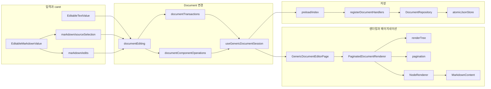

## 이 문서에서 확정할 수 있는 결론

1. 사용자가 입력한 글자가 늦게 보이는 직접 원인은 `beforeinput.preventDefault()` 이후 전체 React commit이 완료되어야 DOM이 갱신되는 현재 제어 방식이다.
2. 변경 이벤트마다 파일을 즉시 쓰지는 않는다. 마지막 변경 후 650ms의 debounce가 있다.
3. 파일 저장은 main process의 비동기 I/O이며 현재 측정에서는 수 초 병목이 아니다.
4. 저장과 연관된 지연은 실제로 존재한다. `saving`, `saved`, library summary 상태가 무거운 전체 page render를 추가로 발생시키기 때문이다.
5. 가장 큰 계산 낭비는 변경되지 않은 Markdown의 반복 파싱과 screen·measure·print·print-measure 네 트리의 중복 렌더링이다.
6. 페이지네이션 정확성을 유지하더라도 한 revision에서 측정 트리는 하나만 필요하며, 저장 상태 변경은 document renderer를 실행할 이유가 없다.
7. 다음 성능 설계에서는 입력 즉시 표시 경로, 파싱 결과 공유, 단일 측정 소유권, print 지연 생성, 저장 UI와 document renderer의 render 경계를 각각 별도 문제로 다뤄야 한다.
