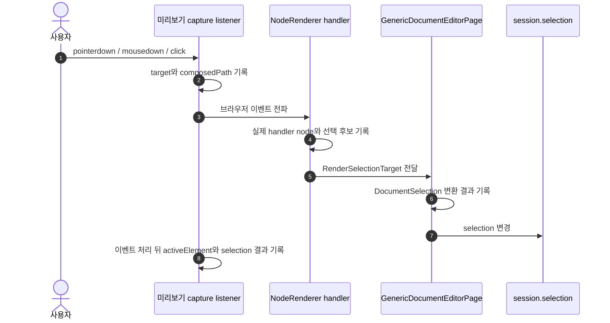

# Document 상호작용 이벤트 디버그 모드

## 목적

Document 미리보기에서 한 요소를 클릭했는데 다른 node가 선택되거나, 중첩된 component node의 여러 클릭 핸들러가 의도와 다르게 반응하는 증상을 확인한다.

이 모드는 기능을 수정하기 전에 다음 세 단계를 같은 시간 순서로 관찰하기 위한 진단 도구다.



## 활성화 방법

기본값은 비활성이다. 앱을 실행할 때 `--debug` 인자를 전달하면 해당 renderer에서 진단 모드를 자동 활성화한다.

```bash
npm run app:debug
```

`app:debug` script가 production build를 완료한 뒤 내부 `--debug`를 `DOCUMENT_INTERACTION_DEBUG=1`로 변환한다. main process는 다시 renderer query의 `interactionDebug=1`로 변환한다. 일반 `npm run app`과 배포 실행에서는 자동 활성화하지 않는다.

실행 중에는 Electron 개발자 도구의 Console에서 다음 명령으로 현재 창의 진단 모드를 제어할 수도 있다.

```js
window.__RESUME_STUDIO_DEBUG__.interactions.enable()
window.__RESUME_STUDIO_DEBUG__.interactions.disable()
window.__RESUME_STUDIO_DEBUG__.interactions.status()
window.__RESUME_STUDIO_DEBUG__.interactions.clear()
window.__RESUME_STUDIO_DEBUG__.interactions.recent()
```

활성 상태는 `localStorage`에 저장하므로 새로고침 뒤에도 유지한다. `recent()`는 최근 200개의 구조화된 로그를 반환한다.

## 수집 대상

| 단계 | 기록 내용 | 확인하려는 문제 |
|---|---|---|
| `dom-event` | `pointerdown`, `mousedown`, `click`, `focusin`, `focusout`의 target, phase, 좌표, 버튼, modifier, composed path | 실제 브라우저 이벤트가 어느 요소에서 시작해 어떤 경로를 거쳤는가 |
| `node-handler` | 실행된 `NodeRenderer`의 render/source node, repeater item, 가장 가까운 DOM node | 중첩된 handler 중 어떤 handler가 선택을 요청했는가 |
| `selection-request` | `RenderSelectionTarget`과 변환된 `DocumentSelection` | 렌더 node가 실제 편집 selection으로 어떻게 해석되었는가 |
| `selection-state` | 선택 변경 전·후 | 요청과 최종 session 상태가 일치하는가 |
| `dom-settled` | 이벤트 처리 뒤 active element와 최종 selection | focus와 selection이 서로 다른 node를 가리키는가 |

각 로그에는 증가하는 번호와 시간이 포함된다. DOM 요소는 tag, id, role, contenteditable 여부와 다음 식별 속성만 기록한다.

- `data-document-node-id`
- `data-document-render-id`
- `data-document-node-type`
- `data-repeater-item-id`
- `data-document-selected`

## 안전 경계

- 입력한 이력서 본문, `innerText`, `textContent`, input value는 기록하지 않는다.
- `mode="screen"`인 Document 미리보기에서만 DOM 이벤트를 수집한다.
- print surface와 measure tree에는 listener나 진단 attribute를 추가하지 않는다.
- 비활성 상태에서는 snapshot 생성, composed path 순회, console 출력이 실행되지 않는다.
- 진단 모드는 선택 동작, propagation, focus, pagination을 변경하지 않는다.

## 증상 확인 순서

1. 진단 모드를 활성화하고 `clear()`로 이전 로그를 비운다.
2. 문제가 있는 요소를 한 번 클릭한다.
3. 같은 번호대의 `dom-event(click)` → `node-handler` → `selection-request` → `selection-state` → `dom-settled`를 비교한다.
4. 하나의 click에 `node-handler`가 여러 번 기록되면 propagation 경계를 확인한다.
5. `target`과 `handlerNodeId`가 다르면 component 내부 node를 어느 구조 node로 승격했는지 확인한다.
6. 요청 selection과 최종 selection이 다르면 selection reconciliation 또는 후속 focus 이벤트를 확인한다.

## 비범위

- 이 문서와 진단 모드 자체는 잘못된 선택 규칙을 수정하지 않는다.
- production 사용자에게 보이는 설정 UI를 추가하지 않는다.
- 장기 분석용 telemetry나 외부 전송을 추가하지 않는다.
