# To-Be Document 입력·렌더링·저장 과정

## 문서 목적

이 문서는 [현재 Document 입력·렌더링·저장 과정](current-document-render-pipeline.md)에서 확인한 병목을 제거하기 위한 목표 구조를 정의한다.

목표는 다음 세 경로를 서로 분리하는 것이다.

1. 키보드 입력을 즉시 화면에 표시하는 편집 경로
2. 문서 레이아웃과 페이지네이션을 갱신하는 파생 계산 경로
3. 확정된 document revision을 디스크와 PDF로 출력하는 저장·출력 경로

이 문서는 구현 순서보다 편집기의 최종 책임과 이벤트 순서를 먼저 확정한다. 구현 과정에서 성능을 이유로 caret, 한국어 IME, Undo/Redo와 페이지 분할 정확성을 약화하지 않는다.

## 목표와 성능 계약

- 평상시 편집에는 `screen renderer` 하나와 공유 measure surface 하나만 존재한다.
- `print renderer`는 PDF 내보내기를 요청한 동안에만 생성한다.
- 활성 편집 요소는 전체 `DocumentData` render가 끝나기 전에 변경 문자를 표시한다.
- 같은 Markdown source와 revision은 한 번만 파싱하고 pagination과 모든 fragment가 결과를 공유한다.
- 저장 상태 `dirty`, `saving`, `saved`는 document renderer를 다시 실행하지 않는다.
- 같은 document revision에서 페이지 측정 요청은 한 프레임에 한 번으로 합친다.
- pagination 결과가 같으면 page state를 갱신하지 않는다.

| 사용자 동작 | 목표 |
|---|---:|
| 일반 문자 표시 | 16ms 이내, 최악 50ms 이내 |
| 한국어 조합 문자 표시 | 브라우저 IME frame 안에서 즉시 |
| 요소 추가·삭제·복제 결과 표시 | 100ms 이내 |
| 페이지네이션 후속 정착 | 300ms 이내 |
| 입력 중 50ms 이상 renderer long task | 0회 |
| 변경되지 않은 Markdown source 재파싱 | 0회 |
| save state 변경으로 인한 document renderer 실행 | 0회 |
| 평상시 편집 중 print render·measure | 0회 |

## 전체 목표 과정

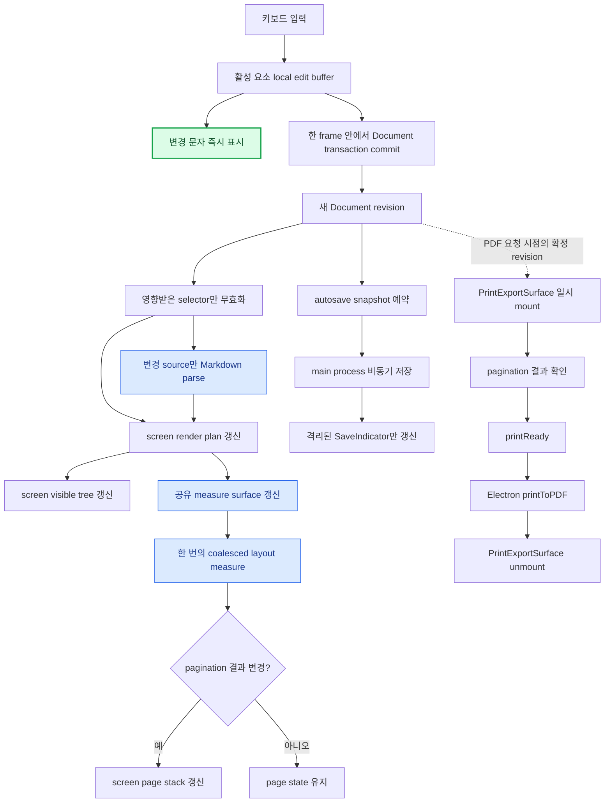

## 목표 화면 렌더링 토폴로지

### 평상시 편집

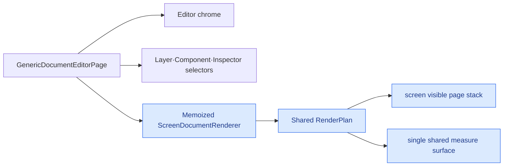

| 렌더 surface | 존재 시점 | 목표 책임 |
|---|---|---|
| screen visible page stack | 평상시 편집 | 편집 결과와 현재 페이지 표시 |
| shared measure surface | 평상시 편집 | 페이지 높이 계산의 유일한 소유자 |
| print visible page stack | PDF 내보내기 중 | 확정 snapshot의 출력 DOM 제공 |
| print measure surface | screen 결과를 재사용할 수 없을 때만 | 출력 조건이 다를 때 한 번만 측정 |

### PDF 내보내기 중

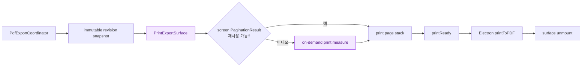

일반 편집 화면에는 print surface가 존재하지 않는다. 내보내기 요청이 들어오면 확정 revision snapshot으로만 일시적으로 생성하고, 성공·실패와 관계없이 제거한다.

## 일반 text·rich-text 키보드 입력 순서

활성 편집 요소는 Document 전체 renderer와 분리된 local edit buffer를 가진다. 입력 이벤트는 local buffer와 DOM만 먼저 갱신하고, Document transaction은 같은 frame 안에서 별도 경로로 commit한다.

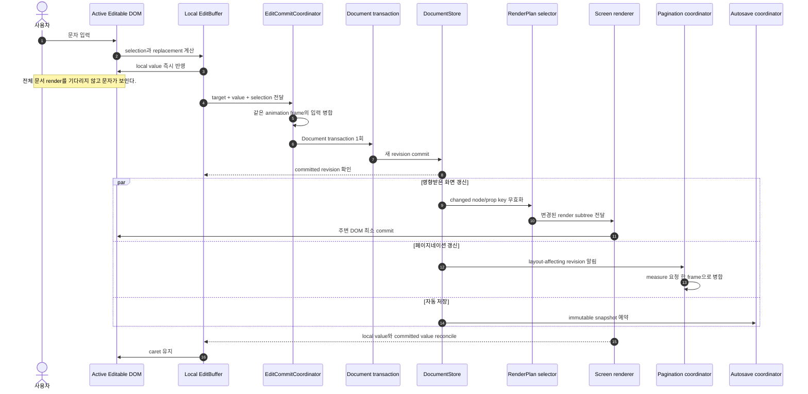

### local edit buffer 계약

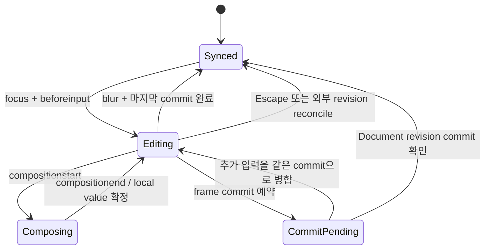

local buffer는 저장되지 않는 별도 문서 모델이 아니다. 활성 편집 요소의 즉각적인 표시와 caret을 책임지는 짧은 수명의 projection이다.

- 최종 데이터 권위는 계속 `DocumentData`에 있다.
- blur, navigation, PDF export 전에 pending commit을 반드시 flush한다.
- `Ctrl/Cmd+Z` history에는 글자마다 거대한 document snapshot을 추가하지 않고 연속 입력 transaction을 시간·target 기준으로 묶는다.
- IME composition 중에는 browser DOM을 덮어쓰지 않는다.
- 외부 transaction이 같은 target을 변경하면 local revision과 document revision을 비교해 명시적으로 reconcile한다.

## Markdown 키보드 입력 순서

Markdown은 local source buffer와 revision 기반 parsed document를 분리한다. 한 source revision을 pagination과 fragment renderer가 독립적으로 파싱하지 않는다.

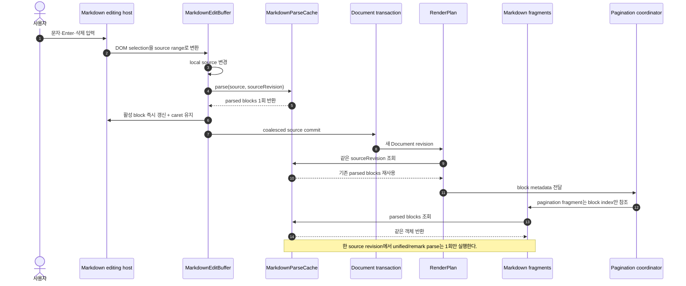

### Markdown parse cache key

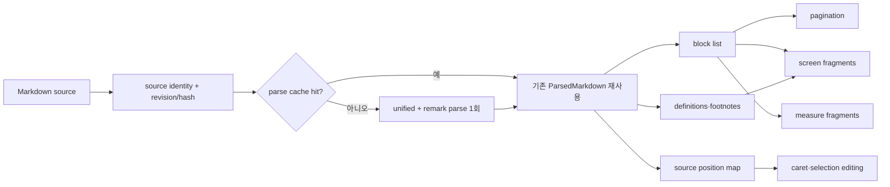

`ParsedMarkdown`은 최소한 다음 파생 데이터를 한 번에 소유한다.

- MDAST root
- block 목록과 block ID
- source 시작·종료 offset
- 추가 빈 줄 정보
- definition과 footnote index
- pagination에 필요한 `keepWithNext` 판단용 block metadata
- editing selection 복원에 필요한 source map

## Document 상태와 selector 경계

최상위 `DocumentData` identity 변경을 모든 UI가 직접 구독하지 않는다. Store는 변경된 key와 revision을 기록하고 각 consumer는 필요한 slice만 구독한다.

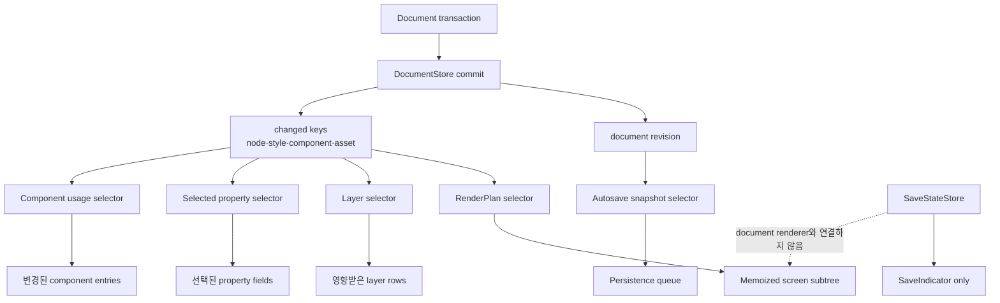

### renderer component 경계

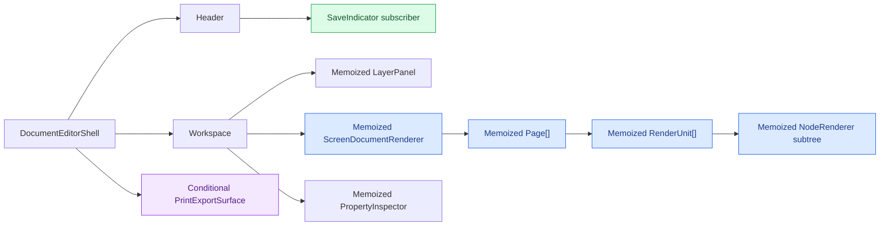

`SaveIndicator`가 `saving`에서 `saved`로 바뀌어도 `ScreenDocumentRenderer` props와 element identity가 유지되어야 한다. 상위 shell이 render되더라도 memo boundary 아래 document subtree는 실행하지 않는다.

## 목표 페이지네이션 계산 순서

페이지네이션은 단일 coordinator가 소유하며 document revision마다 측정 요청을 병합한다.

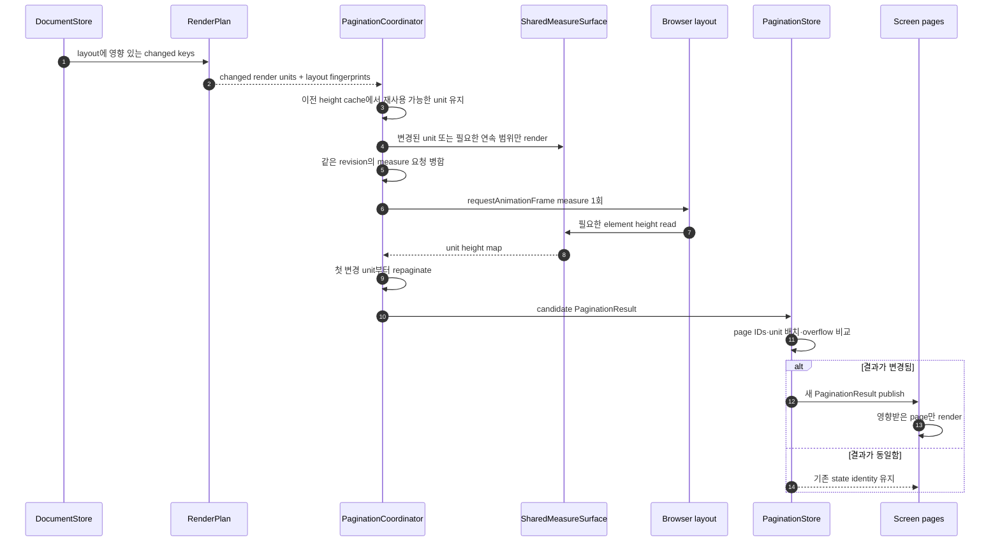

### 측정 요청 병합

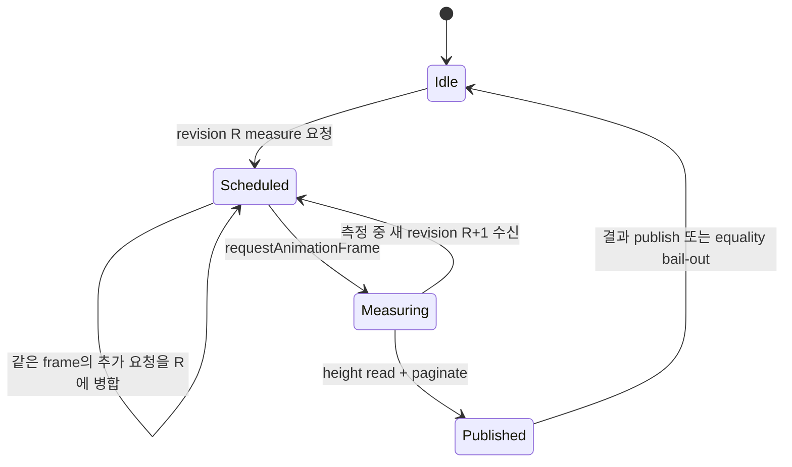

측정 정책:

- `document.fonts.ready`는 editor 생명주기에서 한 번만 기다리고 매 revision마다 새 measure를 예약하지 않는다.
- `ResizeObserver` callback과 document revision callback은 같은 scheduler를 사용한다.
- 이미 예약된 animation frame이 있으면 추가 frame을 만들지 않는다.
- width, font, style, content fingerprint가 같은 unit의 height는 재사용한다.
- unit height가 달라졌다면 해당 unit이 포함된 page부터 뒤쪽만 다시 배치한다.
- 기존 `PaginationResult`와 새 결과가 구조적으로 같으면 state를 유지한다.

## 목표 자동 저장 순서

자동 저장은 현재 650ms trailing debounce 의미를 유지하되, save state와 document renderer 상태를 분리한다.

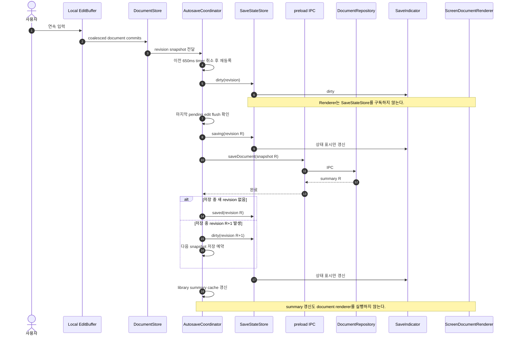

### 저장 불변 조건

- 동시에 둘 이상의 document 파일 쓰기를 실행하지 않는다.
- 저장 요청에는 mutable ref가 아니라 확정된 revision snapshot을 전달한다.
- 저장 완료 summary가 더 최신 revision의 `dirty` 상태를 `saved`로 덮어쓰지 않는다.
- PDF, 문서 닫기, library 이동 전에는 local edit와 autosave를 모두 flush한다.
- 파일 쓰기 실패는 `SaveIndicator`와 retry action에만 반영하고 편집 DOM을 재생성하지 않는다.

## PDF 내보내기 목표 순서

`print`는 상시 renderer mode가 아니라 export job이 소유하는 일시적인 output surface가 된다.

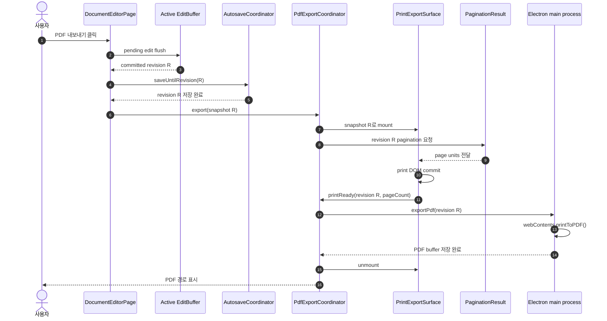

### print readiness 계약

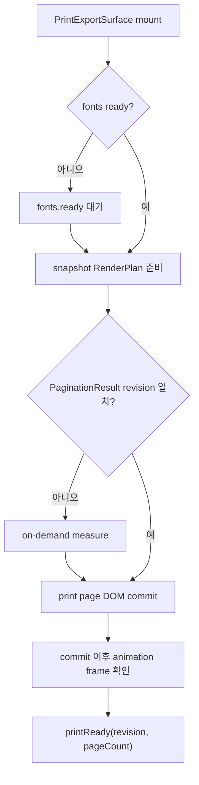

`afterNextPaint()`를 두 번 호출하는 암묵적인 준비 방식은 제거한다. Export coordinator는 다음 값이 일치해야만 `printToPDF`를 호출한다.

- 요청한 document revision
- print surface가 보고한 revision
- pagination result revision
- render 완료된 page count
- font readiness

PDF 생성이 성공하거나 실패하면 `finally`에서 print surface를 반드시 unmount한다.

## Current에서 To-Be로 바뀌는 계산

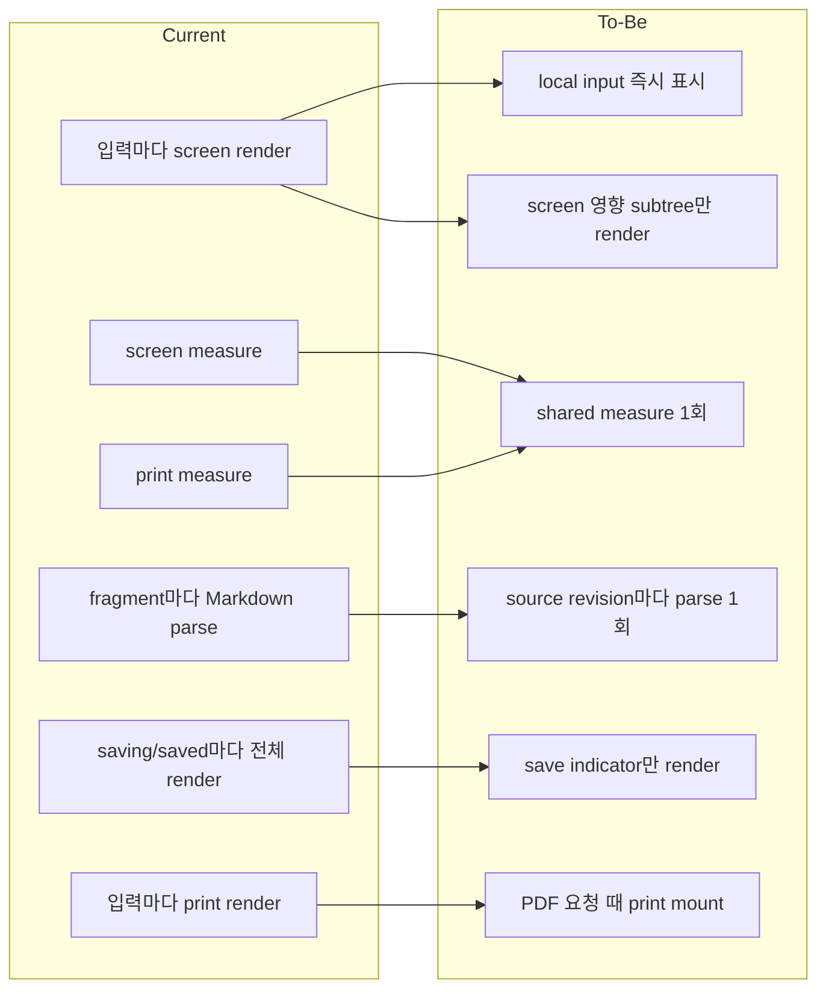

| Current | To-Be | 제거되는 작업 |
|---|---|---|
| 편집 중 print renderer 상시 mount | PDF 요청 중에만 mount | 일반 입력 시 print visible·measure render 전체 |
| screen과 print가 각각 pagination 측정 | screen 결과 공유, 다를 때만 on-demand print 측정 | 같은 document의 중복 높이 측정 |
| fragment마다 전체 Markdown source 파싱 | source revision별 `ParsedMarkdown` 공유 | 동일 AST 재생성과 GC |
| `preventDefault` 후 전체 document commit을 기다려 표시 | local edit buffer에서 먼저 표시 | 입력 표시가 전체 renderer 시간에 종속되는 문제 |
| save state가 page 최상단을 갱신 | 별도 `SaveStateStore`와 indicator subscriber | `saving`, `saved` 시 document subtree 실행 |
| 모든 panel이 전체 `DocumentData` 구독 | changed-key selector 구독 | 선택과 무관한 row·field render |
| 측정 요청마다 새 animation frame | revision-aware scheduler로 병합 | initial/font/resize 중복 measure |
| `setPages` 항상 실행 | pagination equality bail-out | 결과가 같은 page stack render |

## 목표 모듈 책임 지도

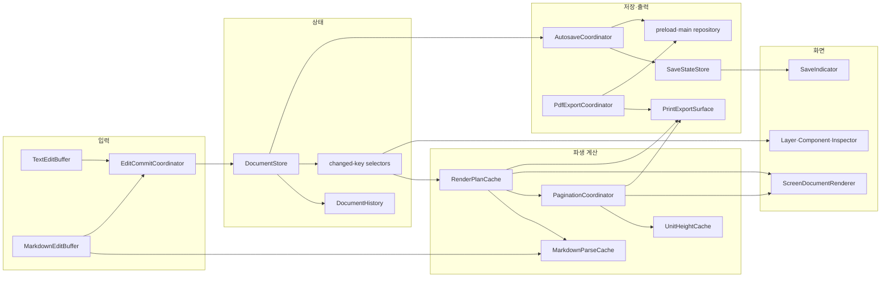

이 이름들은 반드시 새 파일 하나씩을 만들라는 의미가 아니다. 중요한 것은 책임과 구독 경계를 코드에서 분리하는 것이다. 기존 모듈을 확장해도 해당 경계와 불변 조건을 지키면 된다.

## 단계별 변경 순서

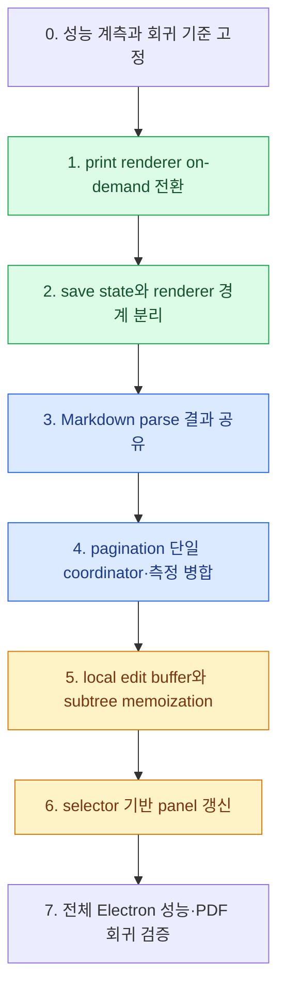

### 0. 계측 고정

- 실제 이력서 fixture로 입력, 요소 추가, 저장, PDF 시간을 측정한다.
- `MarkdownParseCache` miss 횟수, renderer commit 횟수, pagination measure 횟수를 기록한다.
- React commit과 browser long task 기준을 자동화한다.

### 1. print renderer on-demand

- 일반 editor JSX에서 상시 `.document-print-surface`를 제거한다.
- `exportDocument` snapshot이 있을 때만 `PrintExportSurface`를 mount한다.
- `printReady(revision)` 후 `printToPDF`를 호출하고 완료 후 unmount한다.
- PDF의 페이지 수, 줄바꿈, decoration, continuation border를 기존 결과와 비교한다.

### 2. save state 격리

- `SaveIndicator`가 save state를 직접 구독하게 한다.
- document renderer props가 save lifecycle 동안 동일 identity를 유지하도록 한다.
- library summary updater를 stable callback으로 만들고 editor subtree와 분리한다.

### 3. Markdown parse 공유

- `parseMarkdownBlocks(source)` 결과를 source revision 기준으로 캐시한다.
- pagination, editable renderer, read-only renderer가 같은 `ParsedMarkdown`을 받는다.
- cache invalidation은 변경된 Markdown source에만 적용한다.

### 4. 페이지네이션 단일화

- screen과 print의 pagination 소유권을 하나로 합친다.
- font, resize, revision callback을 scheduler 하나로 모은다.
- 동일한 page 배치에는 state update를 생략한다.
- 이후 unit fingerprint와 부분 높이 재측정을 적용한다.

### 5. 입력 fast path

- 활성 text·rich-text·Markdown에 local buffer를 도입한다.
- IME composition, paste, Enter, 삭제, inline format과 caret을 회귀 테스트한다.
- Document commit과 Undo history를 coalescing한다.
- 무거운 파생 계산은 입력 DOM commit 이후 우선순위로 실행한다.

### 6. panel selector와 memoization

- 레이어 row는 자신의 node, selection, collapse, drag 상태만 구독한다.
- Inspector는 선택된 target과 연결된 style·prop만 구독한다.
- component 사용 횟수는 component/repeater 관련 변경 때만 다시 계산한다.

### 7. Electron 검증

- production build에서 실제 한국어 입력을 측정한다.
- 요소 추가·삭제·복제·숨김·drag reorder를 측정한다.
- 자동 저장 중 입력이 끊기지 않는지 확인한다.
- PDF 직전 pending edit flush와 snapshot revision 일치를 확인한다.
- screen과 PDF의 페이지 수 및 시각 결과를 스크린샷으로 비교한다.

## 회귀 방지 테스트 계약

| 영역 | 필수 검증 |
|---|---|
| text·rich-text | 문자 입력, 삭제, 줄바꿈, paste, caret, selection format |
| 한국어 IME | composition 중 DOM 보존, compositionend 이후 값·caret 일치 |
| Markdown | block shortcut, 인용문, 목록, 빈 줄, link, inline format, source map |
| component | instance prop 직접 편집과 definition 격리 |
| repeater | item별 prop 편집과 selection identity 유지 |
| history | 연속 입력 Undo/Redo, 구조 transaction과 입력 transaction 순서 |
| pagination | keepTogether, keepWithNext, forced break, continuation style |
| save | debounce, in-flight 변경, 실패 retry, 최신 revision 보존 |
| PDF | pending edit flush, font readiness, page count, print surface cleanup |
| UI | selection outline과 action UI가 measure·PDF에 포함되지 않음 |

## 완료 조건

- [ ] 일반 편집 상태에서 `PrintExportSurface`가 DOM에 존재하지 않는다.
- [ ] PDF 내보내기 중에만 print surface가 mount되고 완료 후 제거된다.
- [ ] PDF가 요청한 document revision과 print-ready revision이 일치한다.
- [ ] 동일 Markdown source revision의 실제 parse 횟수가 1회다.
- [ ] save state 변경만으로 screen renderer commit이 발생하지 않는다.
- [ ] 입력 중 screen과 print의 독립 pagination 계산이 동시에 실행되지 않는다.
- [ ] 동일 pagination 결과에는 page state update가 발생하지 않는다.
- [ ] 일반 입력 표시가 50ms 이내이며 50ms 이상의 long task가 없다.
- [ ] 요소 추가·삭제·복제 결과가 100ms 이내에 표시된다.
- [ ] 한국어 IME, caret, 직접 Markdown 편집과 Undo/Redo가 유지된다.
- [ ] screen과 PDF의 페이지 수·줄바꿈·스타일이 일치한다.
- [ ] typecheck, 전체 테스트, production build와 Electron 실제 동작 검증이 통과한다.

## 이 문서에서 확정하는 결정

1. `print`는 상시 renderer mode가 아니라 PDF export job이 소유하는 on-demand output surface로 변경한다.
2. 평상시 편집의 페이지네이션 측정 소유자는 하나만 둔다.
3. 활성 입력은 전체 document render보다 먼저 local buffer에서 표시한다.
4. Markdown parsing 결과는 pagination과 renderer가 source revision 단위로 공유한다.
5. 저장 상태와 library summary 갱신은 document renderer render 경계 밖에서 처리한다.
6. 페이지네이션은 revision-aware scheduler와 equality bail-out을 사용한다.
7. 성능 개선은 출력 정확도, IME, caret, Undo/Redo를 희생하지 않는다.
