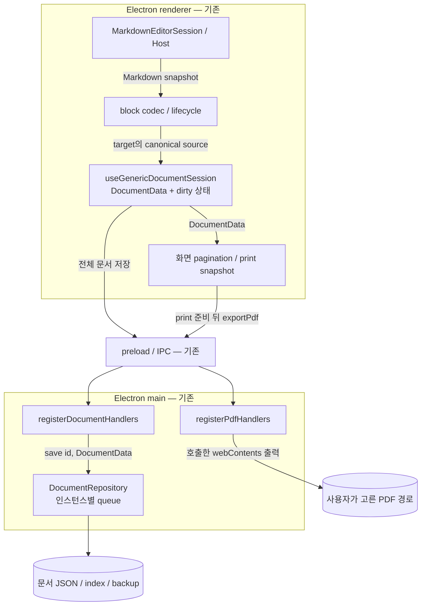
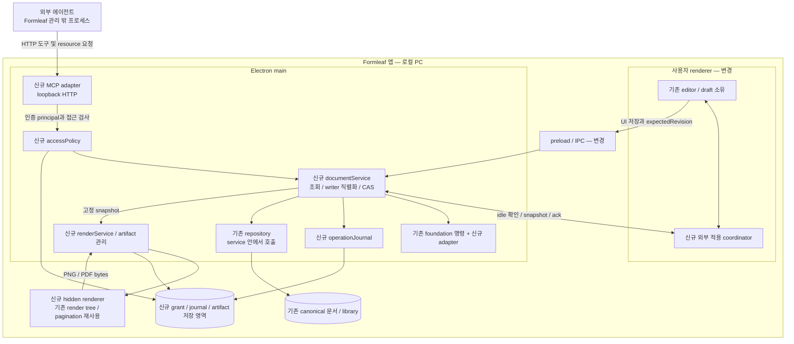
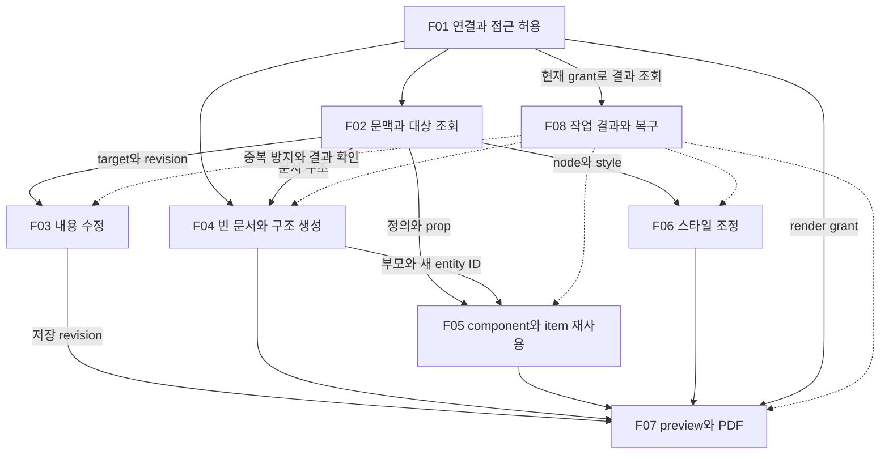
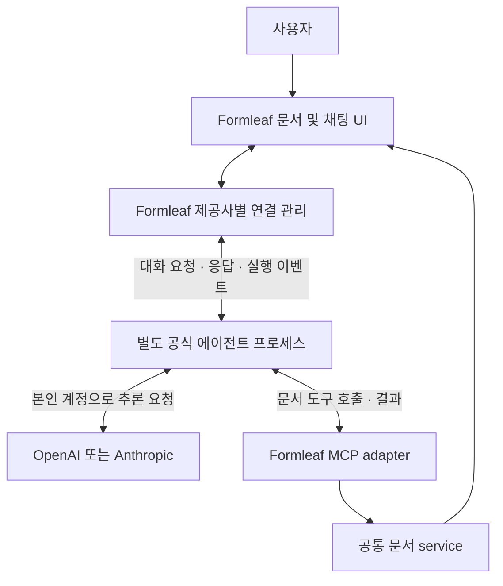

# 에이전트 도구와 MCP 기술 설계

2026-11-02 · 상태: **To-Be 구현 기준안, 제품 구현 미착수** · As-Is 확인: `main@6821494`의 소스.

이 문서는 현재 동작, 변경할 구조, 상태 소유권, 기능 관계와 선택 이유를 설명한다. 호출 순서는 [실행 흐름](runtime-flows.md), 정확한 schema는 [도구 계약](tool-contracts.md), 전환 순서와 검증은 [계획](plan.md)이 기준이다. 양식의 출처·필수 항목은 [문서 세트 양식](../../.codex/skills/resume-studio-task-workflow/references/documentation.md)에 기록한다.

## 1. 설계 목표와 경계

**목표:** 기존 문서 작성 기능을 외부 에이전트에 제공하면서 UI와 에이전트가 같은 저장·검증 경로를 사용한다. 현재 편집기의 DOM/IME 소유권을 유지하고, 허용된 저장 snapshot을 읽어 명시한 대상만 바꾸며 결과를 확인할 수 있어야 한다.

**비목표:** 모델 추론·AI 계정 로그인·내부 채팅·외부 shell sandbox·다중 사용자 실시간 협업은 이번 설계에 포함하지 않는다. MCP는 접속 경로이며 외부 프로세스 전체의 OS 권한 경계가 아니다.

도식의 **기존/변경/신규** 표시는 현재 코드와의 차이다. To-Be 도식의 화살표는 구현할 계약이며 실제 존재하는 연결을 뜻하지 않는다. 일반 Mermaid로 C4의 프로세스·저장소 경계 관점을 표현하며 정식 C4 표기 전체를 적용하지는 않는다.

## 2. As-Is — 현재 제품의 구조와 근거

### 2.1 현재 구조



에이전트와 MCP 서버는 이 As-Is 경로에 없다. 10번에서 활성 Markdown block은 이미 editor가 단독 소유한다. 이번 작업의 문제는 그 기반 위에 외부 writer를 안전하게 연결하는 것이다.

### 2.2 확인한 코드와 한계

| 근거 ID | 확인한 코드·symbol | 현재 동작 | 11번에서 필요한 변화 |
|---|---|---|---|
| A01 | [EditableMarkdownValue](../../client/src/renderer/src/pages/document-editor/rendering/EditableMarkdownValue.tsx), activate/onSnapshot | 클릭 block만 host로 전환, codec 결과를 full source에 반영 | 외부 변경이 active host를 건드리지 않도록 유지 |
| A02 | [markdownEditorLifecycle](../../client/src/renderer/src/pages/document-editor/markdown/editor/markdownEditorLifecycle.ts), reconcileMarkdownDocumentUpdate | 발행값 acknowledgement와 외부 source를 구분·보류 | 저장 CAS와 외부 적용 IPC는 별도 필요 |
| A03 | [useGenericDocumentSession](../../client/src/renderer/src/pages/document-editor/useGenericDocumentSession.ts), updateDocument/saveNow | local revisionRef, dirty, 650ms 자동 저장; 전체 DocumentData 전송 | 저장 revision·충돌 응답·외부 snapshot 동기화 추가 |
| A04 | [preload](../../client/src/preload/index.ts), [registerDocumentHandlers](../../client/src/main/registerDocumentHandlers.ts) | saveDocument(id, document)를 repository.save로 위임 | 공통 service와 expectedRevision을 거치게 변경 |
| A05 | [DocumentRepository](../../client/src/main/document/documentRepository.ts), save/operationQueue와 [atomicJsonStore](../../client/src/main/document/atomicJsonStore.ts) | 인스턴스 queue, 파일별 임시 파일→rename, 문서와 index 별도 저장 | 여러 호출의 CAS, journal, 다중 파일 실패 복구 추가 |
| A06 | [GenericDocumentEditorPage](../../client/src/renderer/src/pages/document-editor/GenericDocumentEditorPage.tsx), exportPdf와 [registerPdfHandlers](../../client/src/main/registerPdfHandlers.ts) | 편집 종료·저장→print 준비→저장 대화상자→호출 창 printToPDF | MCP 출력은 저장 snapshot의 별도 hidden renderer로 분리 |
| A07 | [documentEditing](../../client/src/foundation/documentEditing.ts), [documentComponentOperations](../../client/src/foundation/documentComponentOperations.ts), [documentTransactions](../../client/src/foundation/documentTransactions.ts) | 세 target 유형·구조·prop·style 순수 변경 함수 제공 | typed command adapter·접근 검사·공유 style 분리 추가 |

이는 소스 확인 결과다. 이번 문서 작업에서 앱을 실행해 제품 동작을 검증한 것은 아니다. repository queue가 있다는 사실만으로 별도 프로세스의 직접 파일 쓰기까지 직렬화된다고 판단하지 않는다.

## 3. As-Is → To-Be 변화 요약

| 영역 | As-Is | To-Be | 유지할 것 / 전환 위험 |
|---|---|---|---|
| 호출자 | 앱 UI | UI + 여러 외부 MCP client | UI의 기존 저장 동작을 먼저 새 경로로 옮겨야 함 |
| 저장 진입점 | IPC에서 repository 직접 호출 | UI IPC/MCP adapter → documentService | 우회 저장 경로가 남으면 CAS 무효 |
| 변경 identity | DocumentEditTarget + 화면 local revision | 같은 target + 저장 revision + requestId | block/DOM ID를 문서 target으로 확대하지 않음 |
| 상태 소유 | renderer draft와 repository 저장본 | draft는 renderer, 저장본·직렬화·journal은 main | UI 저장에 MCP busy 규칙을 그대로 적용하면 자기 저장이 막힘 |
| 외부 적용 | Markdown source 보류 기반만 있음 | idle 적용 handshake, CAS 저장, snapshot acknowledgement | handshake 직후 입력 시작 경쟁을 해결해야 함 |
| 출력 | 현재 창을 print 준비 후 출력 | MCP는 immutable 저장 snapshot의 hidden renderer | 기존 수동 PDF UX를 곧바로 제거하지 않음 |
| 장애 추적 | 저장 성공/오류 UI | request journal + persisted/uiSynced 구분 | JSON 파일별 atomic write가 전체 transaction은 아님 |
| 저장 형식 | schemaVersion 4, Markdown 문자열 | 동일한 canonical 문서 + 별도 grant/journal/artifact | 11번 때문에 본문을 editor JSON으로 migration하지 않음 |

정상 저장과 출력의 전후 차이는 [AS01/AS02 및 TB02/TB04 시퀀스](runtime-flows.md)에서 이어서 읽는다.

## 4. To-Be — 프로세스와 컴포넌트 책임

### 4.1 변경 후 구조 — 제안



HTTP와 IPC는 서로 다른 신뢰 진입점이다. UI IPC는 앱의 신뢰된 sender를 확인하고, MCP는 token으로 식별한 principal의 grant를 매 작업에 적용한다. public 입력으로 `trusted=true` 같은 권한 우회 값을 받지 않는다. 외부 agent의 별도 shell→파일 경로는 이 그림의 관리 범위 밖이다.

### 4.2 책임과 상태 소유권

| 컴포넌트 | 소유·책임 | 입력 → 출력 | 직접 하지 않을 일 |
|---|---|---|---|
| Editor/session — 기존 | DOM·IME·caret·undo·미저장 draft | 사용자 transaction → canonical 변경 | HTTP·파일 저장·외부 AI 지시 실행 |
| External apply coordinator — 신규 | renderer의 편집 generation·짧은 적용 구간·ack | prepare/apply/release → busy/ready/ack | 강제 blur·composition 종료 |
| MCP adapter/accessPolicy — 신규 | protocol·token principal·최신 grant 검사 | 도구/resource 요청 → service context | 저장소 직접 쓰기, 입력에서 grant 수락 |
| documentService — 신규 | 저장본 조회·권한·문서 직렬화·CAS·batch 검증 | typed command 또는 UI snapshot → revision/결과 | editor DOM 수정, 모델 추론 |
| foundation — 재사용 | 문서 모델의 순수 변경과 검증 | 사본 + 명령 → 새 사본 | 인증·파일 I/O |
| repository — 재사용 | canonical·index·library 파일 접근 | service의 저장/조회 → 저장값 | 독립 MCP writer로 재생성 |
| journal — 신규 | 요청 중복·결과·저장 경계 복구 기록 | credentialId/requestId/hash → 상태/기존 결과 | 대화 기록·사용자 undo |
| renderService/worker — 신규·재사용 | 고정 snapshot의 출력과 준비 신호 | snapshot/revision → PNG 또는 PDF | 활성 편집 창을 print 작업으로 전환 |
| artifact 관리 — 신규 | 파일 소유 연결·권한·만료·용량 | PDF bytes → 제한된 resource URI | 임의 host 경로 쓰기·사용자 파일 정리 |

coordinator 등 신규 이름은 내부 책임을 나타내며 확정된 public API나 구현 파일 이름이 아니다. plan 2단계에서 handshake의 구체적인 IPC와 실패 정책을 시험해 확정한다.

## 5. 데이터가 이동하고 보관되는 방식

| 데이터 | 생성·현재 기준 | 이동 경로 | 영속 여부와 불변 조건 |
|---|---|---|---|
| DocumentData / Markdown | 저장본은 repository, draft는 renderer | editor→UI save→service→repository; 조회는 역방향 DTO | 문서 영속. 조합 중 draft를 저장본 조회에 섞지 않음 |
| DocumentEditTarget | 앱의 문서 모델 | target 조회→agent→명령→foundation | 명령 안의 참조. anchorRenderId·페이지 위치는 외부 identity 아님 |
| saved revision | main의 canonical 직렬화 hash | read→agent expectedRevision→service CAS→새 revision | 본문 schema에 별도 필드를 강제 추가하지 않음; 계산 규칙은 일관되어야 함 |
| renderer generation / apply token | renderer coordinator | prepare→ready→commit/abort→release | 임시 상태. 저장 revision과 다른 목적; 재시작 때 신뢰하지 않음 |
| credential / grant | 사용자 연결 설정 | 보호 저장→accessPolicy→service context | 영속. token 원문을 로그·journal·일반 응답에 복제하지 않음 |
| request journal | 부작용 있는 요청의 service | input hash·staged snapshot 참조→commit 기록→get_operation | 영속. requestId는 credential 범위; 불명 결과를 자동 재실행하지 않음 |
| render snapshot | 요청 수락 때 저장본 복사 | service→renderService→hidden renderer | job 수명 동안 고정. 문서 편집으로 내용을 교체하지 않음 |
| PDF artifact | 출력 완료 bytes | worker→관리 디렉터리→resource/UI 저장 | 한시 영속. 문서/backup 및 사용자 별도 저장 PDF와 분리 |

library import는 읽은 library revision과 문서 revision을 함께 검사하고 ID를 재매핑해 복사한다. 이후 library 수정이 기존 문서에 자동 전파되지 않는다. 한 문서 batch의 원자성, 생성 문서/index/grant의 복구, PDF job의 완료 시점은 서로 다른 저장 경계다.

**UI 저장과 MCP 변경의 차이:** UI는 자신이 편집한 draft를 저장하므로 dirty라는 이유만으로 거절하지 않는다. UI도 expectedRevision은 검사하며, stale 저장은 draft를 보존한 채 충돌로 처리한다. MCP 변경은 대상 문서의 active/dirty/saving/draft를 먼저 검사해 거절한다. 두 요청은 같은 저장 직렬화 경로를 사용한다.

## 6. 기능 사이의 관계

아래 화살표는 기능 수행에 필요한 정보·공통 기반을 뜻한다. 모든 요청이 왼쪽부터 순차 실행되어야 한다는 의미는 아니다.



- F01은 전체 요청의 권한 전제다. F04의 새 문서 생성은 기존 문서 선택 없이 create 권한으로 시작할 수 있다.
- F03–F06은 같은 documentService와 T07을 공유하며 각각 별도 저장 엔진을 만들지 않는다.
- F05에서 만든 item의 텍스트는 F03으로 수정할 수 있다. 공유 정의 내부 변경 권한이 생기는 것은 아니다.
- F07은 수정 없이 기존 저장본만 출력할 수도 있다. F08은 마지막 순서의 기능이 아니라 모든 부작용 요청을 지원하는 공통 기반이다.

| 사용자 기능 | 내부 흐름 | 핵심 결정 | 계획 단계 |
|---|---|---|---|
| F01–F02 | TB01 발견·조회, TB05 권한 확인 | D01/D02/D05 | 3 |
| F03/F06 | TB02 변경·충돌·ack | D03/D04/D05 | 2, 4-1, 4-3 |
| F04/F05 | TB03 생성·import·후속 ID | D04/D07 | 4-1/2/4/5 |
| F07 | AS02와 TB04 출력 경로 비교 | D06 | 5 |
| F08 | TB05 재연결·복구 | D07 | 2, 3, 5 |

시퀀스 ID는 [runtime-flows.md](runtime-flows.md)에서 정의한다. 사용자 인수 조건은 features/에 유지하고 실행 순서만 이 문서 세트로 연결한다.

## 주요 결정 기록

아래 D01–D07은 현재 구현 기준안의 선택을 추적하는 ID다. 모두 구현 전이며 실제 검증을 통과한 결론으로 표현하지 않는다. 사용자 기능은 [F01–F08](README.md)의 여정·인수 조건에서 확인하고, 정확한 schema·수치 제한은 [도구 계약](tool-contracts.md)을 따른다.

### D01. 실행 중인 앱에 로컬 HTTP로 연결

**선택과 이유:** Electron main이 저장소와 앱 편집 상태를 소유하고 MCP adapter를 함께 실행한다. 같은 저장 경로와 활성 편집 정보를 사용하면서 여러 외부 클라이언트를 연결할 수 있다. 관련 기능은 F01과 모든 작업의 실행 기반이다.

**대안과 비용:** stdio bridge는 클라이언트가 프로세스를 시작하기 쉽지만 앱까지 이어지는 IPC와 bridge 배포가 추가된다. 독립 background service는 앱 없이 실행할 수 있지만 저장소 소유권·UI·출력 worker 연결을 옮겨야 한다. 선택안은 별도 bridge를 줄이는 대신 Formleaf가 켜져 있어야 하며 endpoint·로컬 인증·포트 충돌을 관리해야 한다.

**검증과 재검토:** 두 외부 클라이언트 동시 연결, 앱 종료·재실행, 포트 충돌을 시험한다. 앱을 열지 않은 자동 작업이 제품 요구가 되면 독립 service를 검토한다. 별도 writer가 같은 저장 파일을 직접 여는 방식으로 확장하지 않는다.

### D02. 연결별 문서 목록과 capability로 접근 제한

**선택과 이유:** 기본 허용 목록을 비워 두고 사용자가 앱 UI에서 문서와 쓰기·생성·library·render 권한을 설정한다. 각 연결을 독립 폐기할 수 있고 도구·resource·artifact·결과 조회에 같은 정책을 적용한다. F01이 사용자 설정을 담당한다.

**대안과 비용:** workspace 전체 token은 편하지만 새 문서도 의도치 않게 공개될 수 있다. 매 쓰기 승인 방식은 검토 기회를 주지만 여러 단계 작성에서 승인이 반복된다. 선택안은 요청별 승인 없이 진행할 수 있는 대신 사용자가 문서 목록을 관리해야 하고, 이미 완료된 변경은 권한 폐기로 취소되지 않는다. libraryRead는 개인 라이브러리 전체 조회이므로 문서별 grant와 같은 세밀함을 제공하지 않는다.

**검증과 재검토:** 허용·비허용 문서를 섞은 fixture로 모든 결과 경로와 실행 전 권한 철회를 확인한다. 라이브러리에도 항목별 공개가 필요하거나 설정 단계에서 사용자가 범위를 이해하지 못하면 grant UI와 세분화를 재검토한다. MCP 밖 OS 권한 제한은 별도 실행 환경 과제다.

### D03. 활성 편집 중 쓰기 거절과 저장 revision 비교

**선택과 이유:** dirty·saving·active editor·component draft에서는 DOCUMENT_BUSY를 반환한다. idle 확인 후 expectedRevision을 검사하고 UI와 MCP가 공통 service에서 저장한다. F03–F06의 변경은 사용자 IME와 미저장 입력을 강제로 종료하지 않는다.

**대안과 비용:** 자동 대기는 클릭이나 장시간 편집 뒤 뜻밖의 시점에 변경을 적용할 수 있다. 자동 merge는 같은 prop·Markdown source의 충돌 의미를 추가 설계해야 한다. 강제 flush는 10번 editor ownership을 침범한다. 선택안은 결과를 예측하기 쉽지만 잠시 입력하지 않더라도 editor가 활성화되어 있으면 거절될 수 있고, 사용자가 편집을 마친 뒤 에이전트가 다시 읽고 요청해야 한다.

**검증과 재검토:** composition 중 rerender/publish, idle 확인 직후 사용자 입력, stale UI 자동 저장을 시험한다. 일반적인 작업이 busy에 과도하게 막힌다는 실제 사용 증거가 생기면 충돌 정책과 사용자에게 보이는 적용 시점을 먼저 설계한 뒤 대기/merge를 검토한다.

### D04. 명시적인 변경 명령을 한 문서 batch로 저장

**선택과 이유:** 18개 typed operation을 apply_operations로 묶고 사본에 모두 적용·검증한 뒤 한 snapshot을 저장한다. UI와 같은 foundation 기능을 사용하며 F03–F06의 작업을 조합할 수 있다. 새로운 entity ID는 응답 후 다음 요청에서 사용한다.

**대안과 비용:** 전체 JSON 덮어쓰기는 유연하지만 관계·asset·동시 편집을 넓게 손상할 수 있다. 명령별 개별 tool은 단순한 입력을 제공하지만 함께 성공해야 할 변경의 저장 단위를 추가해야 한다. 선택안은 큰 union schema와 batch 오류 설명을 관리해야 하고, 생성→참조는 여러 호출이 필요하다. 그 여정 전체의 rollback은 보장하지 않는다.

**검증과 재검토:** 중간 명령 실패 무변경, graph cycle·잘못된 참조 거절, 생성 ID로 후속 요청, dryRun 무부작용을 확인한다. 실제 agent가 명령 선택에 반복 실패하거나 호출 횟수가 병목이면 domain service는 유지하면서 도구 분리 또는 임시 ID 계약을 재검토한다.

### D05. 저장 모델과 DocumentEditTarget으로 대상 지정

**선택과 이유:** F02는 outline→target 목록→값의 단계적 조회를 제공한다. F03은 node·instance prop·item prop의 명시적 target과 canonical 값을 사용한다. Markdown은 전체 문자열을 직접 set/replace하고 구조적 codec 왕복을 하지 않는다.

**대안과 비용:** DOM selector와 페이지 fragment는 화면에서 찾기 쉽지만 pagination과 rerender에 따라 변하고 저장 identity와 다르다. 전체 canonical만 주면 호출은 줄지만 큰 문서의 입력량과 shared definition 오해가 늘 수 있다. editor JSON만 받으면 현재 codec이 지원하지 않는 문법을 보존하기 어렵다. 선택안은 읽기 호출이 늘고 자연어 대상 해석은 외부 에이전트가 해야 한다. 명시적 전체 교체로 새 문자열을 전달하면 원래 내용도 교체된다는 점은 유지한다.

**검증과 재검토:** 같은 label의 item 구별, 클릭 후 target 고정, 세 유형 값, unsupported Markdown의 비수정 영역 보존을 확인한다. 본문 검색이나 구조적 Markdown 편집이 필요해지면 검색·source range·문법 보존 계약을 별도로 설계한다.

### D06. 저장 snapshot을 숨겨진 renderer에서 출력

**선택과 이유:** F07은 수락한 revision을 고정하고 사용자의 편집 화면과 분리해 preview/PDF를 만든다. artifact는 앱 관리 영역에 저장하고 현재 권한으로 읽으며 사용자는 앱에서 장기 보관할 파일을 따로 저장한다.

**대안과 비용:** 활성 화면 캡처는 최신 초안에 가깝지만 선택·포커스·출력 준비가 얽힌다. 에이전트 지정 경로 저장은 후속 shell 작업에 편하지만 임의 파일 쓰기 경계를 넓힌다. 선택안은 renderer 비용, 글꼴·asset 준비, artifact 용량과 만료 관리가 필요하다. 미저장 입력과 출력이 다를 수 있으므로 저장본임을 알려야 한다.

**검증과 재검토:** 출력 중 문서 수정, 조합 유지, PDF 의미·레이아웃, 만료 정리의 사용자 파일 불변을 확인한다. 초안 공유나 장기 출력 이력이 요구되면 snapshot 식별·보관 정책을 먼저 확장한다.

### D07. 영속 request journal로 재시도와 결과 확인

**선택과 이유:** F08은 credential의 영속 ID + requestId + 정규화 입력으로 부작용 있는 작업을 식별한다. 같은 요청은 기존 결과를 돌려주고 저장 여부가 불명확하면 복구 필요로 표시한다. 저장 완료와 UI acknowledgement는 별개로 기록한다.

**대안과 비용:** 세션 메모리만 쓰면 재시작 뒤 중복 방지가 사라진다. 연결 실패를 미저장으로 보고 재실행하면 문서·항목·PDF가 중복될 수 있다. 선택안은 journal·staged snapshot·문서 index·grant 사이의 실패 복구를 설계해야 한다. v1에서 journal 자동 삭제를 하지 않아 기록이 증가하며, requestId를 잃은 에이전트의 작업 의도까지 추정하지 않는다.

**검증과 재검토:** 저장 경계별 강제 중단, 재시작 후 조회, 같은 ID의 다른 입력, UI 동기화 실패를 시험한다. 저장 비용이 실제 문제가 되면 오래된 요청의 재사용을 어떻게 거절할지 포함해 보관 정책을 정한다. 사용자 undo나 제공사 대화 복원으로 journal의 역할을 확대하지 않는다.

## 결정 근거: 공통 도구 연결로 MCP 사용

2026-11-01 논의 결과, MCP 채택 근거는 외부 Codex·Claude Code 지원과 향후 내부 에이전트의 도구 연결 재사용이다. MCP가 없으면 앱 조작이 불가능하거나, MCP가 OS 권한을 자동으로 제한하기 때문에 선택한 것이 아니다.

### 요구와 선택의 관계

| 요구 | MCP의 기여 | Formleaf가 별도로 구현할 부분 |
|---|---|---|
| 외부 Codex·Claude Code 지원 | 이미 지원되는 공통 도구 연결 규격 | 접속 설정·실제 양쪽 클라이언트 검증 |
| 기능 발견과 사용법 전달 | 도구 목록·설명·입력 schema 제공 | 설명의 정확성, 예시와 기능 범위 |
| 구조화된 호출과 결과 | 공통 요청·응답 형식 | 입력·권한·revision 검사, 오류 의미 |
| 향후 내부 채팅에서 문서 조작 | 같은 MCP 도구 재사용 | 제공사별 로그인·대화·실행 adapter |

Codex와 Claude Code는 MCP 연결을 지원한다. 도구 발견·설명·입력·결과 계약은 MCP tools 규격을 따른다. [Codex MCP](https://developers.openai.com/codex/mcp), [Claude Code MCP](https://code.claude.com/docs/en/mcp), [MCP tools](https://modelcontextprotocol.io/specification/2025-11-25/server/tools)

### 검토한 대안과 적용 조건

| 대안 | 가능한 구성 | 현재 작업에서의 판단 |
|---|---|---|
| CLI + 사용 지침 | 에이전트가 shell에서 명령을 실행하고 JSON 결과를 읽음 | 기술적으로 가능하지만 사용자는 CLI 제공을 목표로 하지 않으며 이번 범위에서 제외 |
| runtime의 직접 tool 인터페이스 | Formleaf가 도구 호출을 받아 처리 | 특정 runtime의 내부 채팅만 지원할 때 적합; 외부 양쪽 클라이언트 공통 연결 요구가 약해지면 재검토 가능 |
| MCP adapter | 여러 클라이언트가 같은 도구 계약으로 접근 | 현재의 외부·내부 에이전트 지원 목표에 맞는 선택 |

MCP 서버는 사용자 PC에서 실행할 수 있고 인터넷 서버 운영이 필수는 아니다. 프로세스 분리와 MCP 채택도 별개다. 별도 프로세스의 에이전트와 직접 tool 인터페이스로 통신할 수도 있다.

### 책임과 통제 범위

| 계층 | 책임 |
|---|---|
| MCP adapter | 도구 공개, 프로토콜 입력 검증, 접속 인증과 호출 전달 |
| Formleaf 문서 service | 허용 문서·속성 확인, 업무 규칙, revision, 변경·저장 |
| 제공사별 agent adapter — 다음 작업 | 공식 로그인 흐름, 프로세스 실행, 대화·이벤트·중단 |
| 에이전트 실행 환경 — 다음 작업 | shell·파일·네트워크 등 별도 실행 경로의 권한 제한 |
| Formleaf 대화 관리 — 다음 작업 | 문서별 대화 목록과 provider session 연결·재개 |

- MCP의 설명·schema는 권한 강제 장치가 아니다. 실제 요청 처리가 서버와 service에서 허용 범위를 검사해야 한다.
- MCP는 외부 에이전트의 별도 shell·파일 권한을 제거하지 않는다. 도구 사용 지침만으로 직접 파일 접근을 막는다고 설명하지 않는다.
- 프로세스를 별도로 실행해도 자동으로 격리되지는 않는다. 내부 에이전트의 제한은 선택한 runtime과 OS에서 실제 강제되는지 후속 작업에서 검증한다.
- 문서 조작 service는 UI와 MCP가 공유한다. 제공사별 구현에 검증·저장 로직을 복제하지 않는다.

## 코드 배치 제안

```text
client/src/foundation/
  documentCommands.ts          # 직렬화 가능한 operation / result / error 계약
  documentCommandSchemas.ts   # runtime 입력 검증
client/src/main/application/
  documentService.ts          # UI와 MCP의 공통 변경·저장 경로
  documentRevision.ts         # snapshot revision
  operationJournal.ts         # requestId / 결과 / 장애 복구
  renderService.ts            # snapshot preview / PDF job
client/src/main/mcp/
  server.ts                   # MCP lifecycle / transport / 인증
  tools.ts                    # 도구 등록과 service 연결
  resources.ts                # schema / document / artifact 읽기
client/src/renderer/
  ...                         # external change handshake, print worker 화면
```

기존 foundation의 transaction 함수와 repository는 재사용한다. 먼저 IPC handler의 service 위임과 UI 저장 revision 계약을 완성한 뒤 MCP tool을 붙인다. 이 단계에서 root package 분리나 monorepo 전환은 필요하지 않다.

## 구현 위험과 남은 설계 확인

| ID | 위험·미결정 사항 | 구현 전에 확인할 것 | 완료 판단 / 관련 단계 |
|---|---|---|---|
| O01 | SDK 버전·structured output·image/resource 차이 | stable SDK 고정, 두 client의 계약 fixture | 이름·오류·결과 형식이 계약과 일치 / 1, 6 |
| O02 | 문서·index·grant·journal 사이 중단 | 각 영속 경계 fault injection과 재시작 재조정 | 중복·부분 저장 방지 또는 명시적 recovery_required / 2 |
| O03 | idle 응답 직후 사용자 입력 시작 | renderer 적용 구간과 generation 검증, timeout·창 종료·입력 보존 | 단순 idle boolean으로 완료 처리하지 않음. 데이터 유실·IME 종료·무한 잠금 없이 TB02 충족 / 2 |
| O04 | token 로컬 저장과 연결 UX | 기존 설정·OS credential 저장 방식, 문서별 허용·폐기 시나리오 | token 노출 없이 범위·폐기를 확인 / 3 |
| O05 | 출력 worker가 font/image/pagination 준비 전에 응답 | 준비 handshake·timeout·플랫폼별 글꼴 fixture | 고정 revision의 의미·페이지와 오류 구분 / 5 |
| O06 | writer 또는 grant 변경이 공통 경로 우회 | 모든 저장 IPC·문서 관리·library 변경 진입점 검색 | 허용 범위·CAS·복구를 깨는 독립 writer 없음 / 2–4 |
| O07 | 큰 문서·연속 render job의 메모리 비용 | 기존 payload/artifact 한도 내 최악 fixture, worker 동시성 검토 | 한도 초과 명시적 실패·정리 후 editor 정상. 처리량 수치는 측정 후 결정 / 5–6 |

O03의 잠금 수명·이벤트 보존 방식과 O02의 복구 완료 지점은 아직 구현으로 입증되지 않았다. 도식은 충족할 계약을 보여주며, 이 과제의 검증을 대신하지 않는다. 실패하면 MCP 쓰기를 활성화하지 않고 UI 저장 경로부터 수정한다.

전환·롤백 범위와 단계별 gate는 [plan.md](plan.md)를 따른다. MCP를 끄는 것으로 이미 저장된 사용자 변경을 되돌리거나 journal을 지우지 않는다.

## 외부 구현 조사 반영

[Obsidian MCP 분석](../../references/obsidian-mcp/README.md)의 컨텍스트·도구 설명·앱 API 재사용 구조를 참고한다. blacklist의 출력 경로 누락, 단순 read-modify-write, idempotent hint와 실제 동작 불일치를 피하도록 문서별 grant·공통 service·journal을 설계했다. 이 참고 자료를 제품 기능 구현 완료의 근거로 사용하지 않는다.

## 후속 구조와의 연결 — 이번 구현 범위 밖

### 사용자 계정과 실행 방식

제품 목표는 사용자가 본인의 AI 구독 계정으로 공식 실행 도구에 인증하고, Formleaf가 문서 UI와 작업 도구를 제공하는 것이다. Formleaf가 모델 사용량을 대신 제공하는 구조를 전제로 하지 않는다. 계정 연결은 비밀번호나 다른 앱의 cookie·credential을 추출하는 방식으로 구현하지 않는다.

사용자는 Formleaf 안에서 작업하고, 실행상으로는 Formleaf가 별도 에이전트 프로세스를 시작·관리하는 구성을 권장한다. 이 두 설명은 동시에 성립하며 사용자가 터미널을 직접 열 필요는 없다. 로그인 절차·설치/배포·사용 한도는 제공사 조건에 따라 별도 검증한다.



두 통신을 분리한다.

1. **Formleaf ↔ 에이전트:** 메시지·응답 스트리밍·대화 재개·중단·연결 상태를 제공사 인터페이스로 처리한다.
2. **에이전트 ↔ Formleaf 도구:** 문서 조회·변경·preview·PDF 요청을 이번 MCP로 처리한다.

Codex App Server는 자식 프로세스와 stdio 통신, thread 재개를 제공한다. Claude Code는 programmatic 실행과 JSON/streaming 출력, session ID를 통한 재개를 제공한다. 두 제품의 제어 프로토콜을 동일하다고 가정하지 않는다. [Codex App Server](https://developers.openai.com/codex/app-server), [Claude Code programmatic 실행](https://code.claude.com/docs/en/headless)

MCP 자체에는 모델 API key가 필요하지 않다. 에이전트의 추론은 제공사 서버에서 이루어지고, 구독 인증의 사용 가능 범위는 별도다. Claude 원본 실행 도구의 제품 제공 조건과 Agent SDK의 구독 로그인 조건을 혼동하지 않는다. 기존 [계정 연결 조사](../backlog/formleaf-mcp.md)는 당시 기록으로 유지하고 후속 구현 시 공식 문서와 실제 지원을 다시 확인한다.

### 대화 저장·재개

후속 UX에 문서별 AI 대화 목록·저장·재개를 포함하는 방향으로 검토한다. 이번 MCP의 저장소나 API에 대화 관리 기능을 미리 구현하지 않는다.

- Formleaf 대화 ID, documentId, 제공사, provider의 thread/session ID, 실행 환경 식별, 제목과 표시용 기록을 연결한다.
- 세션 재개에는 해당 runtime의 저장 기록이 필요하다. session ID만 저장하면 다른 PC나 삭제된 실행 환경에서도 복구된다고 보장하지 않는다.
- 재개 후 현재 문서와 revision을 다시 읽는다. 과거 대화의 내용으로 현재 문서를 덮어쓰지 않는다.
- 대화 기록을 불러오는 것과 과거 도구 호출을 재실행하는 것은 다르다. 재개 시 이미 완료한 변경을 자동 반복하지 않는다.
- 세션이 없거나 읽을 수 없으면 상태를 표시한다. 필요한 문맥으로 새 세션을 만드는 것은 원래 세션 재개와 구분한다.
- 다른 제공사로 전환할 때 기존 세션 ID를 그대로 재사용하지 않는다.
- Formleaf에서 생성한 대화를 기본 관리 대상으로 한다. 외부 Codex·Claude Code 세션 가져오기는 접근 가능한 환경과 도구 권한을 확인하는 별도 범위다.
- 구독 로그인만으로 ChatGPT·Claude 웹 대화 전체를 가져올 수 있다고 약속하지 않는다. OpenAI는 plan 사용 권한이 기존 ChatGPT 대화 접근을 부여하지 않는다고 명시한다. [공식 안내](https://developers.openai.com/siwc/token-sharing-open-source)

### 다음 작업에 전달할 UX 원칙

- 요소 클릭은 대상 지정이고, 채팅 전송 또는 AI action이 작업 시작이다.
- 요청 시 documentId·DocumentEditTarget·revision을 고정한다. 응답 대기 중 다른 요소를 클릭해도 이미 보낸 요청 대상은 바꾸지 않는다.
- 사용자의 조합·편집 lifecycle을 유지하며 AI 쓰기가 강제로 blur·composition 종료를 일으키지 않게 한다.
- 로그인·대화·세션 lifecycle과 MCP 도구 lifecycle을 분리한다. 에이전트 연결이 끊겨도 문서 저장 상태를 별도로 확인할 수 있어야 한다.

## 구현 결정 보강 — 2026-11-03

O01: SDK 1.32.2/Zod 4.6.7을 정확 버전으로 고정하고 실제 SDK client/server의 JSON·image·resource 전달 fixture를 통과했다.

O02/O06: `DocumentService`를 모든 제품 저장 IPC의 writer로 삼는다. 별도 staged snapshot과 journal을 먼저 기록하고, canonical/index 저장 이후 완료를 기록한다. 이전/다음 hash로 복구를 판정하며 불명 상태는 문서 writer를 차단한다. UI 쓰기도 같은 journal/CAS를 사용하며 요청 결과가 불명이면 draft를 보존한다. 단일 프로세스 workspace lock을 추가했다. 관리 명령은 열린 문서를 거절하고 기존 repository rollback을 재사용한다.

O03: 기존 focus/IME/dirty/saving/component draft가 없을 때 renderer가 동기적으로 root를 inert로 예약하고 acquire에 응답한다. 짧은 적용 구간 동안 “에이전트 변경 적용 중” 상태를 표시한다. apply는 lease와 busy를 재검사한 뒤 React snapshot을 flushSync하고 ack한다. 예약 중 발생한 프로그램적 draft 갱신은 보존하고 apply를 거절한다. timeout/오류는 release하며 저장 후 ack 실패는 persisted=true/uiSynced=false다. 활성 편집기를 flush하거나 selection을 복원하는 경로는 추가하지 않는다.

이 결정의 증거와 남은 검증은 [handoff](handoff.md)와 [plan](plan.md)에 기록한다. operation adapter와 실제 MCP 권한 적용까지 완료한 상태는 아니다.
