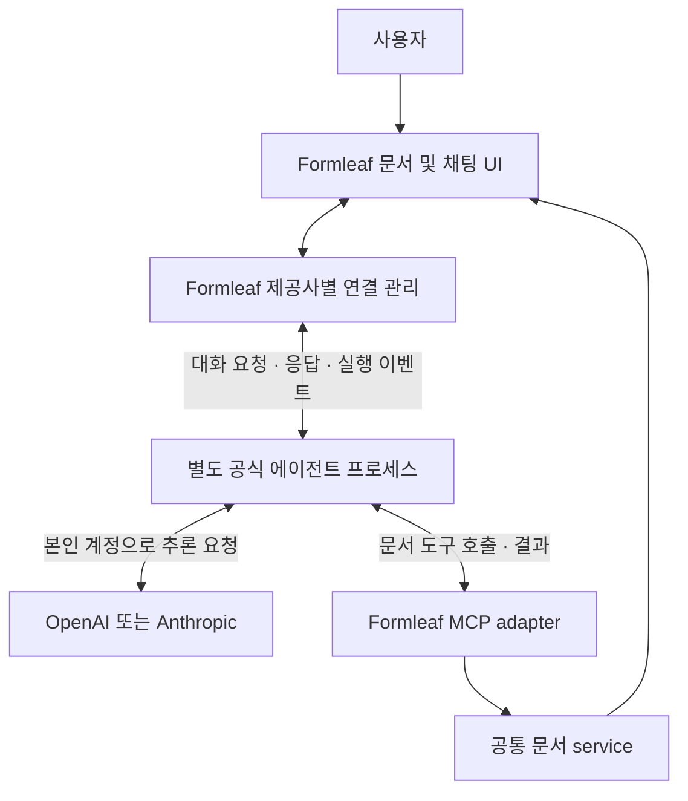

# 에이전트 도구와 로컬 MCP 전체 기획

**기능의 목표·사용자·범위·성공 기준을 이 문서에서 관리한다.**

- 제품 구현은 완료되었으며, 최초 인수 기준과 실제 통과 범위는 구분한다.
- [작업 안내](README.md) · [기술 요약](../implementation/architecture.md) · [실제 검증](../handoff.md).

## 1. 해결할 문제·사용자·목표

**사용자는 AI에게 문서 내용을 다듬고 구성을 바꿔 달라고 요청하고 싶다.**

- 파일 위치·JSON 모델·내부 편집 DOM까지 직접 설명해야 한다면 문서 도구를 사용하는 이점이 줄어든다.
- 에이전트가 파일을 직접 수정하면 앱의 저장·편집 상태와 충돌할 수도 있다.

**Formleaf는 현재 기능을 조회·변경·검증·출력하는 도구로 제공한다.**

- 에이전트는 문서와 편집 대상을 발견하고 명시한 범위의 변경을 요청한다.
- Formleaf는 권한, 모델, revision, 활성 편집 상태를 검사해 저장하고 결과를 돌려준다.
- 문장을 생성하는 모델과 대화 UX는 외부 에이전트가 제공한다.

**최초 목표로 정의한 완료 모습은 “허용한 이력서의 경력 문장을 고치고 항목을 추가한 뒤 페이지를 확인하고 PDF를 얻는 과정”을 이미 로그인된 외부 Codex와 Claude Code에서 각각 수행하는 것이다.**

- 앱 내부 AI 로그인·채팅은 다음 작업이다.

### 사용자와 역할

| 대상 | 하고 싶은 일 | 이번 제품이 제공하는 것 |
|---|---|---|
| 개인 문서 작성자 — 주 사용자 | 자신의 에이전트에 문서 작업을 맡기고 결과 확인 | 연결·허용 문서·작업 권한 설정, 변경된 문서와 출력 결과 |
| 외부 에이전트 — 도구 호출자 | 문서 모델을 파악하고 정확한 대상에 작업 | 설명·schema·안정적인 ID·현재 값·revision·명시적 오류 |
| Formleaf — 작업 실행 주체 | 기존 편집·저장·출력의 일관성 유지 | 공통 service에서 검증·저장·권한 강제 |

**첫 사용자는 본인 PC에 Formleaf와 외부 에이전트를 설치하고 그 에이전트에 로그인한 개인이다.**

- 조직 협업·원격 서버·제공사 계정 연결을 이번 전제로 확장하지 않는다.
- 이는 사용자 인터뷰로 확인한 사실이 아니라 현재 제품 범위의 가정이다.

### 성공 기준과 검증 방법

| 목표 | 완료 판단 | 증거를 얻을 방법 |
|---|---|---|
| 설명만으로 도구 사용 가능 | 두 외부 클라이언트가 UJ-01–08을 수행하며 저장 파일 수동 편집 불필요 | fixture 시나리오별 호출·결과 기록 |
| 의도한 대상만 변경 | node/instance/item을 구별하고 다른 값과 공유 정의 보존 | 변경 전후 canonical snapshot 비교 |
| 기존 사용자 작업 보호 | composition·selection·자동 저장 경쟁에서 덮어쓰기 없음 | hidden Electron과 충돌·장애 주입 시험 |
| 끝까지 문서 작성 가능 | 빈 문서/기존 문서 모두 수정→재열기→preview→PDF까지 수행 | 통합 시나리오와 PDF 내용·레이아웃 확인 |
| 허용 범위 유지 | 비허용 문서·artifact와 폐기 credential의 접근 거절 | 목록·직접 조회·resource·job의 부정 경로 검사 |

**수치형 사용성 목표를 뒷받침할 현재 측정값은 없다.**

- 연결 단계 수·작업 완료 시간·오류 후 재시도는 첫 검증에서 기록하되 임의의 개선율을 약속하지 않는다.
- 인수 조건별 자동 검증 근거와 아직 확인하지 않은 외부 클라이언트·플랫폼 조건은 [handoff](../handoff.md)에 기록한다.

## 2. 기능 목록과 상세

**기능은 사용자가 완료할 작업으로 나눈다.**

- 도구 하나가 곧 기능 하나인 것은 아니다.
- 현재 문서 모델로 표현할 수 있고, 대상·영향이 명확하며 앱의 검증·저장 경로로 수행할 수 있는 작업을 포함한다.

**P0는 저장 안전성과 최소 사용 흐름의 기반, P1은 작성·출력 흐름을 완성하는 기능이다. P0와 P1 모두 이번 11번의 구현 범위다.**

- 번호는 문서 탐색 순서이며 실제 구현 순서는 plan의 의존성을 따른다.

| ID / 여정 | 사용자 요청과 종료 상태 | 우선순위 | 관련 도구 | 상세 정의 |
|---|---|---|---|---|
| F01 / UJ-01 | “이 이력서만 수정하게 허용해줘” → 연결 범위를 알고 폐기 가능 | P0 | 모든 호출의 권한, T01 | [연결과 접근 허용](01-connect-and-authorize.md) / [구현](../implementation/01-connect-and-authorize.md) |
| F02 / UJ-02 | “경력 설명이 어디 있는지 찾아줘” → 값·대상·저장 상태 파악 | P0 | T01–T05, T09 | [문맥과 대상 찾기](02-discover-context.md) / [구현](../implementation/02-discover-context.md) |
| F03 / UJ-03 | “이 설명을 짧게 고쳐줘” → 지정 내용만 저장 | P0 | T05, T07, T12 | [내용 수정](03-edit-content.md) / [구현](../implementation/03-edit-content.md) |
| F04 / UJ-04 | “소개와 경력 섹션을 만들어줘” → 문서 구조 생성·배치 | P1 | T03, T06–T07, T12 | [문서 구성](04-compose-document.md) / [구현](../implementation/04-compose-document.md) |
| F05 / UJ-05 | “내 경력 양식을 가져와 항목을 채워줘” → 재사용과 값 입력 | P1 | T03, T07–T09 | [컴포넌트 재사용](05-reuse-components.md) / [구현](../implementation/05-reuse-components.md) |
| F06 / UJ-06 | “이 문단의 크기와 간격을 줄여줘” → 지정 요소 스타일 변경 | P1 | T03, T07, T10 | [스타일 조정](06-adjust-style.md) / [구현](../implementation/06-adjust-style.md) |
| F07 / UJ-07 | “페이지를 확인하고 PDF로 줘” → 저장본 검토와 출력물 접근 | P1 | T10–T12, resource | [미리보기와 PDF](07-preview-and-export.md) / [구현](../implementation/07-preview-and-export.md) |
| F08 / UJ-08 | “끊기기 전 작업이 저장됐는지 확인해줘” → 중복 없이 결과 확인 | P0 | T06–T07, T11–T12 | [작업 결과와 복구](08-recover-operation.md) / [구현](../implementation/08-recover-operation.md) |

## 3. 포함·제외 범위

### 포함

- 외부 에이전트가 문서·편집 대상·컴포넌트를 발견하고 현재 저장값을 조회한다.
- 문서 생성, 내용·구조·개별 요소 스타일, instance/item prop과 라이브러리 복사·재사용을 제공한다.
- preview·PDF 출력과 응답 유실 후 작업 결과 조회를 제공한다.
- 앱에 MCP 활성화·endpoint·연결 이름·token 발급/복사/폐기·문서별 grant 설정을 추가한다.
- 사용자가 쓰기·생성·library·render 권한을 구분하고 외부 클라이언트 설정 예시를 복사할 수 있어야 한다(F01).
- 최근 작업의 이름·상태·문서·revision을 확인하고 출력 PDF를 열거나 따로 저장한다(F07/F08).
- 본문·인증값은 운영 로그에서 제외한다.
- UI와 MCP의 공통 service, 권한·입력·revision·편집 보호·중복 방지·출력 검증을 구현한다.

**구체적인 12개 도구·18개 변경 명령의 목록은 tool-contracts 한 곳에서 관리한다.**

- 앱 UI에 이미 있는 기능이 모두 MCP 범위에 포함되는 것은 아니다.

### 제외와 이유

| 기능 | 제외 이유 |
|---|---|
| AI 로그인·내부 채팅·대화 재개·에이전트 실행·sandbox | 사용자가 다음 작업으로 분리한 범위 |
| 문서 이름 변경·휴지통·영구 삭제·전체 문서 복제 | 1차 작성·수정·출력 흐름의 필수 도구에서 제외 |
| 전체 문서 본문 검색 | 탐색 기능 확대는 후속 |
| 신규 이미지 업로드·외부 URL 가져오기 | 별도 asset 입력·검증 계약 필요 |
| component 정의 편집·prop 노출·library 저장/삭제 | 공유 변경 영향과 library 쓰기 계약을 후속으로 분리 |
| repeater item 숨김·override 초기화 전용 명령 | 이번에는 항목 추가·수정·순서·복제·제거까지만 제공 |
| 공유 스타일 일괄 수정·Markdown 테마 전체 변경 | 단일 요소 스타일 범위로 제한 |
| AI 작업 되돌리기·장기 변경 내역 UI | 이번 request journal은 중복·복구용이며 사용자용 undo가 아님 |
| 강제 문서 열기·선택 변경·caret 이동 | 사용자의 작업 상태를 바꾸는 UI 제어 도구 제외 |
| 앱 종료 상태에서 자동 실행·원격 서버·CLI 배포 | 첫 버전은 실행 중인 로컬 앱에 연결 |

## 4. 공통 동작과 제품 경계

- 실행 중인 로컬 Formleaf에 연결한다.
- MCP는 기본 비활성이며 사용자가 연결별 문서·capability를 허용한다.
- 권한 확대와 token 발급은 앱 UI에서만 가능하다.
- 조회·출력은 마지막 저장본 기준이다.
- 외부 쓰기는 대상 문서가 active/dirty/saving/draft이면 busy로 끝나고 강제 flush하지 않는다.
- UI 자신의 저장과는 구분한다.
- 요청 target은 명시한 documentId와 DocumentEditTarget으로 고정한다.
- Markdown block·DOM·페이지 위치를 별도 문서 identity로 만들지 않는다.
- 같은 문서 batch는 revision을 검사하고 함께 저장한다.
- 여러 호출로 만든 문서 작성 여정 전체를 한 transaction으로 보장하지 않는다.
- Markdown 문자열과 미지원 문법의 UI fallback을 유지한다.
- 외부 에이전트의 별도 OS 파일·shell 접근은 MCP가 제한하지 않는다.
- 저장 완료·UI 반영·작업 결과 불명·artifact 만료를 구분한다.
- 실제 사용자 문서·backup을 변경하며 시험하지 않는다.

**MCP 선택 이유는 외부 Codex·Claude Code 및 향후 내부 에이전트에 같은 도구 설명·호출 계약을 제공하기 위해서다.**

- 기술적으로 필수이거나 OS sandbox여서 선택한 것은 아니다.
- 대안·비용은 [공통 설계](../implementation/architecture.md)에, 정확한 grant·수치·오류는 [도구 계약](../implementation/tool-contracts.md)에 기록한다.

## 5. 완료 판단

**1절의 성공 기준과 기능별 인수 조건을 모두 만족해야 한다.**

- 계획 문서 작성, diagram 렌더, schema 검사, 제품 실행 검증은 서로 다른 완료 상태다.
- 구현 진행 체크리스트와 실제 결과는 각각 plan과 handoff에서 관리한다.

- 사용자가 허용한 문서에 대해 이미 로그인된 외부 Codex·Claude Code 양쪽에서 발견→변경→저장·재열기→preview→PDF를 수행하고, 접근 거절·동시 편집·재시도·기존 제품 회귀까지 검증해야 작업 완료다.

## 용어와 참고

- Fxx: 사용자 기능, UJ-xx: 대표 여정, Fxx-ACxx: 인수 조건.
- Txx: MCP 도구, Operation: apply_operations 안의 변경 명령.
- Axx: 코드 근거, Dxx: 설계 결정, Oxx: 미확인 과제, ASxx/TBxx: 현재/목표 시퀀스.
- revision은 저장 snapshot의 식별값, requestId는 작업 중복 방지 ID다.
- 화면 local revision·대화 session ID와 구분한다.

**[사전 기획·계정 조사](../../backlog/formleaf-mcp.md)와 [Obsidian 분석](../../../references/obsidian-mcp/README.md)은 조사 이력이다.**

- 현재 구현 기준은 이 작업 문서이며, 이전 제품 제약은 [10번 handoff](../../10-markdown-editor-ownership/handoff.md)에서 확인한다.

## 후속 방향 기록 — 2026-11-01 논의, 이번 구현 범위 밖

### 사용자 계정과 실행 방식

**당시 논의한 제품 목표는 사용자가 본인의 AI 구독 계정으로 공식 실행 도구에 인증하고, Formleaf가 문서 UI와 작업 도구를 제공하는 것이다.**

- Formleaf가 모델 사용량을 대신 제공하는 구조를 전제로 하지 않는다.
- 계정 연결은 비밀번호나 다른 앱의 cookie·credential을 추출하는 방식으로 구현하지 않는다.

**사용자는 Formleaf 안에서 작업하고, 실행상으로는 Formleaf가 별도 에이전트 프로세스를 시작·관리하는 구성을 검토했다.**

- 이 두 설명은 동시에 성립하며 사용자가 터미널을 직접 열 필요는 없다.
- 로그인 절차·설치/배포·사용 한도는 제공사 조건에 따라 별도 검증한다.

- 두 통신을 분리한다.

1. **Formleaf ↔ 에이전트:** 메시지·응답 스트리밍·대화 재개·중단·연결 상태를 제공사 인터페이스로 처리한다.
2. **에이전트 ↔ Formleaf 도구:** 문서 조회·변경·preview·PDF 요청을 이번 MCP로 처리한다.

**Codex App Server는 자식 프로세스와 stdio 통신, thread 재개를 제공한다.**

- Claude Code는 programmatic 실행과 JSON/streaming 출력, session ID를 통한 재개를 제공한다.
- 두 제품의 제어 프로토콜을 동일하다고 가정하지 않는다. [Codex App Server](https://developers.openai.com/codex/app-server), [Claude Code programmatic 실행](https://code.claude.com/docs/en/headless)

**MCP 자체에는 모델 API key가 필요하지 않다.**

- 에이전트의 추론은 제공사 서버에서 이루어지고, 구독 인증의 사용 가능 범위는 별도다.
- Claude 원본 실행 도구의 제품 제공 조건과 Agent SDK의 구독 로그인 조건을 혼동하지 않는다.
- 기존 [계정 연결 조사](../../backlog/formleaf-mcp.md)는 당시 기록으로 유지하고 후속 구현 시 공식 문서와 실제 지원을 다시 확인한다.

### 대화 저장·재개

**후속 UX에 문서별 AI 대화 목록·저장·재개를 포함하는 방향으로 검토한다.**

- 이번 MCP의 저장소나 API에 대화 관리 기능을 미리 구현하지 않는다.

- Formleaf 대화 ID, documentId, 제공사, provider의 thread/session ID, 실행 환경 식별, 제목과 표시용 기록을 연결한다.
- 세션 재개에는 해당 runtime의 저장 기록이 필요하다. session ID만 저장하면 다른 PC나 삭제된 실행 환경에서도 복구된다고 보장하지 않는다.
- 재개 후 현재 문서와 revision을 다시 읽는다.
- 과거 대화의 내용으로 현재 문서를 덮어쓰지 않는다.
- 대화 기록을 불러오는 것과 과거 도구 호출을 재실행하는 것은 다르다.
- 재개 시 이미 완료한 변경을 자동 반복하지 않는다.
- 세션이 없거나 읽을 수 없으면 상태를 표시한다.
- 필요한 문맥으로 새 세션을 만드는 것은 원래 세션 재개와 구분한다.
- 다른 제공사로 전환할 때 기존 세션 ID를 그대로 재사용하지 않는다.
- Formleaf에서 생성한 대화를 기본 관리 대상으로 한다.
- 외부 Codex·Claude Code 세션 가져오기는 접근 가능한 환경과 도구 권한을 확인하는 별도 범위다.
- 구독 로그인만으로 ChatGPT·Claude 웹 대화 전체를 가져올 수 있다고 약속하지 않는다.
- OpenAI는 plan 사용 권한이 기존 ChatGPT 대화 접근을 부여하지 않는다고 명시한다. [공식 안내](https://developers.openai.com/siwc/token-sharing-open-source)

### 다음 작업에 전달할 UX 원칙

- 요소 클릭은 대상 지정이고, 채팅 전송 또는 AI action이 작업 시작이다.
- 요청 시 documentId·DocumentEditTarget·revision을 고정한다.
- 응답 대기 중 다른 요소를 클릭해도 이미 보낸 요청 대상은 바꾸지 않는다.
- 사용자의 조합·편집 lifecycle을 유지하며 AI 쓰기가 강제로 blur·composition 종료를 일으키지 않게 한다.
- 로그인·대화·세션 lifecycle과 MCP 도구 lifecycle을 분리한다.
- 에이전트 연결이 끊겨도 문서 저장 상태를 별도로 확인할 수 있어야 한다.
