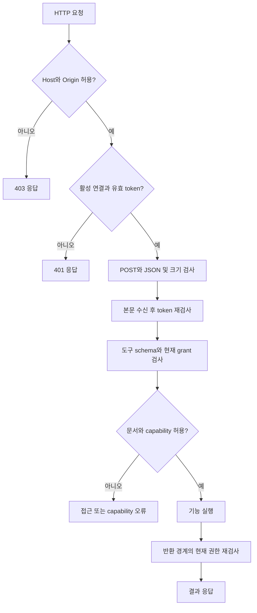
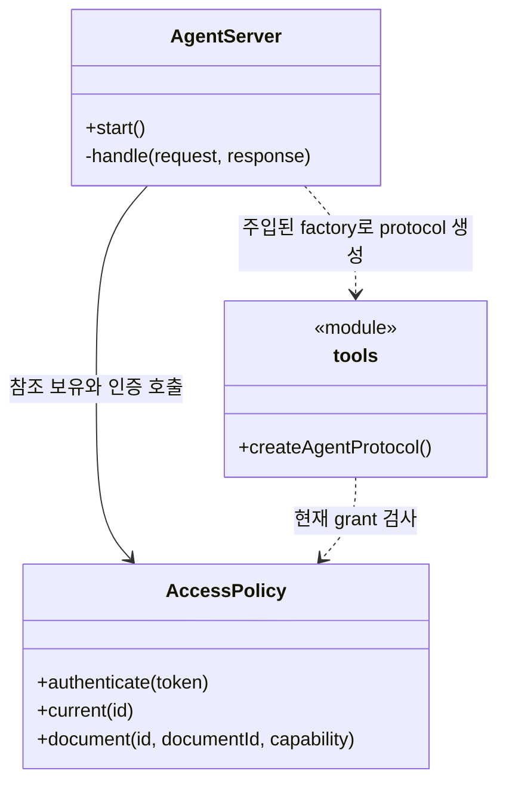
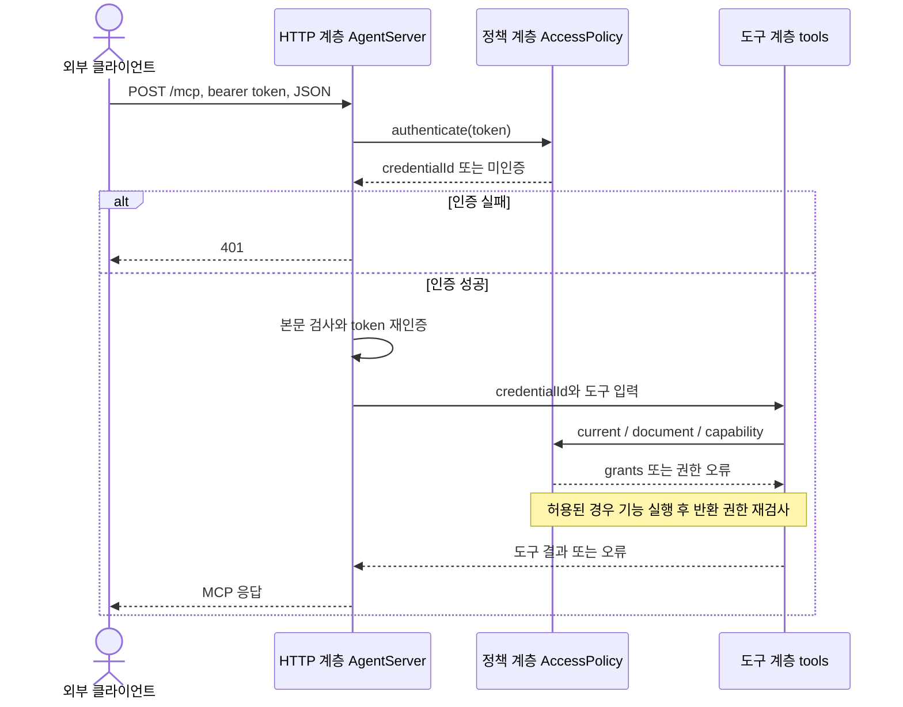

# F01. 연결과 권한 구현 설계

**11번에서 구현한 코드 변경과 목적을 기능별로 설명한다.**

- As-Is: `6821494` · 구현 확인: `531142a` · 문서 개정: 2026-11-08.
- 구현 후 소스와 대조해 정리한 문서이며, 최초 설계 결정과 실행 검증 이력은 별도로 보존한다.
- [기능 기획](../features/01-connect-and-authorize.md) · [설계 요약](README.md) · [계획](../plan.md).

## 1. 구현 목표와 범위

**연결마다 허용 문서와 기능을 분리하고 모든 호출에서 최신 권한을 검사한다.**

- 관련 요구·인수 조건: [F01 기획](../features/01-connect-and-authorize.md).
- 선행 관계: 공통 계약·저장 기반.
- 공통 경계: [실행 흐름](runtime-flows.md)과 [도구 계약](tool-contracts.md).

## 2. As-Is — 11번 구현 전 코드

**11번 이전에는 앱 내부 IPC만 있었고 외부 에이전트용 MCP 인증·문서별 grant 경계가 없었다.**

- 코드 근거: [registerDocumentHandlers()](https://github.com/IceBear9028/form-leaf/blob/6821494/client/src/main/registerDocumentHandlers.ts).
- 근거 종류: 11번 이전 커밋의 소스 확인이며 당시 제품을 새로 실행한 결과는 아니다.
- 변경 필요성: 연결마다 허용 문서와 기능을 분리하고 모든 호출에서 최신 권한을 검사한다.

## 3. As-Is → To-Be — 바뀌는 동작과 코드

| 상황 | As-Is | To-Be | 코드·목적 |
|---|---|---|---|
| 연결과 권한 | 11번 이전에는 앱 내부 IPC만 있었고 외부 에이전트용 MCP 인증·문서별 grant 경계가 없었다. | 연결마다 허용 문서와 기능을 분리하고 모든 호출에서 최신 권한을 검사한다. | [AccessPolicy](https://github.com/IceBear9028/form-leaf/blob/531142a/client/src/main/mcp/accessPolicy.ts) |

## 4. 코드 변경 설계

| 변경 단위 | 구분 | 파일·symbol | 변경 내용과 목적 |
|---|---|---|---|
| AccessPolicy | 신규 | [AccessPolicy](https://github.com/IceBear9028/form-leaf/blob/531142a/client/src/main/mcp/accessPolicy.ts) | token hash·만료·교체·문서 grant를 관리하고 current/document/capability에서 호출 권한을 검사한다. |
| AgentServer | 신규 | [AgentServer](https://github.com/IceBear9028/form-leaf/blob/531142a/client/src/main/mcp/server.ts) | loopback HTTP 요청을 인증하고 서버 활성 상태와 포트 오류를 관리한다. |
| registerAgentHandlers() | 신규 | [registerAgentHandlers()](https://github.com/IceBear9028/form-leaf/blob/531142a/client/src/main/mcp/registerAgentHandlers.ts) | 연결 생성·교체·폐기와 권한 변경을 앱 IPC에 연결한다. |

### 핵심 처리 방식

**인증 수명과 문서 접근 권한을 AccessPolicy에 모은다.**

- 입력: 연결 이름·client 유형·7/30/90일 수명과 documentIds/write/create/libraryRead/render grant.
- 검사: UI가 선택한 grant를 발급 시 함께 저장하며, options 없는 내부 호출만 빈 grant로 시작한다.
- 제약: create 권한은 write가 켜져 있어야 하며 폐기·만료 token은 인증에서 거절한다.
- 처리: create/rotate는 평문 token을 발급 응답에만 넣고 SHA-256 hash와 설정을 저장한다.
- 반환: credentialId·grants·만료 시각·관측된 인증 요청 상태를 반환한다.
- 재사용·호출부 영향: 기존 문서 저장 IPC는 유지하고 외부 진입점에 별도의 접근 정책을 추가한다.

### 코드 흐름과 분기 — 플로우차트

**인증과 문서 grant를 서로 다른 경계에서 검사한다.**

- 기준: To-Be의 구현 확인 `531142a` · 소스 확인 기반 사후 재구성.

- HTTP 형식 오류는 해당 상태 코드로 종료하며, 기능별 저장·출력 부작용은 각 구현 설계에서 다룬다.

### 클래스·함수 관계 — 클래스 다이어그램

**호출 책임과 참조 관계를 실제 symbol로 구분한다.**

- 기준: To-Be의 구현 확인 `531142a` · 소스 확인 기반 사후 재구성.

- `<<module>>`은 일반 함수의 소속 파일이며 실제 클래스가 아니다.
- 점선 화살표는 호출 의존, 실선 화살표는 참조 보유를 나타낸다.

### 입출력과 오류 계약

**호출 계약과 실제 부작용을 함께 확인한다.**

- 호출 경계: T01–T12 공통 권한.
- 권한: 실행 전에는 필요한 capability를 검사하고, 반환 직전에는 연결과 입력 documentId의 읽기 grant를 재검사한다.
- 오류: 미허용 문서는 NOT_FOUND_OR_DENIED, 허용 문서의 작업 권한 부족은 CAPABILITY_DENIED로 반환한다.
- 부작용: 설정 파일과 grant가 변경되며 문서 본문은 수정하지 않는다.
- 재시도: 폐기되거나 만료된 token은 재사용하지 않고 UI에서 연결을 다시 설정한다.
- 정확한 schema와 JSON 예시: [도구 계약](tool-contracts.md).

## 5. 변경 후 실행 흐름과 상태

### 레이어 간 데이터 전달 — 시퀀스 다이어그램

**입력·저장값·응답이 이동하는 레이어 경계를 확인한다.**

- 기준: To-Be의 구현 확인 `531142a` · 소스 확인 기반 사후 재구성.

- token 발급·교체는 앱 IPC의 별도 경로이며 이 그림은 HTTP 도구 호출의 데이터 경계를 보여준다.

| 데이터·상태 | 기준 소유자 | 전달·변경 경로 | 확정·수명 |
|---|---|---|---|
| token hash·grant | AccessPolicy | 앱 IPC → 설정 저장 → 요청 검사 | 설정 저장 후 적용; 평문 token은 재조회하지 않음 |
| 권한 편집 초안 | 연결 설정 UI | 사용자 편집 → 충돌 검사 → 저장 | polling 중 보존; 최신 설정 충돌 시 재검토 |

| 실패·경쟁 상황 | 감지·처리 | 보존 상태 | 복구 |
|---|---|---|---|
| 처리 중 권한 철회 | 실행/반환 시 재검사 | 저장된 결과가 있을 수 있음 | F08로 권한 범위 내 결과 확인 |
| 포트 충돌·token 만료 | 서버 시작/인증 단계에서 거절 | 기존 문서와 설정 보존 | 포트 또는 연결 설정 수정 |

- 공통 sequenceDiagram: [실행 흐름](runtime-flows.md).

## 6. 선택 이유와 대안

| 대안 | 이점 | 비용·위험 | 판단 |
|---|---|---|---|
| 문서별 grant와 capability | 변경 책임과 대상 범위가 명확하다. | 사용자가 연결별 허용 문서를 관리해야 한다. | 선택 |
| workspace 전체 권한 | 호출 또는 구현 경로를 줄일 수 있다. | 이 기능의 권한·상태·대상 경계를 별도 보장해야 한다. | 미선택 |

- 재검토 조건: 실제 사용자 여정에서 현재 제약이 반복적으로 작업을 막으면 별도 범위로 평가한다.

## 7. 구현 순서와 검증 연결

**요구별 검증을 통과하고 해당 기능을 커밋한 뒤 다음 기능으로 진행한다.**

- 구현 순서: 공통 계약·저장 기반 확인 → 변경 단위 구현 → 경계 검증 → 문서 갱신 → 커밋.
- 검증 방법: [agent-access.test.mjs](https://github.com/IceBear9028/form-leaf/blob/531142a/client/test/agent-access.test.mjs) · [agent-connection.spec.ts](https://github.com/IceBear9028/form-leaf/blob/531142a/client/e2e/agent-connection.spec.ts).
- 통과 조건: 허용하지 않은 문서·readonly 쓰기·폐기 token을 거절하고 polling 중 권한 초안을 보존한다.
- 계획과 실제 완료 커밋: [plan](../plan.md).
- 이 절은 검증 설계이며 과거 실행 결과와 이번 미실행 범위는 [handoff](../handoff.md)에 구분한다.
- 호환성: 기존 canonical 문서 모델과 사용자 문서·backup을 유지한다.
- 중단: MCP 비활성화는 신규 접근을 멈추지만 이미 저장된 변경을 되돌리지 않는다.
- 복구: 저장 불명은 F08 정책으로 처리하며 데이터 rollback은 결과 확인 후 별도 판단한다.

## 8. 최초 검토 항목과 확인 범위

**아래 항목은 최초 기획의 확인 과제이며, 실행 결과는 handoff를 따른다.**

**T01 `get_context` 및 모든 tool/resource의 공통 정책. `accessPolicy`, 서버 lifecycle, 연결 설정 UI로 구현한다.**

- 정확한 grant는 [도구 계약](tool-contracts.md)의 권한 절을 따른다.
- 구현 계획 3단계와 연결한다.

**2026-11-04 화면 배치·token 수명은 위 요구로 구체화했다.**

- 보호 저장은 SHA-256 hash와 mode 0600 관리 파일을 유지한다.
- 개인 사용자가 연결 안내와 문서별 권한을 이해하는지는 실제 사용 피드백으로 계속 확인한다.
- 기본 권한을 넓혀서 해결하지 않는다.

**기술 실행 흐름: [실행 시퀀스](runtime-flows.md)의 TB01의 인증·필터링과 TB05의 재조회 권한를 함께 읽는다.**

- 기능 간 의존성은 [설계](architecture.md)의 기능 관계 절을 따른다.
