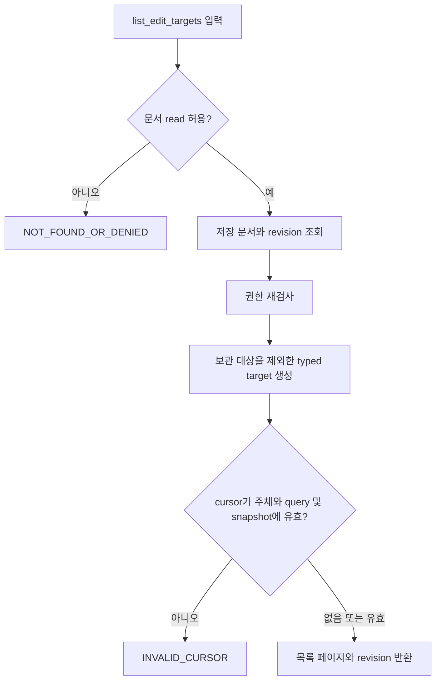
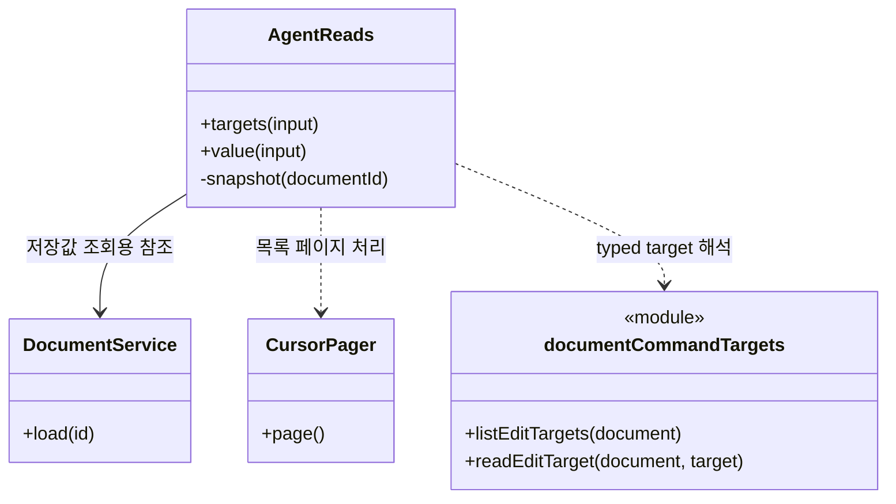
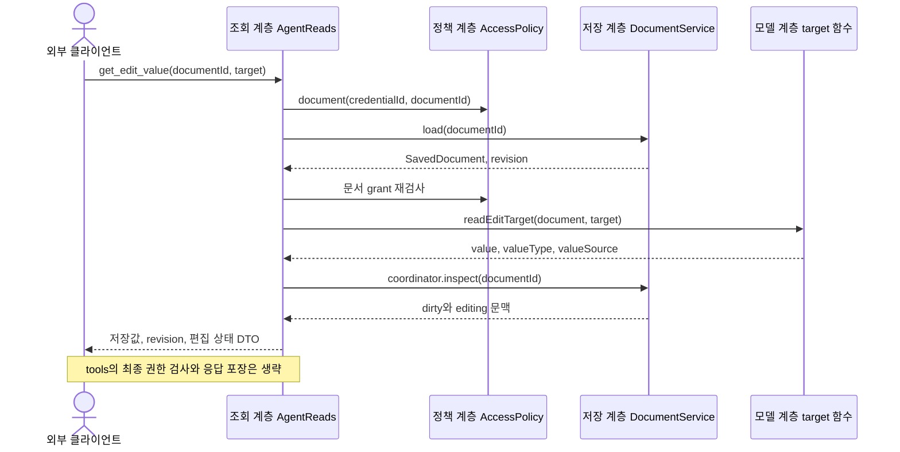

# F02. 문서와 대상 탐색 구현 설계

**11번에서 구현한 코드 변경과 목적을 기능별로 설명한다.**

- As-Is: `6821494` · 구현 확인: `531142a` · 문서 개정: 2026-11-08.
- 구현 후 소스와 대조해 정리한 문서이며, 최초 설계 결정과 실행 검증 이력은 별도로 보존한다.
- [기능 기획](../features/02-discover-context.md) · [설계 요약](README.md) · [계획](../plan.md).

## 1. 구현 목표와 범위

**저장된 문서에서 안정적인 ID와 revision을 반환해 다음 수정 대상을 고정한다.**

- 관련 요구·인수 조건: [F02 기획](../features/02-discover-context.md).
- 선행 관계: F01.
- 공통 경계: [실행 흐름](runtime-flows.md)과 [도구 계약](tool-contracts.md).

## 2. As-Is — 11번 구현 전 코드

**문서 조회와 선택 정보는 앱 내부 문서 목록·편집기 중심이며 외부 클라이언트용 탐색 계약이 없었다.**

- 코드 근거: [DocumentEditTarget](https://github.com/IceBear9028/form-leaf/blob/6821494/client/src/foundation/documentEditing.ts).
- 근거 종류: 11번 이전 커밋의 소스 확인이며 당시 제품을 새로 실행한 결과는 아니다.
- 변경 필요성: 저장된 문서에서 안정적인 ID와 revision을 반환해 다음 수정 대상을 고정한다.

## 3. As-Is → To-Be — 바뀌는 동작과 코드

| 상황 | As-Is | To-Be | 코드·목적 |
|---|---|---|---|
| 문서와 대상 탐색 | 문서 조회와 선택 정보는 앱 내부 문서 목록·편집기 중심이며 외부 클라이언트용 탐색 계약이 없었다. | 저장된 문서에서 안정적인 ID와 revision을 반환해 다음 수정 대상을 고정한다. | [AgentReads](https://github.com/IceBear9028/form-leaf/blob/531142a/client/src/main/mcp/readTools.ts) |

## 4. 코드 변경 설계

| 변경 단위 | 구분 | 파일·symbol | 변경 내용과 목적 |
|---|---|---|---|
| AgentReads | 신규 | [AgentReads](https://github.com/IceBear9028/form-leaf/blob/531142a/client/src/main/mcp/readTools.ts) | 허용 문서·outline·target·저장값·component를 조회하고 dirty 상태와 저장 revision을 구분한다. |
| CursorPager | 신규 | [CursorPager](https://github.com/IceBear9028/form-leaf/blob/531142a/client/src/main/mcp/cursors.ts) | 인증 주체·query·snapshot에 묶인 cursor를 검사하고 오래된 탐색을 거절한다. |
| readEditTarget() | 신규 | [readEditTarget()](https://github.com/IceBear9028/form-leaf/blob/531142a/client/src/foundation/documentCommandTargets.ts) | node·component prop·repeater item prop을 정규화한 target으로 읽는다. |

### 핵심 처리 방식

**단계별 조회로 대상을 좁히고 저장 snapshot에서 값을 읽는다.**

- 입력: documentId·DocumentEditTarget·검색 조건·cursor.
- 검사: 문서 grant와 target 유효성을 검사하고 cursor의 주체·조건·수명을 확인한다.
- 처리: 문서 목록 → outline → target 목록 → 현재 값 순으로 조회한다.
- 반환: 저장값·revision·breadcrumb·기본값/override 출처와 필요한 편집 상태를 반환한다.
- 재사용·호출부 영향: 기존 DocumentEditTarget을 재사용하고 DOM·페이지 조각을 저장 identity로 사용하지 않는다.

### 코드 흐름과 분기 — 플로우차트

**target 목록은 저장 snapshot을 기준으로 만들고 오래된 cursor를 거절한다.**

- 기준: To-Be의 구현 확인 `531142a` · 소스 확인 기반 사후 재구성.

- 대표 로직은 targets 조회이며 value 조회는 동일 snapshot에서 원문과 default/override 출처를 읽는다.

### 클래스·함수 관계 — 클래스 다이어그램

**호출 책임과 참조 관계를 실제 symbol로 구분한다.**

- 기준: To-Be의 구현 확인 `531142a` · 소스 확인 기반 사후 재구성.

- `<<module>>`은 일반 함수의 소속 파일이며 실제 클래스가 아니다.
- 점선 화살표는 호출 의존, 실선 화살표는 참조 보유를 나타낸다.

### 입출력과 오류 계약

**호출 계약과 실제 부작용을 함께 확인한다.**

- 호출 경계: T01–T05·T08·T09.
- 권한: 문서 read 또는 libraryRead이며 이미 문서에 포함된 정의는 문서 grant로 읽는다.
- 오류: INVALID_CURSOR·INVALID_TARGET·NOT_FOUND_OR_DENIED를 구분한다.
- 부작용: 조회는 문서·editor draft를 변경하지 않는다.
- 재시도: cursor가 무효화되면 첫 페이지부터 재조회하고 값과 revision을 다시 읽는다.
- 정확한 schema와 JSON 예시: [도구 계약](tool-contracts.md).

## 5. 변경 후 실행 흐름과 상태

### 레이어 간 데이터 전달 — 시퀀스 다이어그램

**입력·저장값·응답이 이동하는 레이어 경계를 확인한다.**

- 기준: To-Be의 구현 확인 `531142a` · 소스 확인 기반 사후 재구성.

- editor 문맥은 상태 표시용이며 미저장 draft가 저장값 DTO에 합쳐지지 않는다.

| 데이터·상태 | 기준 소유자 | 전달·변경 경로 | 확정·수명 |
|---|---|---|---|
| 저장값·revision | DocumentService/repository | repository → AgentReads → DTO | 조회 시 저장 snapshot |
| 선택·dirty 표시 | 열린 editor | coordinator 조회 → 허용된 context | 참고 문맥이며 쓰기 권한이 아님 |

| 실패·경쟁 상황 | 감지·처리 | 보존 상태 | 복구 |
|---|---|---|---|
| 조회 중 문서 변경 | cursor snapshot 비교 | 원본 문서 불변 | 목록부터 재조회 |
| 같은 제목의 여러 target | ID·breadcrumb으로 구분 | 자동 선택 없음 | 명시적 ID로 현재 값 재확인 |

- 공통 sequenceDiagram: [실행 흐름](runtime-flows.md).

## 6. 선택 이유와 대안

| 대안 | 이점 | 비용·위험 | 판단 |
|---|---|---|---|
| 단계별 typed target 조회 | 변경 책임과 대상 범위가 명확하다. | 호출 수가 늘지만 잘못된 대상 수정과 큰 응답을 줄인다. | 선택 |
| 문서 전체 JSON과 DOM 위치 추정 | 호출 또는 구현 경로를 줄일 수 있다. | 이 기능의 권한·상태·대상 경계를 별도 보장해야 한다. | 미선택 |

- 재검토 조건: 실제 사용자 여정에서 현재 제약이 반복적으로 작업을 막으면 별도 범위로 평가한다.

## 7. 구현 순서와 검증 연결

**요구별 검증을 통과하고 해당 기능을 커밋한 뒤 다음 기능으로 진행한다.**

- 구현 순서: F01 확인 → 변경 단위 구현 → 경계 검증 → 문서 갱신 → 커밋.
- 검증 방법: [agent-reads.test.mjs](https://github.com/IceBear9028/form-leaf/blob/531142a/client/test/agent-reads.test.mjs) · [agent-client-discovery.test.mjs](https://github.com/IceBear9028/form-leaf/blob/531142a/client/test/agent-client-discovery.test.mjs).
- 통과 조건: 동일한 제목도 ID로 구분하고 dirty 문서의 저장값만 반환하며 stale cursor를 거절한다.
- 계획과 실제 완료 커밋: [plan](../plan.md).
- 이 절은 검증 설계이며 과거 실행 결과와 이번 미실행 범위는 [handoff](../handoff.md)에 구분한다.
- 호환성: 기존 canonical 문서 모델과 사용자 문서·backup을 유지한다.
- 중단: MCP 비활성화는 신규 접근을 멈추지만 이미 저장된 변경을 되돌리지 않는다.
- 복구: 저장 불명은 F08 정책으로 처리하며 데이터 rollback은 결과 확인 후 별도 판단한다.

## 8. 최초 검토 항목과 확인 범위

**아래 항목은 최초 기획의 확인 과제이며, 실행 결과는 handoff를 따른다.**

**T01–T05, 필요시 T09의 문서 component 조회.**

- 도구 계약의 DocumentEditTarget과 조회 DTO를 사용한다.
- 계획 3단계에서 구현한다.

**label/breadcrumb의 이해 가능성은 실제 문서 fixture를 사용하는 두 에이전트 검증에서 확인한다. '두 번째 회사'를 에이전트가 항상 올바르게 추론한다는 보장은 하지 않는다.**

- 서버가 강제할 부분은 ID·유형 검증이고, 모호한 자연어 처리 품질은 별도로 기록한다.

**기술 실행 흐름: [실행 시퀀스](runtime-flows.md)의 TB01의 저장 문맥·target 조회를 함께 읽는다.**

- 기능 간 의존성은 [설계](architecture.md)의 기능 관계 절을 따른다.
