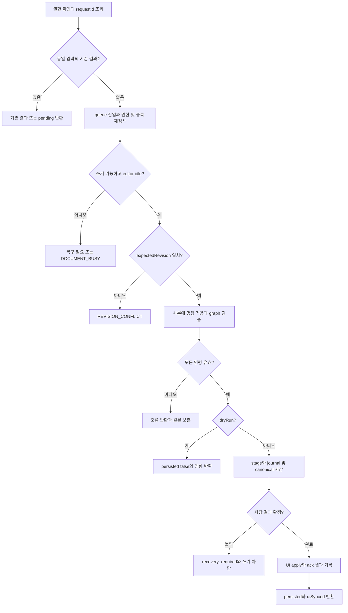
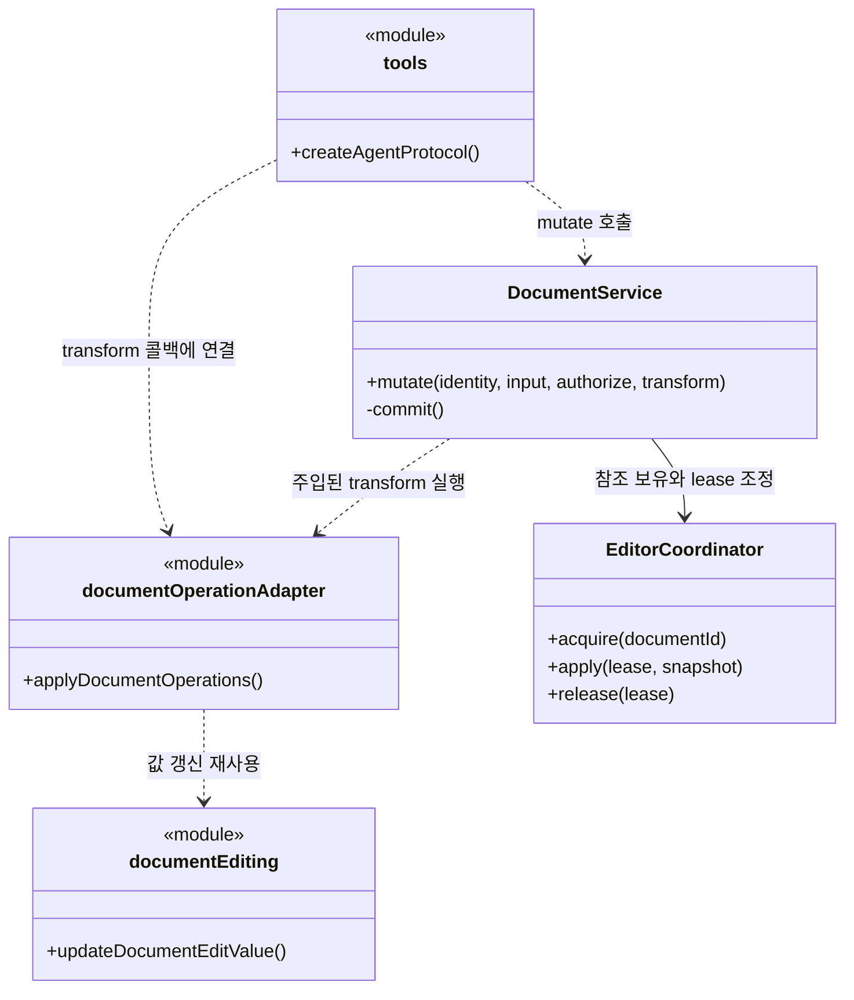
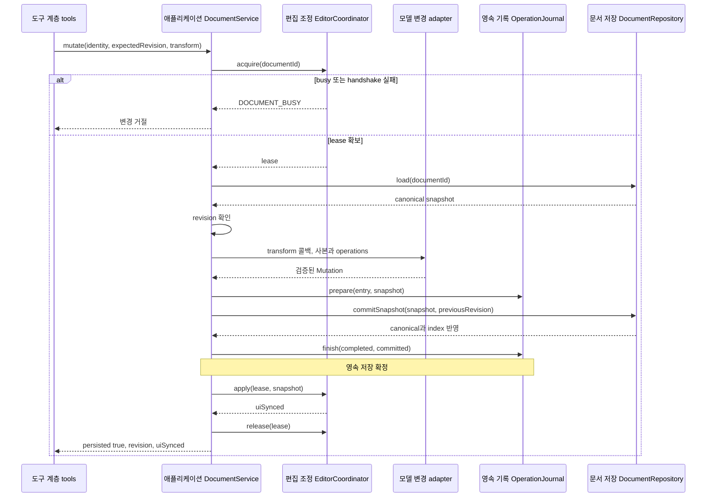

# F03. 기존 내용 수정 구현 설계

**11번에서 구현한 코드 변경과 목적을 기능별로 설명한다.**

- As-Is: `6821494` · 구현 확인: `531142a` · 문서 개정: 2026-11-08.
- 구현 후 소스와 대조해 정리한 문서이며, 최초 설계 결정과 실행 검증 이력은 별도로 보존한다.
- [기능 기획](../features/03-edit-content.md) · [설계 요약](README.md) · [계획](../plan.md).

## 1. 구현 목표와 범위

**지정한 값만 원자적으로 변경하고 사용자의 입력과 Markdown 원문을 보존한다.**

- 관련 요구·인수 조건: [F03 기획](../features/03-edit-content.md).
- 선행 관계: F01·F02와 공통 저장 기반.
- 공통 경계: [실행 흐름](runtime-flows.md)과 [도구 계약](tool-contracts.md).

## 2. As-Is — 11번 구현 전 코드

**UI의 저장 IPC가 repository.save로 직접 이어져 외부 쓰기와 공유할 revision·busy·journal 경계가 없었다.**

- 코드 근거: [IPC.saveDocument → repository.save()](https://github.com/IceBear9028/form-leaf/blob/6821494/client/src/main/registerDocumentHandlers.ts).
- 근거 종류: 11번 이전 커밋의 소스 확인이며 당시 제품을 새로 실행한 결과는 아니다.
- 변경 필요성: 지정한 값만 원자적으로 변경하고 사용자의 입력과 Markdown 원문을 보존한다.

## 3. As-Is → To-Be — 바뀌는 동작과 코드

| 상황 | As-Is | To-Be | 코드·목적 |
|---|---|---|---|
| 기존 내용 수정 | UI의 저장 IPC가 repository.save로 직접 이어져 외부 쓰기와 공유할 revision·busy·journal 경계가 없었다. | 지정한 값만 원자적으로 변경하고 사용자의 입력과 Markdown 원문을 보존한다. | [DocumentService.mutate()](https://github.com/IceBear9028/form-leaf/blob/531142a/client/src/main/application/documentService.ts) |

## 4. 코드 변경 설계

| 변경 단위 | 구분 | 파일·symbol | 변경 내용과 목적 |
|---|---|---|---|
| DocumentService.mutate() | 신규 | [DocumentService.mutate()](https://github.com/IceBear9028/form-leaf/blob/531142a/client/src/main/application/documentService.ts) | UI/MCP 공통 queue에서 권한·busy·revision을 확인하고 journal과 canonical 저장을 조정한다. |
| applyDocumentOperations() | 신규 | [applyDocumentOperations()](https://github.com/IceBear9028/form-leaf/blob/531142a/client/src/main/application/documentOperationAdapter.ts) | 사본에 명령을 적용하고 전체 검증이 성공한 결과만 반환한다. |
| registerDocumentHandlers() | 수정 | [registerDocumentHandlers()](https://github.com/IceBear9028/form-leaf/blob/531142a/client/src/main/registerDocumentHandlers.ts) | UI 저장도 DocumentService와 expectedRevision 계약으로 연결한다. |
| updateDocumentEditValue() | 재사용 | [updateDocumentEditValue()](https://github.com/IceBear9028/form-leaf/blob/531142a/client/src/foundation/documentEditing.ts) | 기존 typed target 갱신을 사용하고 Markdown codec 왕복을 하지 않는다. |

### 핵심 처리 방식

**사본 변경이 모두 통과한 뒤 단일 저장 경계로 진입한다.**

- 입력: documentId·expectedRevision·requestId·operations와 선택적 dryRun.
- 검사: write → 중복 요청 → queue 내부 권한 → editor lease → revision → 명령/graph 순으로 검사한다.
- 처리: set_edit_value는 선언 유형을 확인하고 replace_text는 겹침을 포함해 oldText가 한 번만 일치할 때 변경한다.
- 반환: revision·affectedTargets·명령별 결과와 persisted/uiSynced를 분리해 반환한다.
- 재사용·호출부 영향: updateDocumentEditValue를 재사용하고 저장 책임은 renderer가 아니라 공통 DocumentService에 둔다.

### 코드 흐름과 분기 — 플로우차트

**동일 요청·편집 상태·revision·batch 검사를 통과한 변경만 저장한다.**

- 기준: To-Be의 구현 확인 `531142a` · 소스 확인 기반 사후 재구성.

- 같은 requestId에 다른 입력은 REQUEST_ID_REUSED이며, acquire 이후 경로는 finally에서 lease를 해제한다.
- dryRun도 검사 중 임시 lease를 사용하지만 종료 후 실제 적용을 위한 예약은 남기지 않는다.
- 저장 후 UI ack 결과를 journal에 덧쓰는 작업은 실패를 삼키므로, 기록에는 보수적인 uiSynced=false가 남을 수 있다.

### 클래스·함수 관계 — 클래스 다이어그램

**호출 책임과 참조 관계를 실제 symbol로 구분한다.**

- 기준: To-Be의 구현 확인 `531142a` · 소스 확인 기반 사후 재구성.

- `<<module>>`은 일반 함수의 소속 파일이며 실제 클래스가 아니다.
- 점선 화살표는 호출 의존, 실선 화살표는 참조 보유를 나타낸다.

### 입출력과 오류 계약

**호출 계약과 실제 부작용을 함께 확인한다.**

- 호출 경계: T05·T07·T12 / set_edit_value·replace_text.
- 권한: 대상 문서 write가 필요하며 dryRun도 같은 접근 검사를 받는다.
- 오류: DOCUMENT_BUSY·REVISION_CONFLICT·TEXT_NOT_FOUND·AMBIGUOUS_TEXT·VALIDATION_FAILED.
- 부작용: 실제 적용만 canonical/index/journal을 저장하며 dryRun은 영구 저장과 후속 호출용 예약을 하지 않는다.
- 재시도: 응답을 잃으면 같은 requestId로 get_operation을 조회한다.
- busy/충돌은 편집 종료 후 값을 다시 읽고 새 요청을 판단한다.
- 정확한 schema와 JSON 예시: [도구 계약](tool-contracts.md).

## 5. 변경 후 실행 흐름과 상태

### 레이어 간 데이터 전달 — 시퀀스 다이어그램

**입력·저장값·응답이 이동하는 레이어 경계를 확인한다.**

- 기준: To-Be의 구현 확인 `531142a` · 소스 확인 기반 사후 재구성.

- 시퀀스는 실제 저장의 대표 경로이며 dryRun·revision 거절·I/O 결과 불명은 플로우차트와 아래 실패 표를 따른다.

| 데이터·상태 | 기준 소유자 | 전달·변경 경로 | 확정·수명 |
|---|---|---|---|
| 미저장 draft·IME | renderer editor | 사용자 입력 → busy 검사 | 외부 변경이 강제 flush하지 않음 |
| canonical snapshot | DocumentService/repository | 사본 검증 → stage → 저장 | journal 완료와 함께 성공 확정 |
| uiSynced | editor coordinator | 저장 후 apply/ack | ack 실패가 저장 성공을 취소하지 않음 |

| 실패·경쟁 상황 | 감지·처리 | 보존 상태 | 복구 |
|---|---|---|---|
| batch 후반 명령 오류 | 사본 처리에서 예외 | 원본 전체 불변 | 잘못된 명령 수정 후 재검증 |
| busy·stale revision | coordinator·assertRevision | 사용자 입력과 최신 저장값 유지 | 편집 종료 후 재조회 |
| 저장 중 I/O 결과 불명 | commit catch와 journal | recovery_required·문서 쓰기 차단 | 동일 requestId 조회·재시작 복구 |

- 공통 sequenceDiagram: [실행 흐름](runtime-flows.md).

## 6. 선택 이유와 대안

| 대안 | 이점 | 비용·위험 | 판단 |
|---|---|---|---|
| typed target + CAS + busy 거절 | 변경 책임과 대상 범위가 명확하다. | 활성 편집 상태에서는 재시도가 필요하고 자동 undo 항목은 만들지 않는다. | 선택 |
| 전체 JSON 덮어쓰기 또는 자동 병합 | 호출 또는 구현 경로를 줄일 수 있다. | 이 기능의 권한·상태·대상 경계를 별도 보장해야 한다. | 미선택 |

- 재검토 조건: 실제 사용자 여정에서 현재 제약이 반복적으로 작업을 막으면 별도 범위로 평가한다.

## 7. 구현 순서와 검증 연결

**요구별 검증을 통과하고 해당 기능을 커밋한 뒤 다음 기능으로 진행한다.**

- 구현 순서: F01·F02와 공통 저장 기반 확인 → 변경 단위 구현 → 경계 검증 → 문서 갱신 → 커밋.
- 검증 방법: [agent-content.test.mjs](https://github.com/IceBear9028/form-leaf/blob/531142a/client/test/agent-content.test.mjs) · [agent-document-service.test.mjs](https://github.com/IceBear9028/form-leaf/blob/531142a/client/test/agent-document-service.test.mjs) · [agent-editor-coordination.spec.ts](https://github.com/IceBear9028/form-leaf/blob/531142a/client/e2e/agent-editor-coordination.spec.ts).
- 통과 조건: 세 target·부분 문자열·batch 실패·dryRun·한글 조합·ack 유실에서 비대상 값과 입력 상태를 보존한다.
- 계획과 실제 완료 커밋: [plan](../plan.md).
- 이 절은 검증 설계이며 과거 실행 결과와 이번 미실행 범위는 [handoff](../handoff.md)에 구분한다.
- 호환성: 기존 canonical 문서 모델과 사용자 문서·backup을 유지한다.
- 중단: MCP 비활성화는 신규 접근을 멈추지만 이미 저장된 변경을 되돌리지 않는다.
- 복구: 저장 불명은 F08 정책으로 처리하며 데이터 rollback은 결과 확인 후 별도 판단한다.

## 8. 최초 검토 항목과 확인 범위

**아래 항목은 최초 기획의 확인 과제이며, 실행 결과는 handoff를 따른다.**

**T05/T07/T12, set_edit_value/replace_text. `documentEditing`, 공통 documentService, renderer idle handshake와 journal을 사용한다.**

- 계획 2단계 및 4-1에 대응한다.

**busy를 만났을 때 사용자에게 어떤 표현으로 안내할지는 실제 외부 에이전트 시나리오에서 확인한다. busy 빈도와 재시도 횟수는 조사 대상이며 정해진 성능 개선 수치는 없다.**

- 동시 편집이 핵심 요구가 되면 D03을 다시 검토한다.

**기술 실행 흐름: [실행 시퀀스](runtime-flows.md)의 AS01→TB02의 저장 경로 전환과 TB05의 결과 복구를 함께 읽는다.**

- 기능 간 의존성은 [설계](architecture.md)의 기능 관계 절을 따른다.
