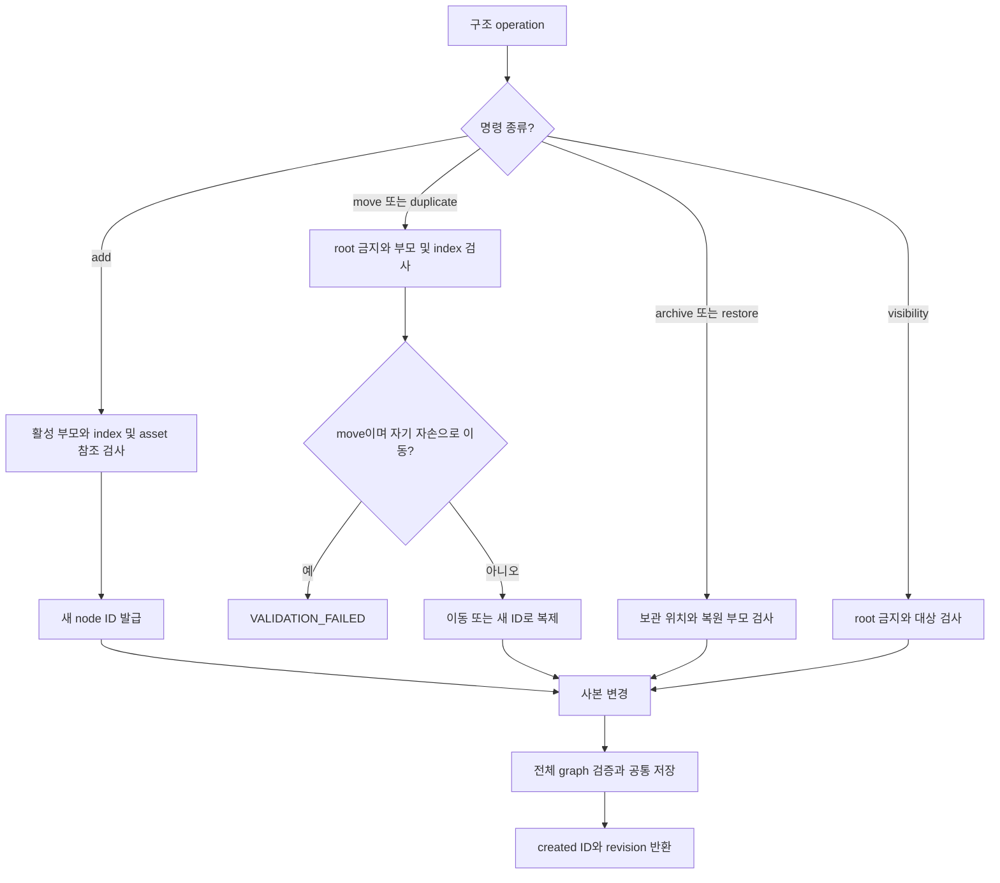
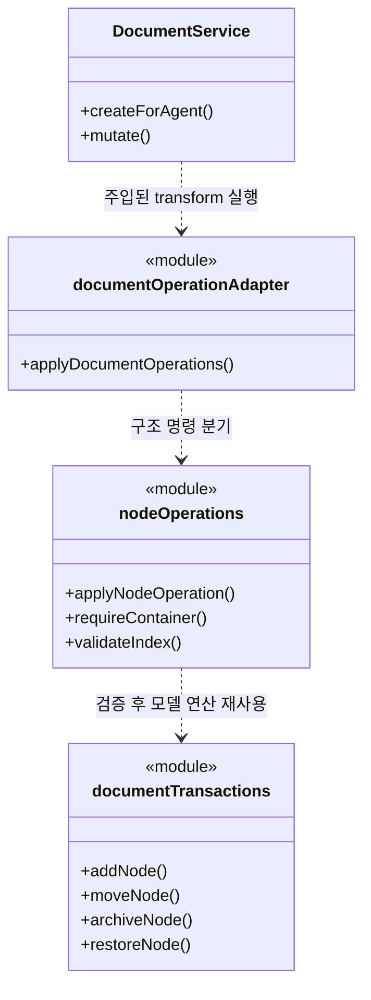
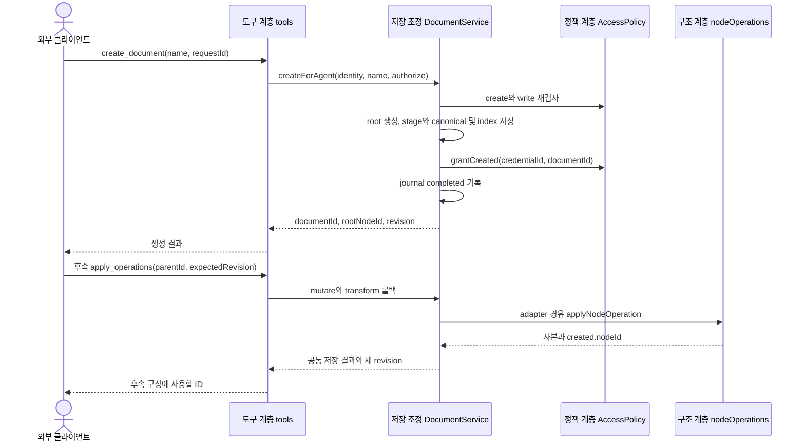

# F04. 문서 생성과 구성 구현 설계

**11번에서 구현한 코드 변경과 목적을 기능별로 설명한다.**

- As-Is: `6821494` · 구현 확인: `531142a` · 문서 개정: 2026-11-08.
- 구현 후 소스와 대조해 정리한 문서이며, 최초 설계 결정과 실행 검증 이력은 별도로 보존한다.
- [기능 기획](../features/04-compose-document.md) · [설계 요약](README.md) · [계획](../plan.md).

## 1. 구현 목표와 범위

**서버가 발급한 ID로 문서와 트리를 단계별 구성하고 잘못된 구조를 저장하지 않는다.**

- 관련 요구·인수 조건: [F04 기획](../features/04-compose-document.md).
- 선행 관계: F01·F02·F03 저장 기반.
- 공통 경계: [실행 흐름](runtime-flows.md)과 [도구 계약](tool-contracts.md).

## 2. As-Is — 11번 구현 전 코드

**문서 생성과 트리 변경은 앱 내부 repository와 documentTransactions를 통해 수행했다.**

- 코드 근거: [문서 트리 transaction 함수](https://github.com/IceBear9028/form-leaf/blob/6821494/client/src/foundation/documentTransactions.ts).
- 근거 종류: 11번 이전 커밋의 소스 확인이며 당시 제품을 새로 실행한 결과는 아니다.
- 변경 필요성: 서버가 발급한 ID로 문서와 트리를 단계별 구성하고 잘못된 구조를 저장하지 않는다.

## 3. As-Is → To-Be — 바뀌는 동작과 코드

| 상황 | As-Is | To-Be | 코드·목적 |
|---|---|---|---|
| 문서 생성과 구성 | 문서 생성과 트리 변경은 앱 내부 repository와 documentTransactions를 통해 수행했다. | 서버가 발급한 ID로 문서와 트리를 단계별 구성하고 잘못된 구조를 저장하지 않는다. | [createForAgent()](https://github.com/IceBear9028/form-leaf/blob/531142a/client/src/main/application/documentService.ts) |

## 4. 코드 변경 설계

| 변경 단위 | 구분 | 파일·symbol | 변경 내용과 목적 |
|---|---|---|---|
| createForAgent() | 신규 | [createForAgent()](https://github.com/IceBear9028/form-leaf/blob/531142a/client/src/main/application/documentService.ts) | 문서 생성 결과·index·연결 grant를 journal 기반으로 확정한다. |
| applyNodeOperation() | 신규 | [applyNodeOperation()](https://github.com/IceBear9028/form-leaf/blob/531142a/client/src/main/application/nodeOperations.ts) | 부모·index·root·cycle 제약을 검사하고 추가·이동·복제·보관·복원을 수행한다. |
| 트리 변경 함수 | 재사용 | [트리 변경 함수](https://github.com/IceBear9028/form-leaf/blob/531142a/client/src/foundation/documentTransactions.ts) | 기존 모델의 구조 연산을 adapter에서 호출한다. |

### 핵심 처리 방식

**문서 생성과 이후 구조 batch를 각각 독립된 저장 단위로 처리한다.**

- 입력: create_document의 name/requestId 또는 add/move/duplicate/visibility/archive/restore 명령.
- 검사: create/write와 부모·index·root·참조 유효성을 검사한다.
- 처리: 생성 ID를 응답으로 돌려주고 후속 호출에서 부모·자식 관계를 구성한다.
- 반환: documentId·rootNodeId·새 nodeId·revision과 명령별 영향을 반환한다.
- 재사용·호출부 영향: 기존 트리 연산을 재사용하고 같은 batch의 임시 ID 참조 문법은 도입하지 않는다.

### 코드 흐름과 분기 — 플로우차트

**구조 명령은 부모·index·root·cycle을 검사한 뒤 문서 사본에 적용한다.**

- 기준: To-Be의 구현 확인 `531142a` · 소스 확인 기반 사후 재구성.

- 각 검사 실패는 예외로 batch 전체를 중단하며, 새 문서 생성은 createForAgent의 별도 저장 단위다.

### 클래스·함수 관계 — 클래스 다이어그램

**호출 책임과 참조 관계를 실제 symbol로 구분한다.**

- 기준: To-Be의 구현 확인 `531142a` · 소스 확인 기반 사후 재구성.

- `<<module>>`은 일반 함수의 소속 파일이며 실제 클래스가 아니다.
- 점선 화살표는 호출 의존, 실선 화살표는 참조 보유를 나타낸다.

### 입출력과 오류 계약

**호출 계약과 실제 부작용을 함께 확인한다.**

- 호출 경계: T06·T07 / 구조 명령 6개.
- 권한: 생성은 create/write이며 기존 문서의 구조 변경은 해당 문서 write다.
- 오류: INVALID_TARGET·VALIDATION_FAILED·REVISION_CONFLICT와 저장 결과 불명 오류.
- 부작용: 생성은 문서·index·grant를 바꾸며 열린 문서와 selection은 전환하지 않는다.
- 재시도: 완료 단계는 유지하고 실패 지점에서 구조를 다시 조회하며 같은 requestId로 중복 생성을 막는다.
- 정확한 schema와 JSON 예시: [도구 계약](tool-contracts.md).

## 5. 변경 후 실행 흐름과 상태

### 레이어 간 데이터 전달 — 시퀀스 다이어그램

**입력·저장값·응답이 이동하는 레이어 경계를 확인한다.**

- 기준: To-Be의 구현 확인 `531142a` · 소스 확인 기반 사후 재구성.

- 생성과 후속 구조 변경은 별도 transaction이며, 이미 완료한 문서는 후속 호출 실패로 제거되지 않는다.

| 데이터·상태 | 기준 소유자 | 전달·변경 경로 | 확정·수명 |
|---|---|---|---|
| node·parent·index | canonical document | 트리 연산 → 전체 graph 검증 → 공통 저장 | batch 단위 확정 |
| 보관 위치 | archived node 정보 | 보관 시 부모·index 기록 → 복원 검증 | 부모가 없으면 임의 배치하지 않음 |

| 실패·경쟁 상황 | 감지·처리 | 보존 상태 | 복구 |
|---|---|---|---|
| 자기 자손으로 이동·root 변경 | node adapter와 graph 검사 | 기존 트리 불변 | 유효한 부모로 수정 |
| 생성 후 grant 저장 장애 | 공통 commit/recover | 생성 결과 불명 상태 기록 | 재시작 복구와 작업 조회 |

- 공통 sequenceDiagram: [실행 흐름](runtime-flows.md).

## 6. 선택 이유와 대안

| 대안 | 이점 | 비용·위험 | 판단 |
|---|---|---|---|
| 생성 ID 반환 후 단계별 구성 | 변경 책임과 대상 범위가 명확하다. | 호출 수와 중간 초안이 늘지만 검증 범위와 실패 지점이 명확하다. | 선택 |
| 임의 문서 JSON 한 번에 업로드 | 호출 또는 구현 경로를 줄일 수 있다. | 이 기능의 권한·상태·대상 경계를 별도 보장해야 한다. | 미선택 |

- 재검토 조건: 실제 사용자 여정에서 현재 제약이 반복적으로 작업을 막으면 별도 범위로 평가한다.

## 7. 구현 순서와 검증 연결

**요구별 검증을 통과하고 해당 기능을 커밋한 뒤 다음 기능으로 진행한다.**

- 구현 순서: F01·F02·F03 저장 기반 확인 → 변경 단위 구현 → 경계 검증 → 문서 갱신 → 커밋.
- 검증 방법: [agent-structure.test.mjs](https://github.com/IceBear9028/form-leaf/blob/531142a/client/test/agent-structure.test.mjs) · [agent-document-service.test.mjs](https://github.com/IceBear9028/form-leaf/blob/531142a/client/test/agent-document-service.test.mjs).
- 통과 조건: 중복 생성·cycle·root 보호·보관/복원·다른 열린 문서의 포커스 보존을 확인한다.
- 계획과 실제 완료 커밋: [plan](../plan.md).
- 이 절은 검증 설계이며 과거 실행 결과와 이번 미실행 범위는 [handoff](../handoff.md)에 구분한다.
- 호환성: 기존 canonical 문서 모델과 사용자 문서·backup을 유지한다.
- 중단: MCP 비활성화는 신규 접근을 멈추지만 이미 저장된 변경을 되돌리지 않는다.
- 복구: 저장 불명은 F08 정책으로 처리하며 데이터 rollback은 결과 확인 후 별도 판단한다.

## 8. 최초 검토 항목과 확인 범위

**아래 항목은 최초 기획의 확인 과제이며, 실행 결과는 handoff를 따른다.**

**T06/T07, add_node/move_node/duplicate_node/set_visibility/archive_node/restore_node.**

- 기존 documentTransactions와 생성 repository 경로를 연결한다.
- 계획 4-1/4-2에 대응한다.

**여러 호출이 필요한 구성 흐름의 실제 호출 수·오류 빈도를 양쪽 외부 에이전트로 확인한다.**

- 복잡한 문서에서 호출 비용이 문제가 되면 batch 내 ID 참조를 별도 설계한다.
- 이번에 암묵적으로 추가하지 않는다.

**기술 실행 흐름: [실행 시퀀스](runtime-flows.md)의 TB03의 생성 ID·후속 호출과 TB02의 공통 저장를 함께 읽는다.**

- 기능 간 의존성은 [설계](architecture.md)의 기능 관계 절을 따른다.
