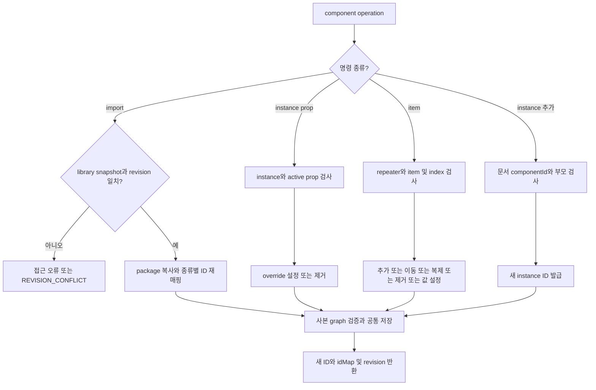
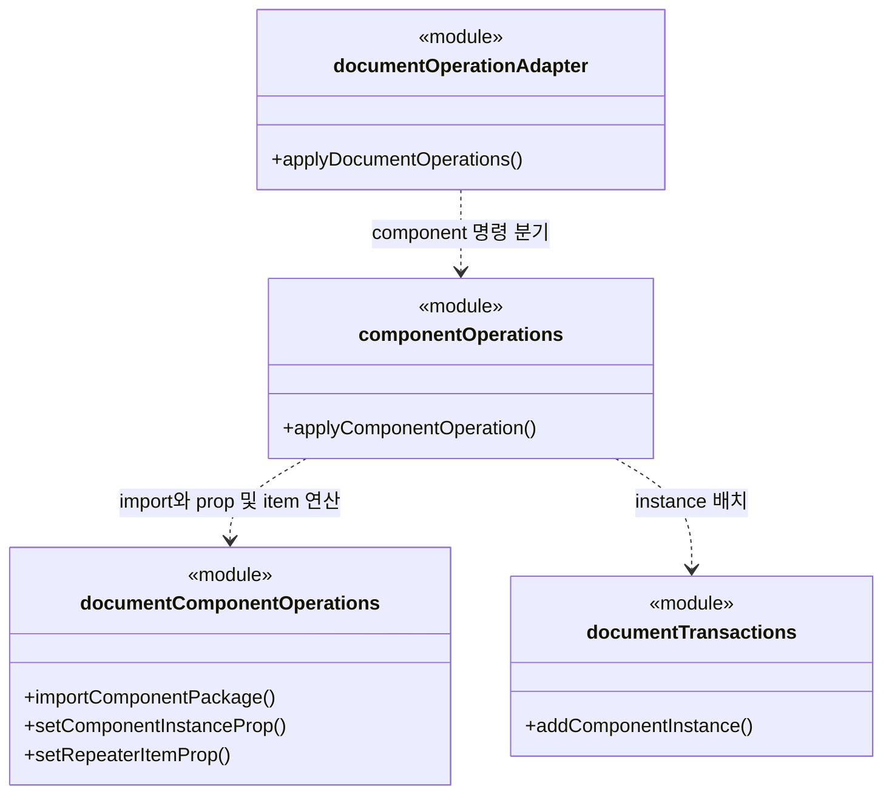
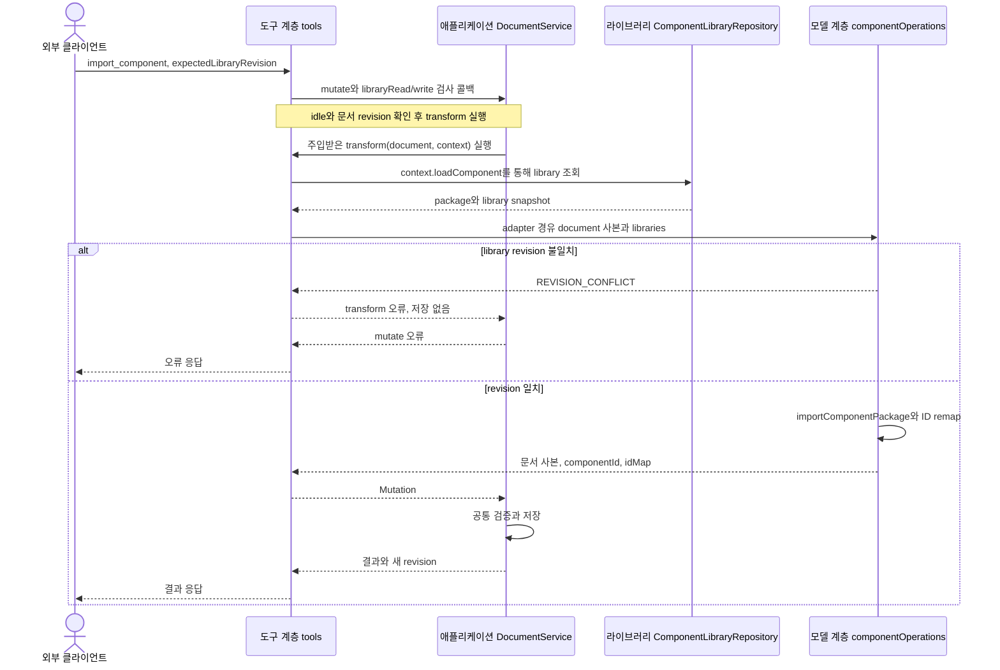

# F05. 컴포넌트와 반복 항목 구현 설계

**11번에서 구현한 코드 변경과 목적을 기능별로 설명한다.**

- As-Is: `6821494` · 구현 확인: `531142a` · 문서 개정: 2026-11-08.
- 구현 후 소스와 대조해 정리한 문서이며, 최초 설계 결정과 실행 검증 이력은 별도로 보존한다.
- [기능 기획](../features/05-reuse-components.md) · [설계 요약](README.md) · [계획](../plan.md).

## 1. 구현 목표와 범위

**라이브러리 형식을 문서에 복사하고 개별 instance/item 값만 변경한다.**

- 관련 요구·인수 조건: [F05 기획](../features/05-reuse-components.md).
- 선행 관계: F01–F04.
- 공통 경계: [실행 흐름](runtime-flows.md)과 [도구 계약](tool-contracts.md).

## 2. As-Is — 11번 구현 전 코드

**component import와 prop/item 연산은 앱 내부 모델 함수로 제공되며 외부 호출 권한·library revision 검사가 없었다.**

- 코드 근거: [importComponentPackage()·prop/item 연산](https://github.com/IceBear9028/form-leaf/blob/6821494/client/src/foundation/documentComponentOperations.ts).
- 근거 종류: 11번 이전 커밋의 소스 확인이며 당시 제품을 새로 실행한 결과는 아니다.
- 변경 필요성: 라이브러리 형식을 문서에 복사하고 개별 instance/item 값만 변경한다.

## 3. As-Is → To-Be — 바뀌는 동작과 코드

| 상황 | As-Is | To-Be | 코드·목적 |
|---|---|---|---|
| 컴포넌트와 반복 항목 | component import와 prop/item 연산은 앱 내부 모델 함수로 제공되며 외부 호출 권한·library revision 검사가 없었다. | 라이브러리 형식을 문서에 복사하고 개별 instance/item 값만 변경한다. | [applyComponentOperation()](https://github.com/IceBear9028/form-leaf/blob/531142a/client/src/main/application/componentOperations.ts) |

## 4. 코드 변경 설계

| 변경 단위 | 구분 | 파일·symbol | 변경 내용과 목적 |
|---|---|---|---|
| applyComponentOperation() | 신규 | [applyComponentOperation()](https://github.com/IceBear9028/form-leaf/blob/531142a/client/src/main/application/componentOperations.ts) | prop 유형·binding·item·부모를 검증하고 기존 연산을 호출한다. |
| importComponentPackage() | 재사용 | [importComponentPackage()](https://github.com/IceBear9028/form-leaf/blob/531142a/client/src/foundation/documentComponentOperations.ts) | 문서로 복사하면서 component/node/style/asset 등 참조 ID를 재매핑한다. |
| apply_operations 분기 | 신규 | [apply_operations 분기](https://github.com/IceBear9028/form-leaf/blob/531142a/client/src/main/mcp/tools.ts) | 필요한 library를 읽고 권한·revision 검사와 사본 변경으로 연결한다. |

### 핵심 처리 방식

**공유 정의는 보존하고 공개 prop과 문서 내 복사본만 수정한다.**

- 입력: libraryItemId/expectedLibraryRevision 또는 instanceNodeId·repeaterNodeId·itemId·propId.
- 검사: libraryRead/write·선언 유형·active prop·asset 참조·library revision을 검사한다.
- 처리: import는 새 componentId와 종류별 idMap을 반환하고 prop/item 명령은 개별 override에 적용한다.
- 반환: 새 componentId/itemId/nodeId·idMap·영향 목록·문서 revision.
- 재사용·호출부 영향: setComponentInstanceProp·clearComponentInstanceProp·setRepeaterItemProp 등 기존 순수 연산을 재사용한다.

### 코드 흐름과 분기 — 플로우차트

**import와 개별 prop/item 변경을 구분해 공유 원본을 보호한다.**

- 기준: To-Be의 구현 확인 `531142a` · 소스 확인 기반 사후 재구성.

- prop 유형·binding·asset 참조 검증 실패는 전체 batch를 중단하며, library 원본은 변경하지 않는다.

### 클래스·함수 관계 — 클래스 다이어그램

**호출 책임과 참조 관계를 실제 symbol로 구분한다.**

- 기준: To-Be의 구현 확인 `531142a` · 소스 확인 기반 사후 재구성.

- `<<module>>`은 일반 함수의 소속 파일이며 실제 클래스가 아니다.
- 점선 화살표는 호출 의존, 실선 화살표는 참조 보유를 나타낸다.

### 입출력과 오류 계약

**호출 계약과 실제 부작용을 함께 확인한다.**

- 호출 경계: T08·T09·T07 / component·item 명령 9개.
- 권한: import는 libraryRead와 문서 write이며 문서 내 prop 변경은 해당 문서 write다.
- 오류: INVALID_TARGET·VALIDATION_FAILED·REVISION_CONFLICT로 부분 import를 방지한다.
- 부작용: 문서의 정의 복사본과 instance/item만 저장하고 라이브러리 원본은 쓰지 않는다.
- 재시도: library revision이 바뀌면 재조회하며 같은 requestId는 import 복사본을 추가하지 않는다.
- 정확한 schema와 JSON 예시: [도구 계약](tool-contracts.md).

## 5. 변경 후 실행 흐름과 상태

### 레이어 간 데이터 전달 — 시퀀스 다이어그램

**입력·저장값·응답이 이동하는 레이어 경계를 확인한다.**

- 기준: To-Be의 구현 확인 `531142a` · 소스 확인 기반 사후 재구성.

- tools가 넘긴 transform에서 library 조회와 adapter 호출을 수행하며, 최종 외부 응답은 항상 tools를 거친다.

| 데이터·상태 | 기준 소유자 | 전달·변경 경로 | 확정·수명 |
|---|---|---|---|
| library package | library repository | 조회 → revision 검사 → 문서 복사 | 원본 불변; 자동 동기화 없음 |
| instance/item override | canonical document | prop 검증 → 개별 값 저장 | 다른 instance·정의 기본값 보존 |

| 실패·경쟁 상황 | 감지·처리 | 보존 상태 | 복구 |
|---|---|---|---|
| library revision 변경 | import 직전 revision 비교 | 문서 부분 import 없음 | 새 package를 읽고 재판단 |
| 잘못된/보관 prop·item | requireProp·target 검사 | 전체 batch 원본 보존 | 유효한 공개 prop을 다시 선택 |

- 공통 sequenceDiagram: [실행 흐름](runtime-flows.md).

## 6. 선택 이유와 대안

| 대안 | 이점 | 비용·위험 | 판단 |
|---|---|---|---|
| 문서로 복사 + 공개 prop 편집 | 변경 책임과 대상 범위가 명확하다. | 중복 정의로 크기가 늘고 공개하지 않은 값은 변경할 수 없다. | 선택 |
| library 실시간 참조 또는 내부 node 직접 수정 | 호출 또는 구현 경로를 줄일 수 있다. | 이 기능의 권한·상태·대상 경계를 별도 보장해야 한다. | 미선택 |

- 재검토 조건: 실제 사용자 여정에서 현재 제약이 반복적으로 작업을 막으면 별도 범위로 평가한다.

## 7. 구현 순서와 검증 연결

**요구별 검증을 통과하고 해당 기능을 커밋한 뒤 다음 기능으로 진행한다.**

- 구현 순서: F01–F04 확인 → 변경 단위 구현 → 경계 검증 → 문서 갱신 → 커밋.
- 검증 방법: [agent-components.test.mjs](https://github.com/IceBear9028/form-leaf/blob/531142a/client/test/agent-components.test.mjs).
- 통과 조건: ID 충돌 remap·다른 instance 불변·기본값 복귀·item 순서·stale library 거절을 확인한다.
- 계획과 실제 완료 커밋: [plan](../plan.md).
- 이 절은 검증 설계이며 과거 실행 결과와 이번 미실행 범위는 [handoff](../handoff.md)에 구분한다.
- 호환성: 기존 canonical 문서 모델과 사용자 문서·backup을 유지한다.
- 중단: MCP 비활성화는 신규 접근을 멈추지만 이미 저장된 변경을 되돌리지 않는다.
- 복구: 저장 불명은 F08 정책으로 처리하며 데이터 rollback은 결과 확인 후 별도 판단한다.

## 8. 최초 검토 항목과 확인 범위

**아래 항목은 최초 기획의 확인 과제이며, 실행 결과는 handoff를 따른다.**

**T08/T09/T07, set_component_prop/clear_component_prop/add_item/move_item/duplicate_item/remove_item/set_item_prop/import_component/add_component_instance.**

- 기존 documentComponentOperations와 library repository를 사용한다.
- 계획 4-4/4-5에 대응한다.

**실제 library의 prop 이름·기본값만으로 에이전트가 필드를 충분히 이해하는지 확인해야 한다.**

- 공개 prop이 부족한 경우를 사용자 입력 없이 추정해서 component 정의를 확대하지 않는다.

**기술 실행 흐름: [실행 시퀀스](runtime-flows.md)의 TB03의 library revision·ID 재매핑·항목 구성를 함께 읽는다.**

- 기능 간 의존성은 [설계](architecture.md)의 기능 관계 절을 따른다.
