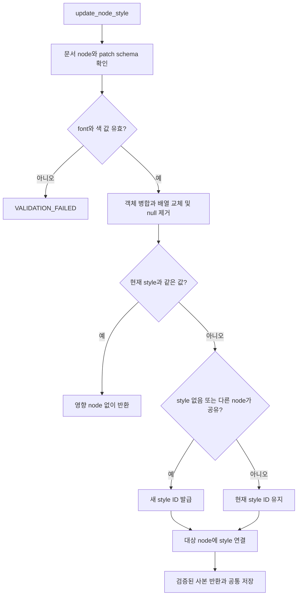
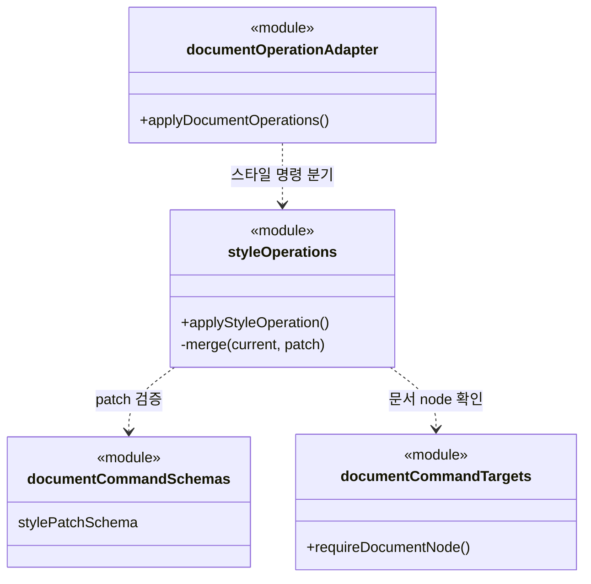
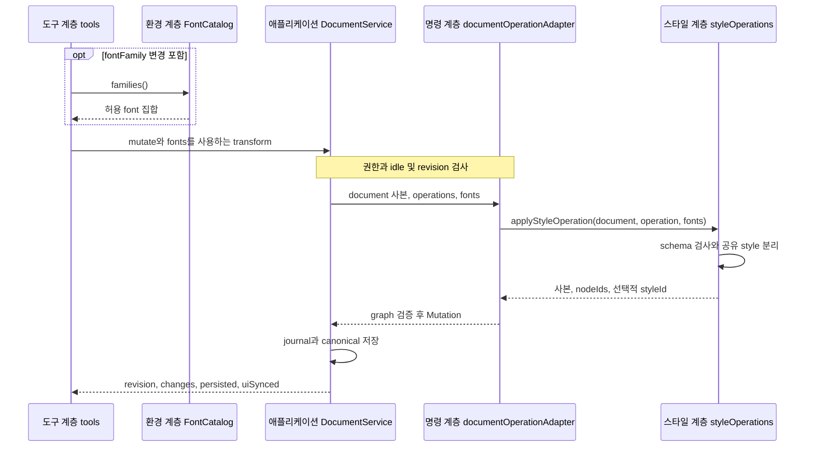

# F06. 요소별 스타일 조정 구현 설계

**11번에서 구현한 코드 변경과 목적을 기능별로 설명한다.**

- As-Is: `6821494` · 구현 확인: `531142a` · 문서 개정: 2026-11-08.
- 구현 후 소스와 대조해 정리한 문서이며, 최초 설계 결정과 실행 검증 이력은 별도로 보존한다.
- [기능 기획](../features/06-adjust-style.md) · [설계 요약](README.md) · [계획](../plan.md).

## 1. 구현 목표와 범위

**허용된 스타일 patch를 지정한 node에 적용하고 공유 style의 다른 사용자를 보존한다.**

- 관련 요구·인수 조건: [F06 기획](../features/06-adjust-style.md).
- 선행 관계: F02·F03; 결과 확인은 F07.
- 공통 경계: [실행 흐름](runtime-flows.md)과 [도구 계약](tool-contracts.md).

## 2. As-Is — 11번 구현 전 코드

**기존 모델의 style 갱신 함수만 호출하면 공유 style을 참조하는 다른 node에 영향이 생길 수 있었다.**

- 코드 근거: [updateNodeStyle()](https://github.com/IceBear9028/form-leaf/blob/6821494/client/src/foundation/documentTransactions.ts).
- 근거 종류: 11번 이전 커밋의 소스 확인이며 당시 제품을 새로 실행한 결과는 아니다.
- 변경 필요성: 허용된 스타일 patch를 지정한 node에 적용하고 공유 style의 다른 사용자를 보존한다.

## 3. As-Is → To-Be — 바뀌는 동작과 코드

| 상황 | As-Is | To-Be | 코드·목적 |
|---|---|---|---|
| 요소별 스타일 조정 | 기존 모델의 style 갱신 함수만 호출하면 공유 style을 참조하는 다른 node에 영향이 생길 수 있었다. | 허용된 스타일 patch를 지정한 node에 적용하고 공유 style의 다른 사용자를 보존한다. | [applyStyleOperation()](https://github.com/IceBear9028/form-leaf/blob/531142a/client/src/main/application/styleOperations.ts) |

## 4. 코드 변경 설계

| 변경 단위 | 구분 | 파일·symbol | 변경 내용과 목적 |
|---|---|---|---|
| applyStyleOperation() | 신규 | [applyStyleOperation()](https://github.com/IceBear9028/form-leaf/blob/531142a/client/src/main/application/styleOperations.ts) | 문서 node를 확인하고 공유 style이면 사본 ID를 연결한 뒤 patch한다. |
| stylePatchSchema | 신규 | [stylePatchSchema](https://github.com/IceBear9028/form-leaf/blob/531142a/client/src/foundation/documentCommandSchemas.ts) | 허용 속성·단위·enum·숫자 범위를 닫힌 schema로 검사한다. |
| fontCatalog.families() 호출 | 신규 | [fontCatalog.families() 호출](https://github.com/IceBear9028/form-leaf/blob/531142a/client/src/main/mcp/tools.ts) | font 변경이 있는 요청에서 사용 가능한 font 집합을 adapter로 전달한다. |

### 핵심 처리 방식

**공유 참조를 분리한 뒤 typed patch를 병합한다.**

- 입력: nodeId와 layout/typography/markdown/decoration/pagination patch.
- 검사: 문서 node·patch schema·설치/제공 font를 확인하고 현재 미지원 color token을 거절한다.
- 처리: 공유 style을 복사해 대상에 새 ID를 연결하며 객체 병합·배열 교체·leaf null 제거 규칙을 적용한다.
- 반환: 영향받은 nodeId와 필요한 경우 새 styleId 및 저장 revision.
- 재사용·호출부 영향: 기존 렌더러와 모델을 사용하며 raw CSS와 component 내부 정의 편집을 받지 않는다.

### 코드 흐름과 분기 — 플로우차트

**유효한 patch만 병합하고 공유 style이면 새 ID로 분리한다.**

- 기준: To-Be의 구현 확인 `531142a` · 소스 확인 기반 사후 재구성.

- component 정의 내부 node는 대상에서 제외하며, 스타일 변경 후 배치의 영향은 F07로 확인한다.

### 클래스·함수 관계 — 클래스 다이어그램

**호출 책임과 참조 관계를 실제 symbol로 구분한다.**

- 기준: To-Be의 구현 확인 `531142a` · 소스 확인 기반 사후 재구성.

- `<<module>>`은 일반 함수의 소속 파일이며 실제 클래스가 아니다.
- 점선 화살표는 호출 의존, 실선 화살표는 참조 보유를 나타낸다.

### 입출력과 오류 계약

**호출 계약과 실제 부작용을 함께 확인한다.**

- 호출 경계: T03·T07·T10 / update_node_style.
- 권한: 문서 write이며 결과 preview에는 render가 별도로 필요하다.
- 오류: INVALID_TARGET·VALIDATION_FAILED·DOCUMENT_BUSY·REVISION_CONFLICT.
- 부작용: 대상 style과 참조만 바꾸지만 부모 layout·상속이 자식의 배치에 영향을 줄 수 있다.
- 재시도: 저장 후 같은 revision의 preview로 확인하고 필요하면 새 변경으로 조정한다.
- 정확한 schema와 JSON 예시: [도구 계약](tool-contracts.md).

## 5. 변경 후 실행 흐름과 상태

### 레이어 간 데이터 전달 — 시퀀스 다이어그램

**입력·저장값·응답이 이동하는 레이어 경계를 확인한다.**

- 기준: To-Be의 구현 확인 `531142a` · 소스 확인 기반 사후 재구성.

- styleOperations는 직접 파일을 저장하지 않으며, 저장 확정은 공통 DocumentService 경계에 있다.

| 데이터·상태 | 기준 소유자 | 전달·변경 경로 | 확정·수명 |
|---|---|---|---|
| style 정의·styleId | canonical document | patch → 공유 사본 분리 → 대상 재연결 | batch 저장 때 확정 |
| 페이지 배치 | snapshot renderer | 저장된 style로 재렌더 | 파생 결과이며 원본 상태가 아님 |

| 실패·경쟁 상황 | 감지·처리 | 보존 상태 | 복구 |
|---|---|---|---|
| raw CSS·미지원 font/token | schema와 adapter 검사 | 원본 style 불변 | 허용된 값으로 수정 |
| component 내부 node 지정 | requireDocumentNode | 공유 정의 불변 | 외곽 node 또는 앱 정의 편집 사용 |

- 공통 sequenceDiagram: [실행 흐름](runtime-flows.md).

## 6. 선택 이유와 대안

| 대안 | 이점 | 비용·위험 | 판단 |
|---|---|---|---|
| typed patch와 공유 사본 분리 | 변경 책임과 대상 범위가 명확하다. | style 정의 수가 늘고 모델 밖 표현은 지원하지 않는다. | 선택 |
| raw CSS 또는 공유 style 직접 수정 | 호출 또는 구현 경로를 줄일 수 있다. | 이 기능의 권한·상태·대상 경계를 별도 보장해야 한다. | 미선택 |

- 재검토 조건: 실제 사용자 여정에서 현재 제약이 반복적으로 작업을 막으면 별도 범위로 평가한다.

## 7. 구현 순서와 검증 연결

**요구별 검증을 통과하고 해당 기능을 커밋한 뒤 다음 기능으로 진행한다.**

- 구현 순서: F02·F03; 결과 확인은 F07 확인 → 변경 단위 구현 → 경계 검증 → 문서 갱신 → 커밋.
- 검증 방법: [agent-style.test.mjs](https://github.com/IceBear9028/form-leaf/blob/531142a/client/test/agent-style.test.mjs).
- 통과 조건: A/B 공유 style에서 A만 변경하고 미지정 속성·본문을 유지하며 잘못된 patch를 저장하지 않는다.
- 계획과 실제 완료 커밋: [plan](../plan.md).
- 이 절은 검증 설계이며 과거 실행 결과와 이번 미실행 범위는 [handoff](../handoff.md)에 구분한다.
- 호환성: 기존 canonical 문서 모델과 사용자 문서·backup을 유지한다.
- 중단: MCP 비활성화는 신규 접근을 멈추지만 이미 저장된 변경을 되돌리지 않는다.
- 복구: 저장 불명은 F08 정책으로 처리하며 데이터 rollback은 결과 확인 후 별도 판단한다.

## 8. 최초 검토 항목과 확인 범위

**아래 항목은 최초 기획의 확인 과제이며, 실행 결과는 handoff를 따른다.**

**T03/T07/T10, update_node_style 및 StylePatch.**

- 현재 구현은 applyStyleOperation에서 patch를 검증하고 공유 style이면 새 ID로 분리한다.
- 계획 4-3과 연결한다.

**일부 글꼴의 실제 출력 품질과 플랫폼별 설치 font 차이는 hidden renderer 시험으로 확인한다.**

- 지원 font 목록의 결정은 구현 과제이며 확인하지 않은 글꼴을 지원한다고 문서에 추가하지 않는다.

**기술 실행 흐름: [실행 시퀀스](runtime-flows.md)의 TB02의 사본 변경·저장과 TB04의 결과 출력를 함께 읽는다.**

- 기능 간 의존성은 [설계](architecture.md)의 기능 관계 절을 따른다.
