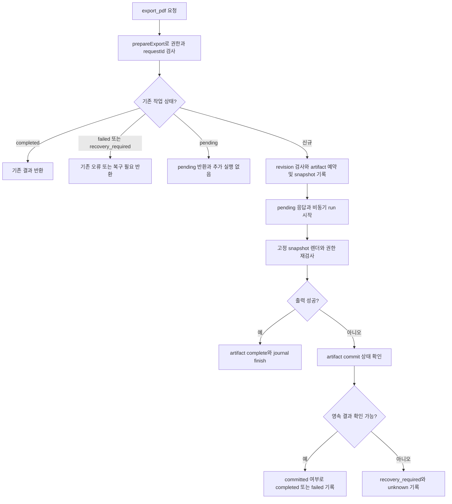
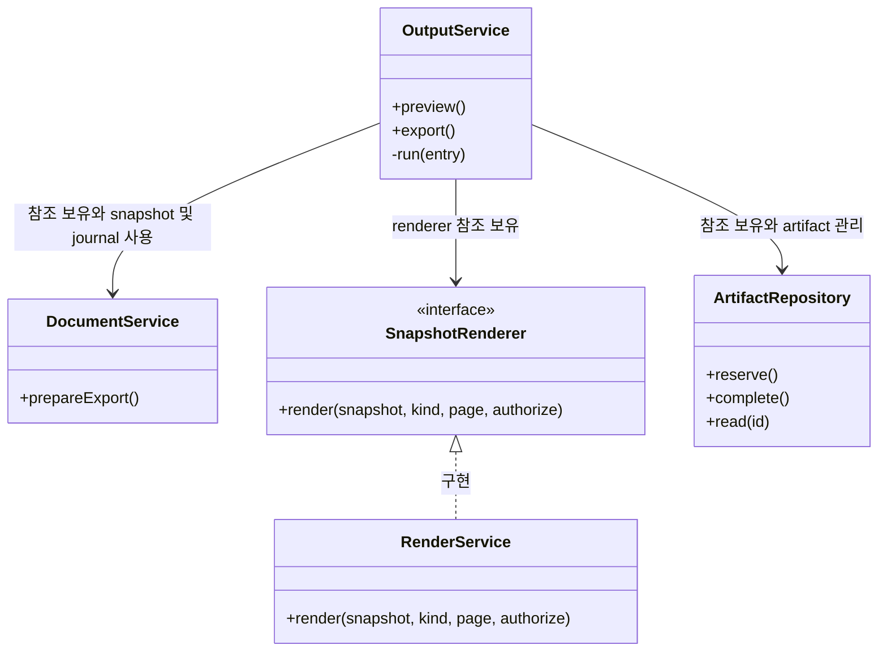
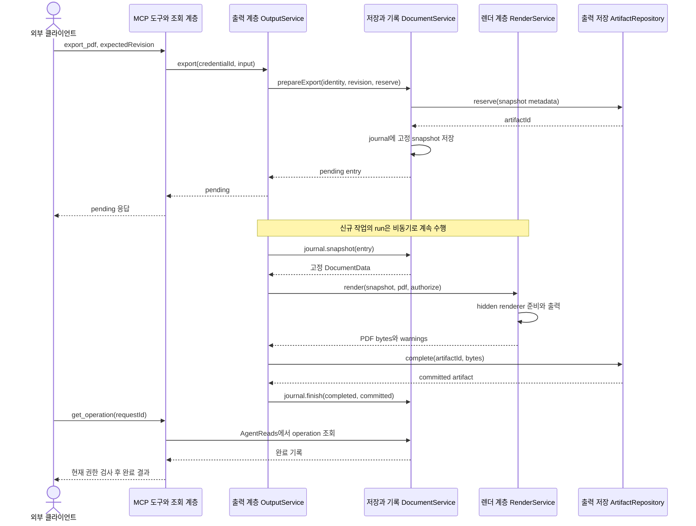

# F07. 미리보기와 PDF 구현 설계

**11번에서 구현한 코드 변경과 목적을 기능별로 설명한다.**

- As-Is: `6821494` · 구현 확인: `531142a` · 문서 개정: 2026-11-08.
- 구현 후 소스와 대조해 정리한 문서이며, 최초 설계 결정과 실행 검증 이력은 별도로 보존한다.
- [기능 기획](../features/07-preview-and-export.md) · [설계 요약](README.md) · [계획](../plan.md).

## 1. 구현 목표와 범위

**저장 revision을 고정한 출력으로 페이지를 확인하고 편집 중인 화면을 보호한다.**

- 관련 요구·인수 조건: [F07 기획](../features/07-preview-and-export.md).
- 선행 관계: F01·F02·공통 journal; F03–F06 결과 확인에 사용.
- 공통 경계: [실행 흐름](runtime-flows.md)과 [도구 계약](tool-contracts.md).

## 2. As-Is — 11번 구현 전 코드

**기존 PDF 경로는 사용자의 수동 출력 요청을 처리하며 MCP용 snapshot·작업 ID·artifact 권한 계약이 없었다.**

- 코드 근거: [registerPdfHandlers()](https://github.com/IceBear9028/form-leaf/blob/6821494/client/src/main/registerPdfHandlers.ts).
- 근거 종류: 11번 이전 커밋의 소스 확인이며 당시 제품을 새로 실행한 결과는 아니다.
- 변경 필요성: 저장 revision을 고정한 출력으로 페이지를 확인하고 편집 중인 화면을 보호한다.

## 3. As-Is → To-Be — 바뀌는 동작과 코드

| 상황 | As-Is | To-Be | 코드·목적 |
|---|---|---|---|
| 미리보기와 PDF | 기존 PDF 경로는 사용자의 수동 출력 요청을 처리하며 MCP용 snapshot·작업 ID·artifact 권한 계약이 없었다. | 저장 revision을 고정한 출력으로 페이지를 확인하고 편집 중인 화면을 보호한다. | [RenderService.render()](https://github.com/IceBear9028/form-leaf/blob/531142a/client/src/main/application/renderService.ts) |

## 4. 코드 변경 설계

| 변경 단위 | 구분 | 파일·symbol | 변경 내용과 목적 |
|---|---|---|---|
| RenderService.render() | 신규 | [RenderService.render()](https://github.com/IceBear9028/form-leaf/blob/531142a/client/src/main/application/renderService.ts) | 별도 hidden renderer에서 저장 snapshot의 font/image/pagination 준비 후 출력한다. |
| OutputService | 신규 | [OutputService](https://github.com/IceBear9028/form-leaf/blob/531142a/client/src/main/application/outputService.ts) | preview와 비동기 PDF 작업·권한·고정 revision·재시작 상태를 조정한다. |
| ArtifactRepository | 신규 | [ArtifactRepository](https://github.com/IceBear9028/form-leaf/blob/531142a/client/src/main/application/artifactRepository.ts) | 관리 artifact의 수명·예산·경로를 제한하고 만료된 관리 파일만 정리한다. |

### 핵심 처리 방식

**출력 snapshot과 사용자 편집 화면의 소유권을 분리한다.**

- 입력: documentId·expectedRevision·page 또는 PDF requestId와 안전한 파일명.
- 검사: render 권한·revision·페이지 범위·출력 준비·예산을 확인한다.
- 처리: PNG는 요청 페이지를 반환하고 PDF는 pending 작업을 등록한 뒤 완료 결과를 조회하게 한다.
- 반환: PNG 크기·pageCount·경고 또는 PDF artifact ID·상태·완료 resource.
- 재사용·호출부 영향: 문서 렌더링 기반을 재사용하되 현재 editor root에서 출력하지 않는다.

### 코드 흐름과 분기 — 플로우차트

**PDF의 접수와 완료를 구분하고 기존 작업을 중복 실행하지 않는다.**

- 기준: To-Be의 구현 확인 `531142a` · 소스 확인 기반 사후 재구성.

- preview는 같은 저장 revision을 사용하는 동기 PNG 응답이며, PDF의 비동기 작업 등록과 구분한다.

### 클래스·함수 관계 — 클래스 다이어그램

**호출 책임과 참조 관계를 실제 symbol로 구분한다.**

- 기준: To-Be의 구현 확인 `531142a` · 소스 확인 기반 사후 재구성.

- `<<module>>`은 일반 함수의 소속 파일이며 실제 클래스가 아니다.
- 점선 화살표는 호출 의존, 실선 화살표는 참조 보유를 나타낸다.
- `SnapshotRenderer`와 `RenderService` 사이의 삼각형 점선은 실제 interface 구현 관계다.

### 입출력과 오류 계약

**호출 계약과 실제 부작용을 함께 확인한다.**

- 호출 경계: T10·T11·T12 / preview_document·export_pdf.
- 권한: 출력·artifact 조회·앱 파일 저장의 경계에서 현재 render 및 문서 grant를 확인한다.
- 오류: PAGE_OUT_OF_RANGE·준비/출력 timeout·권한 거절·만료/예산 오류는 완료 성공과 구분한다.
- 부작용: preview는 PNG를 응답하고, PDF는 journal·staged snapshot·관리 artifact를 저장한다.
- 사용자 draft·caret·composition은 출력 경로에서 변경하지 않는다.
- 재시도: 같은 requestId의 작업 상태를 확인하며 만료된 artifact의 재요청도 기존 작업을 재생성하지 않는다.
- 정확한 schema와 JSON 예시: [도구 계약](tool-contracts.md).

## 5. 변경 후 실행 흐름과 상태

### 레이어 간 데이터 전달 — 시퀀스 다이어그램

**입력·저장값·응답이 이동하는 레이어 경계를 확인한다.**

- 기준: To-Be의 구현 확인 `531142a` · 소스 확인 기반 사후 재구성.

- tools와 AgentReads는 MCP 도구·조회 participant로 묶었으며, artifact 읽기는 별도 권한 검사를 거친다.

| 데이터·상태 | 기준 소유자 | 전달·변경 경로 | 확정·수명 |
|---|---|---|---|
| 출력 snapshot | OutputService/작업 기록 | 저장값 읽기 → 고정 사본 → hidden renderer | 작업 도중 문서가 바뀌어도 동일 revision |
| PDF artifact | ArtifactRepository | 관리 경로 저장 → 인증된 읽기 | 24시간 만료; 사용자 별도 저장본은 제외 |

| 실패·경쟁 상황 | 감지·처리 | 보존 상태 | 복구 |
|---|---|---|---|
| 출력 준비 실패·시간 초과 | render service | 완료 파일로 표시하지 않음 | 원인 해결 후 결과 상태에 맞게 재요청 |
| 권한 철회·만료 | resource/파일 동작 직전 검사 | 작업 이력 유지 | 현재 권한 복원 또는 신규 출력 판단 |
| 예산 부족 | artifact 예약 | 유효한 기존 출력 보존 | 새 출력 거절; 만료 정리 범위만 사용 |

- 공통 sequenceDiagram: [실행 흐름](runtime-flows.md).

## 6. 선택 이유와 대안

| 대안 | 이점 | 비용·위험 | 판단 |
|---|---|---|---|
| 고정 snapshot의 별도 renderer | 변경 책임과 대상 범위가 명확하다. | 추가 렌더 비용과 artifact 수명 관리가 필요하다. | 선택 |
| 활성 editor에서 직접 캡처·출력 | 호출 또는 구현 경로를 줄일 수 있다. | 이 기능의 권한·상태·대상 경계를 별도 보장해야 한다. | 미선택 |

- 재검토 조건: 실제 사용자 여정에서 현재 제약이 반복적으로 작업을 막으면 별도 범위로 평가한다.

## 7. 구현 순서와 검증 연결

**요구별 검증을 통과하고 해당 기능을 커밋한 뒤 다음 기능으로 진행한다.**

- 구현 순서: F01·F02·공통 journal; F03–F06 결과 확인에 사용 확인 → 변경 단위 구현 → 경계 검증 → 문서 갱신 → 커밋.
- 검증 방법: [agent-output.test.mjs](https://github.com/IceBear9028/form-leaf/blob/531142a/client/test/agent-output.test.mjs) · [agent-output.spec.ts](https://github.com/IceBear9028/form-leaf/blob/531142a/client/e2e/agent-output.spec.ts) · [agent-load.spec.ts](https://github.com/IceBear9028/form-leaf/blob/531142a/client/e2e/agent-load.spec.ts).
- 통과 조건: revision A 출력 중 B 저장·IME 유지·잘림·페이지 범위·권한 철회·만료·예산을 확인한다.
- 계획과 실제 완료 커밋: [plan](../plan.md).
- 이 절은 검증 설계이며 과거 실행 결과와 이번 미실행 범위는 [handoff](../handoff.md)에 구분한다.
- 호환성: 기존 canonical 문서 모델과 사용자 문서·backup을 유지한다.
- 중단: MCP 비활성화는 신규 접근을 멈추지만 이미 저장된 변경을 되돌리지 않는다.
- 복구: 저장 불명은 F08 정책으로 처리하며 데이터 rollback은 결과 확인 후 별도 판단한다.

## 8. 최초 검토 항목과 확인 범위

**아래 항목은 최초 기획의 확인 과제이며, 실행 결과는 handoff를 따른다.**

**T10 preview_document, T11 export_pdf, T12 get_operation과 artifact resource.**

- 계획 5단계에서 구현하고 6단계에서 두 외부 클라이언트와 hidden Electron으로 검증한다.

**클라이언트의 image/resource 표시 차이, 실제 글꼴과 PDF 내용 추출 결과는 구현 시 확인한다.**

- 화면과 PDF의 픽셀 완전 일치를 성공 조건으로 삼지 않고 본문 의미·순서와 레이아웃의 잘림 여부를 각각 확인한다.

**기술 실행 흐름: [실행 시퀀스](runtime-flows.md)의 AS02→TB04의 출력 경로 전환를 함께 읽는다.**

- 기능 간 의존성은 [설계](architecture.md)의 기능 관계 절을 따른다.
