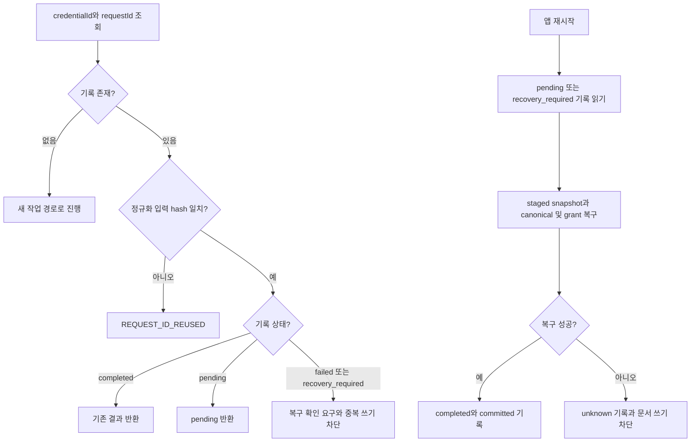
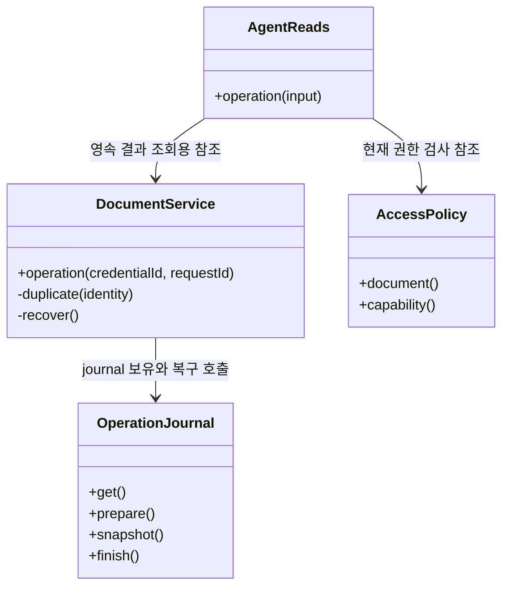
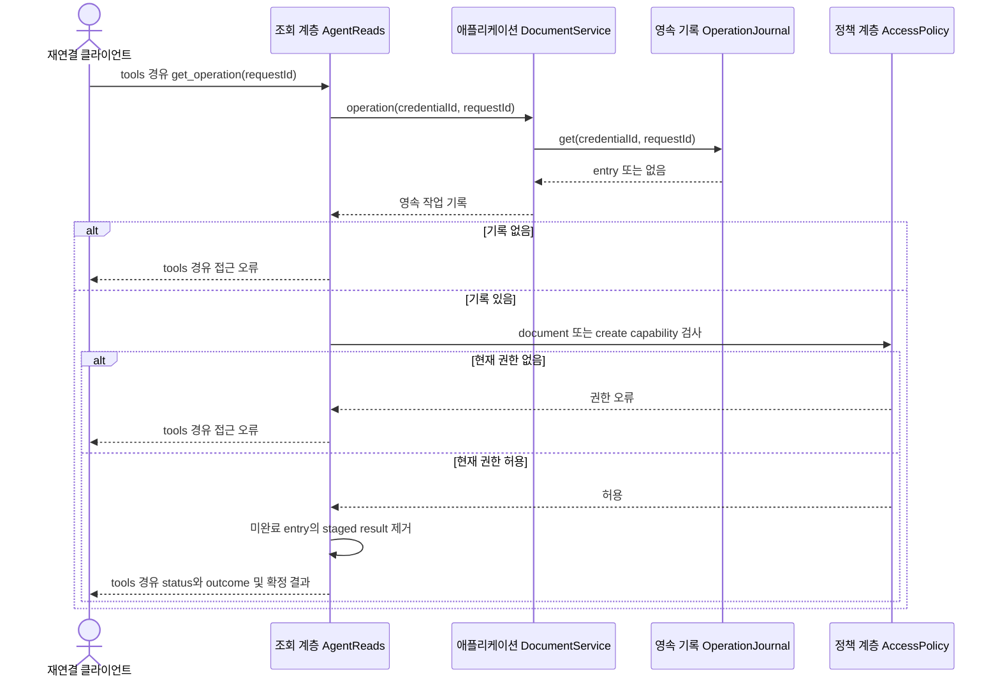

# F08. 작업 확인과 복구 구현 설계

**11번에서 구현한 코드 변경과 목적을 기능별로 설명한다.**

- As-Is: `6821494` · 구현 확인: `531142a` · 문서 개정: 2026-11-08.
- 구현 후 소스와 대조해 정리한 문서이며, 최초 설계 결정과 실행 검증 이력은 별도로 보존한다.
- [기능 기획](../features/08-recover-operation.md) · [설계 요약](README.md) · [계획](../plan.md).

## 1. 구현 목표와 범위

**응답 유실과 재시작 뒤에도 같은 작업의 저장 결과를 확인하고 중복 실행을 막는다.**

- 관련 요구·인수 조건: [F08 기획](../features/08-recover-operation.md).
- 선행 관계: 공통 저장 기반·F01; F03–F07에서 사용.
- 공통 경계: [실행 흐름](runtime-flows.md)과 [도구 계약](tool-contracts.md).

## 2. As-Is — 11번 구현 전 코드

**UI의 요청 응답만으로는 외부 연결 단절 뒤 완료 여부와 동일 요청의 중복 실행을 판단할 영속 기록이 없었다.**

- 코드 근거: [기존 요청별 IPC 응답](https://github.com/IceBear9028/form-leaf/blob/6821494/client/src/main/registerDocumentHandlers.ts).
- 근거 종류: 11번 이전 커밋의 소스 확인이며 당시 제품을 새로 실행한 결과는 아니다.
- 변경 필요성: 응답 유실과 재시작 뒤에도 같은 작업의 저장 결과를 확인하고 중복 실행을 막는다.

## 3. As-Is → To-Be — 바뀌는 동작과 코드

| 상황 | As-Is | To-Be | 코드·목적 |
|---|---|---|---|
| 작업 확인과 복구 | UI의 요청 응답만으로는 외부 연결 단절 뒤 완료 여부와 동일 요청의 중복 실행을 판단할 영속 기록이 없었다. | 응답 유실과 재시작 뒤에도 같은 작업의 저장 결과를 확인하고 중복 실행을 막는다. | [OperationJournal](https://github.com/IceBear9028/form-leaf/blob/531142a/client/src/main/application/operationJournal.ts) |

## 4. 코드 변경 설계

| 변경 단위 | 구분 | 파일·symbol | 변경 내용과 목적 |
|---|---|---|---|
| OperationJournal | 신규 | [OperationJournal](https://github.com/IceBear9028/form-leaf/blob/531142a/client/src/main/application/operationJournal.ts) | credentialId/requestId별 입력 hash·snapshot·결과 상태를 저장한다. |
| duplicate()·recover() | 신규 | [duplicate()·recover()](https://github.com/IceBear9028/form-leaf/blob/531142a/client/src/main/application/documentService.ts) | 동일 입력은 기존 결과를 재사용하고 재시작 시 canonical/index/grant/journal을 복구한다. |
| AgentReads.operation() | 신규 | [AgentReads.operation()](https://github.com/IceBear9028/form-leaf/blob/531142a/client/src/main/mcp/readTools.ts) | 현재 권한을 검사해 해당 credential의 작업 결과만 반환한다. |
| 작업 이력 조회 | 신규 | [작업 이력 조회](https://github.com/IceBear9028/form-leaf/blob/531142a/client/src/main/application/operationHistory.ts) | 앱에서 최근 작업 상태·저장/화면 반영·출력 결과를 확인하게 한다. |

### 핵심 처리 방식

**작업 identity를 MCP 세션이 아닌 영속 credential과 requestId에 묶는다.**

- 입력: credentialId·requestId·정규화한 입력 hash와 get_operation의 requestId.
- 검사: 동일 requestId의 입력 hash를 비교하고 조회 시 현재 문서 grant와 소유자를 확인한다.
- 처리: pending/completed/failed/recovery_required 상태와 committed/not_committed/unknown 결과를 구분한다.
- 반환: 기존 결과·처리 중 상태·복구 필요 상태와 persisted/uiSynced를 반환한다.
- 재사용·호출부 영향: 공통 저장·출력 journal을 재사용하며 새 requestId로 불명 결과를 우회하지 않는다.

### 코드 흐름과 분기 — 플로우차트

**쓰기 재호출은 입력 hash를 비교하고, 조회는 저장된 상태를 그대로 확인한다.**

- 기준: To-Be의 구현 확인 `531142a` · 소스 확인 기반 사후 재구성.

- 위 hash 비교는 DocumentService의 쓰기 재호출 경로이며 get_operation 자체는 입력 hash를 받지 않는다.
- 문서 재시작 복구는 staged snapshot으로 canonical/index/grant를 조정한다.
- PDF는 OutputService가 artifact commit marker를 확인하며 완료되지 않은 출력을 자동 재실행하지 않는다.
- PDF의 failed 재호출은 기록된 출력 오류를 반환하며, recovery_required는 별도 확인을 요구한다.

### 클래스·함수 관계 — 클래스 다이어그램

**호출 책임과 참조 관계를 실제 symbol로 구분한다.**

- 기준: To-Be의 구현 확인 `531142a` · 소스 확인 기반 사후 재구성.

- `<<module>>`은 일반 함수의 소속 파일이며 실제 클래스가 아니다.
- 점선 화살표는 호출 의존, 실선 화살표는 참조 보유를 나타낸다.

### 입출력과 오류 계약

**호출 계약과 실제 부작용을 함께 확인한다.**

- 호출 경계: T06·T07·T11의 부작용 요청과 T12 / get_operation.
- 권한: 해당 credential 소유 작업이며 현재 문서 grant를 다시 검사하고 PDF에는 render도 요구한다.
- 새 문서 생성이 미완료이고 문서 grant가 아직 없으면 create capability로 조회를 허용한다.
- 조회 오류: 없는 요청이나 현재 권한이 없으면 NOT_FOUND_OR_DENIED 또는 CAPABILITY_DENIED다.
- 쓰기 재호출 오류: REQUEST_ID_REUSED·OPERATION_RECOVERY_REQUIRED를 구분한다.
- 조회 결과의 status/outcome은 오류 코드와 별도 축이다.
- 부작용: 쓰기·출력 경로가 영속 journal을 남기며 get_operation은 새 변경이나 새 작업 기록을 만들지 않는다.
- 로컬 이력 요약에는 문서 본문·평문 token을 노출하지 않는다.
- 재시도: unknown은 자동 재실행하지 않고 같은 ID 조회·재시작 복구로 상태를 확정한다.
- 정확한 schema와 JSON 예시: [도구 계약](tool-contracts.md).

## 5. 변경 후 실행 흐름과 상태

### 레이어 간 데이터 전달 — 시퀀스 다이어그램

**입력·저장값·응답이 이동하는 레이어 경계를 확인한다.**

- 기준: To-Be의 구현 확인 `531142a` · 소스 확인 기반 사후 재구성.

- 미완료 작업의 내부 staged 결과는 외부 성공 응답으로 노출하지 않으며, 현재 권한은 조회할 때마다 확인한다.

| 데이터·상태 | 기준 소유자 | 전달·변경 경로 | 확정·수명 |
|---|---|---|---|
| 작업 identity·결과 | OperationJournal | prepare → commit → finish | MCP 세션 종료 후에도 유지 |
| 저장 결과·UI 반영 | DocumentService/coordinator | canonical 확정 → apply/ack | persisted와 uiSynced를 독립 보고 |

| 실패·경쟁 상황 | 감지·처리 | 보존 상태 | 복구 |
|---|---|---|---|
| 동일 ID에 다른 입력 | requestHash 비교 | 기존 결과 보존 | 새 의도만 새로운 ID로 요청 |
| staged snapshot 손상 | recover 실패 | recovery_required와 문서 차단 | 증거 확인 후 복구; 자동 재실행 금지 |
| UI ack 유실 | apply 결과 처리 | persisted=true·uiSynced=false | 저장값 재조회; 변경 반복 금지 |

- 공통 sequenceDiagram: [실행 흐름](runtime-flows.md).

## 6. 선택 이유와 대안

| 대안 | 이점 | 비용·위험 | 판단 |
|---|---|---|---|
| 영속 journal + request hash | 변경 책임과 대상 범위가 명확하다. | 디스크 상태와 재시작 복구를 관리해야 하며 v1은 journal 자동 정리를 제공하지 않는다. | 선택 |
| 메모리 cache 또는 자동 재시도 | 호출 또는 구현 경로를 줄일 수 있다. | 이 기능의 권한·상태·대상 경계를 별도 보장해야 한다. | 미선택 |

- 재검토 조건: 실제 사용자 여정에서 현재 제약이 반복적으로 작업을 막으면 별도 범위로 평가한다.

## 7. 구현 순서와 검증 연결

**요구별 검증을 통과하고 해당 기능을 커밋한 뒤 다음 기능으로 진행한다.**

- 구현 순서: 공통 저장 기반·F01; F03–F07에서 사용 확인 → 변경 단위 구현 → 경계 검증 → 문서 갱신 → 커밋.
- 검증 방법: [agent-history.test.mjs](https://github.com/IceBear9028/form-leaf/blob/531142a/client/test/agent-history.test.mjs) · [agent-document-service.test.mjs](https://github.com/IceBear9028/form-leaf/blob/531142a/client/test/agent-document-service.test.mjs) · [agent-history.spec.ts](https://github.com/IceBear9028/form-leaf/blob/531142a/client/e2e/agent-history.spec.ts).
- 통과 조건: prepare/canonical/index/grant/완료 기록 장애·응답 유실·권한 변경·ack 유실에서 결과를 정직하게 표시한다.
- 계획과 실제 완료 커밋: [plan](../plan.md).
- 이 절은 검증 설계이며 과거 실행 결과와 이번 미실행 범위는 [handoff](../handoff.md)에 구분한다.
- 호환성: 기존 canonical 문서 모델과 사용자 문서·backup을 유지한다.
- 중단: MCP 비활성화는 신규 접근을 멈추지만 이미 저장된 변경을 되돌리지 않는다.
- 복구: 저장 불명은 F08 정책으로 처리하며 데이터 rollback은 결과 확인 후 별도 판단한다.

## 8. 최초 검토 항목과 확인 범위

**아래 항목은 최초 기획의 확인 과제이며, 실행 결과는 handoff를 따른다.**

**T06/T07/T11의 requestId와 T12 get_operation.**

- 계획 2단계에서 journal·복구, 3단계에서 조회, 5단계에서 결과 UI, 6단계에서 재연결을 검증한다.

**원자적 파일 교체·문서 index·새 문서 grant·journal의 실패 순서는 실제 repository 경로를 기준으로 fault injection으로 확인해야 한다.**

- 준비·canonical/index·grant·journal 완료 경계의 실패를 테스트했고 손상된 staged snapshot은 recovery_required로 유지한다.
- 모든 OS/파일시스템 장애를 복구한다고 보장하지 않는다.

**기술 실행 흐름: [실행 시퀀스](runtime-flows.md)의 TB05의 journal 재조정과 도구 계약의 상태도를 함께 읽는다.**

- 기능 간 의존성은 [설계](architecture.md)의 기능 관계 절을 따른다.
