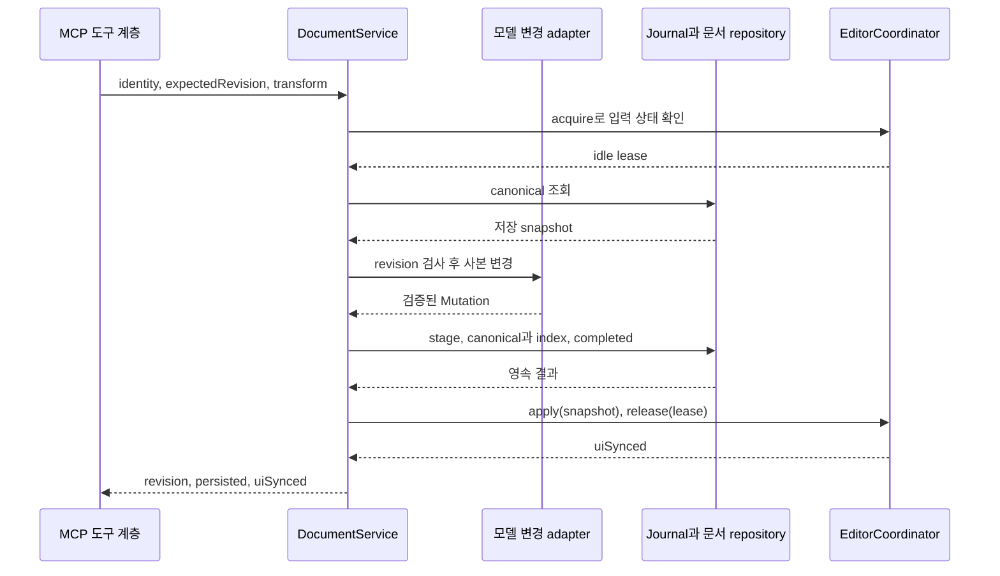
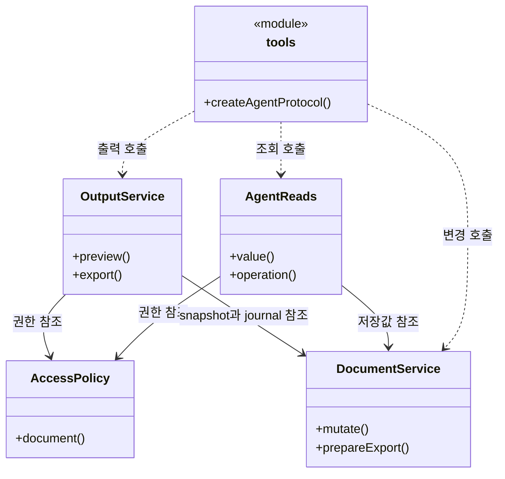

# 에이전트 도구와 로컬 MCP 구현 설계 요약

**기능별 구현 설계와 공통 실행·호출 경계를 찾는 기술 목차다.**

- As-Is `6821494` → 구현 확인 `531142a` · 소스 확인 기반 사후 재구성.
- [전체 기획](../features/README.md) · [계획](../plan.md) · [검증·재개](../handoff.md).

## 1. 설계 목표와 경계

**사용자 입력을 보호하면서 외부 도구가 canonical 문서에 안전하게 접근하게 한다.**

- 포함: MCP adapter·권한·공통 writer·명령·조회·출력·작업 복구.
- 제약: 비활성 기본값·loopback 통신·문서별 grant·busy/CAS 보호.
- 제외: AI 실행 환경과 sandbox·자동 클라이언트 설정.

## 2. As-Is → To-Be 핵심 변화

| 영역 | As-Is | To-Be | 목적 |
|---|---|---|---|
| 진입점 | 앱 IPC | 앱 IPC + MCP adapter | 외부 명령 경계 제공 |
| 저장 | repository 직접 호출 | 공통 queue·revision·editor lease·journal | 경쟁과 불명 결과 관리 |
| 출력 | 사용자 수동 출력 | 고정 snapshot·hidden renderer·artifact | 편집 중 입력과 출력 분리 |
| 복구 | 요청별 응답 | credential/requestId 영속 기록 | 연결 단절 후 중복 방지 |

## 3. 전체 구조와 주요 책임

**문서 변경은 도구·저장 조정·모델·영속 저장·UI 반영 레이어를 지난다.**

- 기준: To-Be의 구현 확인 `531142a` · 성공 경로 요약이며 기능별 분기는 상세 설계에서 다룬다.

**읽기·쓰기·출력은 서로 다른 책임을 맡고 공통 정책과 저장 계층을 참조한다.**

- 기준: To-Be의 구현 확인 `531142a` · 관계선은 참조 보유와 호출 의존을 구분한다.

- `tools`는 함수 모듈이며 실제 클래스가 아니다.
- 이 요약에는 공통 레이어와 관계만 두고, 조건 분기 플로우차트는 각 기능 문서에서 설명한다.

| 경계 | 소유 책임 | 상세 위치 |
|---|---|---|
| AccessPolicy | 연결·token 수명·grant | [F01](01-connect-and-authorize.md) |
| AgentReads | 허용된 저장값 DTO | [F02](02-discover-context.md) |
| DocumentService | queue·revision·canonical 저장 | [F03](03-edit-content.md) |
| 명령 adapter | 사본의 구조·prop·style 변경 | [F04](04-compose-document.md) · [F05](05-reuse-components.md) · [F06](06-adjust-style.md) |
| OutputService | snapshot 출력과 artifact | [F07](07-preview-and-export.md) |
| OperationJournal | 작업 identity와 복구 상태 | [F08](08-recover-operation.md) |

## 4. 공통 결정과 선택 이유

| 결정 | 이유 | 비용·대안 | 상세 |
|---|---|---|---|
| typed 명령 | 변경 범위와 검증 가능성 | 임의 JSON보다 계약이 많음 | [계약](tool-contracts.md) |
| busy 거절과 revision | IME와 최신 저장값 보존 | 자동 병합 대신 재조회 필요 | [F03](03-edit-content.md) |
| 별도 출력 renderer | editor 소유권 보존 | 추가 렌더 비용 | [F07](07-preview-and-export.md) |
| 영속 journal | 불명 결과의 중복 실행 방지 | 복구와 수명 관리 필요 | [F08](08-recover-operation.md) |

## 5. 설계 목록과 읽는 순서

| 관련 기획 | 구현 설계 | 선행 관계 |
|---|---|---|
| [F01](../features/01-connect-and-authorize.md) | [연결과 권한](01-connect-and-authorize.md) | 공통 계약·저장 기반 |
| [F02](../features/02-discover-context.md) | [문서와 대상 탐색](02-discover-context.md) | F01 |
| [F03](../features/03-edit-content.md) | [기존 내용 수정](03-edit-content.md) | F01·F02와 공통 저장 기반 |
| [F04](../features/04-compose-document.md) | [문서 생성과 구성](04-compose-document.md) | F01·F02·F03 저장 기반 |
| [F05](../features/05-reuse-components.md) | [컴포넌트와 반복 항목](05-reuse-components.md) | F01–F04 |
| [F06](../features/06-adjust-style.md) | [요소별 스타일 조정](06-adjust-style.md) | F02·F03; 결과 확인은 F07 |
| [F07](../features/07-preview-and-export.md) | [미리보기와 PDF](07-preview-and-export.md) | F01·F02·공통 journal; F03–F06 결과 확인에 사용 |
| [F08](../features/08-recover-operation.md) | [작업 확인과 복구](08-recover-operation.md) | 공통 저장 기반·F01; F03–F07에서 사용 |

**기능별 설명에 반복되는 긴 공통 내용만 별도 문서로 둔다.**

- [runtime-flows.md](runtime-flows.md): UI/MCP 저장·생성·출력·복구의 공통 sequenceDiagram.
- [tool-contracts.md](tool-contracts.md): 12개 도구·18개 명령의 정확한 schema·오류·JSON 예시.
- 공통 구조·선택 이유·위험 ID는 [구조와 결정 기록](architecture.md)에서 관리한다.
- 새 작업에서 이 두 파일을 기본 생성해야 한다는 의미는 아니다.

## 6. 주요 위험과 미결정

**저장 성공·UI 반영·출력 완료를 한 상태로 뭉치면 중복 적용 위험이 생긴다.**

- 처리: persisted/uiSynced와 operation status/outcome을 구분한다.
- 확인: 장애 주입·응답 유실·재시작·권한 철회를 함께 검증한다.
- 환경 한계: Claude 로그인 모델과 Windows/Linux는 [handoff](../handoff.md)의 후속 검증으로 남긴다.
