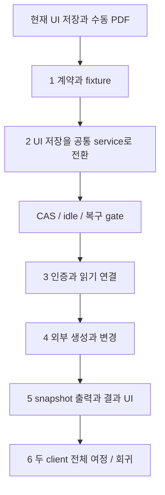

# 에이전트 도구 명세 및 MCP 구현 계획

## 현재 상태

2026-11-03 — 문서 커밋 `b65fc85` 이후 구현 시작. 1단계 계약 완료, 2단계 공통 저장 기반 구현·검증 완료(명령 adapter 통합은 남음), 3단계 조회 연결 진행 중, 4–6단계 대기. 기능별 제품 완료는 별도 검증 후 기록한다.

이번 작업의 구현 기준은 [README](README.md)의 범위와 기능 상세, [tool-contracts](tool-contracts.md)다. AI 로그인·내부 채팅·관리되는 에이전트 실행 환경은 후속이다. 문서 작성과 코드 구현의 완료를 구분한다.

## 완료한 기획 산출물

- [x] MCP 선택 근거와 책임 경계 문서화.
- [x] 이번 제공 도구 12개와 변경 명령 18개의 구현 기준안 작성.
- [x] 기능별 목적·대상·입출력·오류·예시·기존 코드 연결점 작성.
- [x] 포함·제외 목록, 연결 설정 UI, 권한·busy·revision·journal·출력 정책 작성.
- [x] Obsidian 참고 분석의 컨텍스트 제공 방식과 보안 한계를 설계에 반영.
- [x] BMAD의 사용자·목표·여정, OpenSpec의 대안·트레이드오프, Spec Kit의 인수 조건을 기존 11번 문서에 적용.
- [x] F01–F08 각각의 상세 요구·실패 후 행동·Given/When/Then과 공통 결정 D01–D07 작성.
- [x] 재사용할 기능 정의 양식과 기능↔계약↔검증 단계 연결 작성.
- [x] 현재 코드 A01–A07과 목표 컴포넌트·데이터 소유권·기능 관계, AS01–TB05 시퀀스 작성.
- [x] 기능 외 문서의 양식, 단계별 전환·진입/종료 조건·롤백 범위와 미결정 O01–O07 연결.
- [x] 전체 기획을 README로 통합하고 도구 목록·공통 템플릿을 각 기준 위치로 정리. 공통 workflow와 실제 assets 개편.

이는 설계안 작성 완료다. 사용자가 세부 항목 모두를 이미 승인했거나 API가 구현됐다는 뜻은 아니다.

## As-Is에서 To-Be로 전환하는 순서

현재 UI→repository 직접 저장에서 UI/MCP→공통 service로 전환한다. diagram은 구현 의존성을 나타낸다. 단계 번호는 아래 체크리스트와 같다.

| 단계 | 시작에 필요한 상태 | 단계가 끝난 To-Be 상태 | 공개 전 필요한 증거 | 실패 시 유지·복귀 범위 |
|---|---|---|---|---|
| 1 | A01–A07 코드·명세 확인 | typed 계약과 fixture만 추가 | 12 도구/18 명령의 정상·오류 schema, O01 | 제품 경로는 기존 상태 |
| 2 | 계약 fixture 통과 | UI IPC도 service/CAS 경유, journal·coordinator 준비 | AS01 대비 TB02, O02/O03/O06 실패 주입 | MCP는 비활성. writer 우회로로 되돌려 외부 쓰기를 열지 않음 |
| 3 | 공통 저장 gate 통과 | 사용자 연결 설정과 허용 조회 가능 | TB01, 권한 전 경로·폐기·cursor, O04 | 연결 비활성화·credential 폐기 가능, 문서 유지 |
| 4 | 권한·저장 gate 통과 | 내용·구조·style·component 외부 변경 | TB02/TB03, 세 target·library·공유 style 불변 | write/create 비활성. 완료된 변경·journal 보존 |
| 5 | 저장 revision과 job 조회 준비 | hidden renderer 출력과 artifact 제공 | AS02 대비 TB04, O05/O07·만료·권한 철회 | render 비활성, 기존 수동 PDF 경로 유지 |
| 6 | 전 단계 증거 확보 | 두 외부 agent의 전체 흐름 검증 | F01–F08 AC, 회귀·빌드 결과 | 실패한 경계를 수정한 뒤 필요한 gate 재검증 |

**데이터 전환:** schemaVersion 4와 Markdown 문자열은 유지한다. grant/journal/artifact는 별도 관리 영역에 추가한다. 기존 사용자 파일이나 backup을 직접 편집해 새 구조에 맞추지 않는다. 임시 workspace에서 기존 문서를 읽고 저장·재열기하는 호환성을 검증한다.

**롤백의 의미:** 연결이나 capability를 끄는 것은 이후 호출을 중단하는 조치다. 이미 저장한 사용자 변경을 되돌리거나 journal을 지우는 조치가 아니다. 배포 버전의 downgrade는 새 metadata를 이전 버전이 어떻게 다룰지 검증하기 전에는 안전하다고 약속하지 않는다.

**구현 중 상태 기록:** 각 단계 완료 시 아래 인수 조건에 실제 테스트 경로·명령·결과·관련 커밋을 연결하고 handoff에 기록한다. 문서에 있는 시퀀스나 체크박스만으로 실행 증거를 대체하지 않는다.

## 기능별 구현 커밋 진행

사용자의 2026-11-03 요청에 따라 공통 기반 이후 F01→F08 순서로 검증하고 커밋한다. 단계 2의 operation adapter/세 target 검증은 F03–F06에서 연결한다. 현재 공개된 서버는 연결 확인(`get_context`)만 제공하며 외부 쓰기는 아직 열지 않았다.

| 단위 | 현재 상태 | 검증 |
|---|---|---|
| 계약 기반 | 완료, `d587142` | 계약 6개 / 전체 test / build |
| 공통 저장 기반 | 완료, `6368045` | service 10개 / hidden coordinator 1개 / 기존 Markdown E2E 2개 |
| F01 연결·권한 | 완료, `39cfdd9` | access 2개 / hidden UI 1개. 추가 도구/resource 권한은 도구 연결 시 재검증 |
| F02 문맥·대상 | 완료, `ec4c6f3` | reads 4개 / HTTP access 회귀 / 전체 test·build |
| F03 내용 수정 | 완료, `9272786` | content 3개 / 실제 MCP hidden E2E 1개 / 연결·coordinator 회귀 |
| F04 문서 구성 | 완료, `68bace1` | structure 3개 / 생성 grant·journal 복구 / hidden 목록 갱신 |
| F05 재사용 | 구현·검증 완료 | components 2개 / library 조회·remap·revision·원본 불변 / 전체 test·build |
| F06–F08 | 대기 | style/출력/결과 UI와 전체 흐름 |

## 기능과 검증 단계의 대응

P0/P1은 구현 의존성과 우선순위이며 모두 이번 범위다. 아래는 **실행 예정인 검증**이다. 실제 결과·환경·실패 수정 근거를 남기기 전에는 완료로 표시하지 않는다. 상세 인수 조건은 링크한 기능 문서가 기준이다.

| 기능 | 구현 단계 | 핵심 인수 조건 | 확인 방법 |
|---|---|---|---|
| [F01 연결·권한](features/01-connect-and-authorize.md) | 3, 5, 6 | F01-AC01–05 | 연결 UI와 도구/resource/출력 경로의 권한 거절 |
| [F02 문맥·대상](features/02-discover-context.md) | 1, 3, 6 | F02-AC01–05 | 같은 label·default/override·stale cursor fixture, agent 대상 선택 |
| [F03 내용 수정](features/03-edit-content.md) | 2, 4-1, 6 | F03-AC01–07 | 세 target snapshot 비교, IME·revision·batch·dryRun |
| [F04 문서 구성](features/04-compose-document.md) | 2, 4-1, 4-2, 6 | F04-AC01–06 | 생성 재시도·graph·보관/복원·재열기 |
| [F05 재사용](features/05-reuse-components.md) | 3, 4-4, 4-5, 6 | F05-AC01–06 | import ID 충돌·library revision·prop·item·공유 정의 불변 |
| [F06 스타일](features/06-adjust-style.md) | 4-3, 5, 6 | F06-AC01–05 | 공유 style 사본·patch 검증·화면/PDF 비교 |
| [F07 출력](features/07-preview-and-export.md) | 5, 6 | F07-AC01–07 | revision 고정·hidden renderer·만료·권한·PDF 의미 보존 |
| [F08 결과·복구](features/08-recover-operation.md) | 2, 3, 5, 6 | F08-AC01–06 | 저장 경계 fault injection·재시작·requestId·UI ack |

단계 1에서 API fixture와 AC ID를 연결하고, 단계 2–5에서는 해당 service/renderer 경계를 검증한다. 단계 6에서는 외부 에이전트가 전체 여정을 수행하는지 확인한다. 세부 동작을 unit test로 확인한 사실만으로 외부 사용자 흐름까지 완료했다고 처리하지 않는다.

## 1. 계약을 코드와 fixture로 옮기기

대상: T01–T12, Operation 18개 전체.

- [x] documentCommands 및 runtime schema에 도구/명령/error/result union 구현.
- [x] 기존 DocumentEditTarget과 model schemaVersion 4 연결.
- [x] enum·허용 키·문자열/크기 한도·index·prop 유형 검증.
- [x] 정상 입력, 비허용 target, 예상 오류, 결과 schema fixture 작성.
- [x] SDK stable version 고정과 structured output/image/resource 동작 확인.

완료 기준: 명세의 이름·인자·응답과 schema가 일치하고 잘못된 요청이 실행 전에 거절된다.

증거: `client/test/agent-contracts.test.mjs` 6개 테스트 통과. SDK 1.32.2 / Zod 4.6.7을 정확한 버전으로 고정하고 in-memory MCP client로 structuredContent·오류·image·resource 전달을 확인했다. 실제 HTTP 인증·render 결과·문서 참조/설치 font 검사는 후속 단계다.

## 2. 공통 service와 저장 충돌 방지 — 기반 완료, 명령 통합 검증 대기

대상: 모든 조회·쓰기의 기반. MCP 서버를 붙이기 전에 진행한다.

- [ ] 기존 foundation operation과 repository를 documentService로 연결.
- [x] UI IPC도 같은 service와 expectedRevision 사용.
- [x] node·component prop·repeater item prop의 동일한 읽기·쓰기 검증.
- [x] dirty·saving·IME·component draft 확인, idle 적용 handshake와 snapshot acknowledgement.
- [x] batch 사본 적용·graph 검증·단일 snapshot 저장; 부분 변경 방지.
- [x] request journal·staged snapshot·index 갱신 순서·재시작 복구 구현.
- [x] 같은 requestId 재전송, 다른 입력 재사용, 저장 후 UI 동기화 실패 검증.

진행 증거: `agent-document-service.test.mjs` 10개, hidden `agent-editor-coordination.spec.ts` 1개와 기존 Markdown E2E 2개 통과. operation adapter·세 target batch 검증은 후속 기능에서 연결하며 외부 쓰기는 아직 공개하지 않는다.

완료 기준: stale UI 자동 저장과 두 외부 변경이 서로 덮어쓰지 않는다. 장애 후 중복 생성하지 않으며 결과 불명 상태를 명시한다.

## 3. 연결 설정과 조회 도구 — 진행 중

대상: T01–T05, T08–T09, T12의 조회 경로.

- [x] 앱 설정에 MCP 활성화·endpoint·연결 이름·token 발급/폐기 UI 추가.
- [x] 연결별 documentIds 및 write/create/libraryRead/render grant 설정·저장.
- [x] loopback 서버 lifecycle·Host/Origin·인증·입력 크기 제한.
- [x] get_context, list_documents, get_document, list_edit_targets, get_edit_value 구현.
- [x] list_components, get_component와 library/document 식별자 분리 구현.
- [x] get_operation, schema/document resources 구현.
- [x] 목록·instructions·resource·로그에도 문서 권한 적용; 비허용 이름·집계 노출 검사.
- [x] 읽기 전용·권한 변경·폐기 token·만료 cursor·잘못된 origin 검증.

완료 기준: 외부 MCP client가 도구를 발견하고 허용된 저장 문서·target만 조회할 수 있다.

## 4. 문서 생성과 변경 도구

대상: T06–T07, T12의 생성/수정 결과.

아래 순서로 기능을 연결한다. 각 묶음은 같은 documentService를 사용한다.

| 순서 | 묶음 | 구현 명령 |
|---|---|---|
| 4-1 | 새 문서와 내용 | create_document, set_edit_value, replace_text |
| 4-2 | 요소 구조 | add_node, move_node, duplicate_node, set_visibility, archive_node, restore_node |
| 4-3 | 개별 스타일 | update_node_style, 공유 style 사본 분리 |
| 4-4 | instance와 반복 항목 | set_component_prop, clear_component_prop, add_item, move_item, duplicate_item, remove_item, set_item_prop |
| 4-5 | 라이브러리 재사용 | import_component, add_component_instance |

- [x] 4-1 연결 및 세 가지 target 유형 검증.
- [x] 4-2 연결 및 root/cycle/보관 배치/생성 ID 검증.
- [ ] 4-3 연결 및 다른 node의 공유 스타일 불변 검증.
- [x] 4-4 연결 및 default/override, active prop 유형, 제거 영향 검증.
- [x] 4-5 연결 및 library revision·ID 재매핑·기본값·asset 참조 검증.
- [ ] dryRun 무변경, 전체 batch 실패 무변경, unsupported Markdown 원문 보존 검증.
- [x] 생성 문서 grant 추가와 journal 복구의 일관성 검증.

완료 기준: README와 기능 상세의 문장 수정·항목 추가·빈 문서 작성·컴포넌트 재사용 예시를 도구 호출로 수행한다.

## 5. 결과 확인과 출력

대상: T10–T11, T12의 출력 job, artifact resource와 앱 결과 화면.

- [ ] revision에 고정한 hidden renderer job 구현.
- [ ] font/image/pagination 준비 신호와 timeout 처리.
- [ ] preview_document 페이지 PNG와 warning 반환.
- [ ] export_pdf 비동기 job·get_operation 완료 조회.
- [ ] artifact URI·소유 credential·현재 grant·24시간 만료·저장 예산 구현.
- [ ] 앱에서 최근 작업 상태와 PDF 열기/다른 위치에 저장 제공.
- [ ] 문서 선택·포커스·활성 editor root 불변 검증.

완료 기준: 요청한 revision의 페이지 이미지와 PDF를 얻고, 권한 폐기 뒤 artifact를 읽지 못한다. artifact 정리가 사용자 문서·backup에 영향을 주지 않는다.

## 6. 외부 에이전트 연결과 제품 회귀

- [ ] 앱에서 외부 클라이언트 설정 예시 복사 제공.
- [ ] 이미 로그인된 외부 Codex와 Claude Code 각각에서 조회→변경→preview→PDF 전체 흐름 확인.
- [ ] instructions와 schema만으로 에이전트가 ID·revision·target을 올바르게 사용하는지 확인.
- [ ] 동시 요청·연결 단절·클라이언트 취소 신호·재연결·인증 실패·출력 만료 검증. 취소 신호가 이미 저장된 변경의 rollback을 의미하지 않음을 확인하며 별도 취소 도구는 만들지 않는다.
- [ ] 임시 workspace와 hidden Electron으로 빠른 한글, composition 중 rerender/publish, 자동 저장 경쟁 확인.
- [ ] node/component prop/repeater item prop 모두 저장·재열기·PDF 의미 보존 확인.
- [ ] npm test, npm run typecheck, npm run build, git diff --check 실행.
- [ ] 구현 결과·실제 지원 이름·검증 근거·남은 제한을 명세와 handoff에 반영.

완료 기준: 사용자가 허용한 문서에 대해 기능 예시를 끝까지 수행한다. 테스트에는 실제 사용자 데이터나 backup을 사용하지 않는다.

## 다음 작업으로 전달할 사항

- Formleaf가 공식 에이전트 프로세스를 실행·관리하는 내부 채팅 구조.
- 제공사별 로그인·대화·중단 통신과 MCP 도구 호출의 분리.
- 사용자 구독 조건과 runtime 배포·실제 shell/파일 접근 제한 검증.
- 문서별 대화 저장·재개, 과거 session 누락과 현재 revision 재조회.
- 요청 당시 선택 대상 고정, 편집기 lifecycle 보존, AI 변경 결과/되돌리기 UX.

이 항목들은 이번 구현 체크리스트에 포함하지 않는다.
