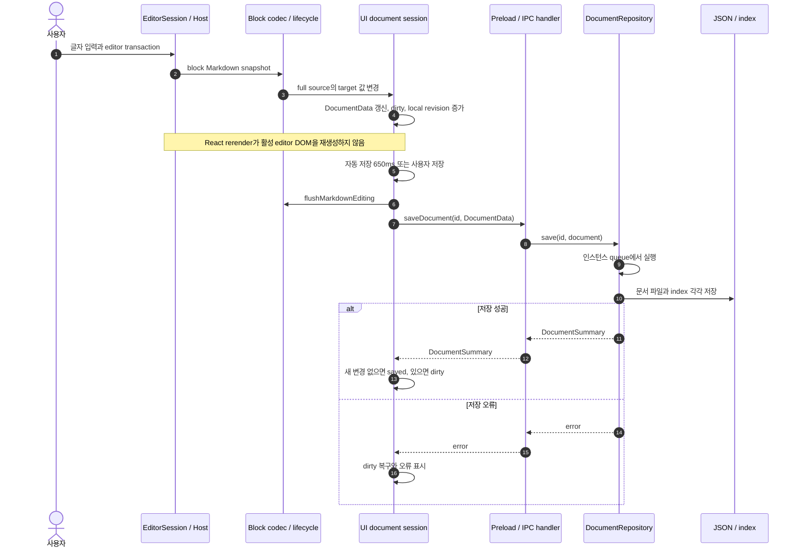
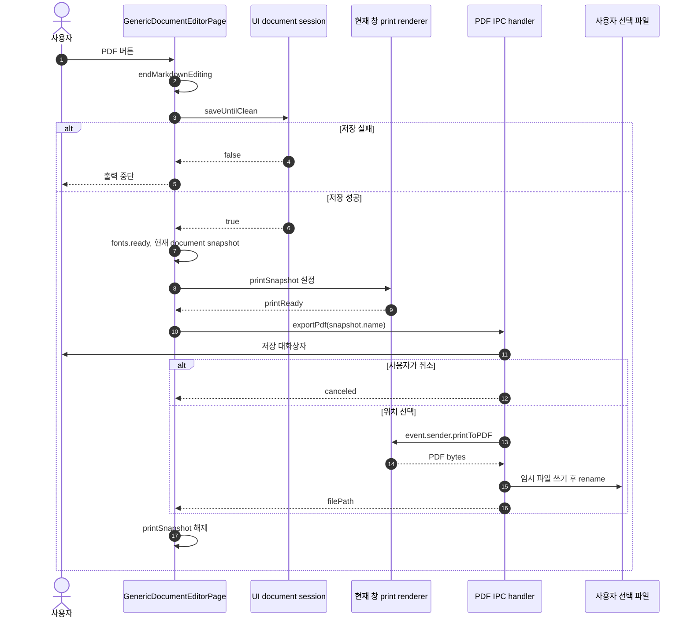
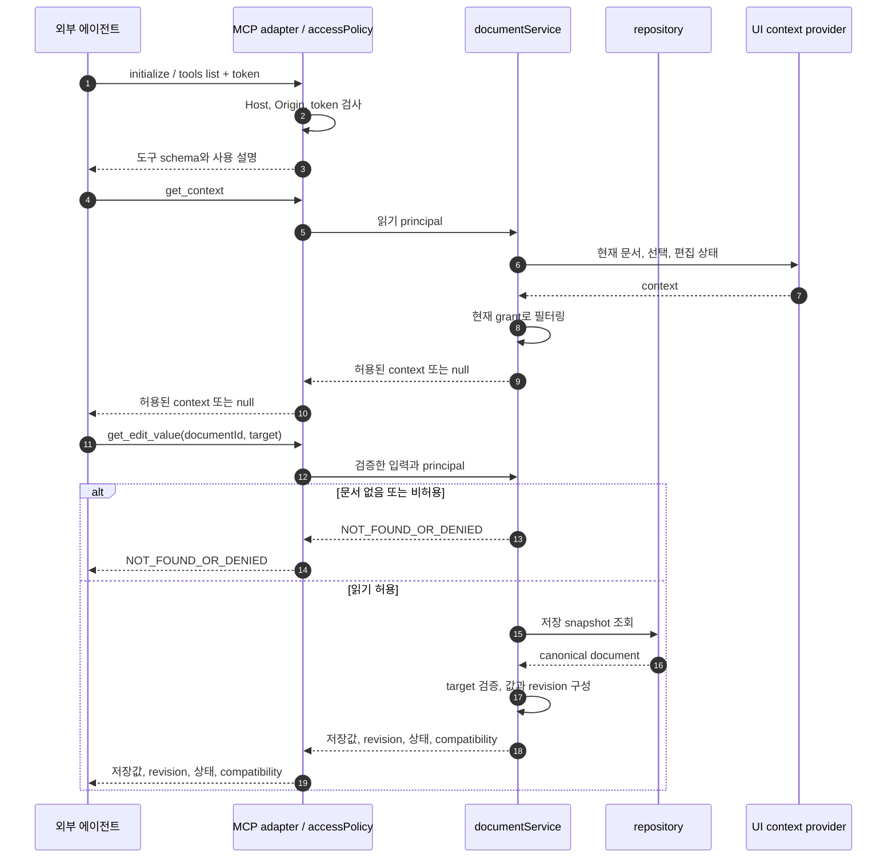
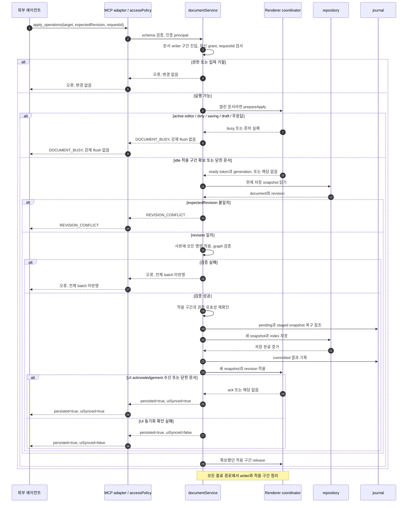
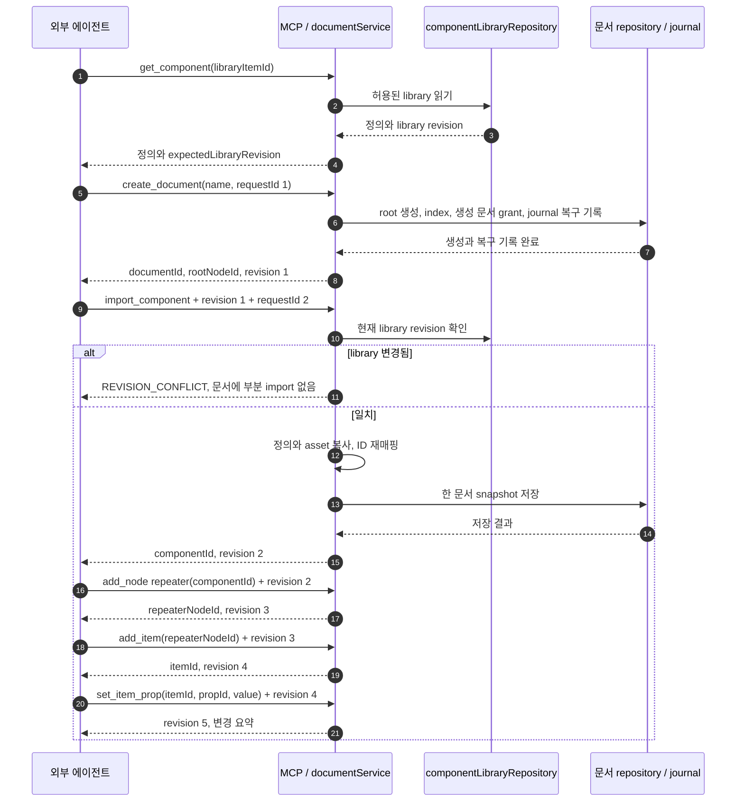
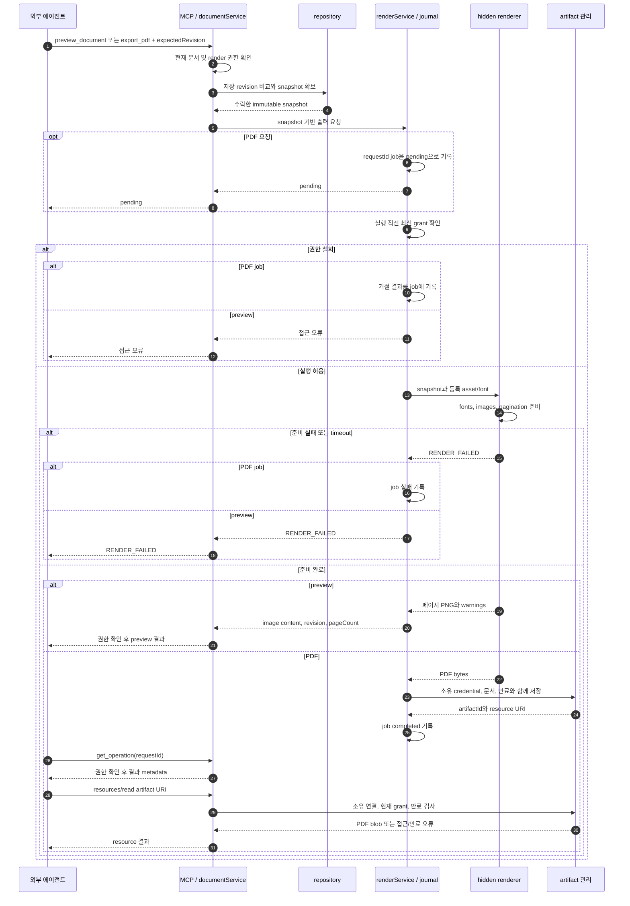
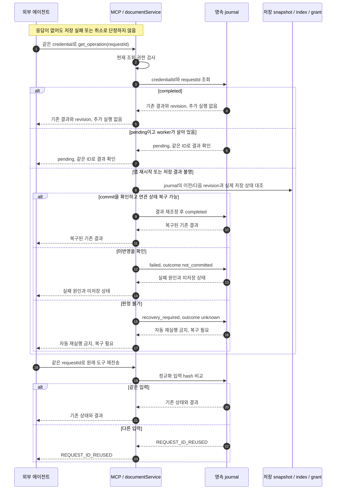

# 실행 흐름 — As-Is와 To-Be 시퀀스

2026-11-02 · As-Is: `6821494` 소스 확인 · **To-Be: 구현할 계약, 실행 검증 전**.

[구조·상태 소유권](design.md) · [정확한 도구 계약](tool-contracts.md) · [구현·검증 순서](plan.md)

## 읽는 방법

AS는 현재 코드 경로, TB는 제안 경로다. 화살표는 메시지·데이터 전달, 점선 응답은 결과 전달이다. `alt`는 조건 분기이며 실패한 경로가 아래 성공 경로까지 계속된다는 의미가 아니다. IPC의 prepare/apply/release는 내부 책임을 설명하는 제안 이름이다.

| 시퀀스 | 설명 | 연결 기능·검증 |
|---|---|---|
| AS01 → TB02 | 현재 UI 저장 → 공통 저장과 외부 변경 | F03-AC01–07, F08-AC01–04 |
| AS02 → TB04 | 현재 창 PDF → 저장 snapshot 출력 | F07-AC01–07 |
| TB01 | 권한 있는 문서·target 발견 | F01-AC01–03, F02-AC01–05 |
| TB03 | 새 문서·library import·반복 항목 구성 | F04-AC01–06, F05-AC01–06 |
| TB05 | 응답 유실·재접속·재시작 후 결과 확인 | F08-AC01–06 |

## AS01. 현재 Markdown 편집과 UI 저장

**전제:** 저장 가능한 일반 문서 화면. editor publish와 저장의 근거는 design의 A01–A05다.

**현재 보장과 한계:** source-range codec과 editor ownership은 이미 존재한다. IPC에는 expectedRevision과 requestId가 없으며 local revision은 영속 CAS가 아니다. UI 저장에서 flush하는 현재 동작을 MCP 요청의 강제 flush로 재사용하지 않는다.

## AS02. 현재 사용자의 수동 PDF 출력

**변경 필요:** 이 경로는 사용자 버튼과 현재 창에 적합하다. MCP 출력은 편집 종료·문서 전환·저장 대화상자 없이 요청한 저장 revision으로 수행해야 하므로 TB04를 별도로 만든다. 기존 수동 출력 UX 제거는 이번 선행 조건이 아니다.

## TB01. 도구 발견과 저장 문맥 조회

**전제:** 사용자가 앱 설정에서 MCP를 켜고 연결에 문서 A만 허용했다. 에이전트는 이미 외부 도구에서 로그인되어 있다.

**사후 조건:** 읽기로 문서·선택·editor를 변경하지 않는다. 비허용 문서 B가 UI에 열려 있어도 B의 이름을 노출하지 않는다. 미저장 조합값은 저장값 응답에 섞지 않는다. context는 힌트이며 다음 쓰기의 명시적 target을 대체하지 않는다.

## TB02. 외부 내용 변경, 충돌 거절, UI 반영

**전제:** 새 requestId이며 이전 조회에서 target과 expectedRevision을 확보했다. 기존 requestId 재요청은 TB05에서 처리한다. 아래 성공 경로는 정상 영속화를 가정하고, 저장 중 실패는 TB05로 이어진다.

**중요한 설계 조건:** prepare는 '방금 idle이었다'는 조회 한 번으로 끝내면 안 된다. 준비 응답부터 snapshot 반영까지 새 편집 시작과 외부 적용이 겹치지 않는 짧은 적용 구간이 필요하다. 그 구간 전에 입력이 시작되면 busy로 끝나야 하며, 구간 중 들어온 사용자 행동을 유실하거나 IME를 강제 종료해서는 안 된다. generation 불일치·token 만료·창 교체는 commit 전 적용 실패로 처리한다. 구간 중 입력 보존·timeout의 구체적 방식은 O03에서 검증할 구현 과제다.

**데이터 경계:** persisted는 canonical 저장 결과, uiSynced는 UI acknowledgement다. journal에는 최종 동기화 결과도 반영해야 한다. dryRun은 위 사본 검증까지 수행하고 저장·journal·artifact 없이 종료한다. 다른 actor의 변경으로 dryRun 뒤 revision이 달라지면 실제 적용은 거절된다.

저장 직전 재확인에서 권한이 철회되거나 적용 구간이 무효하면 journal의 commit 경로로 진행하지 않고 접근 오류 또는 busy로 종료한다. 도식에서 이 재확인의 세부 분기는 생략했지만 생략을 허용하는 검사는 아니다.

**UI 자동 저장도 변경:** UI는 자기 draft와 expectedRevision을 같은 service로 보낸다. UI 자신의 dirty 상태를 busy로 거절하지 않는다. 외부 저장 이후 도착한 stale UI 저장은 revision 충돌로 막고 local draft를 보존한다. 열린 다른 문서의 편집은 이 문서 적용을 차단하지 않는다.

## TB03. 문서 생성과 컴포넌트 재사용

**전제:** create/write/libraryRead 허용. 각 변경 호출은 TB02의 검증·저장·journal 경계를 사용한다.

**원자성 범위:** 실제 모든 저장 요청은 각각 고유 requestId를 갖는다. 도식 후반은 반복 필드만 생략했다. 같은 batch 안에서 생성될 ID를 미리 참조하지 않는다. import가 실패해도 이미 생성한 빈 문서는 남고, 다음 item 설정이 실패해도 앞 호출의 생성 결과는 남는다. 사용자에게 실패 지점과 남은 결과를 설명한 뒤 현재 구조를 읽고 이어간다. 전체 대화를 하나의 transaction처럼 rollback하지 않는다.

## TB04. 저장 snapshot의 preview와 PDF

**전제:** 문서 읽기와 render 권한. 편집 중에도 마지막 저장본 출력은 가능하다.

**실제 응답 방식:** PDF의 pending 이후 완료·실패는 get_operation으로 조회한다. job 실패는 journal에 기록하며 두 번째 tool 응답을 push하지 않는다. preview는 같은 호출에서 최종 결과를 받는다. worker 생성·요청 결과 반환·resource 읽기에도 해당 시점 권한을 적용한다.

**사후 조건:** 수락 이후 문서가 바뀌어도 출력 revision은 바뀌지 않는다. UI editor·선택·포커스에 메시지를 보내지 않는다. preview는 artifact로 저장하지 않는다. PDF만 관리 영역에 저장하고 만료분만 정리한다. 크기·시간·저장 예산의 정확한 값은 도구 계약을 따른다.

## TB05. 응답 유실과 재시작 후 작업 확인

**실패 경계:** canonical만 새로 저장되고 index/journal 갱신이 중단될 수 있다. staged snapshot·grant 추가·index를 재조정하기 전 해당 문서의 새 writer는 허용하지 않는다. 어떤 증거로 복구를 완료할지는 O02의 실패 주입 시험으로 확정한다. token이 폐기되거나 문서 접근이 철회되면 과거 결과도 조회할 수 없다.

**취소와 만료:** 클라이언트 연결 중단은 rollback 명령이 아니다. PDF artifact가 만료되어도 completed job의 기록이 pending으로 돌아가지 않는다. 새 출력은 새 requestId를 사용한다. 대화 세션 복원과 editor undo는 이 시퀀스의 범위 밖이다.

## 시퀀스 검토 기준

- 각 participant의 책임이 design의 컴포넌트 표와 대응하는가?
- snapshot/target/revision/requestId가 어디에서 만들어지고 어디에서 검증되는가?
- 권한 거절·busy·충돌·검증 실패가 저장 전에 종료되는가?
- 저장 완료 뒤 응답·UI 반영 실패가 미저장 실패와 구분되는가?
- To-Be의 미검증 경계 O02/O03/O05를 구현 완료로 오해하게 그리지 않았는가?
- 실제 IPC·저장 순서가 달라지면 diagram과 도구 계약·인수 조건을 함께 고쳤는가?
