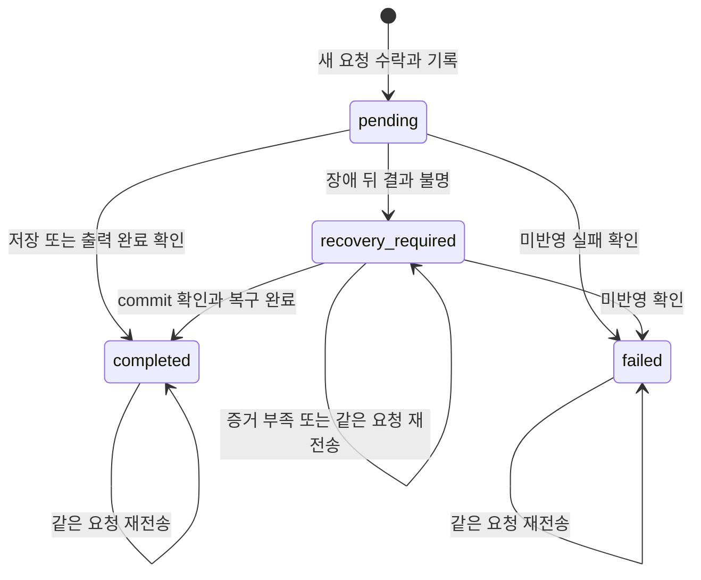

# MCP 도구와 변경 명령 계약 v1

2026-11-02 — [기능 명세](README.md)의 구현 기준안. 아래 이름과 형식은 **새로 구현할 계약**이며 현재 실행 가능한 API가 아니다. `?`는 생략 가능한 필드다. 이 문서의 형식은 구현 시 runtime schema와 테스트 fixture로 옮긴다.

## 현재 인터페이스에서 무엇이 바뀌는가

| 경계 | As-Is | To-Be | 호환성 처리 |
|---|---|---|---|
| 앱 저장 IPC | saveDocument(id, DocumentData), DocumentSummary 응답 | 같은 UI 저장 의도에 expectedRevision·충돌 결과 추가, 공통 service 경유 | renderer/preload/main을 같은 변경에서 전환; public MCP에 전체 문서 저장 API를 노출하지 않음 |
| 외부 에이전트 | MCP 계약 없음 | 아래 T01–T12와 Operation 18개 | 신규 apiVersion 1, 현재 실행 가능하다는 안내 금지 |
| 문서 데이터 | schemaVersion 4 / canonical Markdown 문자열 | 같은 본문 모델을 참조하는 typed target·명령 | 이번 연결을 위해 ProseMirror JSON으로 저장 형식 변경하지 않음 |
| PDF | 현재 창 출력, 사용자 경로 선택 | MCP는 저장 revision job·artifact URI | 기존 수동 출력 경로와 구분, arbitrary path 입력 없음 |

전환 근거는 [design의 A01–A07](design.md), 정상·실패 메시지 순서는 [AS01–TB05](runtime-flows.md)를 참조한다. 이 문서는 schema와 상태 의미를 관리하고 내부 IPC 이름을 public tool로 추가하지 않는다.

## 도구 목록 — T01–T12

아래 이름이 실제 MCP `tools/list`에 노출될 이름이다. 클라이언트가 붙이는 서버 이름 prefix는 이 이름의 일부가 아니다.

| ID | 사용자에게 제공할 기능 | MCP 도구 이름 | 주요 결과 |
|---|---|---|---|
| T01 | 현재 작업 문서와 선택 요소 파악 | `get_context` | 허용 범위, 현재 문서·선택 대상, 기능 목록 |
| T02 | 문서 목록과 이름 검색 | `list_documents` | 허용된 문서 ID·이름·갱신 시각 |
| T03 | 문서 구조와 저장 내용 확인 | `get_document` | revision, outline 또는 canonical 조회 데이터 |
| T04 | 수정 가능한 대상 찾기 | `list_edit_targets` | node·component prop·repeater item prop 목록 |
| T05 | 대상의 현재 값 확인 | `get_edit_value` | 값·유형·상속 여부·Markdown 호환성 |
| T06 | 빈 문서 만들기 | `create_document` | 새 documentId·rootNodeId·revision |
| T07 | 내용·구조·스타일 변경 | `apply_operations` | 변경 요약·생성 ID·저장 revision |
| T08 | 재사용할 컴포넌트 찾기 | `list_components` | 허용된 라이브러리 항목 목록 |
| T09 | 컴포넌트 구조와 입력 항목 확인 | `get_component` | 정의·prop 유형·기본값·library revision |
| T10 | 변경된 문서의 페이지 확인 | `preview_document` | 페이지 이미지·페이지 수·layout 경고 |
| T11 | PDF 만들기 | `export_pdf` | PDF artifact URI·출력 revision |
| T12 | 연결이 끊긴 작업의 결과 확인 | `get_operation` | 진행·성공·실패·복구 필요 상태 |

`list_documents`의 검색은 이름 검색이다. 모든 문서의 본문을 검색하는 기능은 이번에 포함하지 않는다. 문서 안에서 바꿀 내용은 T03–T05로 찾는다.

## 사용자 기능과 계약의 연결

목표·사용자·여정·트레이드오프·인수 조건은 아래 기능 문서에서 설명한다. 이 문서는 정확한 호출 계약을 관리한다. 기능 문서로 분리하면서 도구 12개와 변경 명령 18개의 이름·입출력 범위를 변경하지 않았다.

| 사용자 기능 | 이 문서에서 사용하는 계약 |
|---|---|
| [F01 연결과 허용](features/01-connect-and-authorize.md) | 공통 권한, 모든 tool/resource의 접근 검사 |
| [F02 대상 찾기](features/02-discover-context.md) | T01–T05, T09, 저장 상태·cursor·target |
| [F03 내용 수정](features/03-edit-content.md) | T05/T07/T12, set_edit_value·replace_text |
| [F04 문서 구성](features/04-compose-document.md) | T03/T06/T07/T12, add/move/duplicate/visibility/archive/restore node |
| [F05 컴포넌트 재사용](features/05-reuse-components.md) | T03/T07/T08/T09, prop·item·import·instance 명령 |
| [F06 스타일](features/06-adjust-style.md) | T03/T07/T10, update_node_style와 StylePatch |
| [F07 미리보기와 PDF](features/07-preview-and-export.md) | T10/T11/T12, artifact resource |
| [F08 작업 결과와 복구](features/08-recover-operation.md) | requestId·journal·T12, T06/T07/T11의 부작용과 결과 |

## 1. 공통 계약

### 식별자와 값

- `documentId`, node/item/prop/component ID는 앱에서 조회·생성한 opaque 문자열이다. 파일 경로로 해석하지 않는다.
- `revision`은 저장된 canonical document의 안정적인 직렬화 hash다. 클라이언트가 해석하거나 만들어 보내지 않는다.
- `requestId`는 클라이언트가 만든 UUID 문자열이다. 서버는 연결 credential의 영속 ID와 requestId를 함께 식별자로 사용한다. MCP session이 바뀌어도 조회할 수 있다.
- 새 entity ID는 서버만 생성한다. batch의 앞 명령이 생성할 ID를 뒤 명령이 미리 참조하는 기능은 없다.
- 추가 입력 키는 거절한다. `null`은 명시한 곳에서만 허용한다. 임의 JSON Patch, JS 함수, DOM selector, 파일 경로를 받지 않는다.
- 문자열 길이는 UTF-16 code unit, payload 크기는 UTF-8 byte 기준이다. 목록 `limit` 기본 50, 범위 1–100. `query`는 최대 200자, 이름은 trim 후 1–200자다.
- HTTP JSON body는 최대 2 MiB, 개별 편집 문자열은 최대 100,000자, batch는 1–50개. 큰 원문은 몰래 잘라 반환하지 않고 `RESULT_TOO_LARGE`를 반환한다. 일반 JSON 응답도 2 MiB를 상한으로 한다. 이미지/PDF는 아래 별도 한도를 따른다.

### 편집 대상

기존 [DocumentEditTarget](../../client/src/foundation/documentEditing.ts)을 그대로 사용한다.

```typescript
type DocumentEditTarget =
  | { kind: "node"; nodeId: string }
  | { kind: "component-prop"; instanceNodeId: string; propId: string }
  | { kind: "repeater-item-prop"; repeaterNodeId: string; itemId: string; propId: string };
type DirectEditValue = string | { runs: Array<{ text: string; marks?: RichTextMark[] }> };
```

`RichTextMark`, `ComponentPropValue`, `StyleDefinition`은 기존 [documentModel.ts](../../client/src/foundation/documentModel.ts)의 schemaVersion 4를 기준으로 닫힌 schema를 만든다. 설명 문자열만으로 값 유형을 추정하지 않는다.

직접 수정 가능한 node는 문서 root에서 도달 가능한 node와 해당 문서의 보관 subtree다. component 정의 내부 node는 직접 수정하지 못한다. instance/item은 active prop으로 접근한다. 보관 subtree는 복원 전 내용·스타일 수정 대상에서 제외한다. 조회에는 보관 상태를 표시한다. root는 내용 생성의 container로 사용하되 이동·복제·보관할 수 없다.

### 권한

연결마다 앱 UI에서 다음 grant를 저장한다. tool 호출의 인자로 grant를 받지 않는다.

| grant | 의미 |
|---|---|
| `documentIds` | 읽기 허용 문서 ID 집합; 기본 비어 있음 |
| `write` | 위 문서의 변경 허용; 기본 false |
| `create` | 새 문서 생성 허용; 기본 false. 생성 성공 시 해당 문서를 같은 연결에 읽기·쓰기 가능하게 추가 |
| `libraryRead` | 개인 library 조회·선택 항목 가져오기 허용; 기본 false |
| `render` | 허용 문서 preview/PDF 허용; 기본 false |

`create=true`인 연결에는 UI에서 쓰기도 함께 허용하도록 설정한다. `write`를 해제하면 create도 해제한다. 이미 만든 문서의 읽기 권한은 명시적으로 제거할 때까지 유지한다. library 가져오기는 `libraryRead + write`를 모두 요구한다.

권한 없는 문서는 목록·활성 문맥·resource·오류 상세에도 노출하지 않는다. 미존재/비허용 직접 조회는 동일한 `NOT_FOUND_OR_DENIED`로 응답한다. 대상 식별자를 이미 읽을 권한이 있는 경우에만 상세 오류를 준다. 권한 폐기는 다음 호출 및 artifact 읽기에 즉시 적용한다. 작업을 실행할 때도 최신 grant를 다시 확인한다.

### 성공·오류 응답

도구의 정상 결과는 MCP `structuredContent`에 `{ ok: true, data: ... }`, 호환용 text에 같은 JSON을 반환한다. preview는 추가 image content를 반환한다. `outputSchema`는 성공·실패 결과를 모두 정의한다.

```json
{
  "ok": false,
  "error": {
    "code": "REVISION_CONFLICT",
    "message": "문서가 변경되었습니다. 다시 읽고 수정 내용을 계산하세요.",
    "retryable": false,
    "details": { "currentRevision": "rev-new" }
  }
}
```

도구 실행 오류에는 MCP `isError: true`를 사용한다. 인증 실패는 도구 실행 전에 HTTP 계층에서 처리한다. schema/protocol 오류는 선택한 SDK의 표준 처리에 맞추되, 실행에 들어온 domain 오류는 아래 code로 정규화한다. `retryable=true`여도 새 requestId로 무조건 재실행하라는 뜻은 아니다.

| code | 조건 / 복구 |
|---|---|
| `NOT_FOUND_OR_DENIED` | 비허용 또는 존재하지 않는 문서·library·artifact·request |
| `CAPABILITY_DENIED` | 문서 접근은 가능하지만 쓰기·생성·출력 등 작업 권한 없음 |
| `INVALID_TARGET` | node·item·active prop·container 조건 불일치 |
| `VALIDATION_FAILED` | 값 유형·참조·cycle·형식·범위·알 수 없는 속성 오류 |
| `UNSUPPORTED_OPERATION` | 이번 명세에 없는 operation·기능 |
| `REVISION_CONFLICT` | 저장 revision 또는 library revision 불일치; 재조회 |
| `DOCUMENT_BUSY` | 활성 편집·dirty·saving·draft·적용 handshake 실패; 강제 flush 안 함 |
| `TEXT_NOT_FOUND` / `AMBIGUOUS_TEXT` | 문자열 0회 / 2회 이상 일치 |
| `REQUEST_ID_REUSED` | 동일 credential/requestId에 다른 정규화 입력 |
| `PERSISTENCE_FAILED` | 저장 실패; `details.outcome`은 `not_committed` 또는 `unknown` |
| `OPERATION_RECOVERY_REQUIRED` | journal과 저장 결과 재조정 필요; 자동 중복 실행 금지 |
| `RENDER_FAILED` / `PAGE_OUT_OF_RANGE` | 준비 실패·timeout / 없는 페이지 번호 |
| `ARTIFACT_EXPIRED` | 접근 가능한 작업의 artifact가 만료됨 |
| `RESULT_TOO_LARGE` / `INVALID_CURSOR` | 응답 상한 초과 / 만료·범위 불일치 cursor |

## 2. 조회 도구

### T01 `get_context`

- 입력: `{}`.
- 출력: `apiVersion: "1"`, `appVersion`, `schemaVersion: 4`, opaque `workspaceId`, `capabilities`, `activeDocument: { documentId, revision, hasUnsavedChanges, isEditing } | null`, `selection: { documentId, target: DocumentEditTarget | null, nodeId?: string } | null`, `supportedOperations`, `limits`.
- 현재 문서에 접근 권한이 없으면 activeDocument와 selection을 null로 한다. 이름도 숨긴다.
- selection은 요청 시점 정보다. 이후 쓰기는 명시한 documentId/target으로 고정한다. caret·source-range·anchorRenderId는 보내지 않는다.

### T02 `list_documents`

- 입력: `{ query?: string, cursor?: string, limit?: number }`.
- 출력: `{ items: Array<{ documentId, name, updatedAt }>, nextCursor: string | null }`.
- 허용된 비휴지통 문서만 이름 부분 일치 검색. updatedAt 내림차순, 동률이면 documentId 순.
- 목록은 발견용이다. 수정 revision은 T03/T05에서 다시 읽는다.

### T03 `get_document`

- 입력: `{ documentId: string, view?: "outline" | "canonical" }`. 기본 outline.
- 공통 출력: `{ documentId, name, revision, hasUnsavedChanges, isEditing, view, ... }`.
- outline: `rootNodeId`, `nodes`의 id/type/name/parentId/childIds/visible/archived 상태, instance componentId, repeater의 itemId/componentId/visible 요약. 문서 트리·보관 트리를 제공하고 component 내부 구조는 T09로 조회한다.
- canonical: 저장 모델의 nodes/components/styles와 asset metadata를 포함한 `document` 조회 DTO. asset `dataUrl`은 제외하고 `assets[].{id,name,mimeType}`만 노출한다. 이 DTO를 통째로 저장하는 API는 없다.
- 저장 snapshot만 읽는다. draft/IME 조합 문자열을 저장값에 섞지 않는다. 큰 응답은 오류를 반환하며 T04/T05를 사용하도록 안내한다.

### T04 `list_edit_targets`

- 입력: `{ documentId, cursor?, limit? }`.
- 출력: `{ documentId, revision, items: Array<{ target, label, breadcrumb: string[], valueType: "text" | "markdown" | "rich-text", valueSource: "node" | "default" | "override", supportedOperations: string[] }>, nextCursor }`.
- 문서 순서대로 직접 편집 가능한 text/rich-text/markdown 값만 나열한다. component 정의 내부 node를 별도 쓰기 대상으로 노출하지 않는다. number/boolean/image prop은 T09의 정의와 T03의 instance 값으로 조회하고 전용 prop 명령으로 수정한다.
- 숨긴 요소도 조회하되 label 메타데이터에 표시 상태를 덧붙인다. 보관된 subtree와 archived prop은 제외한다.
- cursor는 documentId·revision·정렬에 묶는다. 중간에 revision이 바뀌면 `INVALID_CURSOR`로 처음부터 다시 조회한다. 다른 목록 cursor도 credential·query·목록 snapshot에 묶으며 10분 후 만료한다.

### T05 `get_edit_value`

- 입력: `{ documentId, target: DocumentEditTarget }`.
- 출력: `{ documentId, revision, target, valueType, value: DirectEditValue, valueSource, hasUnsavedChanges, isEditing, markdownCompatibility?: { editorSupported: boolean, reasons: string[] } }`.
- 기존 `readDocumentEditValue`를 재사용한다. node/prop의 선언 유형을 추가 검증한다.
- Markdown은 원문 문자열을 그대로 반환한다. `editorSupported=false`는 현재 Tiptap block codec으로 편집할 수 없다는 뜻이며, 원문 조회 불가라는 뜻이 아니다.

### T08 `list_components`

- 입력: `{ query?: string, cursor?: string, limit?: number }`.
- 출력: `{ items: Array<{ libraryItemId, name, updatedAt, libraryRevision }>, nextCursor }`.
- `libraryRead` 필요. 개인 library를 이름 부분 일치 검색한다. updatedAt 내림차순, ID로 동률 해소.
- `libraryItemId`는 문서 내부 componentId와 다른 식별자다.

### T09 `get_component`

- 입력은 둘 중 하나다.
  - `{ source: "library", libraryItemId }`: libraryRead 필요.
  - `{ source: "document", documentId, componentId }`: 해당 문서 읽기 필요.
- 출력: `{ source, libraryRevision? 또는 revision, componentId, name, rootNodeId, propDefinitions, nodes, styles, assets }`. assets는 metadata만 제공한다.
- propDefinitions는 id/name/status/valueType/defaultValue/binding을 포함한다. archived prop도 설명용으로 표시하되 수정 불가로 표시한다.
- library에서 받아 본 componentId는 아직 대상 문서에서 유효하지 않다. import 결과의 새 ID를 사용한다.

## 3. 생성·변경·결과 조회

### T06 `create_document`

- 입력: `{ name: string, requestId: string }`.
- 출력: `{ requestId, status: "completed", documentId, rootNodeId, revision, persisted: true }`.
- 기존 `createEmptyDocument`와 repository 생성 경로를 사용한다. 빈 root container와 기존 기본 스타일로 생성한다. UI에서 자동으로 열거나 현재 선택을 바꾸지 않는다.
- create/write 권한 필요. 생성과 권한 추가를 journal로 함께 복구한다. 같은 요청은 문서를 중복 생성하지 않는다.

### T07 `apply_operations`

```typescript
type ApplyInput = {
  documentId: string;
  expectedRevision: string;
  operations: Operation[];
} & (
  | { dryRun: true }
  | { dryRun?: false; requestId: string }
);
```

- write 권한 필요. dryRun도 실제 적용과 같은 권한·입력·revision·busy 검사를 한다.
- dryRun 출력: `{ documentId, baseRevision, dryRun: true, persisted: false, changes, warnings }`. 검증용 메모리 사본에서는 임시 ID를 사용할 수 있으나 영속 생성 ID·가상 revision을 반환하지 않고 artifact·journal도 저장하지 않는다. 예약이나 허가 증서가 아니다.
- 적용 출력: `{ requestId, status: "completed", documentId, previousRevision, revision, persisted: true, uiSynced: boolean, changes, results }`.
- `changes`: `affectedNodeIds`, `affectedTargets`, `removedItemIds`, `summary`.
- `results[]`: `{ operationIndex, type, created?: { nodeId?, itemId?, componentId?, styleId? }, idMap?: Record<string,string> }`. 명령 순서와 대응한다.
- 하나의 문서 snapshot에 순서대로 적용하고 최종 validation 후 저장한다. 중간 실패는 전체 batch를 미반영한다. 별도 문서·library 파일을 수정하는 batch는 지원하지 않는다.
- UI 동기화에 실패해도 저장됐다면 성공 결과의 `persisted=true, uiSynced=false`를 반환한다. UI가 닫혀 있으면 uiSynced는 true로 본다. 저장 실패와 화면 갱신 실패를 혼동하지 않는다.

### T12 `get_operation`

- 입력: `{ requestId }`.
- 출력: `{ requestId, tool, status: "pending" | "completed" | "failed" | "recovery_required", outcome: "not_committed" | "committed" | "unknown", result?, error? }`.
- 같은 credential이 시작한 T06/T07/T11만 조회한다. 현재 문서 접근 권한도 다시 검사한다. pending 생성은 생성 권한을 검사하며, 완료 후에는 생성 문서 권한을 검사한다.
- `failed`는 미반영이 확인된 경우다. 저장 여부 불명이면 recovery_required로 표시하고 무조건 다시 실행하지 않는다.
- request journal은 앱 재시작 뒤에도 유지한다. 첫 버전에는 자동 삭제를 넣지 않는다. 본문 대신 입력 hash·대상·revision·필요한 복구 정보·결과를 기록하고 인증 token은 기록하지 않는다. artifact의 만료와 journal의 생존은 별개다.
- 입력 hash는 도구명과 정규화된 전체 인자로 계산한다(requestId 제외). 권한 확인 뒤 기존 결과를 반환하고 다른 입력이면 `REQUEST_ID_REUSED`다. dryRun에는 requestId가 없다.
- 같은 요청이 아직 처리 중이면 T06/T07/T11 재호출도 `{ requestId, status: "pending" }`을 반환하며 새 실행을 시작하지 않는다. 완료 결과는 T12로 확인한다.

### 변경 실행 순서

1. 인증·현재 권한·형식 검사, requestId 기록 조회.
2. workspace의 직렬화 구간 진입. 대기 사이 바뀔 수 있는 grant와 requestId 상태를 다시 확인.
3. 열린 renderer에 idle 적용 handshake 요청. 실패하거나 dirty/편집 중이면 busy. 확보한 적용 구간 안에서 저장 snapshot과 expectedRevision 비교.
4. 메모리 사본에 명령 실행, 전체 graph·prop·asset·style validation.
5. 적용 구간과 권한이 여전히 유효한지 확인한 뒤 journal에 대상·이전/다음 revision·복구에 필요한 staged snapshot 참조를 남김.
6. canonical document 저장 및 index 갱신. 각 단계의 실패 후 재시작 복구를 테스트.
7. 작업 결과 기록, renderer에 snapshot 전달 및 acknowledgement 결과 반영. 성공·거절·오류 모두 확보한 적용 구간과 writer 구간을 해제.

현재 JSON 파일 여러 개를 한 번의 filesystem transaction처럼 취급하지 않는다. 복구는 staged snapshot과 journal을 대조하며 writer가 복구를 마칠 때까지 관련 문서의 새 변경을 거절한다. UI 저장도 같은 service의 revision 검사를 거치지만, 자신의 dirty draft를 저장하는 요청에 MCP의 busy 규칙을 그대로 적용하지 않는다. 구체적인 적용 구간·generation·timeout은 design O03의 검증 과제다.

### 작업 상태와 재시도 의미 — To-Be



이 상태도는 journal에 수락된 작업을 설명한다. 인증·schema 단계의 거절까지 반드시 journal 항목을 생성한다는 뜻은 아니다. 같은 ID의 다른 입력과 접근 권한 철회는 기존 상태를 바꾸지 않고 해당 조회·재호출을 거절한다.

| 관찰값 | 의미 | 다음 행동 | 하지 않을 추정 |
|---|---|---|---|
| pending | 진행 중 또는 재조정 전 | 같은 ID의 결과 조회 | 응답 지연을 미저장으로 단정 |
| completed + committed | 도구가 약속한 부작용 완료 | 반환 revision/생성 ID 사용 | 모든 경우 UI 반영도 완료됐다고 추정 |
| failed + not_committed | 부작용 미반영 확인 | 원인 해결 후 새 의도의 요청 | 같은 ID에 입력 바꿔 재사용 |
| recovery_required + unknown | 저장 여부 판정 불가 | 복구 상태 확인 | 새 ID로 같은 작업 자동 재실행 |
| persisted=true / uiSynced=false | 저장은 완료, UI ack 미확인 | 현재 저장본과 UI 상태 조정 | 실패로 보고 같은 변경 다시 저장 |
| completed + artifact 만료 | job은 완료, 출력 파일 수명 종료 | 새 PDF가 필요하면 새 requestId | 과거 job을 pending으로 되돌림 |

도구별 commit의 대상은 다르다. T06은 생성 문서·index·grant의 일관성, T07은 하나의 canonical snapshot, T11은 완료된 PDF artifact다. T11의 committed가 문서 본문 변경을 뜻하지는 않는다. 최종 실패 경계와 복구 증거는 O02에서 검증한다.

## 4. Operation 18개

모든 행에는 `type` 필드가 필요하다. 아래 인자는 type 외의 필드다. index는 0부터 시작하며 생략하면 끝에 삽입한다. 허용 범위 밖의 index는 adapter에서 오류로 처리한다. 기존 함수의 clamp 동작을 외부 계약으로 노출하지 않는다.

| type | 입력 | 검증·효과 | 기존 기반 |
|---|---|---|---|
| `set_edit_value` | `target, value` | T05로 읽을 수 있는 값만 같은 선언 유형으로 교체 | `updateDocumentEditValue` |
| `replace_text` | `target, oldText, newText` | text/markdown만; oldText 비어 있으면 오류. 시작 위치를 1자씩 이동해 겹치는 경우까지 일치 수를 세고 1회만 허용 | `replaceTextRange` + `updateDocumentEditValue` |
| `add_node` | `parentId, node: NewNode, index?` | 문서 container 아래 빈 구조 또는 명시 콘텐츠 추가; ID 생성 | `addNode` |
| `move_node` | `nodeId, parentId, index?` | 같은 문서 트리 안 이동; 자기 자손·root·보관 요소 불가. index는 원래 위치 제거 후 기준 | `moveNode` |
| `duplicate_node` | `nodeId, parentId, index?` | 일반 subtree 복제; root/보관 요소 제외. 새 root ID와 idMap 반환 | `duplicateNodeSubtree` |
| `set_visibility` | `nodeId, visible: boolean` | 문서 node의 표시 여부 설정; root 제외 | `setNodeVisibility` |
| `archive_node` | `nodeId` | 부모·index를 보존하며 subtree를 본문에서 제외; root 불가 | `archiveNode` |
| `restore_node` | `nodeId` | archivedFrom으로 복원. 부모가 삭제·보관됐으면 INVALID_TARGET; 이미 복원됐으면 no-op | `restoreNode` |
| `update_node_style` | `nodeId, patch: StylePatch` | 지정 문서 node에만 적용. 공유 style이면 새 style ID로 원본 복사 후 patch | `updateNodeStyle` + 사본 분리 adapter |
| `set_component_prop` | `instanceNodeId, propId, value: ComponentPropValue` | active prop의 선언 유형과 binding 검사; 해당 instance override만 설정 | `setComponentInstanceProp` |
| `clear_component_prop` | `instanceNodeId, propId` | active prop override 제거; 기본값으로 복귀 | `clearComponentInstanceProp` |
| `add_item` | `repeaterNodeId, index?` | 정의 기본값을 쓰는 item 생성; itemId 반환 | `addRepeaterItemFromDefaults` + 필요시 `moveRepeaterItem` |
| `move_item` | `repeaterNodeId, itemId, index` | 같은 repeater 안 순서 변경; 제거 후 배열 기준 | `moveRepeaterItem` |
| `duplicate_item` | `repeaterNodeId, itemId` | 원본 다음에 복제; 새 itemId 반환 | `duplicateRepeaterItem` |
| `remove_item` | `repeaterNodeId, itemId` | item과 override 제거. 복원·UI undo 보장 없음 | `removeRepeaterItem` |
| `set_item_prop` | `repeaterNodeId, itemId, propId, value: ComponentPropValue` | active prop 유형 검사; 해당 item override 설정 | `setRepeaterItemProp` |
| `import_component` | `libraryItemId, expectedLibraryRevision` | 허용 library snapshot을 문서에 복사; 모든 ID 충돌 재매핑, 새 componentId 반환. library 원본은 변경 안 함 | `ComponentLibraryRepository.load` + `importComponentPackage` |
| `add_component_instance` | `parentId, componentId, name, index?` | 이미 문서에 존재하는 정의 사용; props는 빈 객체로 기본값 상속 | `addComponentInstance` |

`archive_node`는 이미 보관 상태면 no-op이다. 나머지 일반 변경은 active 문서 트리만 허용한다. 실제 내용이 바뀌지 않은 batch는 기존 revision을 유지한다. 명령 결과와 requestId 완료 기록은 남긴다.

`import_component`의 idMap key는 종류가 다른 동일 원본 ID를 구별하기 위해 `components:<id>`, `nodes:<id>`, `styles:<id>`, `assets:<id>`, `props:<componentId>:<propId>`, `items:<nodeId>:<itemId>`를 사용한다. 값은 새 ID다. `duplicate_node`의 idMap은 원본 nodeId→새 nodeId다. 새 component의 입력 항목은 T09/T04로 다시 조회할 수 있다.

현재 schemaVersion 4의 binding은 text/rich-text/Markdown/image만 지원한다. 모델의 ComponentPropValue union에 number/boolean이 있어도 실제 active binding 없이 임의 숫자·boolean prop을 만들거나 텍스트 prop에 넣을 수는 없다. 이 작업은 새 binding 종류를 추가하지 않는다.

### NewNode

```typescript
type NewNode = { name: string } & (
  | { type: "container" }
  | { type: "text"; value: string }
  | { type: "rich-text"; value: RichTextValue }
  | { type: "markdown"; source: string }
  | { type: "image"; assetId: string; alt: string }
  | { type: "repeater"; itemComponentId: string }
);
```

visible은 true, container childIds와 repeater items는 빈 배열, style은 미지정으로 시작한다. 호출자가 id/childIds/props/archivedFrom/styleId를 삽입하지 못한다. 이미지 asset과 repeater component는 같은 문서에 이미 있어야 한다. 추가 설정은 반환된 nodeId로 다음 요청에서 한다.

### StylePatch

`StyleDefinition`의 `layout`, `typography`, `markdown`, `decoration`, `pagination`만 허용한다. id/name은 수정하지 않는다. 객체는 깊이 병합, 배열은 전체 교체, leaf의 null은 해당 속성 제거로 정의한다. 그룹 전체 null은 허용하지 않는다.

- typography: fontFamily, fontSizePt, lineHeight, fontWeight, color.
- layout: direction, gapPt, paddingPt, align, justify, width, heightPt, grow, position, topPt/rightPt/bottomPt/leftPt.
- markdown: 현재 모델의 listItemGapPt만.
- decoration: background, borderColor, borderWidthPt, borderEdges, radiusPt.
- pagination: keepTogether, keepWithNext, forcePageBreakBefore.

enum과 ColorValue/WidthValue 형식은 기존 모델을 따른다. 숫자는 finite로 제한한다. fontSizePt/lineHeight는 양수, fontWeight는 1–1000 정수, gap/padding/고정 크기/grow/border/radius는 0 이상, 위치 offset은 음수 허용이다. token 색은 앱이 아는 token만, hex는 앱이 지원하는 hex 형식만 허용한다. fontFamily는 설치 또는 앱 제공 font 목록에 있는 이름만 허용하고 별도 설치는 하지 않는다. raw CSS/HTML/URL 값은 받지 않는다.

### Markdown 보존

set/replace는 canonical 문자열을 직접 변경하며 codec으로 왕복하지 않는다. table/image/reference/footnote/raw HTML 포함 여부를 호환성 결과로 알리고 구조적 block 편집 명령은 제공하지 않는다. 전체 교체는 호출자가 제공한 값으로 명시적으로 교체하는 동작이다. 기존 UI의 unsupported read-only fallback은 유지한다. rich text의 mark는 기존 schema로 검증하고 부분 문자열 교체는 이번 범위에서 제외한다.

## 5. Preview·PDF·resources

### T10 `preview_document`

- 입력: `{ documentId, expectedRevision, page?: number }`. page는 1부터, 기본 1.
- 출력: `{ documentId, revision, page, pageCount, widthPx, heightPx, mimeType: "image/png", warnings: string[] }`와 MCP image content.
- 읽기+render 권한 필요. 현재 저장 revision이 다르면 충돌. 요청이 수락되면 snapshot을 고정하므로 렌더 도중 문서가 변경돼도 처음 수락한 revision을 출력한다.
- hidden BrowserWindow에서 fonts/images/pagination 준비 후 페이지 단위 캡처. 30초 timeout이면 RENDER_FAILED. 이미지는 최대 4 MiB, 긴 변 2048px 이하로 축소하고 실제 크기를 반환한다. 한도 내 생성이 안 되면 오류.
- 편집 중에도 마지막 저장 snapshot preview는 가능하다. 문서 포커스·선택·IME에 접근하지 않는다. 외부 리소스 네트워크 로드는 막고 앱에 등록된 asset/font를 사용한다. 미해결 외부 이미지 등은 warnings로 알린다.

### T11 `export_pdf`

- 입력: `{ documentId, expectedRevision, filename?: string, requestId: string }`.
- filename 기본은 문서명에서 안전하게 만든 `.pdf` basename이다. 지정값은 1–120자, 경로 구분자·제어 문자·`.`/`..`·비PDF 확장자를 거절한다. 실제 저장은 앱 전용 artifact ID별 디렉터리를 사용해 충돌·덮어쓰기를 막는다.
- 읽기+render 권한 필요. 출력 job을 journal에 기록하고 `{ requestId, status: "pending" }`을 반환한다. 결과는 T12로 확인한다.
- 완료 result: `{ documentId, revision, artifactId, uri, filename, mimeType: "application/pdf", byteSize, expiresAt, warnings }`. document 내용에는 쓰지 않는다.
- 60초 job timeout, PDF 최대 20 MiB. 같은 requestId 재요청으로 PDF를 다시 생성하지 않는다. 만료 뒤 새 출력은 새 requestId를 사용한다.
- 사용자는 Formleaf 작업 결과에서 PDF를 열거나 다른 위치에 저장할 수 있다. 에이전트에게 임의 host 파일 경로를 지정하는 기능은 제공하지 않는다.

### Resource 계약

| URI | 내용 | 접근 |
|---|---|---|
| `formleaf://schema/document` | 모델 version, target 유형, Operation schema·예시 | 인증된 연결 |
| `formleaf://documents/{id}` | T03의 outline과 같은 저장 revision·상태 | 같은 문서 grant |
| `formleaf://artifacts/{id}` | 출력 metadata 및 PDF blob | 작업 소유 credential + 현재 문서/render 권한 |

PDF URI는 공개 HTTP 다운로드 URL이 아니다. MCP `resources/read`로 조회하며 앱 UI에서도 export job 결과를 보여준다. 최초에는 resource subscription, autocomplete, 별도 prompt 목록을 제공하지 않는다. 도구 설명과 초기 instructions는 권한에 맞는 기능·사용 순서만 설명하며 비허용 문서 이름을 포함하지 않는다.

artifact는 생성 후 24시간 유지하고 앱 시작 시/주기적으로 만료분을 정리한다. 정리는 **새로 만든 MCP artifact 디렉터리만** 대상으로 하며 사용자 문서·backup·사용자가 별도 저장한 PDF를 삭제하지 않는다. 권한 폐기 시 만료 전이라도 조회를 거부한다. 최대 100 MiB의 MCP artifact 저장 예산을 넘으면 새 job을 거절하고 만료분만 정리한다.

## 6. 호출 예시

다음은 MCP JSON-RPC envelope 안의 tool `arguments` 예시다. ID와 revision은 설명용이며 실제 값은 조회 결과를 사용한다.

### 반복 항목의 설명 일부 변경

`get_edit_value`:

```json
{
  "documentId": "document-example",
  "target": {
    "kind": "repeater-item-prop",
    "repeaterNodeId": "node-careers",
    "itemId": "item-one",
    "propId": "prop-description"
  }
}
```

`apply_operations`:

```json
{
  "documentId": "document-example",
  "expectedRevision": "rev-from-get-edit-value",
  "requestId": "b8bf4984-7777-4da4-a2b7-a405e0455d15",
  "operations": [
    {
      "type": "replace_text",
      "target": {
        "kind": "repeater-item-prop",
        "repeaterNodeId": "node-careers",
        "itemId": "item-one",
        "propId": "prop-description"
      },
      "oldText": "문서 편집 기능을 개발하였습니다.",
      "newText": "문서 편집 기능 개발"
    }
  ]
}
```

### 문단 추가 전 검토

```json
{
  "documentId": "document-example",
  "expectedRevision": "rev-current",
  "dryRun": true,
  "operations": [
    {
      "type": "add_node",
      "parentId": "node-root",
      "node": { "type": "markdown", "name": "소개", "source": "## 소개\n\n문서 편집기를 개발합니다." }
    }
  ]
}
```

적용할 때는 dryRun을 false로 바꾸고 새 requestId를 추가한다. 검토 이후 revision이 바뀌면 적용을 거절한다.

### 페이지 확인과 PDF 출력

`preview_document`:

```json
{ "documentId": "document-example", "expectedRevision": "rev-after-write", "page": 1 }
```

`export_pdf`:

```json
{
  "documentId": "document-example",
  "expectedRevision": "rev-after-write",
  "filename": "resume.pdf",
  "requestId": "7964ca9d-12d3-4f1b-a75a-50ac1b75e64a"
}
```

`get_operation`:

```json
{ "requestId": "7964ca9d-12d3-4f1b-a75a-50ac1b75e64a" }
```

## 7. 구현 파일과 확인할 기준

| 만들거나 변경할 영역 | 책임 | 통과 기준 |
|---|---|---|
| `foundation/documentCommands.ts`, `documentCommandSchemas.ts` | Operation/결과/error 타입과 runtime schema | 18개 명령의 유효·잘못된 값 fixture |
| `main/application/documentService.ts` | UI/MCP 공통 조회·변경·저장 | stale revision·busy·부분 실패 거부 |
| `documentRevision.ts`, `operationJournal.ts` | hash, 중복 실행, 장애 복구 | 같은 ID 재전송·재시작 뒤 한 번만 적용 |
| `main/mcp/server.ts`, `accessPolicy.ts` | loopback, token, grant, Host/Origin | 비허용 문서·폐기 token·잘못된 origin 거부 |
| `main/mcp/tools.ts`, `resources.ts` | 12개 도구·3개 resource 경로 | 목록/실행/출력 schema 일치 |
| `main/application/renderService.ts`, `artifactRepository.ts` | snapshot render·PDF·만료 | revision 고정·권한 폐기·사용자 파일 불변 |
| 기존 IPC handler와 renderer document session | expectedRevision·idle handshake·외부 snapshot 갱신 | IME root/selection 보존·stale autosave 거부 |
| renderer MCP 설정/결과 화면 | 연결·문서 grant·작업 상태·PDF 저장 UX | 사용자 스스로 연결·폐기·결과 확인 |

파일명은 새 책임의 제안 배치다. 기존 foundation operation과 renderer는 재사용하며 실제 구현 시 저장소 관례에 맞춰 분리할 수 있다. 기능 이름·동작 계약을 바꿀 경우에는 이 명세도 먼저 갱신한다.
