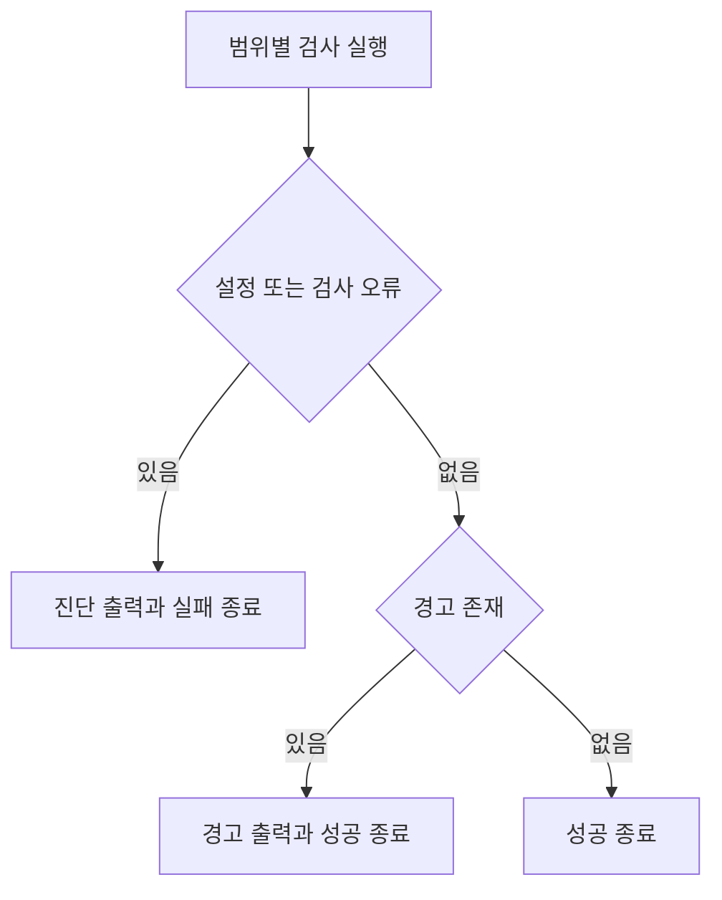

# F01. 검사 기반과 오류·경고 운영 구현 설계

2026-11-08 · 설계 확정·구현 대기 · As-Is 코드 `989a7f6`

[기능 기획](../features/01-analysis-tooling.md) · [설계 요약](README.md) · [정책](policy.md) · [계획](../plan.md) · [테스트 계획·결과](../tests/01-analysis-tooling.md)

## 1. 목표와 현재 상태

**지원되는 도구 조합과 검사 진입점을 만들고 severity·예외의 실행 의미를 보장한다.**

- 관련 인수 조건: F01-AC1·F01-AC2, 공통 AC03·AC04.
- [package.json](../../../client/package.json)은 `tsc --noEmit`과 Node test 명령을 제공하지만 lint가 없다.
- [tsconfig.json](../../../client/tsconfig.json)은 제품과 Vite 설정만 포함한다.
- 측정용 ESLint 9 조합을 제품 의존성으로 그대로 복사하지 않는다.

## 2. 변경 파일과 적용 경계

| 변경 | 파일·symbol | 방식과 이유 |
|---|---|---|
| 수정 | client/package.json·package-lock.json | 지원되는 ESLint·TS plugin 조합과 검사 scripts 추가 |
| 신규 제안 | client/eslint.config.mjs | 파일 범위·severity·unused disable 정책을 관리 |
| 후속 연결 | 환경별 tsconfig와 테스트 범위 | F02·F05가 소유하는 project를 명령에 연결 |

- O01: 설치·peer 호환과 typed lint 실행을 확인해 버전을 확정한다.
- F01은 도구·명령 기반을 검증하며 아직 적용하지 않은 F02–F07 규칙의 완료를 주장하지 않는다.
- F01에서 후속 규칙을 전부 활성화해 해결되지 않은 오류를 한꺼번에 만들지 않는다.
- 각 기능이 자기 규칙을 활성화·수정·검증하고 커밋한다.
- 각 시점에 연결된 검사 범위를 기록하며 최종 범위 누락은 통합 gate에서 실패시킨다.

## 3. 명령과 오류 계약

**아래는 최종 명령 계약이며 project·파일은 담당 기능 완료 시 연결한다.**

| 제안 명령 | 계약 |
|---|---|
| `typecheck:app` | foundation·main·preload·renderer·tools project 검사 |
| `typecheck:test` | unit·E2E project 검사 |
| `typecheck` | 위 두 범위를 모두 실행 |
| `lint:app`, `lint:test`, `lint:tools` | 파일 범위별 검사, 합의한 warning 허용 |
| `lint` | 위 세 범위를 모두 실행 |
| `check` | typecheck와 lint 실행, 오류 발생 시 실패 |
| 기존 `test`·`build` | Node runner 및 Electron/Vite build 유지 |

- 명령은 신규 제안이며 현재 `package.json`에는 없다.
- 루트 check는 하나라도 실패하면 비정상 종료하고 warning만 있으면 성공한다.
- typed lint용 TS project 지정은 실제 파일 포함 목록으로 검증한다.
- CI workflow 신설은 현재 문서 범위에 포함하지 않으며 동일 check를 연결할 수 있게 만든다.

- JS recommended·TS recommendedTypeChecked를 기반으로 정책 override를 명시한다.
- 제품·unit·E2E·설정·JS 도구를 파일 목록으로 점검한다.
- `reportUnusedDisableDirectives`는 error이며 예외에는 규칙과 이유가 필요하다.
- 새 저장 데이터나 runtime 상태는 없고 검사 결과와 프로세스 종료 코드만 생성한다.

To-Be 검사 결과 분기는 다음과 같다.

- 이 설계의 핵심은 검사 결과에 따른 종료 코드이며 위 flowchart가 해당 분기를 설명한다. 개별 plugin 내부 호출·클래스 구조는 도구 선택의 상세 범위가 아니어서 별도 sequence·class 도식은 생략한다.

## 4. 대안·검증·복구

- 대안: 모든 warning 차단은 단순하지만 합의한 경고 정책과 충돌하므로 사용하지 않는다.
- 검증 범위·절차·통과 기준·실행 결과: [대응 테스트 문서](../tests/01-analysis-tooling.md).
- F01 완료: 기반 도구와 현재 연결한 명령이 통과하고 미연결 범위를 기록한다.
- 최종 명령 전체 연결 여부는 F07 이후 통합 검증에서 다시 확인한다.
- 실패 시 의존성·config 변경만 재조정하고 제품 저장·편집 코드를 변경하지 않는다.
