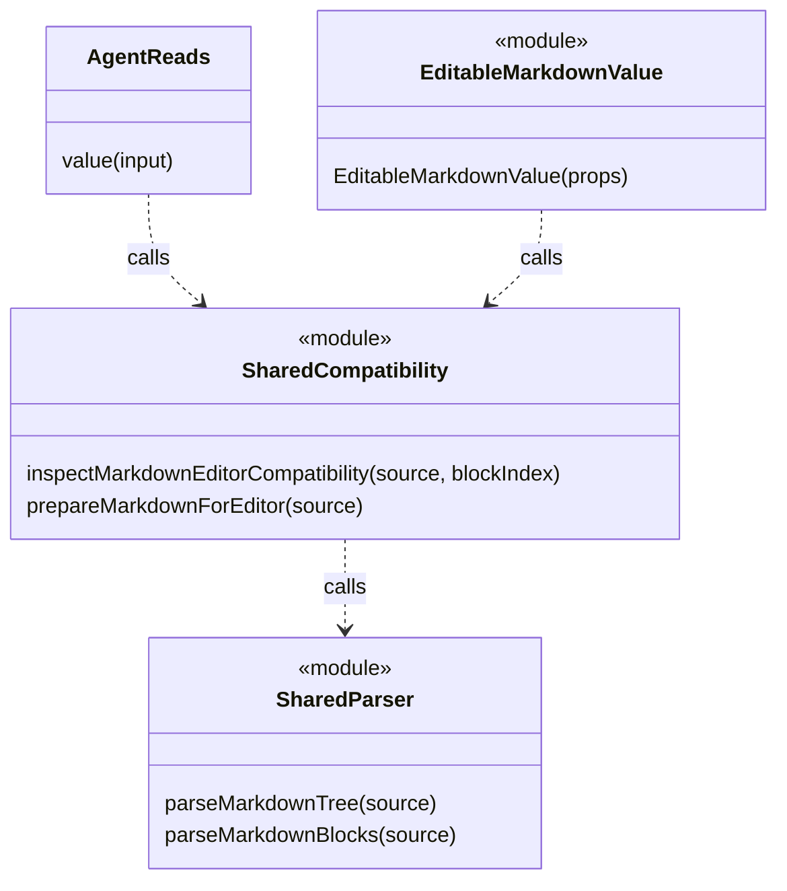

# F02. 실행 환경과 레이어 경계 구현 설계

2026-11-08 · 설계 확정·구현·검증 완료 · As-Is 코드 `989a7f6`

[기능 기획](../features/02-runtime-boundaries.md) · [설계 요약](README.md) · [정책](policy.md) · [계획](../plan.md) · [테스트 계획·결과](../tests/02-runtime-boundaries.md)

## 1. 목표와 As-Is → To-Be

**혼합 타입 환경과 main의 renderer 의존을 분리한다.**

- 관련 인수 조건: F02-AC1·F02-AC2, 공통 AC01·AC02.
- 현재 [tsconfig.json](../../../client/tsconfig.json)은 DOM·Node 전역을 함께 제공한다.
- [AgentReads.value](../../../client/src/main/mcp/readTools.ts)는 renderer의 호환성 함수를 호출한다.
- 목표는 환경별 project와 공통 파서 소유권이며 저장 schema·API 결과는 유지한다.
- F01이 도구 기반을 제공하고 F05가 테스트 project의 실제 전환을 마무리한다.

## 2. 환경별 타입 검사와 import 경계

**공통 compiler 옵션과 실행 환경의 타입을 분리하고 import 방향은 lint에서 검증한다.**

아래 경로는 모두 `client/` 기준 신규 제안이며 아직 존재하지 않는다.

| 제안 파일 | 검사 대상·타입 환경 |
|---|---|
| `tsconfig.base.json` | strict·noEmit 및 확정 compiler 옵션; DOM·Node 전역 없음 |
| `tsconfig.foundation.json` | `src/foundation`, ES lib·환경 독립 계약 |
| `tsconfig.main.json` | `src/main`, Node/Electron |
| `tsconfig.preload.json` | `src/preload`, bridge 구현에 필요한 Electron·Node 타입 |
| `tsconfig.renderer.json` | `src/renderer`, DOM·React·renderer alias |
| `tsconfig.test.json` | `test`, Node runner와 테스트별 필요한 DOM 타입 |
| `tsconfig.e2e.json` | `e2e`, `playwright.config.ts`, Node·Playwright·browser evaluate 타입 |
| `tsconfig.tools.json` | `electron.vite.config.ts`, Node·build tool 타입 |
| `eslint.config.mjs` | 파일별 환경·typed lint project·규칙·import 제한 |

- 기존 `tsconfig.json`은 IDE·도구의 진입점으로 정리하고 실제 검사는 각 project를 명시해 실행한다.
- foundation 단독 검사를 반드시 실행해 다른 project의 DOM·Node 전역 유입을 놓치지 않는다.
- test project에 renderer 소스가 import될 수 있으므로 unit project를 Node 전용이라고 단정하지 않는다.
- JS 스크립트는 기본 lint를 적용하고 TS parser project에 억지로 포함하지 않는다.
- 생성물·의존성·테스트 출력은 제외하되 소스·fixture·설정은 누락하지 않는다.
- `verbatimModuleSyntax`와 Node 직접 실행의 module 해석을 실제 package/import 구조로 검증한다.
- 전역 `type: module` 추가는 Electron main 출력 해석을 바꾸므로 자동 해결책으로 사용하지 않는다.

| 출발 레이어 | 허용할 내부 의존 | 금지할 내부 의존 |
|---|---|---|
| foundation | foundation | main·preload·renderer, Node/Electron/DOM 전용 API |
| main | main·foundation | preload·renderer |
| preload | preload·foundation | main 구현·renderer 구현 |
| renderer app | renderer 하위 레이어·foundation | main·preload 구현 |
| renderer pages | pages·shared·foundation | app·main·preload 구현 |
| renderer shared | shared·foundation | pages·app·main·preload 구현 |

**경로 규칙은 상대 import와 alias 양쪽에서 같은 위반을 잡아야 한다.**

- `no-restricted-imports`의 파일별 override를 우선 검토한다.
- `@/`와 상대 경로, export-from, type import, dynamic import의 우회 여부를 최소 fixture로 확인한다.
- 단순 패턴으로 대상 해석을 보장하지 못하면 resolved path를 다루는 호환 plugin 또는 작은 전용 규칙을 선택한다.
- preload의 타입 허용이 Node API 전체를 renderer에 노출하는 허용은 아니다.

### Markdown 공통 코드 이동

**main이 필요한 순수 파싱·호환성 로직만 foundation으로 이동한다.**

- 현재 [markdownEditorCompatibility.ts](../../../client/src/renderer/src/pages/document-editor/markdown/editor/markdownEditorCompatibility.ts)는 [parser.ts](../../../client/src/renderer/src/pages/document-editor/markdown/parser.ts)의 `parseMarkdownTree`·`parseMarkdownBlocks`를 사용한다.
- 신규 제안 경로는 `src/foundation/markdown/parser.ts`와 `editorCompatibility.ts`다.
- parser의 전체 import closure를 확인하고 DOM·React가 없는 부분만 옮긴다.
- renderer 호출부와 `AgentReads.value`의 import를 함께 갱신한다.
- `prepareMarkdownForEditor`, block offset·빈 줄 보존과 캐시 의미도 이동 전후 비교한다.
- editor session·DOM·toolbar는 renderer에 유지한다.

To-Be 의존 관계는 아래와 같다. 함수는 실제 클래스가 아닌 모듈 멤버로 표시한다.

- `SharedCompatibility`·`SharedParser`는 제안한 foundation 모듈의 도식 별칭이다.
- 다른 renderer 파서 호출부와 외부 remark 의존은 생략했다.

## 3. 계약·선택·검증

- `DocumentData`, Markdown source·blockIndex 입력과 editable·unsupportedTypes 출력을 유지한다.
- 파서 이동은 영속 저장을 추가하지 않으며 기존 캐시·offset 의미를 보존한다.
- [electron.vite.config.ts](../../../client/electron.vite.config.ts)의 ESM 의존성 bundle과 CJS main 실행을 유지한다.
- 대안: config 분리만으로는 import 방향을 막을 수 없어 lint를 병행한다.
- O02: 상대·alias·type import·export-from·dynamic import 위반 fixture와 정상 import를 비교한다.
- 검증 범위·절차·통과 기준·실행 결과: [대응 테스트 문서](../tests/02-runtime-boundaries.md).
- 실패 시 공통 코드 이동 범위부터 복구하며 결과 호환성이 확보될 때까지 다음 기능으로 넘어가지 않는다.
- 이 문서의 핵심인 공통 파서 호출·의존 방향은 위 classDiagram이 설명한다. 파서 내부 실행 순서와 MCP 요청 전체의 runtime sequence는 이 이동 설계의 판단에 추가 정보가 없어 생략한다.

## 적용 결과

환경별 foundation/main/preload/renderer/tools project와 import 제한을 추가했다. Markdown parser와 호환성 로직은 foundation으로 이동했고 기존 renderer 경로는 재수출로 호출 호환성을 유지한다. Node/DOM 전역을 열지 않고 표준 clone/UUID 기능만 제공하는 foundation/runtime.ts를 추가했다. 경계 규칙은 상대 경로·alias·type import·export-from·dynamic import·require를 검사한다.

## 편집기 연결 후속 수정

- 분리한 leaf project를 root solution references로 연결해 편집기 자동 탐색에도 같은 환경을 적용한다. 공통 baseUrl은 제거하고 paths의 config 기준 상대 해석을 유지한다. 상세 원인·수정·검증은 [F05 후속 설계](05-typescript-tests.md#편집기-프로젝트-연결-누락의-후속-수정-설계)가 소유한다.
