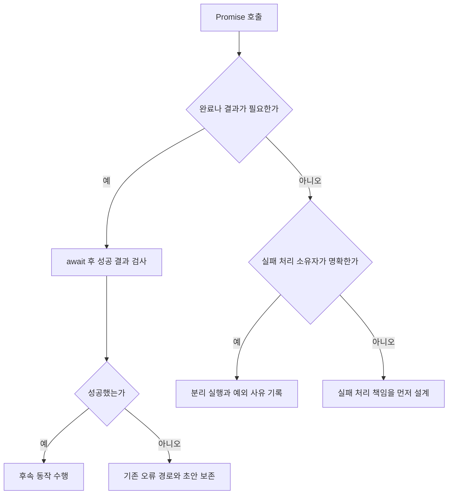
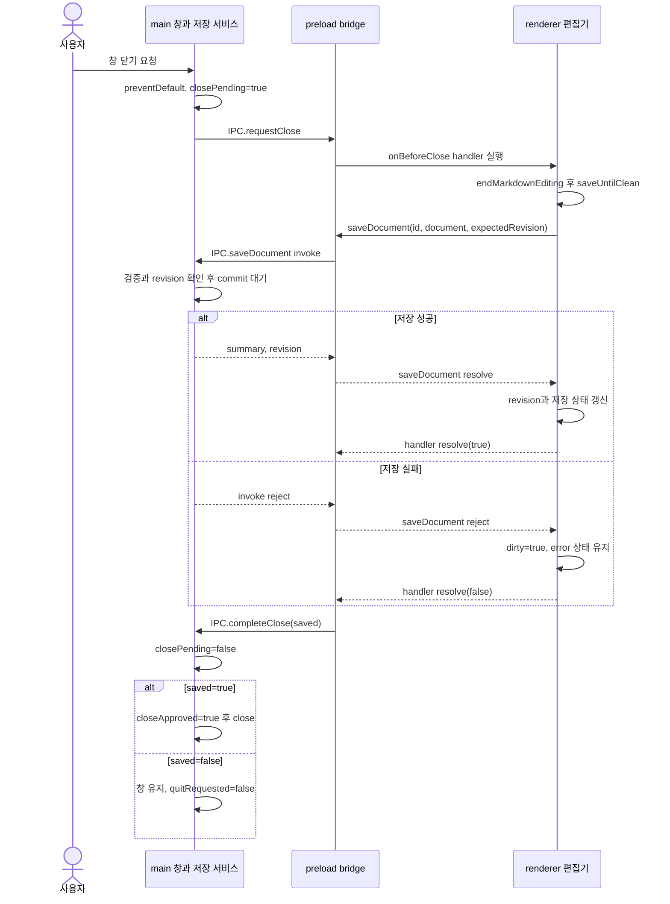

# F03. Promise 완료와 실패 책임 구현 설계

2026-11-08 · 설계 확정·구현 대기 · As-Is 코드 `989a7f6`

[기능 기획](../features/03-promise-ownership.md) · [설계 요약](README.md) · [정책](policy.md) · [계획](../plan.md) · [테스트 계획·결과](../tests/03-promise-ownership.md)

## 1. 목표와 현재 호출

**Promise의 완료·결과·실패 책임을 호출부별로 확정한다.**

- 관련 인수 조건: F03-AC1·F03-AC2, 공통 AC02·AC03.
- `ignoreVoid=false` 실험의 49곳은 검토 대상이며 확인된 버그 49개가 아니다.

| 현재 파일·symbol | 확인한 호출 | 수정 방향 |
|---|---|---|
| [useGenericDocumentSession](../../../client/src/renderer/src/pages/document-editor/useGenericDocumentSession.ts) | timer·flush의 void saveNow, saveUntilClean | 내부 실패 처리와 boolean 결과 계약 확인 |
| [GenericDocumentEditorPage](../../../client/src/renderer/src/pages/document-editor/GenericDocumentEditorPage.tsx) | onBeforeClose → saveUntilClean | 저장 성공을 닫기 결과로 전달하는 순서 보존 |
| [main/index](../../../client/src/main/index.ts) | loadURL·loadFile·openExternal·초기화 chain | 실패 처리 소유자·앱 초기화 후속 동작 검토 |
| [AgentSettingsPage](../../../client/src/renderer/src/pages/agent-settings/AgentSettingsPage.tsx) | poll·refresh·run 호출 | 내부 catch·UI error 반영·수명 취소 확인 |

## 2. 변경 방식과 실패 계약

- ESLint에 `no-floating-promises: [error, {ignoreVoid:false}]`, `no-misused-promises: error`를 적용한다.
- 반환 결과가 필요한 경로는 await 후 성공 여부까지 확인한다.
- 결과가 불필요해도 실패 소유자가 없으면 처리 경계를 먼저 만든다.
- 내부 처리로 안전한 호출만 국소 예외와 사유를 남긴다.
- 빈 catch·무조건 await·성공 결과 무시는 해결 방식이 아니다.
- 저장 데이터·commit 시점은 기존 service가 소유하며 오류 시 초안을 지우지 않는다.

To-Be Promise 판단 흐름은 D01의 호출 문맥을 기준으로 한다.

- 예외를 발생시키지 않고 실패 결과를 반환하는 함수도 성공 여부를 확인한다.
- lint만으로 내부 실패 처리의 적절성을 입증할 수 없으므로 호출자 검토가 필요하다.
- 저장소 재시도와 사용자 알림의 구체적인 방식은 각 기존 서비스 계약을 따른다.

### 저장 후 닫기의 실제 호출 순서

**As-Is에서 확인한 저장·닫기 순서를 To-Be에서도 보존한다.**

- 근거: `989a7f6`의 [main close handler](../../../client/src/main/index.ts), [preload onBeforeClose](../../../client/src/preload/index.ts), `GenericDocumentEditorPage`와 `useGenericDocumentSession`.
- 전제: editor의 close guard가 켜져 있고 저장할 변경이 있으며, 이 요청 중 추가 입력이 없는 경우다.
- renderer participant는 페이지의 닫기 handler와 session hook을 묶어 표시한다.

- 저장 서비스는 [DocumentService.save](../../../client/src/main/application/documentService.ts)의 commit 완료 후 응답한다. IPC 전송 시작을 저장 완료로 간주하지 않는다.
- handler 자체가 reject하면 preload의 rejection handler가 `completeClose(false)`를 보낸다.
- `saveNow`는 기존 in-flight 요청을 기다리고, `saveUntilClean`은 첫 성공 뒤 dirty가 남으면 한 번 더 저장한다. 그림은 이 반복·이미 clean인 경우를 생략했으며 무한 재시도 보장을 뜻하지 않는다.
- 닫기 guard가 없는 화면과 권한·revision 검사의 내부 분기는 이 그림의 범위 밖이다.
- 이 순서는 기존 계약의 설명이며 현재 코드에서 닫기 버그가 재현됐다는 주장이 아니다. 검증은 [F03-T01·T02](../tests/03-promise-ownership.md)를 따른다.

## 3. 대안·검증·복구

- 모든 void 허용 대신 호출 문맥별 책임을 선택한 이유는 [D01](policy.md)을 따른다.
- reject·false 결과·지연 완료·분리 실행의 검증은 [F03 테스트](../tests/03-promise-ownership.md)를 따른다.
- 저장 실패 시 닫기가 거절되고 성공 후에만 후속 동작이 수행돼야 한다.
- 분리 실행은 처리되지 않은 rejection이 없고 필요한 UI 오류가 표시되는지 확인한다.
- 호출 책임과 완료 순서는 위 sequence에서 설명한다. 별도 class 도식은 이 기능에 필요한 추가 의존 관계를 설명하지 않아 생략한다.
- 실패 시 해당 호출 수정만 재검토하고 기존 saveUntilClean 계약을 유지한다.
