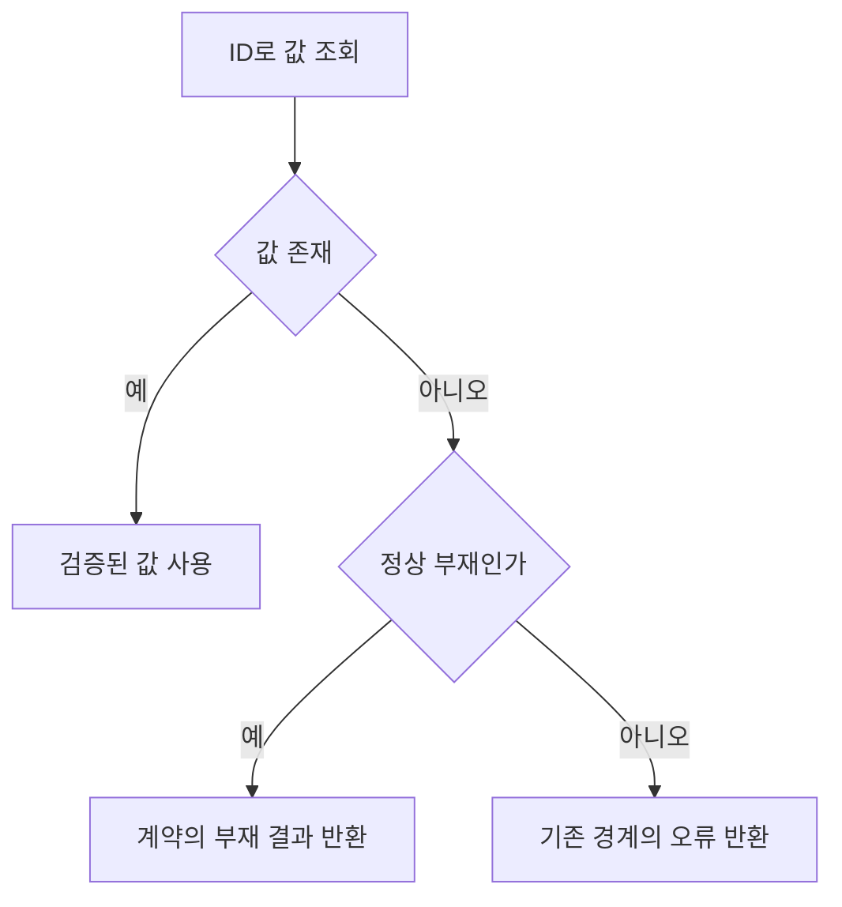

# F04. 타입 안전성과 제어 흐름 구현 설계

2026-11-08 · 설계 확정·구현 대기 · As-Is 코드 `989a7f6`

[기능 기획](../features/04-type-safety.md) · [설계 요약](README.md) · [정책](policy.md) · [계획](../plan.md) · [테스트 계획·결과](../tests/04-type-safety.md)

## 1. 목표와 코드 근거

**부재·외부 입력·반환 의도를 타입으로 표현하고 런타임 계약을 유지한다.**

- 관련 인수 조건: F04-AC1·F04-AC2, 공통 AC02·AC03.
- 인덱스 강화 174건과 반환 경로 3건 등 기존 측정은 [audit](audit.md)을 따른다.

| 파일·symbol | 현재와 변경 |
|---|---|
| [documentCommandTargets](../../../client/src/foundation/documentCommandTargets.ts) requireDocumentNode | 기존 검사 함수를 재사용해 필수 존재 검증을 모음 |
| [AgentReads.document](../../../client/src/main/mcp/readTools.ts) | document.nodes 조회의 부재를 계약에 맞게 처리 |
| [nodeOperations](../../../client/src/main/application/nodeOperations.ts)·[componentOperations](../../../client/src/main/application/componentOperations.ts) | 미지원 경로에 명시적 undefined 반환, 정상 sentinel 유지 |
| [renderService](../../../client/src/main/application/renderService.ts) | page bounds와 SDK 응답을 좁히되 finally cleanup 유지 |
| [atomicJsonStore](../../../client/src/main/document/atomicJsonStore.ts) | firstError 전달 시 Error 원인 보존 |
| [env.d.ts](../../../client/src/renderer/src/env.d.ts) | CSS import 선언 추가, 실제 경로는 build 확인 |

## 2. 옵션·규칙 적용

- F02의 공통 config에 D02·D09·D11·D12, noImplicitOverride·verbatimModuleSyntax를 적용한다.
- exactOptionalPropertyTypes는 전역 비활성, skipLibCheck는 true로 유지한다.
- D07·D08과 추가 타입·제어 흐름 error 규칙을 적용한다.
- require-await는 끄고 allowUnreachableCode는 default, no-unreachable로 검사한다.
- 정책 목록·예외는 [policy](policy.md)가 소유하며 F04가 일반 타입 관련 규칙을 구현한다.

## 3. 입력·분기·오류 계약

**진단별로 정상 부재, 불변식 위반, 외부 실패를 구분해 수정한다.**

| 수정 대상 | 입력·검사 | 처리와 출력 | 실패 경계 |
|---|---|---|---|
| node·component 인덱스 | ID와 검증된 document | 정상 부재면 분기, 필수 존재면 공통 checked lookup | 기존 INVALID_TARGET 등 호출 경계의 오류 의미 유지 |
| JSON·IPC·SDK 응답 | unknown 값 | 기존 schema/guard 재사용 후 typed 값 반환 | 경계에서 실패, 내부에 any 전파 금지 |
| operation 반환 | operation 종류 | 기존 dispatch 순서와 미지원 undefined 유지 | 정상 미지원에 새 예외를 만들지 않음 |
| Error·문자열 변환 | throw 값·객체 | Error/cause·의미 있는 문자열로 표현 | 원본 실패 세부 정보 보존 |

To-Be 인덱스 조회는 정상 부재와 불변식 위반을 구분한다.

- 필수 ID 검사는 기존 requireDocumentNode·schema를 재사용하며 무조건 throw하는 새 규칙을 만들지 않는다.
- 외부 JSON·IPC·SDK 값은 unknown에서 guard/schema를 거쳐 내부 typed 값으로 전달한다.
- 핵심 조회 분기는 위 flowchart, 입력·출력·실패 계약은 대응 표에서 설명한다. 개별 service 내부 알고리즘 전체나 저장 레이어 호출 순서는 이 타입 보강 범위에 포함하지 않으며, 저장 완료와 후속 동작의 순서는 [F03](03-promise-ownership.md)의 sequence를 참조한다.

## 4. 대안·검증·복구

- 대안: assertion 일괄 추가는 타입 오류를 숨기므로 실제 검사를 선택한다.
- 제어 문자 검증 regex는 의도와 위치를 확인한 국소 예외만 허용한다.
- unused 인자·rest 제외는 D08의 범위만 허용하고 일반 지역 변수는 정리한다.
- 검증 범위·절차·통과 기준·실행 결과: [대응 테스트 문서](../tests/04-type-safety.md).
- 타입 검사·lint·기존 domain 테스트와 build를 통과한다.
- 실패 시 변경한 lookup·validator·반환 경계에서 수정하며 오류 code와 원본 cause를 유지한다.
