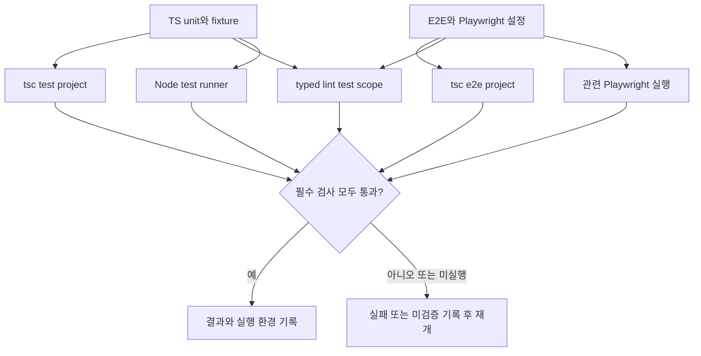
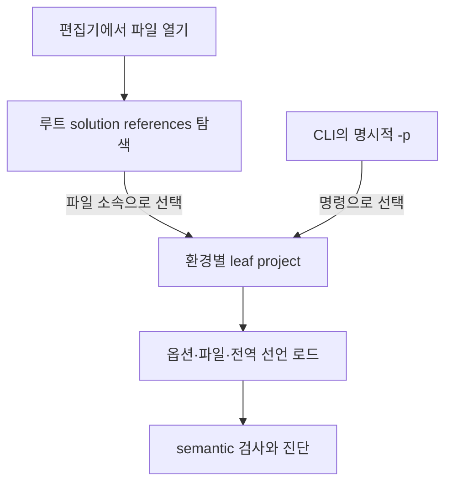

# F05. 테스트 TS 전환과 검사 범위 구현 설계

2026-11-08 · 설계 확정·구현·검증 완료 · As-Is 코드 `989a7f6`

[기능 기획](../features/05-typescript-tests.md) · [설계 요약](README.md) · [정책](policy.md) · [계획](../plan.md) · [테스트 계획·결과](../tests/05-typescript-tests.md)

## 1. 목표와 현재 구조

**unit·fixture를 TS로 전환하고 E2E까지 실행과 정적 검사를 분리한다.**

- 관련 인수 조건: F05-AC1·F05-AC2, 공통 AC01·AC05.
- [package.json](../../../client/package.json)은 unit .mjs를 Node runner로 실행한다.
- [playwright.config.ts](../../../client/playwright.config.ts)와 e2e는 현재 제품 typecheck include 밖이다.
- F01의 명령과 F02의 project 경계를 재사용하고 실제 테스트 파일 목록을 연결한다.

## 2. 변경 파일·방식

**테스트 실행과 타입 검사를 분리하고, 전체 검사가 둘 다 빠뜨리지 않도록 구성한다.**

- `test/**/*.test.mjs`와 테스트 fixture를 `.ts`로 바꾸고 내부 import 및 package scripts를 갱신한다.
- 잘못된 입력을 의도한 테스트는 유효 타입으로 위장하지 말고 해당 호출의 최소 예외를 명시한다.
- E2E의 CDPSession 값·factory 구분, Node union narrowing, HTMLElement narrowing을 실제 타입으로 고친다.
- `findLast`의 lib 선택과 Electron executable path는 실행 런타임·타입 선언을 함께 확인한다.
- 테스트를 위해 build target을 무조건 올리거나 `any`로 되돌리지 않는다.
- 기존 개별 test 명령의 테스트 목록을 보존한다.

| 변경 | 대상 | 결과 |
|---|---|---|
| 이름·타입·import 수정 | client/test의 unit·fixture | 같은 사례를 .ts로 직접 Node 실행 |
| 타입 수정 | client/e2e와 playwright.config.ts | CDPSession·DOM·SDK 계약 오류 해소 |
| config 연결 | tsconfig.test.json·tsconfig.e2e.json·eslint.config.mjs | 실제 파일 전체를 타입 검사·lint에 포함 |
| scripts 연결 | package.json의 test·typecheck:test·lint:test | 실행과 타입 검사 모두 수행 |

### 실행 성공과 정적 검사 성공의 구분

**To-Be에서는 같은 테스트 소스를 타입 검사·lint·runner 실행으로 각각 확인한다.**

- 이 그림은 검사 책임과 완료 판단이며 명령의 병렬 실행이나 하나의 npm 명령으로 모두 실행됨을 뜻하지 않는다.
- Node의 타입 제거와 테스트 통과만으로 `tsc`·lint 성공을 대신할 수 없다.
- E2E 실행은 해당 변경에 필요한 범위를 정하고 외부 CLI·계정 조건 때문에 못한 경우 별도로 기록한다.
- 합의한 lint warning은 통과를 막지 않지만 error와 필수 검사의 미실행은 통과로 기록하지 않는다.
- 소스→검사→결과 관계는 이 그림에서 다루며 실제 명령·버전·실행 결과는 [F05 테스트](../tests/05-typescript-tests.md)가 소유한다.

## 3. 계약·전환·검증

- Node type stripping은 타입 검사가 아니므로 tsc 실행을 유지한다.
- O03: module 해석·.ts 확장자·erasable 문법·lib를 실제 설치 런타임에서 확인한다.
- 제품 package의 type 필드를 변경해 Electron 출력 해석을 깨뜨리지 않는다.
- 테스트 fixture는 격리 데이터만 사용하며 실제 userData를 읽거나 수정하지 않는다.
- 의도적인 invalid input은 테스트 지점의 예외이며 전체 test 폴더 제외는 금지한다.
- 대안: runner 교체는 범위와 비용을 늘리므로 현재 Node runner를 유지한다.
- 검증 범위·절차·통과 기준·실행 결과: [대응 테스트 문서](../tests/05-typescript-tests.md).
- 실패 시 확장자·import·config를 같은 단위로 복구하며 사례 자체를 삭제하지 않는다.
- 검사 경로는 위 flowchart로 설명한다. 실행 도구 내부의 호출 순서와 클래스 관계는 선택한 Node runner를 교체하는 설계가 아니므로 상세 범위에서 제외한다.
- 최종 검사 명령 계약은 [F01](01-analysis-tooling.md)을 따른다.

## 적용 결과

unit 30파일과 fixture를 TS로 전환하고 기존 사례 159개의 이름·순서를 보존했다. Node runner·개별 script 목록은 유지한다. test/e2e project는 ES2023 lib·DOM/Node 타입·erasableSyntaxOnly를 적용하며 제품 target은 유지한다. typed lint는 두 project와 Playwright 설정을 포함한다. fixture의 필수 값·node 종류·MCP 응답은 실제 검사 helper로 좁히고 의도적인 invalid input에만 사유 있는 국소 예외를 둔다. Node test 등록 Promise는 top-level await로 처리한다. Electron executable의 런타임 문자열 반환을 별도 adapter에서 확인한다.

- React session 시험의 inline JS/TSX 문자열도 `test/fixtures/promise-harness.ts`로 옮겨 타입 검사·lint에 포함했다.
- Playwright는 testInfo를 쓸 때 첫 인자의 object destructuring을 요구하므로 5곳의 빈 fixture 패턴만 사유 있는 no-empty-pattern 예외로 남겼다. Electron 경로 adapter는 import.meta 없이 CJS 수집과 Node ESM 양쪽을 지원한다.

## 편집기 프로젝트 연결 누락의 후속 수정 설계

- 기준 `dceeffe`에서 실제 tsserver를 실행하니 e2e/agent-content.spec.ts와 test/react-behavior.test.ts가 inferred project로 열렸다. CLI의 명시적 -p 검사와 편집기 자동 탐색이 다른 상태였다. agentRoot를 포함한 기존 전역 선언 파일 자체는 존재한다.
- client/tsconfig.json은 src만 포함하는 혼합 프로젝트였으며 분리한 test/e2e config를 편집기에 알려주지 않았다. 루트를 files=[] + 7개 leaf project references의 solution으로 바꾼다. 제품 파일도 각 환경 config를 선택하도록 한다.
- VS Code 내장 TS 6.0.3과 workspace TS 5.9.3을 확인했다. 공통 baseUrl은 삭제하고 기존 ./src/renderer/src/* paths를 config 기준 상대 경로로 유지한다. ignoreDeprecations나 전역 Window 선언 확장으로 덮지 않는다.
- 검증: 실제 tsserver의 projectInfo·semanticDiagnosticsSync·compilerOptionsDiagnostics-full로 E2E/unit·foundation/main/preload/renderer/tools 선택과 진단을 확인한다. 기본 npm suite에 workspace tsserver 회귀를 추가하고 설치된 VS Code 6.0.3으로 별도 검증한다. alias 해석은 기존 check·build로 확인한다.
- 기존 domain·저장·React 수명 변경은 없다. references는 leaf 간 출력 의존성을 새로 만들지 않는 편집기 탐색용 solution이다. 기존 -p 검사와 noEmit 계약은 유지하며 build mode로 전환하지 않는다.

- 근거: TypeScript의 [solution config 안내](https://www.typescriptlang.org/docs/handbook/project-references)와 [TS 6.0 baseUrl 변경](https://www.typescriptlang.org/docs/handbook/release-notes/typescript-6-0.html). 실제 protocol 회귀는 test/editor-projects.test.ts·fixtures/tsserver-client.ts가 소유한다.

### 후속 적용 결과

- root solution references와 baseUrl 제거를 적용하고 실제 editor discovery 회귀를 기본 suite에 연결했다. -p 검사·Node 타입 제거·Electron build 계약은 유지했다.
- workspace/VS Code 두 tsserver의 8개 경로·root config 진단, TS 6의 전체 7 project 진단과 CLI check·166 unit·build·해당 E2E 1개가 통과했다. 기존 화면의 잔여 진단 갱신 한계는 F05 테스트 결과에 명시한다.

### 편집기와 CLI의 project 선택 경로

기존 혼합 root project 대신 동일한 leaf 설정으로 진단을 연결한다. 전역 선언은 선택된 project 안에서만 로드한다.

- root solution은 파일을 직접 혼합하지 않는다. 테스트 전역 선언을 제품 project로 옮기지 않는다. 새 runtime 모듈/클래스 의존성을 만들지 않는 설정 선택 흐름이므로 별도 classDiagram은 추가하지 않는다.
