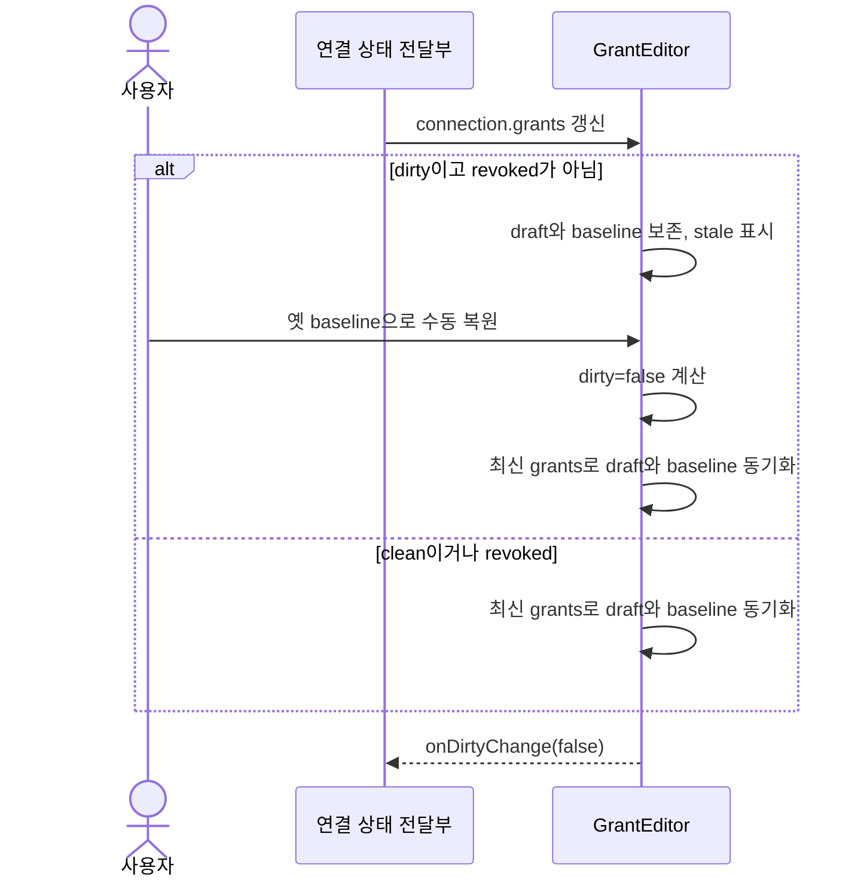
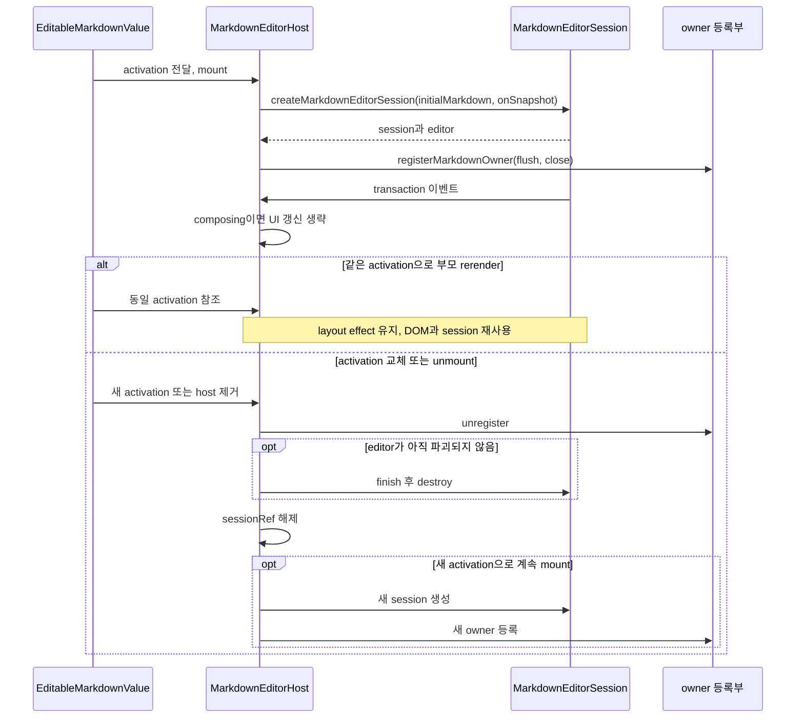
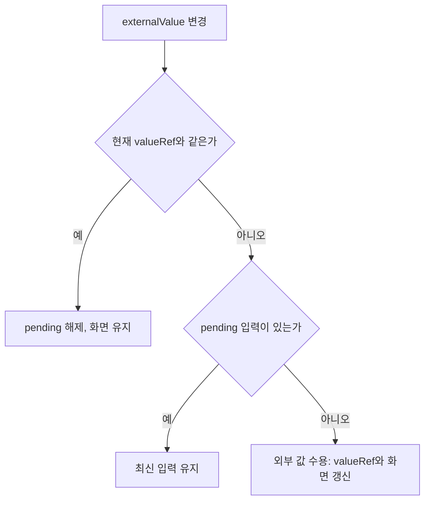

# F06. React 규칙과 편집·초안 보존 구현 설계

2026-11-08 · 설계 확정·구현 대기 · As-Is 코드 `989a7f6`

[기능 기획](../features/06-react-behavior.md) · [설계 요약](README.md) · [정책](policy.md) · [계획](../plan.md) · [테스트 계획·결과](../tests/06-react-behavior.md)

## 목표·규칙·선행 조건

**핵심 React 오류와 재현된 권한 초안 문제를 해결하면서 편집 수명을 보존한다.**

- 관련 인수 조건: F06-AC1·F06-AC2, 공통 AC06·AC07.
- 선행 F05의 테스트 기반을 사용하고 D06의 핵심 Hooks·JSX 규칙을 error로 적용한다.
- refs·set-state-in-effect는 warn이며 수정 자체가 위험하면 근거를 남긴다.
- 이 문서가 기존 React 재현 근거와 해당 코드 수정 설계를 함께 소유한다.
- O04: native IME·pagination·editor identity는 후보 변경 후 추가 검증한다.

## 1. 증거 구분

**권한 초안 동기화는 현행 코드에서 재현했고, 나머지 재현은 잘못된 수정이 일으키는 회귀다.**

| ID | 구분 | 결과 |
|---|---|---|
| R01 | 현재 문제 재현 | dirty가 false로 돌아와도 최신 원격 grants를 반영하지 않음 |
| R02 | 수정 위험 재현 | effect에 전체 session을 넣으면 선택 변경 때 editor가 flush·close됨 |
| R03 | 수정 위험 재현 | activation 객체를 재생성하면 조합 중 DOM과 텍스트가 교체됨 |
| R04 | 수정 위험 재현 | pending guard 제거 시 화면 입력이 늦은 외부 값으로 되돌아감 |
| R05 | 정적 검토 | pagination·선택적 panel cache·drag callback 수명 보존 필요 |

- esbuild로 실제 컴포넌트와 React·Base UI를 번들했다.
- GrantEditor와 session probe 노출, 후보 변경은 임시 번들에만 적용했다.
- headless Chrome과 mock IPC·통제된 props를 사용했으며 최종 page error는 0이었다.
- 실제 Electron와 native IME는 검증하지 않았다.

## 2. R01 — 권한 초안의 clean 전환

**[GrantEditor](../../../client/src/renderer/src/pages/agent-settings/AgentConnectionDetail.tsx)의 동기화 effect가 dirty 전환을 구독하지 않는다.**

1. 초기 원격 권한은 `write=true`, `render=false`다.
2. 사용자가 `write=false`로 수정해 dirty 상태가 된다.
3. 원격에서 `render=true`로 바뀌면 현행 dirty guard는 초안을 보존하고 충돌 안내를 보여준다.
4. 사용자가 write를 옛 baseline인 true로 되돌리면 dirty=false가 된다.
5. effect의 의존성이 `[remote, connection.revoked]`뿐이므로 다시 실행되지 않는다.
6. 화면은 `render=false`인데 “저장된 권한입니다.”를 표시한다.
7. 내용이 같은 polling을 반복해도 관찰한 시나리오는 복구되지 않았다.

**수정 후보는 dirty와 실제 참조한 grants를 의존성에 포함하고 기존 보호 조건을 유지한다.**

- 시험 후보 `[remote, connection.revoked, connection.grants, dirty]`는 위 시나리오에서 `render=true`, dirty=false로 동기화했다.
- `if (!dirty || connection.revoked)` 조건은 유지해 편집 중인 초안을 덮어쓰지 않는다.
- 실제 적용 때 직렬화 값과 객체 의존성의 중복·동일값 polling 비용을 확인한다.
- 근거 없는 effect 제거나 연결 객체 전체 교체로 해결하지 않는다.

To-Be 데이터 흐름은 기존 원격 전달을 유지하면서 clean 전환도 동기화 계기로 삼는다.

- 이 그림은 동기화 경로이며 새 저장 요청을 뜻하지 않는다.
- 저장 시에는 기존 `onSave(grants): Promise<boolean>`의 성공 여부와 실패 시 초안 보존을 유지한다.
- 원격 권한이 기준값이고 draft·baseline은 컴포넌트의 임시 상태다.
- 추가 상태 분기 검증은 [F06 테스트](../tests/06-react-behavior.md)가 소유한다.

## 3. R02 — effect와 session 객체 수명

**[GenericDocumentEditorPage](../../../client/src/renderer/src/pages/document-editor/GenericDocumentEditorPage.tsx)의 외부 클릭 effect cleanup은 실제 편집 종료를 수행한다.**

- 기준 위치는 239–275행의 listener 등록·해제와 `endMarkdownEditing`, `dismissDeferredMarkdownChange`다.
- [useGenericDocumentSession](../../../client/src/renderer/src/pages/document-editor/useGenericDocumentSession.ts)의 반환 객체는 selection·document 갱신에 따라 달라진다.
- 현행 `[session.setSelection]`을 전체 `[session]`으로 바꾸면 selection 갱신만으로 cleanup이 실행된다.

| 시험 변형 | flush | close |
|---|---:|---:|
| 현행 baseline | 0 | 0 |
| 전체 session 의존성 | 1 | 1 |
| 안정적인 setSelection 멤버 분리 | 0 | 0 |

**`const { setSelection } = session`으로 필요한 멤버를 분리하고 effect 안에서도 같은 멤버를 사용한다.**

- 같은 접근을 `saveUntilClean`, `updateDocument`, `library.load` 사용처에 적용하되 안정성을 먼저 확인한다.
- 검증 범위·절차·통과 기준·실행 결과: [대응 테스트 문서](../tests/06-react-behavior.md).
- 저장 전 종료 순서를 바꾸거나 cleanup을 통째로 지우지 않는다.

## 4. R03 — activation과 조합 DOM

**[MarkdownEditorHost](../../../client/src/renderer/src/pages/document-editor/markdown/editor/MarkdownEditorHost.tsx)는 `[activation]` layout effect가 session 생성·폐기를 소유한다.**

- [EditableMarkdownValue](../../../client/src/renderer/src/pages/document-editor/rendering/EditableMarkdownValue.tsx)는 현재 activation을 state로 유지한다.
- 현행 부모 rerender 자체가 항상 editor 재생성을 일으킨다고 주장하지 않는다.
- CDP로 `경쟁: 가` 조합 상태를 만들고 activation identity만 비교했다.

| 입력 | DOM identity | 화면 텍스트 | cleanup snapshot |
|---|---|---|---|
| 같은 activation으로 rerender | 유지 | `경쟁: 가` | 없음 |
| 내용이 같은 새 activation | 교체 | `경쟁: ` | `경쟁: 가`, revision 1 |

**refs 경고를 해결하더라도 editor 수명은 toolbar UI 상태와 분리해 유지한다.**

- 최신 callback 갱신은 session을 다시 만들지 않는 경로로 설계한다.
- 조합 중 selection·toolbar·부모 rerender가 DOM을 교체하지 않는지 확인한다.
- 실제 편집 대상 전환·종료에서는 기존 snapshot·destroy가 정상 수행돼야 한다.
- native IME 확인이 필요하며 CDP 결과로 대체했다고 기록하지 않는다.

### activation과 session 수명

**As-Is의 layout effect 수명을 도식화하고, To-Be에서도 무관한 UI 갱신이 이 수명을 끊지 않도록 한다.**

- 근거: `989a7f6`의 `EditableMarkdownValue`·`MarkdownEditorHost`와 [markdownEditorLifecycle](../../../client/src/renderer/src/pages/document-editor/markdown/editor/markdownEditorLifecycle.ts).
- 다음 그림은 mount와 activation 교체/unmount 경로이며, 새 activation 생성이 매번 일어난다는 의미가 아니다.

- `finish`가 발행하는 최종 snapshot은 기존 onSnapshot 경로로 전달된다. callback 최신화와 session 재생성을 같은 동작으로 취급하지 않는다.
- 명시적인 `endMarkdownEditing` 경로는 owner의 flush→close를 호출한다. close callback은 finish→destroy→activation.onClose를 실행하며 이후 effect cleanup은 파괴 여부를 확인한다.
- 선택 갱신 때문에 페이지 effect가 정리되는 R02도 이 명시적 종료 경로를 불필요하게 호출할 수 있어 안정 멤버 의존성을 유지한다.
- 수명·순서는 위 그림에서, 정상 종료·조합 회귀는 [F06-T03·T04·T07](../tests/06-react-behavior.md)에서 확인한다.

## 5. R04 — pending 입력 보호

**[useBufferedStringEdit](../../../client/src/renderer/src/pages/document-editor/rendering/useBufferedEditValue.ts)의 pending guard는 늦은 외부 반영으로부터 입력을 보호한다.**

- `publishRef.current`의 render 중 갱신과 68행 이후 pending 보호는 다른 책임이다.
- 사용자 입력 `가나다` 뒤에 외부 `가나`를 전달해 비교했다.

| 변형 | 화면 값 | publish 값 |
|---|---|---|
| 기존 guard 유지 | `가나다` | `가나다` |
| pending guard 제거 | `가나` | `가나다` |

**callback 참조 갱신을 바꿀 때 pending 상태 전환과 flush 의미를 유지한다.**

- externalValue가 현재 값과 같아지면 pending을 해제한다.
- pending이 남아 있으면 늦은 외부 값을 화면에 덮어쓰지 않는다.
- 검증 범위·절차·통과 기준·실행 결과: [대응 테스트 문서](../tests/06-react-behavior.md).

### 늦은 외부 값의 수용 조건

**As-Is의 외부 값 반영 분기를 보존하는 것이 To-Be ref 수정의 조건이다.**

- 근거: `989a7f6`의 `useBufferedStringEdit` layout effect.
- 사용자 update는 화면 값과 valueRef를 먼저 갱신하고 pending을 만든다. 예약 publish나 flush가 실행돼도 pending은 외부 값 일치를 확인할 때까지 남는다.

- publish는 pending.published를 먼저 표시해 중복 발행을 막고 최신 publish callback을 호출한다.
- flush는 예약된 frame/timer를 취소하고 pending을 동기 발행한다. pending 해제와 발행 완료를 같은 상태로 취급하지 않는다.
- 여기서 외부 값 일치는 값 비교이며 request ID에 의한 서버 ack 프로토콜이 아니다.
- callback 참조를 바꾸더라도 위 분기와 publish/flush 의미를 유지해야 하며 [F06-T05](../tests/06-react-behavior.md)로 검증한다.

## 6. R05 — 정적 검토와 정상 패턴

| 파일·패턴 | 검토 결과 | 수정 시 검증 |
|---|---|---|
| [PaginatedDocumentRenderer](../../../client/src/renderer/src/pages/document-editor/rendering/PaginatedDocumentRenderer.tsx) previousTree·units | render 중 cache 변이; 실제 버그 미재현 | IME pin·측정 생략·identity 재사용·reflow |
| GenericDocumentEditorPage panel document cache | 선택적 갱신 의도; 실제 버그 미재현 | panel 최신성·selection·불필요한 재계산 |
| [ComponentDirectManipulationOverlay](../../../client/src/renderer/src/pages/document-editor/ComponentDirectManipulationOverlay.tsx) callback·document ref | 장기 drag listener가 최신 상태 필요 | stale callback 방지·종료 cleanup |
| 같은 파일 body.style.userSelect | drag 이벤트 중 변경 후 복구 | 실제 mutation 대상 확인 후 국소 예외 가능 |
| SaveStateStore 지연 생성 | 단일 instance 초기화 의도 | 필요 시 lazy useState, instance 수명 보존 |
| AgentSettingsPage refreshSequence cleanup | 이전 비동기 응답 무효화 | 오래된 응답이 최신 화면을 덮지 않음 |
| 빠른 삽입 선택·component 이름 draft | reset·동기화 의미 검토 필요 | 정상 선택 초기화와 미저장 초안 보존 |

- R05는 코드 검토 결과이며 실행으로 버그를 입증한 항목이 아니다.
- `refs`·`set-state-in-effect` 경고를 일괄 해소하기 위한 대규모 재설계를 완료 조건으로 삼지 않는다.
- 예외와 경고가 남는 이유·위치를 기록하고 필수 error와 재현된 R01을 해결한다.

## 7. 대안·전환·완료

- 전체 session 의존성과 모든 ref의 state 치환은 수명을 바꿀 수 있어 채택하지 않는다.
- 작은 dependency 수정과 개별 상태 소유권 검토를 우선한다.
- 구현 순서: R01 → 안정 멤버 의존성 → 필요한 error 수정 → warning·예외 기록.
- 검증 범위·절차·통과 기준·실행 결과: [대응 테스트 문서](../tests/06-react-behavior.md).
- 실패 시 해당 후보 변경을 재설계하며 baseline의 pending guard·cleanup·activation을 보존한다.
- 상태 소유자와 session 수명은 위 sequence, 입력 수용 조건은 flowchart에서 설명한다. 같은 관계를 반복하는 별도 class 도식은 생략한다.
