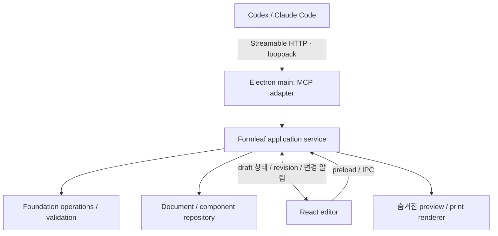

# Formleaf MCP 사전 기획 및 조사 기록

## 정식 작업 문서

2026-11-01부터 이번 작업의 현재 범위·설계·계획은 [11번 작업](../11-agent-tools-mcp/README.md)에서 관리한다. 아래 내용은 작업 전 기획과 후속 로그인 조사 기록으로 보존한다. 최신 판단은 11번 작업 문서를 따른다.

## 상태와 전제

- 작성일: 2026-10-31
- 범위 갱신일: 2026-11-01
- 상태: 작업 범위 확정·도구 명세 초안 — 구현 미착수
- 조사 기준: `main@6821494`, 10번 Markdown editor ownership 통합 이후
- 목표: Codex와 Claude Code가 Formleaf의 문서, 콘텐츠, 구조, 스타일, 컴포넌트와 PDF 기능을 호출할 수 있게 한다.
- 확정한 작업 단위: 1. 에이전트에 제공할 기능 정의와 2. MCP 구현을 이번 작업으로 묶는다. 3. AI 로그인 및 사용 UX는 다음 작업으로 분리한다.
- 권장 첫 범위: Formleaf 앱을 실행한 상태에서 연결하는 로컬 MCP. 앱 미실행 자동화의 우선순위는 사용자 확인 전 제안이다.
- 이 문서의 도구 이름, 파일 위치, 포트와 응답 예시는 구현할 계약의 제안이며 현재 제공되는 API가 아니다.

## 이번 작업과 다음 작업의 경계

### 이번 작업: 도구 명세 + MCP 구현

- 제공할 도구, 사용 설명, 입력·출력 schema, 접근 대상과 변경 가능한 범위를 정의한다.
- 권한·입력 검증, revision 충돌, 저장 완료와 실패 응답 규칙을 정의하고 구현한다.
- 기존 Formleaf 기능을 공통 문서 service로 연결하고 MCP 도구로 제공한다.
- 외부 Codex·Claude Code에서 연결해 조회·변경·결과 확인 흐름을 검증한다.
- 로컬 MCP의 활성화, endpoint·접근 인증과 외부 클라이언트 연결 안내를 제공한다. 여기서 접근 인증은 Formleaf MCP 접속용이며 AI 제공사 계정 로그인과 별개다.
- CLI 배포나 임의 shell·스크립트 실행 도구는 이번 제공 범위에 포함하지 않는다.

이번 작업의 완료 기준은 **이미 사용자가 로그인한 외부 AI 에이전트가 Formleaf MCP를 통해 명세에 포함된 기능을 호출하고, 앱에서 결과를 확인할 수 있는 것**이다. 구체적인 도구 목록은 아래 초안을 바탕으로 명세 단계에서 확정한다.

### 다음 작업: AI 로그인 및 사용 UX

- 사용자 구독 계정과 공식 AI runtime의 로그인·연결·해제.
- Formleaf가 관리하는 에이전트 세션과 shell·파일 접근 제한.
- 앱 내부 채팅, 선택한 요소를 대상으로 한 요청, 대화 이어가기.
- 진행·중단·오류·변경 결과와 되돌리기 UX.

이번 MCP 서버는 자신에게 들어온 요청을 통제한다. 사용자가 별도로 실행한 외부 에이전트의 shell·파일 접근 권한까지 제한한다고 보장하지 않는다. 다음 작업에서 Formleaf가 관리하는 실행 환경의 제한을 구현한다.

후속 작업의 구독 로그인·권한 제한 가능성은 공식 문서 조사로 위험을 기록하되, 로그인 PoC나 내부 채팅 구현을 이번 완료 조건에 포함하지 않는다. 아래 12절은 후속 작업을 위한 조사 기록이다.

## 1. 사용자가 할 수 있어야 하는 일

1. “문서 목록을 보고 이 문서의 구조와 내용을 설명해 줘.”
2. “소개 문단을 고치고, 경력 repeater에 항목을 추가해 줘.”
3. “이 컴포넌트의 노출 속성만 바꾸고 다른 instance는 유지해 줘.”
4. “본문 크기와 간격을 조정한 뒤 페이지 미리보기를 확인해 줘.”
5. “문서를 새로 만들고 라이브러리 컴포넌트를 배치한 뒤 PDF로 내보내 줘.”

완료 기준은 두 클라이언트에서 동일한 MCP 계약으로 이 흐름을 수행하고, 앱에서 같은 결과를 확인하는 것이다. Formleaf MCP 자체에는 LLM 호출이나 모델 API key가 필요하지 않다. 문서에서 읽은 내용은 호출한 AI 클라이언트의 문맥에 전달된다.

## 2. 현재 코드에서 재사용할 기반

| 기능 | 기존 코드 | MCP 지원에 필요한 추가 작업 |
|---|---|---|
| 문서 모델·검증 | `client/src/foundation/documentModel.ts`, `documentValidation.ts` | 입력 JSON Schema, 결과 검증, 모델 설명 |
| 문서 목록·생성·저장·휴지통 | `client/src/main/document/documentRepository.ts` | 공용 service, revision 비교, 변경 알림 |
| 콘텐츠 편집 | `client/src/foundation/documentEditing.ts` | typed target 조회와 변경 command |
| 레이어 추가·이동·복제·표시·보관 | `client/src/foundation/documentTransactions.ts` | 직렬화 가능한 operation 계약 |
| 컴포넌트·prop·repeater | `client/src/foundation/documentComponentOperations.ts` | operation별 schema와 영향 범위 반환 |
| 컴포넌트 라이브러리 | `client/src/main/document/componentLibraryRepository.ts` | 조회·import·export service |
| 스타일 | `StyleDefinition`, `updateNodeStyle` | 허용 속성 patch, 공유 style 영향 표시 |
| 화면·페이지·print | `renderTree.ts`, `PaginatedDocumentRenderer.tsx` | revision에 고정된 숨겨진 render job |
| PDF | `client/src/main/registerPdfHandlers.ts` | 저장 대화상자 없이 출력하는 경로 |
| 활성 편집 보호 | `useGenericDocumentSession.ts`, `markdownEditorLifecycle.ts` | draft 상태·편집 중 여부·외부 변경 handshake |

현재 `DocumentRepository.operationQueue`는 해당 인스턴스 안에서만 직렬화한다. 별도 Node 프로세스가 저장소를 열면 앱과의 동시 쓰기를 막지 못한다. `saveDocument`도 현재는 전체 DocumentData를 저장하며 기대 revision을 받지 않는다. renderer의 `revisionRef`는 화면 갱신용이고, 영속 저장의 충돌 검사용 version이 아니다.

PDF는 현재 renderer가 print snapshot과 페이지 준비를 마친 뒤, main에서 저장 대화상자를 열고 호출한 webContents를 출력한다. MCP용 `export_pdf(documentId)`는 이 흐름을 별도 service로 묶어야 한다.

## 3. 권장 연결 구조



### 첫 버전: Electron main 안의 로컬 Streamable HTTP 서버

- MCP adapter는 tool 입력 검증과 응답 변환을 담당한다.
- 문서 변경, revision 검사와 저장은 application service가 담당한다.
- 앱 IPC도 같은 service를 사용한다. MCP handler에서 저장소를 직접 수정하지 않는다.
- 앱의 설정에서 MCP를 켜고 실제 endpoint와 클라이언트 설정을 확인한다. 앱 종료 시 서버도 종료한다.
- MCP 클라이언트 연결이 끊겨도 Formleaf 앱은 종료하지 않는다.
- Codex와 Claude Code가 동시에 연결해도 하나의 저장 경로를 사용한다.

MCP는 stdio와 Streamable HTTP를 정의한다. 이 제안은 이미 실행 중인 Electron main에 연결하고 여러 클라이언트가 같은 저장소 소유자를 공유하기 위해 HTTP를 선택한다. [MCP transports](https://modelcontextprotocol.io/specification/2025-11-25/basic/transports)

| 대안 | 장점 | 추가 비용 / 적용 시점 |
|---|---|---|
| main에 로컬 HTTP 서버 — 권장 | 앱 상태와 저장소 공유, 별도 bridge 불필요 | 앱 실행 필요, endpoint와 로컬 인증 관리 |
| stdio adapter → 앱 bridge | 클라이언트가 adapter 실행 가능 | 앱 연결용 별도 IPC·프로세스 lifecycle 필요 |
| 독립 background service | 앱이 없어도 작업 가능 | 저장소 소유권을 service로 이전하고 UI·PDF worker 연결 필요 |

앱 없이 동작하는 모드가 첫 요구라면 독립 service를 저장소의 유일한 소유자로 설계한다. UI와 별도 MCP 프로세스가 각자 같은 JSON 파일을 수정하는 모드는 만들지 않는다. PDF에는 여전히 Electron 렌더링 환경이 필요하다.

## 4. MCP 도구 범위

### 1차: 문서 읽기·작성·확인·출력의 완결된 흐름

| 도구 제안 | 주요 입력 | 반환 / 동작 |
|---|---|---|
| `get_context` | 없음 | 앱 version, workspace identity, 활성 documentId, 선택 target, 기능 지원 범위 |
| `list_documents` | query, cursor, limit | 문서 요약 목록 |
| `get_document` | documentId, view | revision, outline 또는 canonical data, dirty/editing 상태; asset 본문 기본 제외 |
| `list_edit_targets` | documentId, cursor | 표시 이름, target, 값 type, 상속/override 여부 |
| `get_edit_value` | documentId, target | 실제 값, revision, Markdown 편집 호환성 정보 |
| `create_document` | name, requestId | documentId, 초기 revision |
| `apply_operations` | documentId, expectedRevision, requestId, operations, dryRun | 검증된 변경 요약, 실제 저장 revision, 생성된 ID |
| `list_components` | cursor, limit | 개인 컴포넌트 라이브러리 요약 |
| `get_component` | componentId | prop schema와 컴포넌트 구조 |
| `preview_document` | documentId, expectedRevision, page | 페이지 수, 지정 페이지 이미지, layout 경고 |
| `export_pdf` | documentId, expectedRevision, filename | artifactId, URI, 출력 revision, 파일 크기 |
| `get_operation` | requestId | 완료/실패/결과 불명 상태와 기존 결과; 연결 단절 후 확인 |

`view`는 `outline` / `canonical` 등 명시한 enum으로 제한한다. 기본 조회는 outline으로 시작하고 긴 Markdown, 반복 항목과 이미지는 필요한 범위만 추가 조회한다. `get_context`의 선택 대상은 편의 정보이며 쓰기 요청은 항상 documentId와 target을 명시한다.

### `apply_operations`의 typed operation

| 범주 | 제안 operation | 기존 기반 |
|---|---|---|
| 내용 | `set_edit_value`, `replace_text` | `readDocumentEditValue`, `updateDocumentEditValue` |
| 레이어 | `add_node`, `move_node`, `duplicate_node`, `set_visibility`, `archive_node`, `restore_node` | `documentTransactions` |
| 스타일 | `update_node_style` | `StyleDefinition`, `updateNodeStyle` |
| instance | `set_component_prop`, `clear_component_prop` | `documentComponentOperations` |
| repeater | `add_item`, `move_item`, `duplicate_item`, `remove_item`, `set_item_prop` | `documentComponentOperations` |
| 재사용 | `import_component`, `add_component_instance` | package import, instance 생성 |

operation은 `type`으로 구분하는 닫힌 schema를 사용한다. 임의 JS callback을 받지 않는다. 생성 ID는 서버가 만들고 결과에 반환한다. 1차에서는 한 batch에서 생성된 ID를 다음 operation이 참조하는 문법을 추가하지 않고, 반환받은 ID로 다음 호출을 한다.

`dryRun: true`는 영속 변경 없이 같은 validation과 변경 요약을 제공한다. 이후 실제 적용 시 expectedRevision을 다시 검사한다. dry run 자체가 적용 예약이나 권한 부여는 아니다.

### 추가 도구 후보: 명세 단계에서 이번 포함 여부 결정

- 문서 이름 변경, 휴지통 이동·조회·복원. 영구 삭제는 별도 도구와 명시적 capability로 분리한다.
- subtree에서 컴포넌트 정의 만들기, prop 노출, definition 수정과 영향받는 instance 조회.
- 컴포넌트 library 저장·삭제. 문서의 정의 ID와 library package ID를 구분한다.
- image asset 등록과 이미지 node/prop 변경. MIME·크기·실제 파일 형식을 검증하고 기존 asset 모델을 사용한다.
- 화면에서 문서/target 열기. 화면 이동과 내용 수정을 서로 다른 요청으로 제공한다.
- MCP 변경 내역 조회와 복구. 기존 `.backup` 한 개를 무제한 undo history로 취급하지 않는다.

스타일 API는 현재 `StyleDefinition`이 표현하는 값만 받는다. 문서별 heading/quote/code/table 테마 전체 지원은 별도 [Markdown styles backlog](document-owned-markdown-styles.md)의 범위다. 공유 style을 수정하면 영향받는 node ID를 반환하며, 한 node만 바꾸는 요청은 style을 분리해 다른 node에 전파하지 않는다.

## 5. 가장 먼저 구현할 저장·동시 편집 계약

### revision과 단일 변경 경로

- service는 저장된 canonical document의 안정적인 직렬화 hash를 opaque revision으로 제공하는 방식을 1차안으로 사용한다. 클라이언트는 revision을 해석하거나 생성하지 않는다.
- `updatedAt` 문자열이나 renderer의 local revision을 CAS(compare-and-swap) token으로 사용하지 않는다.
- UI 저장과 MCP 변경 모두 expectedRevision을 전달한다. 검사는 현재 문서 읽기부터 최종 저장까지 같은 직렬화 구간 안에서 수행한다.
- 문서 목록과 컴포넌트 library를 함께 쓰는 작업도 workspace service가 조정한다. 앱의 중복 실행은 single-instance/workspace ownership으로 차단한다.
- batch는 메모리 사본에 순서대로 적용하고 전체 graph 검증 후 한 문서 snapshot을 저장한다. 중간 operation의 변경만 저장하지 않는다.
- 기존 document와 index는 별도 파일이다. 기존 atomic JSON write만으로 여러 파일의 원자성이 보장된다고 간주하지 않고 실패·재시작 시 복구 순서를 검증한다.

### 열려 있는 문서와 IME

첫 버전은 문서 단위로 보수적으로 충돌을 판정한다.

1. 조회는 마지막 저장 snapshot과 revision을 반환하고 `hasUnsavedChanges`, `isEditing`을 함께 표시한다. 조합 중인 문자열은 committed content처럼 반환하지 않는다.
2. 대상 문서가 dirty, saving, active editor 또는 component 편집 draft 상태이면 MCP 쓰기에 `DOCUMENT_BUSY`를 반환한다. MCP가 강제로 blur, composition 종료 또는 session flush를 실행하지 않는다.
3. 열린 문서가 clean이어도 main의 요청 시점 상태만 믿지 않는다. renderer의 짧은 적용 handshake로 idle 상태를 재확인하고 새로운 편집 시작과 외부 적용이 겹치지 않게 한다. renderer 무응답 시 쓰기를 거절한다.
4. revision 확인 → operation 적용 → 검증 → 저장 → renderer에 새 snapshot과 revision 전달 → acknowledgement 순서를 따른다.
5. UI acknowledgement에 실패해도 이미 저장된 작업을 미실행으로 보고하지 않는다. 응답에 `persisted: true`, `uiSynced: false`를 구분하고 재연결 시 상태를 맞춘다.
6. 뒤늦은 UI 자동 저장은 이전 revision으로 새 데이터를 덮어쓰지 못한다. 충돌 시 local draft를 보존하고 사용자가 확인하도록 한다.

10번의 외부 snapshot 보류 기능은 editor DOM 보호를 위한 기반이다. 저장소의 revision 검사와 외부 변경 구독은 별도로 구현해야 한다. MCP의 변경 성공을 UI의 ProseMirror undo stack에 자동으로 합치지도 않는다.

### requestId와 실패 응답

- 쓰기는 requestId와 입력 hash를 함께 기록한다. 같은 ID·같은 입력 재요청은 기존 결과를 돌려주고 다른 입력은 거절한다.
- 재시작 후에도 생성·repeater 추가가 중복되지 않도록 operation journal과 저장 복구 순서를 구현한다. 중간 장애로 결과가 불명확하면 `get_operation`에서 이를 표시하고 무조건 재실행하지 않는다.
- 오류 code: `DOCUMENT_NOT_FOUND`, `INVALID_TARGET`, `VALIDATION_FAILED`, `REVISION_CONFLICT`, `DOCUMENT_BUSY`, `PERSISTENCE_FAILED`, `RENDER_FAILED`.
- `REVISION_CONFLICT`는 currentRevision과 재조회 안내를 포함한다. agent가 최신 값을 다시 읽고 변경을 재계산해야 한다.
- MCP tool 실행 실패는 `isError: true`와 구조화된 오류 내용으로 반환한다. 입력·출력 schema를 선언하고 구조화 결과와 호환용 text 요약을 함께 제공한다. [MCP tools](https://modelcontextprotocol.io/specification/2025-11-25/server/tools)

## 6. Markdown target과 원문 보존

target은 기존 `DocumentEditTarget`의 세 종류를 그대로 사용한다.

```json
{
  "documentId": "document-example",
  "expectedRevision": "opaque-revision-from-get-document",
  "requestId": "unique-request-id",
  "operations": [
    {
      "type": "set_edit_value",
      "target": {
        "kind": "repeater-item-prop",
        "repeaterNodeId": "node-careers",
        "itemId": "item-one",
        "propId": "prop-description"
      },
      "value": "## 담당 업무\n\n- 문서 편집 기능 개발"
    }
  ]
}
```

- node, component prop, repeater item prop 모두 같은 값 읽기·쓰기 경로를 사용한다.
- DOM selector, pagination fragment ID, anchorRenderId를 MCP 편집 identity로 노출하지 않는다.
- canonical Markdown 문자열을 사용한다. ProseMirror JSON은 외부 저장 계약으로 만들지 않는다.
- `replace_text`는 기대 문자열과 매칭 횟수를 확인해 정확한 범위만 교체한다. 동일 문자열이 여러 곳에 있으면 모호성 오류를 반환한다.
- 콘텐츠 전체 교체는 호출자가 명시적으로 제공한 값의 교체다. 기존 문자열을 Tiptap으로 왕복 변환해 table/image/reference 등의 원문을 잃는 경로를 만들지 않는다.
- 미지원 문법이 포함된 값도 원문 조회·보존은 가능하다. 구조적 block 편집을 추가한다면 기존 compatibility gate를 적용한다. UI의 read-only fallback은 유지한다.

## 7. Preview와 PDF

- service는 요청 revision의 DocumentData를 고정한 render job을 생성한다.
- 별도 숨겨진 BrowserWindow에서 기존 render tree·pagination·print renderer를 사용한다. 사용자가 보고 있는 문서나 선택을 바꾸지 않는다.
- renderer load, font 준비, image decode, 해당 snapshot의 pagination 완료 handshake를 기다린 뒤 캡처 또는 PDF를 생성한다. 고정 sleep을 완료 조건으로 삼지 않는다.
- `preview_document`는 페이지별 이미지와 page count를 반환해 AI가 실제 결과를 확인할 수 있게 한다. 화면에 임시 확장된 편집 page 대신 확정 snapshot의 pagination을 사용한다.
- `export_pdf`는 앱이 관리하는 export 위치에 충돌 없는 이름으로 출력한다. filename은 경로가 아닌 파일명으로 제한하고 기존 파일을 묵시적으로 덮어쓰지 않는다.
- artifact URI, 생성 revision, 로컬 경로를 반환한다. PDF를 사용할 클라이언트가 resource link를 지원하는지 확인하고 필요한 경우 artifact 조회 경로를 제공한다.
- 저장된 snapshot 출력과 미저장 draft 출력의 의미를 혼합하지 않는다. 첫 버전은 저장 revision만 출력한다.

## 8. MCP resources와 연결 설정

Tools를 기본 경로로 제공하고 resources는 읽기 보조 경로로 제공한다.

- `formleaf://schema/document` — model version, node type, prop type, operation 설명.
- `formleaf://documents/{id}` — 현재 저장 snapshot과 revision. subscription 지원 시 변경을 알리되 notification만으로 충돌 검사를 대체하지 않는다.
- `formleaf://artifacts/{id}` — preview/PDF 결과. 만료와 접근 불가를 명확히 반환한다.

MCP resources는 URI로 식별되는 데이터를 제공한다. 클라이언트별 resource 사용 차이를 고려해 핵심 읽기는 tools에서도 가능하게 한다. [MCP resources](https://modelcontextprotocol.io/specification/2025-11-25/server/resources)

### 연결과 권한

- `127.0.0.1`에만 bind하고 Host/Origin을 검증한다. Origin이 없는 로컬 CLI 요청도 인증을 통과해야 한다.
- 앱이 발급한 로컬 token을 사용하고 연결 설정과 실제 token은 repository에 기록하지 않는다. 읽기·쓰기 capability는 서버가 검사한다.
- MCP tool annotation은 동작 설명이며 권한 검사를 대신하지 않는다.
- 한 workspace의 endpoint를 명확히 표시한다. 포트 사용 중이면 실패 이유를 보여주고 설정에서 변경한다.
- 문서 본문과 인증값을 기본 로그에 기록하지 않는다. 작업 ID, tool 이름, revision, 결과 위주로 기록한다.

loopback binding, Origin 검증과 인증 요구는 [MCP HTTP transport 지침](https://modelcontextprotocol.io/specification/2025-11-25/basic/transports)을 따른다. 외부 네트워크 공개와 원격 OAuth 서버 구성은 후속 범위다.

### 구현 이후의 설정 예시

아래 `43121`은 예시다. 앱이 표시한 실제 endpoint와 발급 token으로 설정한다.

Codex의 MCP 설정 예시:

```toml
[mcp_servers.formleaf]
url = "http://127.0.0.1:43121/mcp"
bearer_token_env_var = "FORMLEAF_MCP_TOKEN"
```

Codex는 HTTP MCP URL과 bearer token 환경변수 설정을 지원한다. 환경변수는 Codex 프로세스가 읽을 수 있어야 한다. [OpenAI 공식 MCP 문서](https://developers.openai.com/codex/mcp)

Claude Code 등록 예시:

```sh
claude mcp add --transport http formleaf http://127.0.0.1:43121/mcp \
  --header "Authorization: Bearer $FORMLEAF_MCP_TOKEN"
```

등록은 개인 로컬 설정에서 수행한다. CLI의 header 전달은 값을 설정에 저장할 수 있으므로 해당 설정을 공유하지 않는다. [Claude Code 공식 MCP 문서](https://code.claude.com/docs/en/mcp)

공식 TypeScript SDK의 server·transport·schema 기능을 사용한다. 구현 착수 시 stable SDK version과 해당 문서를 함께 고정한다. v1과 v2의 import/API 예시를 혼합하지 않는다. [TypeScript SDK server 가이드](https://ts.sdk.modelcontextprotocol.io/server)

## 9. 코드 배치 제안

```text
client/src/foundation/
  documentCommands.ts          # 직렬화 가능한 operation / result / error 계약
  documentCommandSchemas.ts   # runtime 입력 검증
client/src/main/application/
  documentService.ts          # UI와 MCP의 공통 변경·저장 경로
  documentRevision.ts         # snapshot revision
  operationJournal.ts         # requestId / 결과 / 장애 복구
  renderService.ts            # snapshot preview / PDF job
client/src/main/mcp/
  server.ts                   # MCP lifecycle / transport / 인증
  tools.ts                    # 도구 등록과 service 연결
  resources.ts                # schema / document / artifact 읽기
client/src/renderer/
  ...                         # external change handshake, print worker 화면
```

기존 foundation의 transaction 함수와 repository는 재사용한다. 먼저 IPC handler의 service 위임과 UI 저장 revision 계약을 완성한 뒤 MCP tool을 붙인다. 이 단계에서 root package 분리나 monorepo 전환은 필요하지 않다.

## 10. 구현 순서와 완료 조건

| 단계 | 구현 | 완료 조건 |
|---|---|---|
| 0. 도구 명세 확정 | 도구 목록·설명·schema·허용 대상·오류·저장 계약 | 이번에 제공할 기능과 제외 기능을 식별하고 호출 예시 확정 |
| 1. 공통 변경 service | typed commands, runtime validation, revision/CAS, UI IPC 연결, operation journal | UI 회귀 통과; stale 저장 거절; 실패한 batch 부분 적용 없음; 재시작 복구 |
| 2. MCP 읽기 | local HTTP, 인증, context/list/read/schema | Codex·Claude Code 양쪽에서 문서와 prop 구조 조회 |
| 3. MCP 쓰기 | create/apply, target·style·repeater, dry run, busy handshake | 두 클라이언트 동시 쓰기·IME·자동 저장 충돌에서 데이터 손실 없음 |
| 4. 결과 확인 | hidden preview, snapshot PDF, artifact | 편집 화면 포커스 유지; 요청 revision의 이미지·PDF 일치 |
| 5. 외부 클라이언트 연결 검증 | MCP 설정·접근 인증·재연결·사용 안내 | 로그인된 외부 Codex·Claude Code에서 확정한 도구 흐름 통과 |

검증은 임시 workspace와 hidden Electron에서 수행한다.

- 세 target 종류의 읽기·쓰기와 다른 instance/prop 불변.
- 한글 composition 중 MCP 변경이 `DOCUMENT_BUSY`로 실패하고 root/caret/조합 유지.
- 조회 직후 UI 편집, MCP 적용 직후 오래된 자동 저장, 두 클라이언트의 동일 revision 변경 경쟁.
- 검증 실패·disk write 실패·index write 실패·renderer 장애·요청 응답 유실·앱 재시작.
- requestId 재요청으로 문서/repeater가 중복 생성되지 않음.
- Markdown table/image/footnote/reference/raw HTML 원문 보존.
- UI에서 재열기, PDF 의미와 페이지 수, font/image 준비, 다른 문서 출력 중 활성 편집 보존.
- 잘못된 target, 다른 workspace, 인증 실패, 허용 범위 밖 export 경로 거절.
- npm test, npm run typecheck, npm run build, git diff --check.

## 11. 기획에서 확정할 항목

1. 첫 버전은 앱 실행 중 사용을 우선할지, 앱 없이 자동 실행까지 포함할지.
2. MCP에 연결한 workspace 전체를 허용할지, 사용자가 지정한 문서만 허용할지. 첫 구현은 workspace 단위 권한을 제안한다.
3. 사용자가 편집 중이면 즉시 busy를 반환하는 정책으로 시작할지. 자동 대기·강제 편집 종료는 1차에 포함하지 않는 것을 제안한다.

위 항목은 제안이며 확정된 사용자 요구로 취급하지 않는다. 구현 착수 시 선택을 반영해 작업 문서와 세부 단계를 확정한다.


## 12. 다음 작업 참고: 구독 계정으로 사용하는 앱 내부 AI 채팅

### 사용자 방향

- 이번 작업에서는 외부 Codex·Claude Code가 Formleaf MCP를 사용한다.
- 다음 작업에서는 Formleaf 채팅 패널에서 문서를 작성하고, 클릭한 요소를 대상으로 AI가 조작한다.
- 사용자는 별도 종량제 API key 입력보다 본인이 구독하는 ChatGPT 또는 Claude 계정 연결을 원한다.
- 구독을 사용해도 모델 추론은 제공사 서버에서 수행된다. 오프라인 모델 실행을 뜻하지 않는다.

### 조사 결과 — 2026-10-31 공식 문서 기준

**Codex**: App Server가 대화 thread, turn, streaming event, 중단, tool 실행과 ChatGPT 로그인 흐름을 제공한다. Formleaf가 local app-server를 실행하고 자체 채팅 UI를 연결하는 구성이 가능하다. 계정에서 사용 가능한 모델과 한도는 실제 로그인 결과로 확인한다. [Codex App Server](https://developers.openai.com/codex/app-server)

별도로 Sign in with ChatGPT에는 open-source·locally hosted 앱에서 사용자 plan으로 eligible 요청을 처리하는 경로가 문서화되어 있다. 유료 또는 원격 호스팅 앱은 별도 문의 경로가 안내되어 있고 preview 제한이 있다. Formleaf의 배포·라이선스 조건을 확인한 뒤 선택하며, 일반 로그인만으로 모든 API 사용권을 얻는 것으로 간주하지 않는다. [Plan usage](https://developers.openai.com/siwc/token-sharing-open-source), [제한 사항](https://developers.openai.com/siwc/token-sharing-open-source/preview-limitations)

**Claude**: 공식 문서는 원본 Claude Code를 제품에서 실행하는 조건을 안내한다. binary를 수정하지 않고, 내장 인증 방법을 제거·제한하지 않으며, 각 사용자가 자신의 자격으로 로그인하고 직접 사용량을 부담해야 한다. 관련 Commercial Terms가 적용된다. [제품 내 Claude Code 제공 조건](https://code.claude.com/docs/en/legal-and-compliance)

동시에 Agent SDK 문서는 사전 승인 없이 제3자 제품에 claude.ai 로그인이나 구독 한도를 제공하는 것을 허용하지 않는다고 명시한다. 따라서 원본 CLI 연동과 자체 SDK 구독 로그인은 동일한 제공 방식으로 취급하지 않는다. 자체 채팅 UI와 구독 인증을 묶는 배포 형태가 어느 조건에 해당하는지 출시 전 확인해야 한다. 이번 외부 Claude Code → MCP 연결은 유지하고, 후속 내장 연동은 원본 runtime의 공식 인터페이스와 허용 범위를 먼저 검증한다. [Agent SDK 조건](https://code.claude.com/docs/en/agent-sdk/overview), [CLI programmatic 실행](https://code.claude.com/docs/en/headless)

### 후속 구조 제안

```text
Formleaf 채팅 / 선택한 요소에 대한 요청
  → provider adapter (대화 시작·이어가기·중단·이벤트·연결 상태)
  → 공식 agent runtime (Codex App Server / 검증된 Claude 연결 방식)
  → 이번에 만드는 Formleaf MCP
  → 공통 문서 변경 service
```

- 문서 조작 기능은 MCP와 공용 service에 두고 provider adapter는 대화·인증·runtime 연결만 담당한다.
- 요청 전송 시 documentId, revision, DocumentEditTarget과 사용자 지시를 고정한다. AI 실행 중 다른 요소를 클릭해도 이미 보낸 요청의 대상이 바뀌지 않는다.
- 요소 클릭은 대상 지정으로 취급한다. 실제 조작은 채팅 전송이나 명시적인 AI action으로 시작한다.
- 채팅으로 이동할 때 사용자 편집 lifecycle에서 조합 완료·flush를 처리한다. busy인 대상에 AI 쓰기를 강제로 적용하지 않는다.
- 변경 결과, 중단 상태, 실패 이유와 되돌리기 범위를 UI에 표시한다. 기존 block별 editor undo와 AI 변경 history를 혼동하지 않는다.
- 인증은 공식 runtime 또는 승인된 OAuth 흐름에 맡긴다. 기존 앱의 cookie나 credential 파일을 추출해 별도 모델 호출에 재사용하는 방식을 설계하지 않는다.

후속 단계의 우선 제안은 Codex App Server로 내부 채팅과 선택 요소 조작을 먼저 검증하고, Claude는 제공 조건에 맞는 adapter를 추가하는 것이다. 사용자 구독 지원을 양쪽 모두 같은 방식으로 보장하는 것은 아직 확정하지 않는다.
