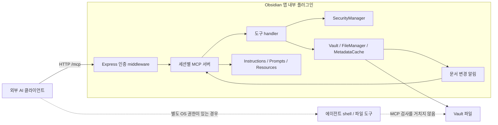

# 설계 철학과 구조

## 1. 명시된 목적과 구현에서 읽히는 의도

저장소가 명시한 목적은 Obsidian 내부에 MCP 서버를 실행해 외부 AI 도구가 활성 문맥을 읽고 앱의 기능을 호출하게 하는 것이다. 개인 지식 저장소를 여러 에이전트가 사용할 수 있도록 연결한다. [README](https://github.com/Leonezz/obsidian-mcp-server/blob/e16ba0e95ed22f0d75c20efbd07b37525da2ba65/README.md)

아래의 '철학'은 저자의 인터뷰가 아닌, 문서와 구현을 종합한 해석이다.

| 설계 방향 | 구현 근거 | 해석 |
|---|---|---|
| 앱이 문서 기능의 진입점 | `vault.read/modify/create`, `fileManager.renameFile/trashFile` | 앱의 문서 모델과 동작을 재사용한다 |
| 외부 에이전트와 연결 | Express + Streamable HTTP, 세션별 MCP 객체 | 특정 모델의 추론 API에 묶이지 않는다 |
| 사용 중인 문맥 제공 | `workspace.getActiveFile`, 초기 instructions | 파일명만 전달하는 것보다 사용자의 현재 작업을 이해시키려 한다 |
| 기능과 사용법을 함께 제공 | Zod schema, 도구 설명, prompts, resources, annotations | 호출 가능성뿐 아니라 에이전트의 사용 품질을 고려한다 |
| 작은 개인용 설정 | 하나의 토큰, 전역 blacklist, 인증 해제 옵션 | 다중 사용자 권한 서버보다 신뢰하는 개인 환경을 중심에 둔 것으로 보인다 |
| 호출 관찰 가능성 | 세션 이름·시간·도구별 통계 | 어떤 클라이언트가 활동하는지 사용자에게 보여준다 |

근거: [도구 등록](https://github.com/Leonezz/obsidian-mcp-server/blob/e16ba0e95ed22f0d75c20efbd07b37525da2ba65/src/tools/index.ts), [활성 문서](https://github.com/Leonezz/obsidian-mcp-server/blob/e16ba0e95ed22f0d75c20efbd07b37525da2ba65/src/tools/get-active-file.ts), [세션 설계 기록](https://github.com/Leonezz/obsidian-mcp-server/blob/e16ba0e95ed22f0d75c20efbd07b37525da2ba65/docs/plans/2026-02-22-session-stats-design.md), [인증 해제 설계 기록](https://github.com/Leonezz/obsidian-mcp-server/blob/e16ba0e95ed22f0d75c20efbd07b37525da2ba65/docs/plans/2026-02-23-disable-auth-design.md).

## 2. 프로세스와 호출 흐름

플러그인 로드 시 설정을 읽고 토큰을 생성한 뒤 서버·통계·구독 관리자를 만든다. unload 때 서버와 이벤트 구독을 종료한다. 별도 MCP 서버 실행 파일을 사용자가 띄워야 하는 구조가 아니다. 다만 소스의 Plugin 실행 문맥만으로 Electron main 프로세스에서 실행된다고 단정하지 않는다. [main.ts:18](https://github.com/Leonezz/obsidian-mcp-server/blob/e16ba0e95ed22f0d75c20efbd07b37525da2ba65/src/main.ts#L18)

HTTP 요청에는 공통 인증 middleware가 먼저 적용된다. 초기화 요청마다 `McpServer`와 `StreamableHTTPServerTransport`를 생성하고 도구·prompts·resources를 등록한다. 최대 10개 세션, 30분 유휴 만료, 5분 간격 정리 정책이 있다. 세션 수 한도는 호출 속도 제한이나 파일 권한 분리가 아니다. [server.ts:20](https://github.com/Leonezz/obsidian-mcp-server/blob/e16ba0e95ed22f0d75c20efbd07b37525da2ba65/src/server.ts#L20), [server.ts:344](https://github.com/Leonezz/obsidian-mcp-server/blob/e16ba0e95ed22f0d75c20efbd07b37525da2ba65/src/server.ts#L344)

## 3. 에이전트가 기능을 배우는 방식

| 전달 수단 | 내용 | 권한 강제 여부 |
|---|---|---|
| 초기 instructions | vault 이름, Markdown 규칙, 먼저 읽고 수정하기, 검색·메타데이터 우선 사용, 사용자 지침 | 자연어 안내 |
| tools | 이름·설명·입력 schema와 실행 handler | handler의 검사가 실제 통제 |
| prompts | Obsidian Markdown, JSON Canvas, Bases 작성 가이드 | 작성 도움말 |
| resources | 개요, 노트, 태그, 일일 노트, 폴더 | resource callback별 검사 필요 |
| annotations | 읽기/변경/파괴적 작업 힌트, draft·긴 문서·깨진 링크 안내 | 힌트이며 허가나 격리 장치가 아님 |

근거: [instructions.ts](https://github.com/Leonezz/obsidian-mcp-server/blob/e16ba0e95ed22f0d75c20efbd07b37525da2ba65/src/instructions.ts), [prompts/index.ts](https://github.com/Leonezz/obsidian-mcp-server/blob/e16ba0e95ed22f0d75c20efbd07b37525da2ba65/src/prompts/index.ts), [resources/templates.ts](https://github.com/Leonezz/obsidian-mcp-server/blob/e16ba0e95ed22f0d75c20efbd07b37525da2ba65/src/resources/templates.ts), [annotations.ts](https://github.com/Leonezz/obsidian-mcp-server/blob/e16ba0e95ed22f0d75c20efbd07b37525da2ba65/src/annotations.ts).

Formleaf에서 참고할 핵심은 **앱의 도메인 규칙을 도구와 함께 설명하는 방식**이다. 도구가 있다는 사실만으로 에이전트가 canonical Markdown, component prop, repeater item의 의미를 이해하지는 않는다.

## 4. 제공하는 기능의 단위

분석 버전은 `registerTools`에서 21개 도구를 등록한다.

| 범주 | 도구 |
|---|---|
| 현재 문맥·본문·구조 | `get_active_file`, `read_note`, `get_note_metadata`, `get_backlinks` |
| 탐색 | `list_folder`, `list_all_tags`, `list_recent_notes`, `search_notes`, `search_content`, `describe_vault` |
| 작성·수정 | `create_note`, `edit_note`, `append_note`, `patch_note`, `append_daily_note` |
| 관리 | `rename_note`, `delete_note`, `create_folder` |
| 첨부 | `read_attachment`, `add_attachment` |
| 운영 | `list_sessions` |

[도구 등록 전체](https://github.com/Leonezz/obsidian-mcp-server/blob/e16ba0e95ed22f0d75c20efbd07b37525da2ba65/src/tools/index.ts#L26)

현재 문서는 편의 조회에 사용되고, 수정 요청은 명시한 vault 상대 경로를 받는다. 활성 문서 조회는 `vault.read(activeFile)`을 사용하므로 편집기 caret, 선택 범위, IME 조합 상태를 전달하는 API가 아니다. [get-active-file.ts:14](https://github.com/Leonezz/obsidian-mcp-server/blob/e16ba0e95ed22f0d75c20efbd07b37525da2ba65/src/tools/get-active-file.ts#L14)

## 5. 수정 안정성은 별도 문제

- `edit_note`: 현재 파일 접근을 검사한 뒤 전체 내용을 `vault.modify`한다. expected revision이 없다.
- `append_note`: read → 문자열 결합 → modify. 사이에 다른 변경이 발생할 수 있다.
- `patch_note`: 이전 문자열의 일치 여부를 검사하지만 읽기와 저장을 원자적 처리로 묶지 않는다. 같은 요청의 중복 실행도 기록하지 않는다.
- `rename_note`: `fileManager.renameFile`을 이용한다. 내부 링크 갱신은 사용자의 Obsidian 설정에 따른다.
- `delete_note`: `fileManager.trashFile`을 이용한다. 함께 제공한 OpenClaw skill의 '영구 삭제' 설명과 다르므로 코드의 실제 호출을 기준으로 본다.

근거: [edit](https://github.com/Leonezz/obsidian-mcp-server/blob/e16ba0e95ed22f0d75c20efbd07b37525da2ba65/src/tools/edit-note.ts#L19), [append](https://github.com/Leonezz/obsidian-mcp-server/blob/e16ba0e95ed22f0d75c20efbd07b37525da2ba65/src/tools/append-note.ts#L34), [patch](https://github.com/Leonezz/obsidian-mcp-server/blob/e16ba0e95ed22f0d75c20efbd07b37525da2ba65/src/tools/patch-note.ts#L34), [rename](https://github.com/Leonezz/obsidian-mcp-server/blob/e16ba0e95ed22f0d75c20efbd07b37525da2ba65/src/tools/rename-note.ts#L11), [delete](https://github.com/Leonezz/obsidian-mcp-server/blob/e16ba0e95ed22f0d75c20efbd07b37525da2ba65/src/tools/delete-note.ts#L29), [OpenClaw 안내](https://github.com/Leonezz/obsidian-mcp-server/blob/e16ba0e95ed22f0d75c20efbd07b37525da2ba65/openclaw-skill/SKILL.md).

P06은 두 append가 같은 값을 읽으면 마지막 저장만 남는 순서를, P07은 동일 patch 재전송이 다시 내용을 바꾸는 사례를 모의 vault에서 확인했다. 실제 Obsidian에서 해당 실행 순서가 얼마나 발생하는지는 측정하지 않았다. 이 구현은 Formleaf의 revision·IME·자동 저장 충돌 설계를 대체하지 않는다.

## 6. MCP와 shell을 대립시키지 않는다

저장소에는 `curl`과 `jq`로 MCP 요청을 보내는 shell helper도 있다. 이것은 shell에서 **MCP 서버에 요청하는 경로**다. shell에서 파일을 직접 여는 경로와 구분해야 한다. MCP 사용 여부가 shell 사용 가능 여부를 결정하지 않는다. [helper](https://github.com/Leonezz/obsidian-mcp-server/blob/e16ba0e95ed22f0d75c20efbd07b37525da2ba65/openclaw-skill/scripts/obsidian-mcp.sh#L58)
