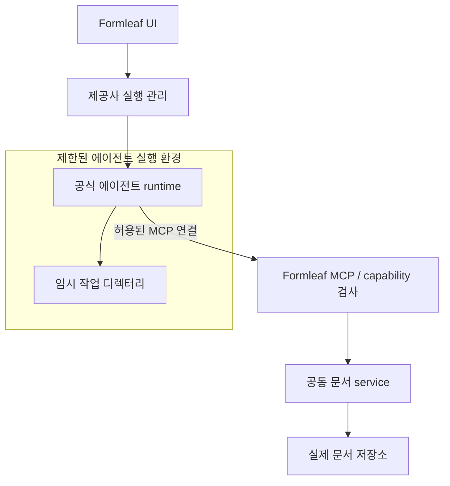

# Formleaf에 적용할 점

이 문서는 외부 구현 분석에서 나온 제안이다. [11번 작업 설계](../../docs/11-agent-tools-mcp/design.md)의 확정 결정이나 새 작업 범위를 대신하지 않는다.

## 1. 참고할 구조

| 참고할 점 | Formleaf에서의 적용 후보 |
|---|---|
| 앱이 MCP lifecycle을 소유 | 앱 실행·설정 활성화·종료에 서버를 연결하고 실제 endpoint 표시 |
| 현재 문맥 조회 | active document, 선택한 `DocumentEditTarget`, 저장 revision, 편집 중 여부 제공 |
| 설명·schema·예시 함께 제공 | node, component prop, repeater item, canonical Markdown의 의미를 에이전트에게 전달 |
| 가벼운 탐색 후 필요한 내용 조회 | outline → 편집 대상 → 값 → 수정 → preview 흐름 |
| 앱 API로 변경 | UI와 MCP가 공통 application service를 이용 |
| 사용자에게 연결 상태 표시 | 클라이언트·허용 범위·최근 작업·연결 해제 제공 |

근거가 되는 원본 구조와 도구는 [설계 분석](architecture.md)에 연결해 두었다.

## 2. 그대로 가져오면 안 되는 부분

1. **기본 허용 blacklist를 문서 권한의 전부로 사용하지 않는다.** 허용한 workspace/document와 read/write capability를 먼저 명시하고 service에서 검사하는 안이 Formleaf 요구에 맞는다.
2. **모든 출력 경로에 같은 정책을 적용한다.** tools뿐 아니라 instructions, resources, 목록·완성, 태그·집계, 로그, 변경 알림, preview/artifact도 포함한다.
3. **문서 identity를 파일 경로와 구분한다.** 문서 변경은 documentId와 typed target을 사용한다. 내부 저장 파일·앱 package 경로는 도구 입력으로 받지 않는다.
4. **변경 전 검사하고 변경을 한 곳에서 직렬화한다.** expectedRevision, busy 상태, requestId 중복 처리와 저장 결과를 공통 service가 소유한다. 생성·첨부 같은 부수효과도 허가 뒤 수행한다.
5. **에이전트 지침을 동시 편집 보장으로 취급하지 않는다.** '먼저 읽고 수정'해도 이후 사용자가 편집할 수 있다. Markdown IME와 활성 editor DOM의 소유권은 별도로 유지한다.
6. **표시용 hint와 실제 동작을 맞춘다.** idempotent/destructive 표시는 재시도·데이터 손실 동작과 일치해야 한다. 통계는 `isError`도 반영하고, 감사 기록은 결과와 revision을 기록한다.
7. **네트워크 설정을 명시적으로 제한한다.** 첫 버전은 loopback + 인증을 기본으로 하고, 무인증 외부 바인딩은 허용하지 않는 안을 검토한다. 실제 SDK 버전의 Host/Origin 검사를 시험한다.

근거: [보안 분석](security.md), [P01–P09 결과](probes/results.json).

## 3. '허용한 도구만 사용' 요구의 두 수준

### 이번 작업: 외부 에이전트에 제공하는 MCP

Formleaf는 **MCP를 통해 성공할 수 있는 작업**을 제한할 수 있다. 이미 사용자가 독립적으로 실행한 에이전트의 shell·파일 권한까지 통제하는 제품으로 설명하면 안 된다.

검토할 계약:

- credential별 허용 workspace/document와 읽기·쓰기 권한.
- 앱에서 연결 해제·토큰 폐기 시 기존 세션의 다음 요청에도 적용되는 정책.
- 문서 변경 허용 범위와 preview/export 결과 접근 범위.
- 실패·취소·timeout 뒤 실제 저장 상태를 조회하는 방법.

### 다음 작업: Formleaf가 실행 환경을 관리하는 에이전트

shell 직접 접근까지 차단하려면 에이전트 프로세스의 실행 환경을 설계해야 한다. MCP 도구 목록만 줄이는 것으로는 달성할 수 없다.

권장 검토 순서:

1. **도구 권한:** runtime의 shell·파일 도구를 비활성화할 수 있는지, 해당 옵션이 강제 제한인지 단순 승인 생략인지 구분한다.
2. **OS 파일 경계:** 실제 문서·backup·플러그인/앱 설정을 에이전트에 노출하지 않고 임시 디렉터리만 쓰게 할 수 있는지 확인한다. 앱·runtime 파일은 필요한 읽기만 허용하고 수정 권한을 검토한다.
3. **프로세스·자격 증명:** child process에도 제한이 이어지는지, 인증에 필요한 credential만 제공할 수 있는지 확인한다. 환경 변수와 호스트 홈 전체를 무조건 공유하지 않는다.
4. **네트워크:** 추론·로그인과 MCP 연결에 필요한 범위를 정한다. 파일 sandbox와 네트워크 제한은 별도로 검증한다.
5. **플랫폼별 실험:** 임시 fixture로 직접 read/write, 부모 경로·symlink, child process, package 수정, 허가되지 않은 endpoint 접근이 실제로 거부되는지 확인한다.

이는 구현 후보이며 특정 제공사 runtime이나 macOS/Windows에서 이미 가능하다고 검증한 설정이 아니다. VM/컨테이너를 택할 경우 호스트의 `127.0.0.1`이 그대로 보이지 않을 수 있으므로 MCP 연결 경로와 인증도 다시 설계해야 한다.

서버만 sandbox 안에 넣고 에이전트를 제한 없는 호스트 프로세스로 남기면, 에이전트의 직접 파일 접근 문제는 해결되지 않는다. 강제 경계를 적용할 대상은 실제 접근 권한을 가진 프로세스다. 사용자 본인·관리자가 제한을 변경하는 것까지 제품이 막는다는 목표와도 구분한다.

## 4. 현재 단계별 검토에 반영할 질문

| 단계 | 결정할 것 | 검토 근거 / 검증 |
|---|---|---|
| 도구 명세 | 최초 허용 문서, 읽기/쓰기, 삭제·export 포함 여부 | 최소 workflow 예시와 권한 행렬 |
| 공통 service | revision, busy, 원자적 변경, requestId | 두 클라이언트+UI 동시 수정, 실패 후 재시도 fixture |
| MCP 연결 | credential 범위, 폐기, loopback, Origin/Host | 잘못된 토큰·폐기 세션·브라우저 요청·비허용 문서 거부 |
| 컨텍스트·출력 | 어떤 상태와 메타데이터까지 공유할지 | 차단 문서의 이름·집계·알림·artifact 누출 검사 |
| 후속 AI 실행 UX | runtime 권한과 OS 격리 방식 | 실제 공식 runtime을 제한된 환경에서 실행한 부정 테스트 |

이번 분석으로 확정할 수 있는 결론은 **Obsidian MCP가 앱 내부 도구 서버의 참고 사례라는 것**이다. 외부 shell 차단이나 OS sandbox의 검증된 구현 사례로 사용할 수는 없다.
